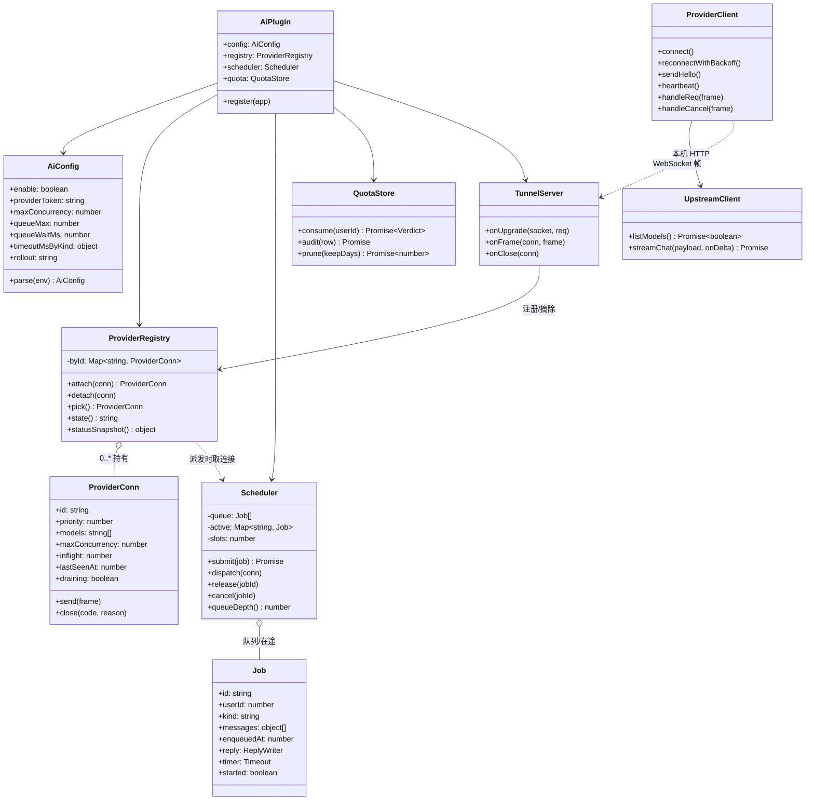
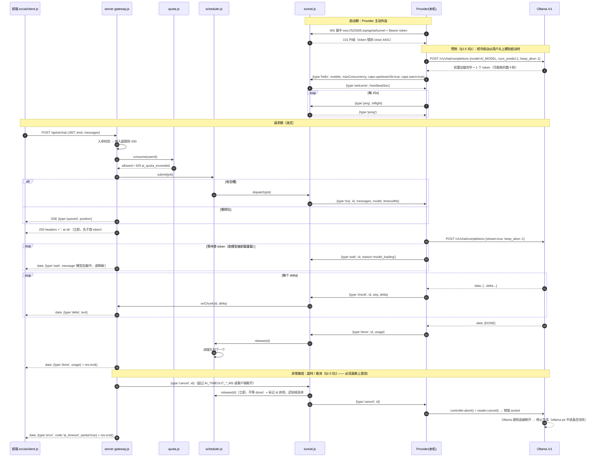

# AI 网关设计 —— 本机模型经 520305.top 反向隧道中转

> 状态：设计阶段（未动代码）。配套 PRD 由 PM 并行编写，本文只定**链路与契约**。
> 读者：实施工程师、QA、运维（改 nginx 的人）。
>
> 两句话概括：
> 作者本机的 **Ollama** **不出内网、不开端口**；由本机跑一个 Provider 客户端
> **主动外连**服务器的 WebSocket 隧道，服务器把 `/api/ai/*` 的请求经隧道转发过去，
> 响应按 token 流式原路返回。前端自始至终只认识 `https://520305.top`。
>
> 已定稿（用户拍板）：本机模型服务就是 **Ollama**（`http://127.0.0.1:11434/v1`）。
> LM Studio 等 OpenAI 兼容实现只作为"换一个 `AI_UPSTREAM_BASE` 即可"的可选替代，
> **不为它增加任何分支**（见 §8.2）。
>
> 另一条定稿的工程约定：**不对本机算力做任何假设，也不把它当开工阻塞项**。
> 容量与超时参数**一律走环境变量、默认值取保守值**，换机器 / 换模型 / 实测调优
> **只改 env，不改代码**（见 §8.4）。

---

## 0. 约束与现状（本文的事实基础，均来自代码实测）

| 现状 | 出处 | 对设计的约束 |
|---|---|---|
| 生产容器用 `network_mode: host`，`CMD node src/index.js`（**不能**用 `npm start`，`--env-file` 缺文件致命） | `docker-compose.yml`、`server/Dockerfile` | 新增的一切配置必须走**环境变量**，不得新增文件型配置依赖 |
| `TRUST_PROXY=127.0.0.1`，写 `true` 会启动即退出 | `server/src/index.js:41-48` | 隧道连接同样经 nginx 回源，`request.ip` 语义不变；AI 配额**按 user_id 而非 IP** 记账（校园网 NAT 会误伤，已有前车之鉴） |
| 限流/配额必须落 PostgreSQL，不能落进程内存 | `server/src/rateLimit.js` 头部注释 | AI 配额与审计同样落库，复用 `INSERT ... ON CONFLICT` 原子 upsert 套路 |
| 新增表后必须同步 `db.js` 的 `REQUIRED_CONSTRAINTS` | `server/src/db.js:31-70`（2026-10-17 事故） | 新增 `ai_quota` / `ai_audit` 必须登记主键约束，否则线上 `ON CONFLICT` 报 42P10 → 500 |
| 前端 CSP `connect-src 'self' ipc: http://ipc.localhost https://520305.top` | `src-tauri/tauri.conf.json` | **好消息**：前端走 520305.top 的 SSE 已在白名单内，**CSP 一行都不用改** |
| 前端 API 基址唯一来源 `src/sync/apiBase.js`（`VITE_API_BASE`，Tauri 为 `https://520305.top/api`），`src/sync/api.js` 统一封装 Bearer + 401 刷新重试 | 同上 | `/api/ai/*` 直接复用 `request()` 的鉴权与错误处理；SSE 需另写（原因见 §2.4） |
| 后端路由注册在 `app.js` 的 `app.register(...)`，鉴权用 `app.authenticate`，管理员用 `requireAdmin` | `server/src/app.js`、`admin.js` | AI 路由作为新插件注册，风格对齐 |
| 后端测试用 `node --test` + `app.inject()` | `server/test/*.test.js` | 隧道与调度逻辑必须做成**可注入的纯模块**，才能进 `node --test` |
| 老 Android WebView ≈ Chromium 58-70，构建目标 es2019 | `vite.config.js` 注释 | 前端 SSE 解析**不能依赖** `EventSource` 自定义头 / `TextDecoderStream`，用 `fetch + getReader + TextDecoder` 手写 |

---

## 1. 方案选型：为什么是「反向隧道」

### 1.1 核心矛盾

作者的模型跑在**自己电脑上**（无公网 IP、不能开端口映射），而消费方是**线上客户端**（Android App / 桌面端）。
服务器必须能"主动"把请求送到这台机器上 —— 但服务器根本连不进来。

唯一能穿透的方向是：**本机 → 公网服务器**（出方向，家宽/校园网一律放行）。
所以让本机主动建一条**长连接**，服务器把请求**复用这条连接**送回去 = 反向隧道。

### 1.2 备选方案对比

| 方案 | 需要公网 IP / 端口映射 | 第三方依赖 | 模型与数据出本机？ | 鉴权责任 | 运维成本 | 结论 |
|---|---|---|---|---|---|---|
| **A. 反向隧道（本机主动外连 WS）** | ❌ 全不需要 | ❌ 无 | ❌ 不出 | 服务器侧：预共享 token + 每用户配额 | 中（要写两端代码） | ✅ **主推** |
| B. frp / ngrok 内网穿透 | 需要一台公网中转机（ngrok 用官方） | frp 需自建机；ngrok 走官方 | 流量出本机到中转 | 穿透层自己要么没鉴权，要么再配一层 | 高（多一套进程/配置/证书） | ❌ 不推荐 |
| C. Cloudflare Tunnel | ❌ | **强依赖 Cloudflare** | 流量绕境外第三方 | 靠 CF Access | 中 | ❌ 违反"不接第三方云"的硬约束精神 |
| D. 把 Ollama 直接暴露公网（`OLLAMA_HOST=0.0.0.0` + 端口映射） | ✅ 需要 | ❌ | ❌ | **Ollama 自带接口无鉴权** | 低（最省事） | 🚫 **明令禁止**，见 §7.1 |
| E. Tailscale / WireGuard 组网（服务器也入网） | ❌ | 服务器与本机各装一个客户端 | ❌ | 靠组网 ACL | 中（服务器上多一个常驻进程 + 密钥分发） | 🟡 Plan B |
| F. 服务器自己跑模型 | — | ❌ | 变成"上云" | — | — | ❌ 直接违背"模型跑在作者本机" |

**推荐结论**：采用 **A（反向隧道）**。
理由优先级排序：① 满足"无公网 IP / 无端口暴露"的硬约束；② 零第三方依赖，不违反"不接第三方云 LLM"；
③ 暴露面最小 —— 公网只多一个**需要 token 的 WebSocket 端点**，且它只能被服务器"喂"服务端构造好的请求，
不是把本机端口交给公网（这是与 B/C/D 的本质区别，也是 §6 的安全基座）。

**E 作为 Plan B** 保留：若将来隧道在弱网下频繁重连、体验不可接受，可改用组网让 nginx 直连本机。
但那样服务器上会多一个常驻第三方进程，且密钥分发是新的运维负担，故不作为首选。

---

## 2. 请求转发契约

### 2.1 四段链路总览

```
[前端 Vue/Tauri]                    [服务器 Fastify 容器]              [作者本机]
  fetch POST /api/ai/chat   ──HTTP/JWT──▶  gateway.js
  (JWT + 入参校验 + 配额)                │ 排队/槽位/超时
                                        │  multipex by id
                                        ▼
                                    tunnel.js  ══WebSocket 长连接══▶  ai-provider/index.js
                                    (唯一隧道)                          │ 本地 HTTP
                                                                       ▼
                                                              Ollama 127.0.0.1:11434
                                                              /v1/chat/completions
                                                              (stream:true)
  ◀── SSE: data:{"type":"delta"...} ──  ◀── 帧 {type:'chunk'}  ──  ◀── SSE 增量 ◀──
```

### 2.2 HTTP 侧接口（前端 ↔ 服务器）

| 方法与路径 | 鉴权 | 说明 |
|---|---|---|
| `GET /api/ai/status` | JWT | 返回 AI 可用性 + 本人当日配额。**前端进 AI 页面时调一次**，用于置灰/显示离线徽标 |
| `POST /api/ai/chat` | JWT | 主接口。**响应恒为 `text/event-stream`**（前提校验通过），见 §2.4 |
| `POST /api/ai/cancel` | JWT | 带上一步返回的 `id`，主动取消（前端 abort fetch 时也会自动触发，非必调） |
| `GET /api/admin/ai/usage` | JWT + admin | 用量与审计（复用 `requireAdmin`） |

请求体：

```jsonc
{
  "kind": "qa",              // 'quiz' 出题 | 'qa' 答疑 | 'explain' 讲解 | 'analysis' 学情
  "messages": [              // 只放"用户轮"，system prompt 由服务器按 kind 注入，客户端传了也忽略
    { "role": "user", "content": "这道数列题怎么求通项？" }
  ],
  "context": { "subject": "math", "pageKey": "math/06/02" },  // 可选，供服务器裁剪与审计分类
  "maxTokens": 512           // 可选；服务器按 kind 取 min(客户端值, AI_MAX_OUTPUT_TOKENS)
}
```

`status` 响应：

```jsonc
{
  "available": true,         // false = 隧道离线或上游不可用 → 前端应展示"AI 离线"
  "state": "ready",          // 'offline' | 'warming' | 'ready' | 'busy'（见 §3.4 四态）
  "reason": null,            // 'model_loading' | 'upstream_unavailable' | null
  "queueDepth": 0,
  "quota": { "used": 3, "limit": 50, "resetAt": "2026-10-25T16:00:00.000Z" },
  "model": "qwen2.5:7b-instruct"
}
```

> **已移除：~~`availability.hours` 历史可用性提示~~**（原 S5.5，team-lead 裁决**不做**，不是延后）。
> 它服务于"作者电脑有规律关机时段"这一旧前提；用户已拍板 **Q3 = 电脑几乎全天开 / 可保持常开**，
> 常开前提下小时桶**没有信息量**——每个小时都"通常在线"，聚合出一张全亮的直方图，
> 展示给用户反而暗示了**并不存在的波动**。且"没人看的数据 = 负债"：要维护统计、
> 要处理"数据不足不渲染"的边界，却没有用户价值。
> **前端在离线态统一显示"AI 助手离线中"**，不给任何时段规律、不给"预计恢复时间"。
> （`state` / `reason` 保留 —— 它们服务的是 `model_loading` 这类**当下**状态，与历史统计无关。）

### 2.3 隧道帧协议（服务器 ↔ 本机 Provider）

单条 WebSocket 上多路复用多个请求，**靠 `id`（UUID）关联**，故每个帧都必须带 `id`（除控制帧）。
传输用 **text 帧 + JSON**（可读、易抓包排查）；单帧上限 `AI_MAX_FRAME_BYTES=256KB`，超限即关连接（防内存打爆）。

```jsonc
// ── Provider → 服务器 ──────────────────────────────────────────────
{ "type": "hello",  "providerId": "mac-studio", "priority": 100,
  "models": ["qwen2.5:7b-instruct"], "maxConcurrency": 1,
  "caps": { "stream": true, "upstreamOk": true, "warm": true } }
   // 首帧。upstreamOk=false=Ollama 没起；warm=false=模型未驻留（预热中），见 §2.5 坑1。
   // warm 由 false 变 true 时可再发一次 hello 更新（服务器据此解除 warming 态）
{ "type": "ping",   "ts": 1730000000000, "inflight": 1 }  // 心跳，顺带报在途数（可观测）
{ "type": "wait",   "id": "9f1c...", "reason": "model_loading" }  // 等待首 token 期间的心跳（§2.5 坑1）
{ "type": "chunk",  "id": "9f1c...", "seq": 7, "delta": "设" }        // 流式增量（seq 从 1 递增）
{ "type": "done",   "id": "9f1c...", "usage": { "promptTokens": 120, "completionTokens": 86 },
  "finishReason": "stop" }
{ "type": "error",  "id": "9f1c...", "code": "upstream_unavailable",
  "message": "本机模型服务未启动", "retryable": false }
{ "type": "pong",   "ts": 1730000000000 }

// ── 服务器 → Provider ──────────────────────────────────────────────
{ "type": "welcome", "serverTime": 1730000000000, "heartbeatSec": 15, "maxFrameBytes": 262144 }
{ "type": "req",     "id": "9f1c...", "kind": "qa",
  "messages": [ { "role": "system", "content": "…服务器注入…" }, { "role": "user", "content": "…" } ],
  "model": "qwen2.5:7b-instruct", "maxTokens": 512, "timeoutMs": 45000 }
{ "type": "cancel",  "id": "9f1c..." }
{ "type": "bye",     "reason": "preempted" | "duplicate" | "shutdown", "drainMs": 10000 }
```

字段约定：
- `type`：帧类型。未知类型 → 忽略并计一次 warn（**不要关连接**，便于将来加帧类型向前兼容）。
- `id`：请求 UUID。**唯一的多路复用键**。服务器侧 `pending: Map<id, Job>`，Provider 侧 `inflight: Map<id, Job>`。
- `seq`：单请求内 chunk 自增序号。WS 本身保证有序，`seq` 用于日志排查与 Provider 侧去重，非流控。
- `retryable`：告诉服务器值不值得换 Provider 重试（当前单活模式下恒为 false，保留字段）。

### 2.4 流式（SSE）如何端到端贯穿 —— 这是硬需求，不是优化项

本机 CPU 推理 7B 模型通常 **每秒 3~10 个 token**，一次 300 字的回答要 30~60 秒。
一次性返回 = 前端长时间无反馈 = 用户以为卡死。所以**流式是唯一可接受的形态**。

四段流式缺一不可：

1. **上游 → Provider**：`POST {AI_UPSTREAM_BASE}/chat/completions`，body 带 `"stream": true`，
   用 `fetch` 读 `res.body` 逐行解析 `data: {...}`（Ollama 的 OpenAI 兼容接口原生支持，详见 §2.5）。
   若上游返回非流式（`"stream": false` 或实现缺失），Provider 降级为**一次性拿到后切成若干 chunk 帧**，
   至少保证前端有增量。
2. **Provider → 服务器**：每解析出一个 `delta` 立刻发一个 `chunk` 帧（**不要攒批**）。
3. **服务器 → 前端**：`chunk` 帧到达即 `res.write('data: ' + JSON.stringify({type:'delta',text}) + '\n\n')`。
4. **前端消费**：`fetch` + `res.body.getReader()` + `TextDecoder` 手写 SSE 切分；
   **拿到 delta 之后怎么渲染（LaTeX 未闭合、Markdown 标记半截）见 §2.7** —— 这是 P0 两个用途
   （答疑 / 内容讲解）能否落地的另一半，别只做传输不做呈现。

⚠️ **前端必须用 `fetch` 手写 SSE，不能用 `EventSource`**：`EventSource` 不支持自定义请求头，
带不上 `Authorization: Bearer`，只支持 GET（会把 token 塞进 query → 进 nginx access log / Referer）。
同理不能用 `TextDecoderStream`（Chromium 58-70 没有），用 `TextDecoder` + 自己按 `\n\n` 切包。

⚠️ **服务器侧必须 `reply.hijack()`**：Fastify 的 `reply.send()` 会接管响应体并加序列化/压缩，
流式要自己拿 `reply.raw` 写；`hijack()` 之后**绝对不能再调 `reply.send()`**。

⚠️ **SSE 三件套（漏一个就"看起来像卡死"）**：
```js
reply.hijack()
res.writeHead(200, {
  'Content-Type': 'text/event-stream; charset=utf-8',
  'Cache-Control': 'no-cache, no-transform',
  'Connection': 'keep-alive',
  'X-Accel-Buffering': 'no'      // 告诉 nginx 别缓冲（关键）
})
res.flushHeaders()               // 立刻把响应头推出去，前端马上脱离"等待首字节"
res.write(': ai-ok\n\n')         // 首个注释帧：穿透代理缓冲 + 让前端立刻拿到第一段数据
```

⚠️ **状态码一旦发出就不能改**：HTTP 200 + 响应头写出去之后，后续任何错误都只能以 SSE
`data: {"type":"error","code":"..."}` 事件下发，并**必须 `res.end()`**（否则前端 fetch 永不结束 → 无限转圈）。
对应地，所有"可前置判定"的错误（鉴权、配额、入参、AI 离线、队满）必须在**写响应头之前**判完并返回正常状态码。

SSE 事件类型：

```jsonc
data: {"type":"queued","position":2}          // 排队中，每 2s 更新一次位置
data: {"type":"wait","reason":"model_loading","message":"模型加载中，请稍候"}  // 见 §2.5 坑1
data: {"type":"delta","text":"设"}            // 增量
data: {"type":"done","id":"9f1c...","usage":{...},"latencyMs":41230}
data: {"type":"error","code":"ai_timeout","message":"生成超时，已中断","partial":true}
: hb                                          // 每 15s 一条注释保活（防代理空闲超时掐断）
```

---

### 2.5 上游契约：Ollama（含两个必知的坑）

**上游就是本机 Ollama**：`POST http://127.0.0.1:11434/v1/chat/completions`，`stream: true`，
模型名由环境变量 `AI_MODEL` 指定。请求体形如：

```jsonc
{
  "model": "qwen2.5:7b-instruct",   // 取自 AI_MODEL
  "messages": [ { "role": "system", ... }, { "role": "user", ... } ],  // 服务器注入后原样下发
  "stream": true,
  "keep_alive": -1,                 // ← 关键，见坑 1
  "options": { "num_predict": 512 } // 由 AI_MAX_OUTPUT_TOKENS 推出
}
```

Ollama 的 OpenAI 兼容层满足本设计需要的全部三点：SSE 增量（`data: {"choices":[{"delta":{"content":"…"}}]}`）、
结束时 `data: [DONE]`、`/v1/models` 可用于存活自检。

> 自检的一个要点：`GET /v1/models` **只列模型，不加载权重**。
> 所以它便宜、适合放心跳里，但也意味着 **"`/v1/models` 通" ≠ "模型已驻留可立即推理"** ——
> 这正是坑 1 不能被这条自检掩盖的原因。

#### 坑 1：冷启动（模型权重加载）

**现象**：Ollama 默认 `keep_alive` 为 **5 分钟**。空闲超过 5 分钟模型会被卸载，
下一个请求要先从磁盘把权重重新加载回内存/显存 —— 7B 量级在冷页缓存或机械盘上**可达数十秒**。
这段时间里 Ollama **已经返回了 HTTP 响应头，但一个 token 都不吐**，
直到加载完成才开始流式输出。

**为什么危险**：这段"有响应头、无数据"的空窗，正好落在"首 token 超时"的判定区间里。
若 `AI_FIRST_TOKEN_MS` 设成 30s，一次普通的冷启动就会被**误判为失败**，
用户看到"生成超时"，而本机其实正在正常加载 —— 而且**越没人用越容易触发**（空闲才卸载），
表现为"隔一阵子来的第一个人必定失败"，极难排查。

**应对（推荐四件套，按重要性排序）**：

1. **Provider 启动时预热（最有效的手段）**
   连上隧道后立刻对 `AI_MODEL` 发一个**极小请求**（如 `messages` 只有一个字、`num_predict: 1`、带 `keep_alive: -1`），
   触发加载并常驻；完成后才在 `hello` 里报 `caps.upstreamOk: true` **且 `caps.warm: true`**。
   这一步把"冷启动"从**第一个用户的等待**变成**Provider 启动时的一次性 30 秒**，
   是唯一真正消除用户可感知延迟的做法。
2. **`keep_alive` 常驻**
   所有请求都带 `keep_alive: -1`（Ollama 语义：永不卸载）。
   代价是模型常驻占内存/显存 —— 本项目只用 `AI_MODEL` **一个**模型，不存在多模型轮换挤占，
   这笔开销换来"AI 随时可用"，值得。也可在 Ollama 服务端设 `OLLAMA_KEEP_ALIVE=-1` 作全局默认（二者取其一即可）。
3. **把不可见变成可见：`wait` 帧 + 前端文案**
   等待首 token 期间，Provider 每 2s 发一个控制帧：
   `{ "type": "wait", "id": "...", "reason": "model_loading" }`；
   服务器转成 SSE 事件 `data: {"type":"wait","reason":"model_loading","message":"模型加载中，请稍候"}`。
   好处有两个：① 用户看到明确状态而不是干转圈；② **该帧本身算心跳**，
   不会被 `AI_PROVIDER_TIMEOUT_SEC` 误判为连接死亡。
4. **首 token 超时按冷热分档**
   `AI_FIRST_TOKEN_MS=60000`（默认，预热后的正常档）；
   Provider 上报 `warm:false` 时，服务器对该连接上的请求改用 `AI_FIRST_TOKEN_COLD_MS=120000`。
   **更彻底的做法**：`warm:false` 期间服务器根本**不派发**请求 ——
   该连接标为 `warming`，`status` 返回 `state:'offline'` + `reason:'model_loading'`
   （前端显示"AI 正在启动"），预热完成再接活。这样冷启动**完全不落在任何用户头上**。

> **推荐做法 = 1 + 2 + 3，并以 4 的"warming 不派发"作为兜底。**
> 有了 1 和 2，冷启动只在 Provider 刚启动或 Ollama 被重启时出现一次；
> 有了 3，即使撞上也能给用户明确反馈而不是超时。

#### 坑 2：取消语义 —— 必须**断开**上游流，不只是停止转发

**现象**：Ollama **没有**独立的"取消生成"端点（原生 `/api/generate` 与兼容层都没有 cancel 接口）。
唯一能让它停下来的办法是**断开这次请求的 HTTP 连接**，Ollama 感知到写失败/连接关闭后才会中止生成。

**所以"超时发 cancel 让 Ollama 停生成"这一步，必须是真的销毁上游流**，具体写死为三条：

```js
// Provider 收到 {type:'cancel', id} 后的处理（三条缺一不可）
controller.abort()                  // ① 中止 fetch（undici 会 destroy 底层 socket）
await reader.cancel().catch(() => {}) // ② 取消响应流读取，丢弃已缓冲但未转发的剩余数据
job.state = 'abandoned'             // ③ 该 id 标记为弃用：此后迟到的 chunk/done 帧一律丢弃
```

**为什么三条都要**：
- 只做 ① 不做 ②：已读入缓冲区的 chunk 可能被继续转发，前端会看到"取消后还在出字"。
- 只做 ② 不做 ①：**socket 可能回到 keep-alive 连接池**（这是最隐蔽的一条）——
  Ollama 端不知道客户端不要了，会**继续把整段生成跑完**。
  后果是本机 GPU/CPU 被一个没人要的请求占满几十秒。
- 不做 ③：迟到的 `done` 帧会落到已关闭的 SSE 上（写已关闭的 `res` → 报错或静默），
  也会让服务器侧的槽位计数错乱。

**服务器侧的对应动作（同样不能省）**：
超时/客户端断开后，服务器**立即**释放槽位并调度下一个，**不等** Provider 回 `done`；
同时把该 `id` 从 `pending` 里摘掉并标为弃用，后续任何关于该 `id` 的帧直接忽略。
（这与坑 2 的 ③ 是同一个 id 生命周期的两端，必须同时实现。）

**验收方式**（写进 S4）：取消后在本机执行 `ollama ps`，
该模型的运行条目应在 1~2 秒内消失；若仍显示运行中，说明上游流没真断，必须修。

### 2.6 上下文窗口预算（回答 PRD 的 Q2：一次能喂多少）

本地模型窗口有限（8k / 32k 视 `AI_MODEL` 选型而定），而**本设计不对模型做假设**（§8.4）。
所以这里不写死"喂几轮、喂几条"，而是给一个**由预算推导、随 env 自适应**的公式 ——
**换模型只改 `AI_CONTEXT_TOKENS`，代码与 PRD 都不用动。**

```
输入预算 inputBudget
  = floor((AI_CONTEXT_TOKENS - AI_RESERVE_SYSTEM - AI_MAX_OUTPUT_TOKENS) × 0.9)
    ↑ 0.9 是安全余量：字符→token 估算必然有误差，误差必须留在自己这边

可喂汉字数 ≈ inputBudget × AI_CHARS_PER_TOKEN   （默认 1.0，即"1 字当 1 token"的保守估算）
```

**两条裁剪原则（与 §7.3"不静默截断"是一体两面，别搞混）**：

| 场景 | 是谁的内容 | 处理 |
|---|---|---|
| 用户自己打的字超长 | **用户的** | **直接拒绝** `400 ai_input_too_long`，绝不静默截断 |
| 系统自动拼装的历史轮次 / 聚合错题 | **系统的** | **按预算裁剪**，但必须在响应里**明示**裁了多少 |

裁剪必须可见：`done` 事件带上 `"truncated": { "turns": 2 }` 或
`"includedItems": 18, "totalItems": 47`，前端提示
"仅基于最近 3 轮对话" / "基于最近 18 条错题分析（共 47 条）"。
**不告知的裁剪等于骗用户** —— AI 会基于残缺上下文给出看似完整却错误的结论。

**推导结果（PM 可直接填进 PRD）**：

| 有效窗口 | `inputBudget` | 答疑历史轮次 N | 学情分析可喂错题条数 |
|---|---|---|---|
| **4k（保守默认）** | 2600 字 | **3 轮** | **18 条** |
| 8k | 6200 字 | 8 轮（`AI_HISTORY_MAX_TURNS` 触顶） | 30 条（`AI_ANALYSIS_MAX_ITEMS` 触顶） |
| 32k | 28400 字 | 8 轮（触顶） | 30 条（触顶） |

- 答疑：每轮历史按 ~550 字估算（用户 150 + 助手 400），再扣掉当前问题与页面片段 ~800 字。
- 学情：每条是**聚合条目**（题干精简 + 错因标签，不含完整解析，这是 PM 的定稿口径），
  单条 `AI_ANALYSIS_ITEM_CHARS=120` 上限，约 120 字/条，再留 15% 给指令与输出结构。
- **32k 窗口也不建议放开上限**：历史越长，prefill 越慢，首 token 延迟线性上升；
  错题喂到 30 条以上边际价值低于等待代价。上限本身就是设计的一部分。

> ⚠️ `AI_MAX_OUTPUT_TOKENS` 故意参与预算计算而不是写死：
> 想让学情分析输出更长而调大它时，输入预算会**自动收紧**，不会撑爆窗口。

### 2.7 流式回答的前端渲染（LaTeX / Markdown 增量渲染）

> 这一节解决的是：**delta 到了前端之后怎么上屏**。
> 现有渲染管线（`src/composables/useKatex.js`）是按**完整文本**设计的，直接喂增量会出错，
> 且它会污染内容侧渲染缓存（见 §2.7.5）。P0 的答疑与内容讲解都卡在这里。

#### 2.7.0 先纠正一个前提：单反引号行内代码**已经支持**

任务描述里"processSegment 不支持单反引号、739 处原样上屏"是**已关闭的旧待办**：
commit `aec2c67` 已在 `processSegment` 里加了 `processInlineCode`（`INLINE_CODE_RE` = `` /`([^`\n]+?)`/g ``），
`tests/useKatex.test.js` 有三条断言钉死（含"代码内部字面量不被 `**`/`==` 误伤"）。
**不要再为它做一遍。** 增量版要处理的只是**流式下未闭合反引号**这一种新情形（§2.7.2）。

另有一个内容侧与新场景的关键差异，先摆出来：

| | 内容侧（现状） | AI 回答（新场景） |
|---|---|---|
| 行内定界符 | **只认 `\( \)`**，还有 `$$` / `\[ \]` | AI 自然写法是 **`$x^2$`** |
| 单 `$` | **刻意不支持**（`HAS_DELIM_RE = /\$\$\|\\\(\|\\\[/`，防 `$5 元` 误判） | 不支持则答疑里公式全是裸源码 |

**决策（team-lead 裁决，主次已定）：两条都做，但 ——**

> ## 🟢 **主防线：渲染器必须支持单 `$`（确定性兜底）**
> ## 🔵 **辅助：prompt 约束（提高准确率、减轻误判压力）**
>
> **给工程师的一句话**：
> **即使 system prompt 已约束定界符，渲染器仍必须能正确渲染单 `$` ——
> prompt 约束视为不可靠，不得作为唯一防线。**

**为什么主次是这样（而不是反过来）**：
prompt 约束把 P0 的可用性押在"模型听话"上，而 **LLM 不保证遵守格式约束**
——7B 级 instruct 模型对输出格式的遵循率不是 100%，且**输出越长越容易漂移**，
换模型后更是重新洗牌。一旦模型输出单 `$` 而渲染器不支持，就是**整段公式变纯文本**，
这是**静默失效**：用户只会觉得"AI 不会写公式"，极难定位到定界符上。
渲染器支持则是**确定性**的：模型怎么写都不会废。

**反过来 prompt 约束也不是可有可无**：单 `$` 在自然文本里有真实歧义（金额 `$5`、shell `$var`），
三条件只是**限窄**而非消除误判；prompt 能大幅降低走到这条危险路径的频率。
**两者是乘法关系，但兜底必须垫在下面。**

**① 主：`src/ai/render.js` 兜底支持单 `$`（不动 `useKatex`，内容侧规则保持稳定）**

```
候选 $...$ 必须同时满足才转公式：
  ① 成对、不含换行         （排除跨行与半截）
  ② 内容不含 CJK 字符       （"价格 $5 到 $10" 这类必含中文 → 直接排除；数学公式里几乎不出现中文）
  ③ KaTeX 能成功渲染        （渲染失败就退回原文，由 KaTeX 自己裁决，不靠我们猜规则）
```

**② 辅：服务端 `prompts.js` 的 system prompt 里钉死格式（PM 提出，采纳）**

```
数学公式的写法（**必须严格遵守**）：
  - 行内公式只能用 \(...\)    例：\(x^2 + \frac{1}{2}\)
  - 块级公式只能用 $$...$$    例：$$\int_0^1 x^2 dx = \frac{1}{3}$$
  - **不要**使用单美元 $...$ 包裹公式
  - 也不要用 \[...\]（本项目同样支持，但统一到上面两种更好维护）
```
四类 `kind`（`qa` / `explain` / `quiz` / `analysis`）**都加**，成本相同、收益相同。
（完整的输出格式约束清单见 **§2.8**，本节只讲定界符这一条。）

**③ 验收必须按"prompt 失效"来设计**：
S3.6 的验收用例**必须包含"模型违反 prompt 输出 `$x^2$`"这一条** ——
也就是说，验收时**故意**喂单 `$`，确认渲染器照样正确渲染。
只测"模型听话时的表现"，等于没测防线。

> ⚠️ 反过来，**不要**为了这件事去改 `useKatex` 的 `HAS_DELIM_RE` / `delimRegex`
> （加上单 `$` 会影响内容侧已稳定的渲染口径，且内容里 `$` 多见于金额）。
> 单 `$` 只在 `src/ai/render.js` 里支持，与内容侧管线彻底隔离。

#### 2.7.1 分块策略（推荐：段落级冻结 + 节流）

**推荐 = 「已冻结段落 + 单一活动段」双区，按 `\n\n` 冻结，活动段节流 ~100ms 重渲染。**

```
累积全文
  ├─ 按 "\n\n" 切段 → 除最后一段外全部【冻结】（渲染一次，此后永不再渲染）
  └─ 最后一段 = 【活动段】→ 每 ~100ms 重渲染一次（rAF + 最小间隔）
      冻结兜底：活动段 > 400 字且末尾是句末标点（。！？.!?）→ 也冻结
      （防 AI 输出不带空行的长段落时活动段无限膨胀）
```

为什么是这三种里的它：

| 候选 | 问题 |
|---|---|
| 按标点（句） | 中文标点太密；且**加粗常跨句**（`**重要：**` 在句1、`内容**` 在句2），按句切断会把加粗弄丢 |
| 按公式块 | 只覆盖公式边界，纯文本长段落得不到冻结，退化成全量重渲染 |
| **按段落（`\n\n`）+ 句末兜底** | 段落是 Markdown 的自然语义单位，块级结构（`$$`、代码块、列表）都以段落为界，跨段切断几乎不会破坏标记 |

**服务端不需要按段落聚合**（回答见 §2.7.7）。

#### 2.7.2 未闭合区间的临时呈现

活动段内，按**优先级**切分（顺序不能颠倒，否则会误伤）：

```
1. 三反引号围栏 splitCodeFences()   ← 必须最先：围栏内的 `**`、`==` 是字面量
2. 数学定界符 \( \) / $$ / \[ \] / $...$
3. 行内 `code`
4. 行尾未闭合的标记（** / == / 单个反引号 / 半截定界符）→ 切进 pending 区
```

⚠️ **围栏必须最先切**：现有 `splitCodeFences` 在未闭合时把**整段**降级为 text，
此时围栏内的 `a ** b`（Python 幂运算）会被 `processBold` 误伤成加粗 ——
而 `INLINE_CODE_RE` 只保单行反引号，保不了围栏内容。
所以增量版要在围栏未闭合时，**把围栏起点之后的内容单独切出来走"预格式原样"**，不进 `processSegment`。
（这是增量版相对现有管线的一个**必要增强**，不是可选的打磨。）

各类未闭合的临时呈现：

| 未闭合对象 | 临时呈现 | 闭合后 |
|---|---|---|
| 行内公式 `\(x^2 +` | `<span class="ai-math-pending">x^2 +</span>`：等宽、淡色、`display:inline-block; min-height:1.4em` | 原地替换为 KaTeX HTML |
| 块级公式 `$$...` | `<div class="ai-math-pending ai-math-pending--block">`：`min-height:2.6em` | 原地替换为块级 KaTeX |
| 代码块围栏已开未闭 | `<pre class="ai-code-pending">` 等宽原样（**不做任何装饰转义**） | 按 `splitCodeFences` 正常渲染 |
| 行尾半截 `**` / `==` / 单个 `` ` `` | **不显示标记本身**，内容正常显示 | 标记生效 |

**为什么不用 `mark.katex-hl` 做占位**：`katex-hl` 是"高亮"语义（黄底），看起来像被强调的结论，
会误导用户以为这是最终内容。pending 必须是**另一套视觉语言**（淡色 + 等宽 = "还没定稿"）。

**pending 区是否保留定界符 —— 与 PRD §6.4 的口径对齐说明**：
pending 区显示的是**去掉定界符的公式体源码**（`\(x^2 +` → 显示 `x^2 +`）。
这与 PM"避免定界符闪现闪消"的目标是同一方向：`\(` `\)` 是最刺眼的噪声，
去掉之后 pending 区读起来像"还没定稿的代码"，闭合那一刻原地变成公式，视觉连续性最好；
"这是公式"这件事由**等宽 + 淡色的样式**表达，不需要靠定界符表达。
⚠️ 它必须与既有的 `renderPlainFallback`（引擎未就绪 → 剥定界符的纯文本）保持**可区分**：
前者是瞬时态（淡色等宽，秒级后变公式），后者是长期态（正常文本色，不会变）。
若 PM 的口径是"连定界符一起保留"，这只是一行改动（不 strip），以 PRD 为准。

**避免跳动的两个手段**：
- ① pending 容器给 `min-height`，让它的高度接近最终渲染结果，闭合时高度变化最小；
- ② **已冻结段落各自是独立的 `v-html` 容器**，`v-for` 的 key 稳定 → 活动段更新时 Vue **不会触碰**前面那些子树。
  ⚠️ 反过来，若把全文拼成一个字符串做单次 `v-html`，每次更新都会**重建整棵子树**，
  表现就是已渲染内容持续闪烁 + 滚动位置乱跳。这是最容易被写成的错误实现。

#### 2.7.3 已渲染区域冻结

```
frozenSegments: string[]   // 每段一个【已渲染好的 HTML 字符串】，入库后永不再计算
activeHtml: string         // 只有活动段每帧重算
```

- 冻结发生在：出现 `\n\n`，或活动段 > 400 字且停在句末标点，或流结束（`done`）。
- **流结束必须做一次收尾渲染**：`done` / `error{partial:true}` 到达时把活动段强制冻结，
  并把残留的 pending 区**定稿为纯文本**（等宽显示）。
  ⚠️ 超时/中断时回答是半截的（未闭合公式、未闭合围栏很常见），
  不让收尾会让 pending 占位**永久留在屏幕上**，看起来像渲染坏了。
- 滚动：用户停留在底部时自动跟随；**用户已上滚则不要再抢滚动条**（AI 回答长，抢滚动条体验极差）。

#### 2.7.4 性能

| 方案 | 渲染次数 | 与文本长度的关系 |
|---|---|---|
| 每 token 全量重渲染 | ≈ token 数 × 全文本解析 | **O(n²)** —— 千字回答必然卡死 |
| **本方案（冻结 + 节流）** | ≈ 段落数 + Σ(每段时长 / 100ms) | **与总长度无关**，只与"活动段的存活时长"有关 |

- 活动段每帧只解析这一段（通常几十~几百字），KaTeX 单公式渲染在亚毫秒级；节流 100ms 下 CPU 占用可忽略。
- 节流用 `requestAnimationFrame` + **最小间隔 100ms**（只用 rAF 会在 60fps 下过度调用）。
- 老 Android WebView（Chromium 58-70）若实测扛不住，把节流调到 160ms；**再不行才考虑服务端聚合**（§2.7.7 的降级预案）。

#### 2.7.5 失败兜底（分层降级，不能让回答区崩掉）

| 层 | 触发 | 降级 |
|---|---|---|
| ① 未闭合 | 定界符/标记还没配对 | pending 占位，**根本不调 KaTeX**（未闭合必然报错，调了也是浪费） |
| ② 已闭合但 KaTeX 报错 | `throwOnError:false` 会返回带 `.katex-error` 的红色源码 | **检测输出是否含 `katex-error`** → 改成"等宽原文 + 淡红"，不显示红色乱码 |
| ③ 引擎未就绪 | `isKatexReady()===false` | 走既有 `renderPlainFallback`（剥定界符纯文本） |
| ④ 渲染器整体异常 | 任何未预期异常 | `try/catch` 兜住 → 该段 `escapeHTML` 纯文本，**其余段落照常显示** |

**一个必踩的坑：不要用 `renderMath()` 的 memo。**
它按"完整文本"做 FIFO 缓存（上限 512KB）。流式下每个 token 都是一个新 key ——
**命中率恒为 0，还会把内容页的稳定渲染结果全部挤掉**。
增量渲染器必须走自己的路径（复用 `processSegment` / `renderFormula` 这类**纯函数**，
建议给 `useKatex.js` 增加这两个导出），**不进那张缓存表**。

#### 2.7.6 与 CSP 的相容性

- CSP 是 `script-src 'self'` + `style-src 'self' 'unsafe-inline'`。**KaTeX 相容**：它输出的是
  静态 HTML 字符串 + 静态 CSS，解析靠自带的 PEG parser，**不用 eval / `new Function`**。
- ⚠️ 因此**不能引入任何需要 `unsafe-eval` 的 Markdown 库**来做这件事 —— 增量渲染器自己写正则切分即可，
  本就只需要处理 4~5 种标记，不值得为此放宽 CSP（CSP 是本项目的硬约束，见 §0）。
- `v-html` 注入不受 CSP 限制，项目已有先例（`MathJaxRender`）。
- pending 占位只能挂 **class**（不写内联 style），与 `tests/useKatex.test.js` 里
  "`<code style=` 不得出现"那条断言保持同一口径；样式写进组件 `<style>` 或 `main.css`。

#### 2.7.7 会不会反过来影响 §2.4 的 SSE 帧设计？—— **不会，保持逐 token 下发**

| 考虑 | 结论 |
|---|---|
| 改成服务端按段落聚合后再下发？ | ❌ **不采纳**：① 破坏"首 token 尽快上屏"（要等满一段才发，冷启动后首个可见反馈被白白推迟几十秒）；② 段落边界是**渲染层**的知识，服务端不该知道 Markdown 规则；③ 客户端已有冻结机制，逐 token 完全够用。 |
| 需要新增帧类型？ | ❌ 不需要。`chunk` 帧原样用。 |
| 需要改协议？ | ❌ 不需要。`done` / `error{partial:true}` 已足够让客户端做收尾渲染（§2.7.3）。 |

**唯一要预留的口子**：加一个 env `AI_SSE_AGGREGATE=0`（默认关）。
若老 Android WebView 实测扛不住节流渲染，才打开它让服务端按 `\n\n` 聚合后下发 ——
**这是降级预案，不是默认路径**，不要一开始就做。

#### 2.7.8 对文件清单与实施步骤的影响

> ⚠️ **讲解缓存键必须带 prompt 版本**：explain 有「标准 / 更基础」两档（PM 定稿），
> 缓存键只有 `fileKey + 难度档` **不够** —— 还要加 `promptVersion`（或 prompt 模板的哈希）。
> 否则改了 prompt 之后旧缓存仍然命中，作者改了措辞/格式（比如这次加定界符约束）
> 但用户看到的还是旧讲解，且**没有任何报错**，排查会非常费劲。
> 建议：`cacheKey = fileKey + 难度档 + promptVersion`；`promptVersion` 手工 +1 即可，
> 或直接用模板文本的短哈希（更省事，改了自动失效）。

- 新增 `src/ai/render.js`：增量渲染器（**纯函数 + `createStreamRenderer()` 状态机**，便于 `npm test` 单测）。
- `src/composables/useKatex.js`：增加 `processSegment` / `renderFormula` 两个**导出**供 AI 侧复用
  （不改其现有行为，不动内容侧规则与定界符口径）。
- 新增 pending 样式 class（`ai-math-pending` / `ai-math-pending--block` / `ai-code-pending`），
  写进组件 `<style>` 或 `src/assets/css/main.css`。
- 实施步骤新增 **S3.6 流式回答渲染**（见 §12），可与 S3 同批验收。

### 2.8 system prompt 必须约束的输出格式清单

> 给工程师：这份清单逐条落到 `prompts.js`。**每条都写了"不约束会怎样"** ——
> 知道后果才不会在精简 prompt 时把关键项删掉。
>
> 适用：`qa` / `explain` / `analysis` 三类（**流式上屏**）。
> `quiz` 不适用 —— 它走 §4.5 的异步 + 结构化输出，prompt 是另一套（只输出 JSON，不解释）。

**前提：增量渲染器只认识这 6 种标记**（§2.7.2），其余一律原样上屏：

```
``` 围栏代码块  ·  `行内代码`  ·  \( \) / $$ / \[ \] / $ $  ·  **加粗**  ·  ==高亮==  ·  \n → <br>
```

#### A. 必须禁用（不禁用就会原样上屏裸标记）

| # | 禁用项 | 不约束会怎样 | 替代写法 |
|---|---|---|---|
| 1 | **Markdown 表格** `\|a\|b\|` | 最严重的一种：流式下表格**根本无法增量渲染**（必须整表到齐才能对齐列宽），且渲染器不认 `\|` 和 `\|---\|`，用户看到一堆竖线和连字符 | "用简短列表逐条列举；超过 3 项就分段叙述" |
| 2 | **标题** `#` `##` | 渲染器不识别 → 裸 `# 一、概念` 上屏 | "小标题用 `**加粗**` 独占一行" |
| 3 | **引用块** `>` | 同上 → 裸 `>` | 不用 |
| 4 | **链接 / 图片** `[x](url)` `` | 裸显示方括号与整串地址；且 CSP 下也不该诱导用户点外部链接 | "需要提网址就直接写域名文字" |
| 5 | **任何 HTML 标签** | 经 `escapeHTML` 变成 `&lt;div&gt;` 原样显示 | 禁止输出 HTML |

#### B. 必须限定

| # | 限定项 | 约束 | 理由 |
|---|---|---|---|
| 6 | **公式定界符** | 行内 `\(...\)`、块级 `$$...$$`、避免单 `$` | 见 §2.7.0（**辅助防线，不是唯一防线**） |
| 7 | **代码块** | 只能 ``` 围栏 + 语言名；单行代码用反引号；**单个块 ≤ 20 行** | 围栏未闭合期间其后内容全部进 pending 区（§2.7.2），块太长会让用户长时间看不到东西 |
| 8 | **列表** | 允许 `- ` / `1. `，但**单层、不嵌套、每项一行** | 渲染器不认列表语义，但裸 `- xxx` 配 `<br>` 的观感可接受；嵌套会糊成一团 |
| 9 | **长度** | `qa` ≤ 400 字、`explain` ≤ 600 字、`analysis` ≤ 500 字；**宁简勿繁，结尾必须完整收句** | ⚠️ 被 `AI_MAX_OUTPUT_TOKENS` **拦腰截断的半句话**，观感远差于一个简短但完整的回答；且本机算力稀缺，回答越长全员等越久 |

#### C. 强烈建议

| # | 项 | 理由 |
|---|---|---|
| 10 | **结论前置**：先一句话给答案，再展开 | 流式下用户先看到开头；超时/中断时（失败模式 #6/#9 保留部分文本）**开头有价值 = 这次问答没白等** |
| 11 | **不重复问题、不客套开场**（不说"好的，我来帮你…"） | 浪费 token → 直接拉长等待；本机算力是全局稀缺资源 |

#### 可直接粘贴的措辞（四类 kind 共用，按用途改字数上限即可）

```
【输出格式 · 必须严格遵守】
1. 用中文回答。直接给结论，再展开；不要复述我的问题，不要客套开场。
2. 公式：行内用 \(...\)，块级用 $$...$$。不要用单美元 $...$ 包裹公式。
3. 禁止使用：Markdown 表格、# 标题、> 引用、链接、图片、任何 HTML 标签。
4. 小标题用 **加粗** 独占一行。列表可单层使用，不要嵌套。
5. 代码：多行用 ```语言名 围栏（单个代码块不超过 20 行），单行用反引号。
6. 长度控制在 {N} 字以内，宁可简短也要把最后一句话写完整。
```

> ⚠️ **约束条数不要再加**：prompt 里的格式约束超过 ~10 条后遵循率明显下降，
> 加约束的边际收益转负。这份清单**刻意只留"不约束就会翻车"的项**；
> 想加新条目前先问一句：不约束的最坏后果是什么？答不上来就别加。

---

## 3. 连接与鉴权

### 3.1 身份：预共享 token，握手期校验

- 服务器侧环境变量 `AI_PROVIDER_TOKEN`（**强随机，`openssl rand -hex 32`**）。
  `AI_ENABLE=1` 且 `NODE_ENV=production` 时缺失 → **拒绝启动**，与 `JWT_SECRET` 同款护栏
  （`server/src/index.js:16`）。
- 本机 Provider 侧 `.env` 里放**同一个** token，**不得写进代码、不得进 Git**
  （`tools/ai-provider/.env` 加进 `.gitignore`，只提交 `.env.example`）。
  - 增强项（建议做）：服务器侧同时接受 `AI_PROVIDER_TOKEN_SHA256`（存摘要），
    比对时双方各做一次 sha256 再 `timingSafeEqual` —— 既避免服务器上落明文，也避免长度泄露。
- 传递方式：WebSocket **握手请求头** `Authorization: Bearer <token>`。
  **不用 query 参数**（会进 nginx access log）。
- 校验失败：不升级协议 / 直接 `socket.close(4401, 'unauthorized')`。
- 二次确认：握手成功后 Provider 首帧发 `hello`（带 providerId / 能力 / 上游自检结果），
  服务器回 `welcome`。职责划分：**握手 = 你是谁；hello = 你能干什么**。

### 3.2 心跳与存活判定

| 参数 | 默认 | 说明 |
|---|---|---|
| `AI_HEARTBEAT_SEC` | 15 | Provider 主动发 `ping` 的间隔（顺带报 `inflight`，服务器上直接可见负载） |
| `AI_PROVIDER_TIMEOUT_SEC` | 45 | 服务器**超过 3 个心跳周期**没收任何帧 → 判死：关闭连接、该连接上所有在途请求按 `ai_disconnected` 失败 |

- 服务器收到 `ping` 回 `pong`；Provider 也可据 `pong` 缺失反向判定服务器失联。
- 判死时必须**一次性清空该连接的 pending** 并把槽位归还，否则并发上限会被"僵尸连接"永久吃掉。

### 3.3 断线重连（含指数退避）

```
退避序列：base=1s → 2 → 4 → 8 → 16 → 30(上限)，每步叠加 ±20% 抖动
抖动的目的：多 Provider 同时断线时不至于"惊群"一起重连
```

| 关闭码 | Provider 行为 |
|---|---|
| 1000（服务器主动关闭 / 正常下线） | 重连（退避） |
| 1006 / 1001 / 网络错误 | 重连（退避） |
| 4401 `unauthorized` | **不重连**，打印"token 无效，请检查 .env"后退出（重试只会刷日志） |
| 4409 `provider_conflict` | 重连（退避）—— 说明有更高优先级实例在占坑 |
| 4408 `bye/preempted` | 进入 **standby**：每 `AI_STANDBY_RETRY_SEC=60` 试一次，不做指数退避（见 §4） |

- 服务器重启/发布：Provider 会在 1~30s 内自动回来，**AI 不可用窗口 ≤ 30s**，前端靠 `status` 接口感知。
- 本机休眠/断网：唤醒后自动重连，无需人工干预（这是隧道方案相对"端口映射"的一个隐性优势）。

### 3.4 服务器如何判断「AI 当前是否可用」

`ProviderRegistry` 维护连接表，可用性判定为**四态**，而不是布尔（多出来的 `warming` 是 Ollama 冷启动带来的，见 §2.5 坑1）：

```
offline  = 连接数为 0（或全部超过 AI_PROVIDER_TIMEOUT_SEC 未心跳）
warming  = 有连接、上游可达，但 caps.warm=false（模型权重加载中）→ 不派发
busy     = 有 ready 连接，但当前无空槽（新请求要排队）
ready    = 有连接且心跳新鲜且上游自检通过（hello.upstreamOk / 最近一次 req 未报 upstream_unavailable）
```

- 上游自检：Provider 每次 `hello` 时对 `{AI_UPSTREAM_BASE}/models` 探一次，结果放进 `caps.upstreamOk`。
  这样"电脑开着但 Ollama 没启动"能立刻区分出来（`state=offline` + `reason=upstream_unavailable`），
  而不是等用户提问才第一次失败。
  ⚠️ 这条自检**不加载权重**，所以它证明不了"模型能立即推理" —— 那是 `caps.warm` 的职责（§2.5 坑1）。
  两者是独立的两个标志位，不要合并成一个。
- **四态**：在 `offline` / `busy` / `ready` 三态之上，`warm === false` 的连接标为 `warming`，
  此时 `status` 返回 `state:'offline'` + `reason:'model_loading'`（前端显示"AI 正在启动"），
  且服务器**不向它派发请求**（冷启动不落在用户头上）。
- 该状态对外暴露为 `GET /api/ai/status`，供前端做**入口置灰 / 离线徽标**——
  避免用户点进去才被告知不可用。

---

## 4. 并发、排队、超时

### 4.1 并发上限

- 本机只有一个模型实例。**有效并发 = min(Provider 声明的 `maxConcurrency`, 服务器 `AI_MAX_CONCURRENCY`)**，默认 **1**。
- 为什么默认 1：多线程/多请求并发喂给 Ollama 时，单请求延迟会成倍上升（上下文切换 + KV cache 争用），
  **总吞吐几乎不涨，但每个人的等待时间都变长**。串行排队反而让"第一个人"体验正常。
  ⚠️ 这里的 1 是**保守默认值，不是对作者机器算力的判断**。
  本机是独显还是核显、模型是 7B 还是 14B，本设计**不做假设、也不作为开工前提** ——
  实测后把 `AI_MAX_CONCURRENCY` / `AI_PROVIDER_MAX_CONCURRENCY` 调到 2 或 3 即可，**只改 env，不改代码**（§8.4）。
- 槽位释放**必须放在 `finally` 里**（正常完成 / 超时 / 取消 / 连接断开 四条路径都要走到），
  漏一条就是"泄漏一个槽，直到重启才能恢复"。

### 4.2 排队策略

- **全局单队列 FIFO**（不按用户分队列，避免复杂度和插队）。
- `AI_QUEUE_MAX=20`：队列满 → `429 ai_queue_full`（不排队，直接拒绝，防止无限堆积）。
- `AI_QUEUE_WAIT_MS=20000`：排队等待超时 → `503 ai_busy`。
- 排队期间**已经在发 SSE**（响应头已在收到请求时立即发出），所以能持续下发
  `{"type":"queued","position":N}` 让前端显示"前方还有 N 人"，而不是干转圈。
- 客户端中途断开（用户关页面 / abort fetch）：监听 `req.raw.on('close')`
  → 还在排队就出队，已派发就发 `cancel` 帧。**这条最容易被漏**，漏了就是"队列里堆满没人要的请求"。

### 4.3 超时（按用途可配）

| 环境变量 | 默认 | 用途 |
|---|---|---|
| `AI_TIMEOUT_MS` | 60000 | 兜底默认值（**从派发到 done 的总预算**） |
| `AI_TIMEOUT_QA_MS` | 45000 | 答疑（短答） |
| `AI_TIMEOUT_QUIZ_MS` | 90000 | 出题（要吐结构化 JSON，最慢） |
| `AI_TIMEOUT_EXPLAIN_MS` | 60000 | 内容讲解 |
| `AI_TIMEOUT_ANALYSIS_MS` | 60000 | 学情分析（输入长） |
| `AI_FIRST_TOKEN_MS` | **60000** | **首 token 早停子检查**（总预算内）：出字前卡住这么久就判失败 |
| `AI_FIRST_TOKEN_COLD_MS` | 120000 | Provider 上报 `warm:false` 时替代上一项（冷启动放宽，见 §2.5 坑1） |

超时后的动作链：
1. 服务器标记该 job 超时 → 发 `cancel` 帧。Provider 侧**必须真的断开与 Ollama 的上游流**
   —— `abort()` + `reader.cancel()` + 标记该 id 弃用，三条缺一不可，
   **否则本机 GPU/CPU 会继续把整段生成跑完**（Ollama 没有 cancel 端点，断流是唯一手段）。
   详见 **§2.5 坑 2**。
2. 服务器**立即释放槽位**并调度队列里的下一个，**不等** Provider 回 `done`；
   同时把该 `id` 从 `pending` 摘掉并标为弃用，此后关于该 id 的迟到帧一律丢弃。
3. 对前端：若一个字都没出 → `504 ai_timeout`；若已出过字 → 发
   `{"type":"error","code":"ai_timeout","partial":true}` 然后 `res.end()`。
   **已生成的部分文本要保留给用户**（半道题的讲解也有价值，丢掉最伤）。

> ⚠️ `AI_FIRST_TOKEN_MS` 从 30s 提到 **60s** 是 Ollama 冷启动倒逼的（§2.5 坑1）：
> 30s 会把一次正常的权重加载**误判成失败**，且表现为"隔一阵子来的第一个人必定失败"，极难排查。
> 有了 §2.5 的预热 + `keep_alive: -1` 之后，正常路径根本不会撞到这个值 —— 它只是兜底。

### 4.4 多人同时提问实际行为（以默认并发 1、队列 20 为例）

```
用户A  ──▶ 立即开跑，逐字出流（~40s）
用户B  ──▶ SSE 立即返回 "queued, position=1"，每 2s 更新；A 跑完自动接上
用户C  ──▶ position=2 …
第22人 ──▶ 429 ai_queue_full，"AI 繁忙，请稍后再试"（带重试按钮，不要只给一行字）
```

### 4.5 整卷出题：90s 不够怎么办（对应 PRD 的 Q2，已答复）

> **本节即 PM（许清楚）在 `docs/prd-ai.md` 里提的 Q2 的答复**：
> 智能出题的超时与形态。**结论：走异步 + 结果落库；P2 立项时按本节执行。**

PM 指出：智能出题若做"整卷 20~30 题"，`AI_TIMEOUT_QUIZ_MS=90s` 大概率不够（每题 ~2s + 长 prompt prefill）。
**技术上同意 PM 的判断，并确认异步是正解。** 三个选项的取舍：

| 选项 | 做法 | 问题 | 结论 |
|---|---|---|---|
| A 直接调高 `AI_TIMEOUT_QUIZ_MS` | 调到 300s | 会**撑破 nginx 预算**（§8.3 的 240s），一次改动牵动整条链路；且用户要盯着转 5 分钟 | ❌ |
| B 拆批 + 前端循环调用 | 每批 5 题，前端连调 4~6 次 | 每批都要**重新排队**，别人插队进来就把整卷切碎；并发 1 时尤其明显 | 🟡 仅在没有异步时凑合 |
| C **异步 + 结果落库** | 提交 job → 拿 `jobId` → 轮询/推送取结果 | 要新增任务表与状态机 | ✅ **推荐**，与 PM 的 PRD 定稿一致 |

**结论**：整卷出题走 C（异步），单卷内的分批仍按每批 ≤ 5 题下发，单批保持在 90s 预算内 —— 这样**不触碰超时预算、不改动 nginx**，
且失败时只丢最后一批（可重跑该批），不必整卷重来。
若作者将来要求"当场出题当场做"，则退到 B，且服务器需额外支持"同一 jobId 的批次保留槽位"，
否则排队插队会毁掉体验；**这需要新增设计，不在当前范围内**。

---

## 5. 多实例与争用

场景：作者的台式机 + 笔记本都跑了 Provider。

**默认策略：单活（`AI_PROVIDER_SINGLE=1`）+ 主备抢占。**

| 情况 | 处理 |
|---|---|
| 新连接 `providerId` **与现存相同** | 视为**同一台机器网络闪断后重连**：给旧连接发 `bye{duplicate}` 并关闭（其在途请求标记 `provider_gone`），接受新连接。不允许多条同 id 连接并存 |
| 新连接 `providerId` 不同，且 `priority` **更高**（值更小） | **抢占**：给旧连接发 `bye{preempted, drainMs}` → 旧连接停止接新活、把在途请求跑完（最多 `AI_DRAIN_MS=10s`）→ 服务器关闭旧连接 → 接受新连接 |
| 新连接 `priority` 更低或相等 | **拒绝**：`close(4409, 'provider_conflict')`，现存实例不动 |
| 被抢占的 Provider 收到 `bye{preempted}` | 进入 **standby**：每 `AI_STANDBY_RETRY_SEC=60` 尝试重连一次（不等指数退避）。**关键**：否则两台机器会互相踢，形成"永动踢腿" |

- 单活的理由不只是算力：**两个 Provider 可能跑着不同的模型/提示词版本**，
  用户会拿到质量不一致的答案，且问题难以复现。宁可只有一个。
- `AI_PROVIDER_SINGLE=0` 时允许多活，按"槽位最多者优先 + 轮询"派发，
  但**不推荐**，仅作为将来扩容的口子。

---

## 6. 降级与失败模式表

硬要求：**任何失败模式下前端都必须在有限时间内拿到明确状态，不允许无限转圈或白屏。**

| # | 失败模式 | 服务器如何检测 | 返回 | 前端表现（必须做到） |
|---|---|---|---|---|
| 1 | 隧道离线（无 Provider / 全超时） | registry 为空或全部心跳过期 | `503` `ai_offline`（status 接口 `available:false`） | AI 入口置灰 + "AI 助手离线中"徽标；已进入页面则提示并禁用发送 |
| 2 | 本机模型没启动（Ollama 未运行） | `hello.upstreamOk=false`，或 req 时上游 ECONNREFUSED | `503` `ai_upstream_unavailable` | 同 #1（对用户不可区分，运维看日志/code 区分） |
| 3 | 隧道在线但槽位满、需排队 | 队列非空 | SSE `queued{position}` | "排队中，前方 N 人"，每 2s 更新 |
| 4 | 排队超时 | 等待 > `AI_QUEUE_WAIT_MS` | `503` `ai_busy` | "当前使用人数较多，请稍后再试" + 重试按钮 |
| 5 | 队满 | 队列 ≥ `AI_QUEUE_MAX` | `429` `ai_queue_full` | 同上 |
| 6 | 推理超时（已出字） | > `AI_TIMEOUT_*_MS` | SSE `error{code:'ai_timeout',partial:true}` + `end()` | **保留已出文本** + "生成超时，已中断" |
| 7 | 推理超时（未出字） | > `AI_FIRST_TOKEN_MS` / 用途超时（未发头） | `504` `ai_timeout` | "生成超时" + 重试 |
| 8 | 上游返回 4xx/5xx | Provider 上报 `error` 帧 | `502` `ai_upstream_error` | "模型服务返回错误" + 重试 |
| 9 | 连接中途断开（WS close / 本机断网） | socket close 事件，且有在途 job | 已发头 → SSE `error{ai_disconnected}` + `end()`；未发头 → `503 ai_offline` | 保留已出文本 + "连接中断，已停止生成" |
| 10 | 用户当日配额用尽 | quota 计数 | `429` `ai_quota_exceeded` + `resetAt` | "今日 AI 次数已用完（50/50），明日 0 点重置" |
| 11 | 全局配额用尽 | quota 计数 | `429` `ai_quota_global_exceeded` | "今日 AI 服务已到上限，请明天再来" |
| 12 | 输入过长 / 参数非法 | 入参校验 | `400` `ai_input_too_long` | "内容过长（上限 4000 字），请缩短后重试" |
| 13 | 功能总开关关闭 | `AI_ENABLE=0` | `503` `ai_disabled` | AI 入口隐藏或置灰 |
| 14 | 未登录 / 令牌过期 | `app.authenticate` | `401` | 走现有 `api.js` 的 refresh 重试，最终跳登录 |
| 15 | **模型权重加载中（冷启动）** | `caps.warm=false`（连接标 `warming`） | `503` `ai_offline` + `reason:'model_loading'`（不派发，不排队） | "AI 正在启动，请稍候"（**不是错误态**，数十秒后自动可用） |
| 16 | 已派发但撞上卸载重载 | 首 token 迟迟不来，Provider 持续发 `wait` 帧 | SSE `wait{reason:'model_loading'}` | "模型加载中，请稍候"（按 `AI_FIRST_TOKEN_COLD_MS` 放宽） |

**两条工程纪律（对应最容易踩的坑）**：
- 表中 #3/#6/#9/#16 属于"响应头已发出"的情形，**只能走 SSE error / wait 事件**；其余属于"响应头未发出"，
  走正常 HTTP 状态码。实施时用一个 `respondError(reply, code, started)` 函数统一分流，避免散落判断。
- 前端给**每一条** SSE 流都设一个**客户端侧兜底超时**（如 `AI_TIMEOUT_*` + 10s）：
  若届时既没 `done` 也没 `error`，自行 abort 并展示"网络异常，已停止"。
  这是最后一道保险 —— 即使服务端有 bug 也不会让用户干等。

---

## 7. 安全与滥用防护

### 7.1 本机模型服务绝不暴露公网（红线）

- **Ollama 只监听 `127.0.0.1`**（`OLLAMA_HOST=127.0.0.1:11434`，这也是它的出厂默认），
  不得改成 `0.0.0.0`，不得在路由器做端口映射，不得开 UPnP。
  理由：Ollama 的 HTTP 接口**默认无鉴权**，暴露公网等于把算力白送，
  且其 `/api/*` 还包含模型拉取/删除等管理动作，风险不止"被白嫖算力"。
- 隧道打通后，公网**唯一新增的入口**是 `wss://520305.top/api/ai/tunnel`，
  它需要 token，且**只能接收服务器构造好的请求**（见下条）。
  这与"把本机端口暴露到公网"有本质区别。

### 7.2 服务器是唯一的"请求构造者"

- 客户端**不能**指定：`model`、`system` prompt、`temperature`、上游地址、上游 API Key。
  这些一律由服务器按 `kind` 从 `prompts.js` 注入。
  否则用户可把本机模型当任意代理用（提示注入 / 越狱 / 把本机当爬虫出口）。
- `messages` 只接受 `role ∈ {user, assistant}`，条数上限（`AI_HISTORY_MAX_TURNS=8`），
  每条内容上限，总字符上限 `AI_MAX_INPUT_CHARS=4000`。
- ⚠️ **两种"截断"要区别对待，实施时不要一刀切**（对应 §2.6）：
  用户亲手输入的字超限 → **拒绝**（静默截断 = 用户以为 AI 读了全文）；
  系统自动拼装的上下文超限 → **按预算裁剪 + 在响应里明示**。

### 7.3 防滥用

| 手段 | 默认值 | 说明 |
|---|---|---|
| 每用户日配额 | `AI_QUOTA_PER_DAY=50` | 按 **Asia/Shanghai 自然日**记账（`((now() AT TIME ZONE 'Asia/Shanghai')::date)`） |
| 全局日配额 | `AI_QUOTA_GLOBAL_PER_DAY=2000` | 保护作者电费与算力 |
| 每用户分钟频率 | `AI_RATE_PER_MIN=6` | 挡脚本连续刷 |
| 输入长度 | `AI_MAX_INPUT_CHARS=4000` | **超限直接拒绝，不静默截断**（截断会让用户以为 AI 读了全文，答案却基于残缺上下文） |
| 输出长度 | `AI_MAX_OUTPUT_TOKENS=800` | 客户端传值只可更小 |
| 帧大小 | `AI_MAX_FRAME_BYTES=256KB` | 防内存打爆 |
| 灰度开关 | `AI_ROLLOUT=admin\|all` | 上线先只对管理员开放 |

配额计数走与 `auth_guard` 相同的原子 upsert（`INSERT ... ON CONFLICT DO UPDATE ... RETURNING`），
保证并发下不超发；**任何配额/审计 SQL 异常一律 fail-open**（放行 + 记 error），
与 `rateLimit.js` 的既有取舍保持一致 —— 防御系统的故障不该变成用户的 500。

### 7.4 审计

`ai_audit` 表字段：`id / user_id / req_id / kind / provider_id / created_at / queue_ms / latency_ms /
status / error_code / input_chars / output_chars / prompt_sha256 / excerpt`。
- **不存完整输入输出**（避免整本教材对话把库撑爆，也降低敏感内容留存风险）：
  存长度 + sha256 + 前 200 字摘要。
  **已与 PM 对齐为定稿**：默认不存全文 —— 题目与作答属学生隐私，本地推理的隐私优势是本方案卖点，
  不能为了复盘质量把它破坏掉。
- **admin 灰度内测期的临时例外**：`AI_AUDIT_STORE_FULL=1` 存全文，用于评估答疑质量。
  ⚠️ 加一道护栏：**该开关仅在 `AI_ROLLOUT=admin` 时允许生效**，
  `AI_ROLLOUT=all` 而 `AI_AUDIT_STORE_FULL=1` → 启动即拒绝
  （"忘了关全文"是最容易发生的隐私事故，让它根本无法发生）。
  正式放开前必须关掉并清一遍历史全文。
- 保留 `AI_AUDIT_KEEP_DAYS=30` 天，清理挂在**现有 `SESSION_CLEANUP_MS` 定时器**里
  （`server/src/index.js:89`），**不新增定时器**，与项目既有习惯一致。
- `GET /api/admin/ai/usage` 复用 `requireAdmin`，给作者看"谁在用、用了多少、平均延迟、失败率"。

---

## 8. 配置项清单

### 8.1 服务器侧（进 `server/.env`，同步登记到 `server/.env.example` 脱敏版）

| 变量 | 默认 | 说明 |
|---|---|---|
| `AI_ENABLE` | `1` | 总开关。`0` 时 `/api/ai/*` 全部 `503 ai_disabled`（线上紧急关停用） |
| `AI_PROVIDER_TOKEN` | **必填** | 预共享 token。`AI_ENABLE=1` + production 时缺失 → **拒绝启动** |
| `AI_PROVIDER_TOKEN_SHA256` | — | 可选，替代上项存摘要（见 §3.1） |
| `AI_TUNNEL_PATH` | `/api/ai/tunnel` | 隧道路径，nginx 反代要按它配 |
| `AI_ROLLOUT` | `all` | `admin` = 仅管理员可用 |
| `AI_MAX_CONCURRENCY` | `1` | 服务器侧并发上限（与 Provider 声明取 min） |
| `AI_QUEUE_MAX` / `AI_QUEUE_WAIT_MS` | `20` / `20000` | 队列深度与排队超时 |
| `AI_TIMEOUT_MS` | `60000` | 兜底超时（派发→done 总预算） |
| `AI_TIMEOUT_QA_MS` / `AI_TIMEOUT_QUIZ_MS` / `AI_TIMEOUT_EXPLAIN_MS` / `AI_TIMEOUT_ANALYSIS_MS` | `45000` / `90000` / `60000` / `60000` | 按用途 |
| `AI_FIRST_TOKEN_MS` | `60000` | 首 token 早停子检查（见 §2.5 坑1，勿调回 30s） |
| `AI_FIRST_TOKEN_COLD_MS` | `120000` | `warm:false` 时替代上一项 |
| `AI_HEARTBEAT_SEC` / `AI_PROVIDER_TIMEOUT_SEC` | `15` / `45` | 心跳与判死 |
| `AI_PROVIDER_SINGLE` / `AI_DRAIN_MS` | `1` / `10000` | 单活与抢占排空时间 |
| `AI_QUOTA_PER_DAY` / `AI_QUOTA_GLOBAL_PER_DAY` / `AI_RATE_PER_MIN` | `50` / `2000` / `6` | 配额 |
| `AI_MAX_INPUT_CHARS` / `AI_HISTORY_MAX_TURNS` / `AI_MAX_OUTPUT_TOKENS` | `4000` / `8` / `800` | 输入/输出约束（`AI_MAX_OUTPUT_TOKENS` 参与 §2.6 的窗口预算计算，调大它会自动收紧输入） |
| **上下文窗口预算（§2.6）** | | |
| `AI_CONTEXT_TOKENS` | `4096` | **模型有效窗口，保守默认 4096**；实测后按 `AI_MODEL` 真实窗口调（8k→`8192`、32k→`32768`）——**这是换模型时唯一必改的一项** |
| `AI_RESERVE_SYSTEM` | `400` | 给 system prompt 预留 |
| `AI_CHARS_PER_TOKEN` | `1.0` | 汉字→token 估算系数，保守取 1.0（即"1 字当 1 token"） |
| `AI_ANALYSIS_MAX_ITEMS` / `AI_ANALYSIS_ITEM_CHARS` | `30` / `120` | 学情分析：最多喂多少条、单条多少字 |
| `AI_MAX_FRAME_BYTES` | `262144` | 单帧上限 |
| `AI_AUDIT_KEEP_DAYS` | `30` | 审计保留期 |
| `AI_AUDIT_STORE_FULL` | `0` | 内测期临时存全文；**仅在 `AI_ROLLOUT=admin` 时允许为 1**，否则拒绝启动（§7.4） |
| `AI_MODEL` | 空 | **可选强制指定**模型名；留空则用 Provider `hello.models[0]`。与 Provider 侧同名，用于线上临时换模型 |

进 docker-compose：与 `JWT_SECRET` 保持同样惯例即可 —— 写进 `server/.env`，
由现有 `env_file: ./server/.env` 自动带入，**不需要改 `docker-compose.yml`**（host 网络、CMD 均不变）。
若要把 token 从 `.env` 里挪走，可用 compose 的 `environment: AI_PROVIDER_TOKEN: ${AI_PROVIDER_TOKEN}` 从宿主机环境注入。

### 8.2 本机 Provider 侧（`tools/ai-provider/.env`，`.gitignore` 忽略，只提交 `.env.example`）

| 变量 | 默认 | 说明 |
|---|---|---|
| `AI_SERVER_URL` | `wss://520305.top/api/ai/tunnel` | 生产；本地联调改 `ws://127.0.0.1:3000/api/ai/tunnel` |
| `AI_PROVIDER_TOKEN` | **必填** | 与服务器同一个 |
| `AI_PROVIDER_ID` | `mac-studio` | 唯一实例标识（同 id 重连 = 同一台机器） |
| `AI_PROVIDER_PRIORITY` | `100` | 小者优先（抢占依据） |
| `AI_UPSTREAM_BASE` | `http://127.0.0.1:11434/v1` | **Ollama 默认地址，一般不用改**（换 LM Studio 等 OpenAI 兼容实现时改成 `http://127.0.0.1:1234/v1` 即可，代码无分支） |
| `AI_UPSTREAM_API_KEY` | `ollama` | Ollama 不校验，填占位即可 |
| **`AI_MODEL`** | `qwen2.5:7b-instruct` | **模型名，必填**。Provider 连上后立刻用它预热（§2.5 坑1），并每次请求带上 |
| `AI_KEEP_ALIVE` | `-1` | 传给 Ollama 的 `keep_alive`：`-1` = 常驻不卸载（推荐）；改 `-1` 之外的值需同步看 §2.5 坑1 |
| `AI_WARMUP_ON_START` | `1` | 启动时是否预热。`0` 则首请求会撞冷启动（仅调试用） |
| `AI_PROVIDER_MAX_CONCURRENCY` | `1` | 声明本机可并行数（与服务器 `AI_MAX_CONCURRENCY` 取 min） |
| `AI_RECONNECT_BASE_MS` / `AI_RECONNECT_MAX_MS` | `1000` / `30000` | 退避 |

启动脚本：`tools/ai-provider/index.js`（Node 22，零第三方依赖 ——
用 Node 22 内置的 `WebSocket` 全局对象与 `fetch`；若需更细的 ping/pong 控制再引 `ws@^8`）。
作者本机运行：`cd tools/ai-provider && node index.js`（或配一个 `launchd`/`systemd --user` 开机自启）。

> Ollama 侧的配套设置（作者机器上一次即可）：`OLLAMA_HOST=127.0.0.1:11434`（出厂默认，别改）、
> 可选 `OLLAMA_KEEP_ALIVE=-1` 作服务端全局常驻（若已在 Provider 侧传 `keep_alive:-1` 则**不必**再设，二者取其一）。

### 8.3 nginx 侧（服务器运维，必须的改动）

```nginx
# 1) 隧道：必须显式支持 Upgrade，且长连接不能被 60s 默认读超时掐断
location /api/ai/tunnel {
    proxy_pass http://127.0.0.1:3000;
    proxy_http_version 1.1;
    proxy_set_header Upgrade    $http_upgrade;
    proxy_set_header Connection "upgrade";
    proxy_set_header Authorization $http_authorization;  # 握手 token 要透传
    proxy_read_timeout 3600s;     # 长连接
    proxy_send_timeout 3600s;
    proxy_buffering off;
}

# 2) AI 业务接口：SSE 必须关缓冲，读超时必须大于「排队 + 最长推理」
location /api/ai/ {
    proxy_pass http://127.0.0.1:3000;
    proxy_http_version 1.1;
    proxy_set_header Connection "";
    proxy_buffering off;          # 不关 = 前端攒一批才收到 = 流式失效
    proxy_cache off;
    proxy_read_timeout 240s;      # 必须 > AI_QUEUE_WAIT_MS(20s) + AI_TIMEOUT_QUIZ_MS(90s) + 余量
    chunked_transfer_encoding on;
}
```

**超时预算推导（改动任何一个值都要重算这一行）**：

```
最坏总时长 = AI_QUEUE_WAIT_MS(20s) + AI_TIMEOUT_QUIZ_MS(90s) = 110s
（正常路径不会撞冷启动：warm:false 时不派发，见 §2.5 坑1）
nginx  proxy_read_timeout  = 240s   ← 给最坏值留 2 倍余量
前端   客户端兜底超时        = 270s   ← 比 nginx 再高一点，确保"服务器先说话"
```

⚠️ `proxy_read_timeout` 默认 60s，而一次出题可能 90s —— **这是"本地怎么测都测不出来、只有上线才暴露"的失效模式**
（与本项目 Chromium 58-70 白屏那次同型），见 §14 风险。

### 8.4 工程约定：容量与超时一律走 env（不对本机算力做假设）

**本机是什么显卡、模型是 7B 还是 14B，本设计不做假设，也不作为开工前提。**

- 所有容量与超时参数**都是环境变量**，默认值取**保守值**：`AI_MAX_CONCURRENCY=1`、
  超时 45~90s、`AI_FIRST_TOKEN_MS=60s`。保守值的含义是"慢机器上也大概率不失败"，
  不是"这是最优值"。
- **换机器 / 换模型 / 实测调优 → 只改 env，不改代码**：
  `AI_MODEL`（换模型）、`AI_MAX_CONCURRENCY` + `AI_PROVIDER_MAX_CONCURRENCY`（换强机器后调并发）、
  `AI_TIMEOUT_*`（实测偏慢就调大）、`AI_QUEUE_MAX`（容纳更多人排队）、`AI_KEEP_ALIVE`（内存紧张时改成长时长而非 `-1`）。
- 因此**实施阶段不需要先拿到作者的机器配置**，S1~S7 可以连续推进；
  等真机跑起来，用 `ollama ps` 与服务器日志里的 `latencyMs` 反推，再调一轮 env 即可（S8）。
- 新增任何"魔法数字"时都要问一句：这个值换台机器还成立吗？不成立就提成环境变量。

---

## 9. 文件清单

**新增依赖（已在 `server/package.json` 落定，勿改大版本）**：
`@fastify/websocket@^11.3.4`（v11 对应 Fastify 5；装成 v10 会在 `register` 时报版本不匹配）。
本机 Provider 侧**零依赖**（Node 22 内置 `WebSocket` + `fetch`）。

```
server/src/ai/
  index.js        注册入口（HTTP 路由 + WS 隧道），被 app.js register
  protocol.js     帧常量 / 校验 / 编解码（纯函数，无 IO，最好测）
  tunnel.js       WebSocket 服务端：握手鉴权、心跳、ProviderRegistry、帧分发
  gateway.js      /api/ai/* 处理：入参校验、配额、排队调度、SSE 写出
  scheduler.js    并发槽位 + FIFO 队列 + 超时/取消（纯逻辑，注入时钟便于单测）
  quota.js        配额与审计（注入 query，纯函数，对齐 rateLimit.js 风格）
  prompts.js      四类用途的 system prompt 模板与输入裁剪（定界符约束见 §2.7.0、
                   完整输出格式清单见 §2.8；explain 的「标准 / 更基础」两档 = 2 套模板，见下）
server/src/db.js            REQUIRED_CONSTRAINTS 追加 ai_quota/ai_audit 主键（改约束两处同步！）
server/src/schema.sql       新增 ai_quota / ai_audit 表
server/test/ai-*.test.js    protocol / scheduler / quota 单测（node --test）

tools/ai-provider/
  index.js        启动、信号退出、重连主循环
  config.js       环境变量读取与校验（缺失即报错退出，不静默用默认值）
  tunnel.js       WS 客户端：握手、心跳、指数退避、standby
  upstream.js     调 Ollama /v1/chat/completions + SSE 解析 + 断流取消（§2.5 坑2）+ 启动预热（坑1）
  .env.example    脱敏模板

src/ai/
  sse.js          fetch + getReader + TextDecoder 手写 SSE 解析（含客户端兜底超时）
  client.js       status / chat / cancel，复用 src/sync/apiBase.js 与 auth store
  render.js       流式增量渲染器（§2.7）：段落冻结 + 活动段节流 + pending 占位 + 分层降级
src/composables/useKatex.js   仅新增两个导出（processSegment / renderFormula），不改现有行为
```

---

## 10. 数据结构与关系



---

## 11. 程序调用流



---

## 12. 实施步骤（小步快跑，每步独立可验收）

| 步骤 | 内容 | 验收方式 |
|---|---|---|
| **S1 隧道骨架** | 服务器 `/api/ai/tunnel`（握手鉴权 + hello/welcome + ping/pong + 判死）+ `/api/ai/status`；Provider 最小脚本 | ① 正确 token 连上，`GET /api/ai/status` 返回 `available:true`；② 错 token 被 `close(4401)`；③ kill Provider → 45s 内 status 变 `offline` |
| **S2 回显链路** | `/api/ai/chat` 先做**非流式回显**：Provider 收到 `req` 原样返回一句话；打通 `id` 多路复用 | 并发发 2 条请求，响应**不错乱**（各回各的 id）；`server/test` 加 protocol/scheduler 单测 |
| **S3 接 Ollama + 流式 + 预热** | Provider 调 `/v1/chat/completions` 解析 SSE（**先读 §2.5**）；`keep_alive:-1`；启动预热 + `caps.warm`；服务器 `hijack()` 写 SSE；前端 `src/ai/sse.js` 逐字渲染 | ① `curl -N` 能看到逐块输出；② 前端 Tauri 桌面端逐字上屏；③ **重启 Provider 后立刻发请求不超时**（预热生效）；④ `ollama ps` 显示模型常驻 |
| **S3.5 冷启动可见化**（可选并入 S3） | `wait` 帧 + SSE `wait` 事件 + `warming` 态不派发 + `AI_FIRST_TOKEN_COLD_MS` | 人为 `ollama stop <model>` 卸载后发请求 → 前端显示"模型加载中，请稍候"并最终出字，**不是**超时失败 |
| **S3.6 流式回答渲染 + prompt 格式约束**（前端，P0 必做） | §2.7 的增量渲染器：段落冻结 + 活动段节流 + pending 占位 + 分层降级 + 收尾渲染；§2.8 的格式约束落进 `prompts.js` | ① 喂一段含 `\(x^2+\frac{1}{2}\)` 与三反引号代码块的增量，**中途不出现红色乱码、不跳动**；② **故意喂单 `$x^2$`（模拟模型违反 prompt）也必须正确渲染** —— 主防线验收就在这里；③ 千字回答全程流畅（渲染次数与长度无关）；④ **中断后 pending 占位不残留**；⑤ `renderMath` 的 memo 命中率不被流式污染（内容页渲染仍正常）；⑥ 模型实测输出不含表格 / `#` 标题 / 裸 `$` |
| **S4 并发/排队/超时/取消** | 槽位、FIFO 队列、按用途超时、首 token 早停、前端 abort → `cancel` 帧 → **真断上游流**（§2.5 坑2 三条） | ① 并发 5 条 → 1 条跑 4 条排队且位置正确递减；② 强制超时后 `inflight` 归 0（槽位不泄漏）；③ **取消后 1~2s 内 `ollama ps` 中该模型运行条目消失**（这是坑2 的唯一硬验收） |
| **S5 配额 / 审计 / 入参约束 / 窗口预算** | `ai_quota`、`ai_audit` 表 + 约束登记 + 管理员用量接口 + §2.6 的 token 预算与"裁剪明示" + `AI_AUDIT_STORE_FULL` 联动护栏 | 连打 51 次 → 第 51 次 `429 ai_quota_exceeded` 且带 `resetAt`；`ai_audit` 有记录且**不含全文**；超长输入 `400`；历史超预算时 `done` 事件带 `truncated` 且前端有提示 |
| **S6 失败模式与前端呈现** | 状态徽标、排队提示、错误文案、超时保留部分文本、**客户端兜底超时** | 手动断 Provider（关进程/断网）→ 前端 **3s 内**出明确提示，无一处无限转圈；逐条核对 §6 的 16 行表 |
| **S7 部署上线** | compose 环境变量、nginx 两块 location、`AI_ROLLOUT=admin` 灰度 → `all` | 线上 Android 端实测一次问答；`curl -N` 拉一条 **超过 90s 的长回答**确认不被 nginx 掐断 |
| **S8 真机调参**（非阻塞，拿到真机后随时做） | 按实测调 `AI_MODEL` / `AI_MAX_CONCURRENCY` / `AI_TIMEOUT_*` / `AI_QUEUE_MAX` | 只看 env，不动代码；用 `ai_audit.latencyMs` 与 `ollama ps` 反推 |

可合并提交为 3 个里程碑：**M1 = S1+S2（链路通）**、**M2 = S3+S3.5+S4（能用且不踩 Ollama 的坑）**、**M3 = S5+S6+S7（敢上线）**。

---

## 13. Anything UNCLEAR / 待确认

> 已定稿、不再列为待确认：① 本机模型服务 = **Ollama**（LM Studio 仅作可选替代，不引入分支）；
> ② **本机算力不做假设、不作为开工阻塞项** —— 容量与超时一律走 env、默认值取保守值，
> 实测后调 env 即可（§8.4）。因此 S1~S7 可连续推进，不必等真机配置。

1. ~~**作者本机的开机/在线时段**~~ → **已由 PM 定稿**（`docs/prd-ai.md`）：离线态给"历史可用性提示"，
   措辞用"最近常见于 19:00–23:00"，**无数据显示为空、绝不编造**。技术落点：§2.2 的 `status.availability`（P2）。
2. ~~**审计是否需存原文**~~ → **已由 PM 定稿**：默认不存全文（隐私优先）；内测期临时开，且加护栏
   （`AI_AUDIT_STORE_FULL=1` 仅在 `AI_ROLLOUT=admin` 时允许生效）。技术落点：§7.4、§8.1。
3. **服务器自身是否有可用算力**：本文按"服务器不跑模型"设计。若将来服务器上也能跑一个小模型，
   可把 Provider 抽象成"多实例 + 优先级"，服务器侧实例优先级最高（永不停机），本设计已预留该口子。
4. ~~**一次能喂多少错题 / 带几轮历史（PRD Q2）**~~ → **已按"预算推导"给出结构性答案**（§2.6），
   不再依赖先知道模型：换模型只改 `AI_CONTEXT_TOKENS`，代码与 PRD 都不用动。
   剩下的只是**实测后填一个数字**：候选模型定下来后把真实窗口写进 env 即可（S8）。
4. **`keep_alive: -1` 的代价是否可接受**：常驻意味着模型一直占着内存/显存（7B 量化约 4~8GB）。
   若作者机器内存紧张且同时要干别的，可改为较长时长（如 `30m`）并接受偶发冷启动 —— 需作者确认机器用途。
   （这是唯一与"本机资源"相关的确认项，且**不阻塞开工**：默认 `-1`，事后一条 env 即可改。）

---

## 14. 风险最高的一点

**风险最高的不是"能不能连上"，而是「流式链路上各层超时/缓冲不一致导致的随机中断」。**

- 它涉及 **5 个独立超时**：nginx `proxy_read_timeout`（默认 60s）、服务器 `AI_TIMEOUT_*`（45~90s）、
  `AI_FIRST_TOKEN_MS`（60s）、`AI_FIRST_TOKEN_COLD_MS`（120s）、前端兜底超时；
  以及 **2 处缓冲**：nginx `proxy_buffering`、Fastify/Node 的响应写出。
  任意一处配小了，表现都是"长回答进行到一半突然断掉"。
- 它的失效形态极其难查：**只在长回答时出现、本地开发环境（vite proxy，无 nginx）永远复现不出来**，
  与本项目 Chromium 58-70 白屏那次属于同一类"只有上真机/上生产才暴露"的坑。
- **Ollama 冷启动会给它再叠一层**：模型卸载后的首次请求有几十秒"有头无数据"的空窗，
  若首 token 超时设小了，症状与"链路中断"完全一样，但根因在本机 —— 排查极易跑偏方向（§2.5 坑1）。

对策（已写进 §2.5、§8.3、§8.4 与 S7）：
1. 建立**超时预算表**并单向对齐：
   前端兜底(270s) > nginx `proxy_read_timeout`(240s) > `AI_QUEUE_WAIT_MS` + `AI_TIMEOUT_QUIZ_MS`(110s) > `AI_TIMEOUT_*`；
2. nginx 两块 location 必须显式 `proxy_buffering off` + `X-Accel-Buffering: no`；
3. **先把冷启动从这条链路上摘掉**（预热 + `keep_alive:-1` + `warming` 不派发），
   让"超时"只剩下真超时一种可能 —— 这是降低本风险最有效的一招；
4. S7 上线验收**必须**包含一条 `curl -N` 拉满 90s 以上的长回答实测，而不是只测一句短问答。
