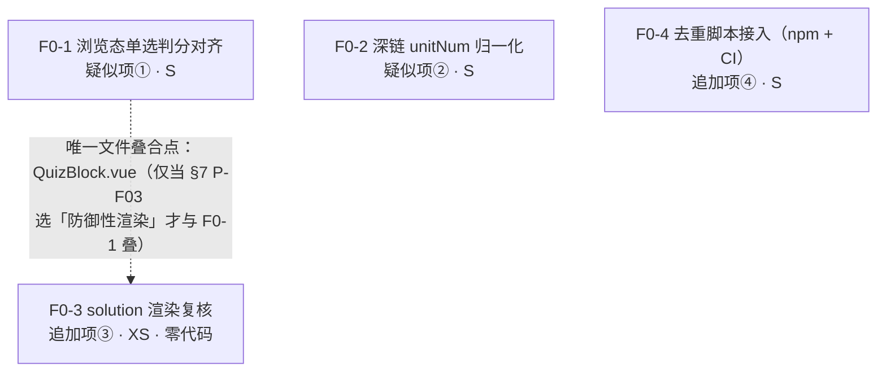
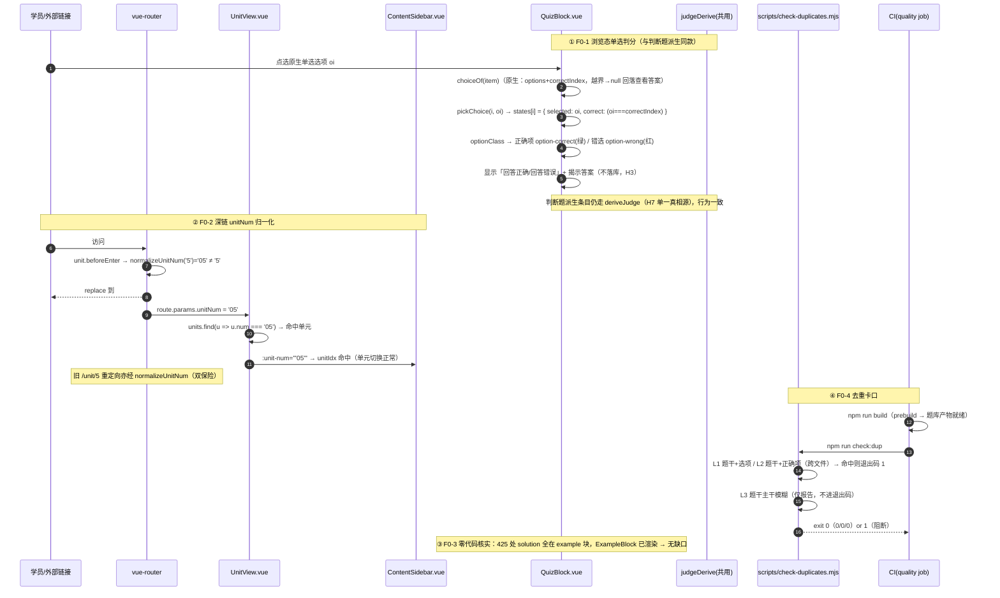

# 批 F0「来件响应热修」任务卡（单选判分 · 深链归一化 · 解析渲染复核 · 去重脚本接入）—— 工程师照单实现版

> 状态：**规划定稿（未写代码）**。本文是内容侧两件来件 + 功能侧回函的**落地拆解**，不推翻既有路线图，只把「来件响应热修」拆到可直接开工的粒度（文件、改动点、测试点、验收条、commit 划分）。
> 角色：架构师（Bob）产出；供工程师直接照单实现，供 team-lead / 用户拍板 §7 的遗留点。
> 上游（已读并内化）：
> - `协同交流/01_内容侧来件/2026-10-10_浏览器实测两个疑似项待功能侧确认（单选题判分与深链零填充）.md`（疑似项①单选不判分 / ②深链 `5` vs `05`）
> - `协同交流/01_内容侧来件/2026-10-11_去重口径脚本交付与昨日0重复的更正说明.md`（去重脚本 + `solution` 缺口口径）
> - `协同交流/02_功能侧回函/2026-10-11_回复两疑似项判定与去重脚本收讫及本轮内容收编.md`（判定：①缺陷受理、②归一化受理、追加③`solution` 渲染受理、④脚本入库）
> - `docs/proposals/batch-e-tasks.md`（格式与模式复用；H1–H7 硬约束沿用）
> - 源码实测：`QuizBlock.vue` / `ExamBlock.vue` / `router/index.js` / `UnitView.vue` / `ContentSidebar.vue` / `scripts/check-duplicates.mjs` / `package.json` / `.github/workflows/ci.yml` / `tests/csp-guard.test.js`
>
> **两条纪律贯穿全文**：① 数字、行号、接口一律以**本次实际读码**为准（关键校验一律 Python 脚本复核 —— 本环境 grep 漏命中，结论以 Python 为准）；② 不写实现代码，只给「关键函数签名 + 伪代码级要点」。
> **任务数 = 4**（`F0-1 / F0-2 / F0-3 / F0-4`），等于 ≤4 硬上限；按**来件条目**分组（一项来件 = 一个任务）。
> **行号基准**：本文全部行号**实测于 HEAD = `d486b8a`**（工作树**干净**）。批 E 已合入（611 测试绿）。

---

## 0. 开工前必读：本次核查对上游来件/回函的**更正与补充**（务必以本节为准）

> 以下为本次只读核查的实测结论（HEAD = `d486b8a`；工作树**干净**）。**更正 1 直接推翻回函 §三 的修复前提，把 F0-3 从「改渲染点」收敛为「零代码核实」**；照抄回函会对不存在的缺口动刀。

| # | 上游写法 | 实测事实 | 处理 |
|---|---|---|---|
| **更正 1（关键）** | 回函 §三：「全库只有「例题（example）」渲染 `solution`；quiz/exam 题目的答案区只渲染 `answer` → 有 `solution` 的 **425 道题，其详细解析学员确实看不到**」 | **前提不成立**。Python + 构建期 `walkBlocks` 双重复核：全库 `solution` 字段 **425 处，全部位于 `example` 块**（425 个 example 题，个题都带 `solution` 与 `answer`）；**`quiz` 块 1687 题、`exam` 块 245 题，`solution` 命中均为 0**。而 `ExampleBlock.vue:23-32` **本就渲染 `item.solution`**（「先思考，再看解答」折叠区）。→ **425 道题的解析学员本来就看得见**，不存在「看不到」的渲染缺口 | **F0-3 收敛为「零代码核实 + 回函更正」**（§2 F0-3）；**不**在 QuizBlock/ExamBlock 新增 `solution` 渲染（当前无数据可渲染，属 YAGNI；且若内容侧日后把 `solution` 搬进 `answer`，并列渲染会重复）。是否加「防御性渲染」列入 §7 **P-F03** |
| **更正 2** | 回函 §一：「细节（… `ExamBlock` 是否有同类缺口）由架构师读码细化」 | **`ExamBlock` 无同类缺口**：单选在考试态**已判分** —— `selectOption`（`:313-317`）置 `answers[i] = { answered, selected, correct: oi === item.correctIndex }`，结果页逐题回顾以勾/叉 + 左色条呈现对错（`:131-134`、`.review-ok/.review-no` `:753-754`）。**「单选拿不到对错结论」只发生在浏览态 `QuizBlock`**（自主学习版） | F0-1 落点 **只在 `QuizBlock.vue`**；`ExamBlock` **不改判分**（回函所问的「ExamBlock 同类缺口」= 否） |
| **更正 3** | 批 E §0 补充 6 / P-E5：「**实测 `package.json`：无 `build:search` script**」 | **在 F0 HEAD 已存在**：`package.json:21` `"build:search": "node scripts/build-search-index.mjs"`；`build:index`（`:22`）= `build:practice && build:search`，搜索索引顺序问题**已解决**。`check:dup` **仍不存在** | F0-4 只需补 `check:dup` script + CI 卡位（**不**再动 build 顺序） |
| **更正 4** | 深链原因：「`unitNum` 未做零填充」 | 定位更精确：匹配发生在**字符串相等**处 —— `UnitView.vue:198` `site.units.find((u) => u.num === route.params.unitNum)`，`site.js` 的 `num` 为 `"01"…"12"` 零填充；`ContentSidebar.vue:358-363`（`unitIdx`）同款 `u.num === props.unitNum`。**`fileIndex` 已容错**（`UnitView.vue:201-204` 用 `Number()`，`'04'`→4 正常），故**只需归一化 `unitNum`** | F0-2 归一化范围收敛为**只 `unitNum`**（`fileIndex` 不动） |
| **补充 1** | 回函 §四：去重脚本「已收入仓库（`7b17d5f`），三档实跑复验 0/0/0」 | 实测 `scripts/check-duplicates.mjs` 存在且**与来件描述一致**：L1 题干+选项（有序）、L2 题干+正确项文本、L3 题干主干模糊（L3 刻意**不进退出码**）；退出码仅 L1/L2 命中返回 `1`（`:20`、`:132-135`）。`lint`（`package.json:26`）覆盖 `scripts/`，脚本已 lint 干净 | F0-4 只做**接线**（npm script + CI），脚本本体**不改** |
| **补充 2** | — | `tests/csp-guard.test.js`（L1–L4 + L6）与 `tests/helpers/csp-lock.js`（L5）**已存在**（批 E 落地）。F0 全部改动（router 归一化 / QuizBlock 判分 / package.json / ci.yml）**均不引入任何 `import()`**，L6 天然绿 | 每 commit 必跑 `tests/csp-guard.test.js`（含 L6）作为**回归闸门**（§6） |

### 0.1 F0-1 的口径前提（H3 不破）

**浏览态「判分」只是「显示对错」**，**不得**把浏览态接入错题本/正确率/XP —— `QuizBlock.vue` 头注 `:8` 明写「**不发放 XP、不记错题本、不计正确率**（维持既有契约；错题落库仍只在练习/考试链路）」。F0-1 只在**视觉层**补「绿/红 + 判定文案」（与判断题派生同款），**判分结果不落库、不上报**。判据与派生**共用** `src/content/judgeDerive.js` 之外的**同一份 `correctIndex`**（原生选择题字段，非派生）。

### 0.2 F0-1 与批 E-1 的边界（有意不一致，勿顺手合并）

批 E §4 第 14 条已固化：三档自评（`known/seen/unknown`）**只**作用于 `practice` 练习链路（`PracticeSession.vue`）；`ExamBlock` 自评是布尔「对/错」。**F0-1 不碰任何自评链**，只把浏览态**原生单选题**的对错显示**对齐判断题派生**（判断题派生早已在 `QuizBlock` 内即时判定，`:92-98`）。二者语义不同，**不做三档化**。

---

## 1. 总览：任务编号 / 依赖 / 顺序

### 1.1 任务一览表

| 任务 | 来件条目 | 内容 | 依赖 | 预估 | 触碰 DB / schema / CSP 配置 |
|:--:|---|---|:--:|:--:|---|
| **F0-1** | 疑似项①（单选判分） | `QuizBlock.vue` 浏览态**原生单选题**点选即判对错（绿/红）+ 揭示答案；`correctIndex` 越界防守 | 无 | **S** | 否 |
| **F0-2** | 疑似项②（深链零填充） | 路由层 `unitNum` 归一化（`5` ≡ `05`），使外部深链可打开 | 无 | **S** | 否 |
| **F0-3** | 追加项③（`solution` 渲染） | **读码核实（更正 1）**：无渲染缺口 → **零代码**，产出回函更正要点 | 无 | **XS** | 否 |
| **F0-4** | 追加项④（去重脚本） | `package.json` 加 `check:dup` script + `.github/workflows/ci.yml` 加卡口步（L1/L2 阻断、L3 仅报告） | 无 | **S** | 否（仅 CI 配置） |

> **批 F0 全程不改 `engine.js` / `site.js` / 内容页 / `schema` / `tauri.conf.json`。** DB 停在 **v7**（`studyDb.js:33`），本批**零升版、零迁移**。唯一新增文件是 F0-2 的纯函数工具 + 其测试（可选，见 §7 P-F04）。

### 1.2 依赖图



> **读图**：四任务**无硬依赖边**（可任意次序或并行）。F0-1 / F0-2 / F0-4 改三个互不相交的落点（`QuizBlock.vue` / `router/` / `package.json`+`ci.yml`）。F0-3 默认零代码；**仅当** §7 P-F03 拍板「加防御性渲染」时才会再碰 `QuizBlock.vue`/`ExamBlock.vue`（届时并入 F0-1 同一 commit，避免同文件双改）。

### 1.3 实现顺序建议（详见 §6）

```
① F0-2（S，纯路由/纯函数，最低风险，先清深链）
   → ② F0-4（S，构建期/CI，无 UI 风险）
   → ③ F0-1（S，碰浏览态渲染，需回归判断题派生与 H3）
   → ④ F0-3（XS，核实结论 + 回函，无代码）
```

---

## 2. 逐任务卡

### 任务 F0-1 · 浏览态单选题判分对齐（疑似项①）

**目标**：`QuizBlock.vue`（自主学习版）的**原生单选题**在浏览态**点选即判定对错**（正确项恒绿、错选红），并即时揭示答案/解析——**与同页判断题派生（`:92-98`）行为一致**。消除「判断题有反馈、单选题无反馈」的不一致，补齐 62.4% 可判分题的自测闭环。**契约不变**：不记错题本、不计正确率、不发 XP（头注 `:8`）。

**为什么本任务落在 `QuizBlock.vue` 而非 `ExamBlock.vue`**：`ExamBlock` 单选**已判分**（更正 2），无缺口；缺口只在浏览态。

**涉及文件**

| 动作 | 路径 | 说明 |
|---|---|---|
| 修改 | `src/components/blocks/QuizBlock.vue` | `choiceOf` 越界防守 / `pickChoice` 恒判 / `optionClass` 统一 / 反馈条件放宽 / 锁定重选 / 头注与注释更新 / 清死代码 CSS |
| 新增（建议） | `tests/quiz-block-judge.test.js` | 挂载 `QuizBlock`，断言单选点选后绿/红高亮与「回答正确/回答错误」文案、且**不写库**（无 DB 调用） |

**关键改动（伪代码级）**

```js
// ① isChoice（:153-155）：补 correctIndex 范围防守 —— 越界视为「非可判分」，回落「查看答案」
function isChoice(item) {
  return Array.isArray(item.options) && item.options.length > 0
    && Number.isInteger(item.correctIndex)
    && item.correctIndex >= 0 && item.correctIndex < item.options.length
}
// 说明：原实现只判 `correctIndex !== undefined`；若数据越界，`oi === correctIndex` 恒 false → 全判错。
//      收紧后越界条目自动退回「查看答案」通路（安全降级，见 §7 P-F06）。

// ② pickChoice（:183-190）：原生选择题与判断题派生**统一判分**（去掉 `if (eff.derived)` 门槛）
function pickChoice(i, oi) {
  const eff = choiceOf(props.block.items[i])
  if (!eff) return
  states[i] = { selected: oi, correct: oi === eff.correctIndex }  // 原名仅 derived 才判，现二者皆判
  opened[i] = true
}

// ③ optionClass（:171-180）：统一为「正确项恒绿 / 错选红」，与 practice 的 optionClass 同款
function optionClass(i, oi) {
  const st = states[i]
  if (!st || st.selected === undefined) return {}
  const eff = choiceOf(props.block.items[i])
  if (!eff) return {}
  return {
    'option-correct': oi === eff.correctIndex,
    'option-wrong': st.selected === oi && oi !== eff.correctIndex
  }
}
```

**模板改动**

- 选项按钮 `:disabled`（`:51`）：`choiceOf(item).derived && …` → **`states[i]?.selected !== undefined`**（原生选择题也锁定重选，与 practice `:51`「picked 后 disabled」一致）。
- 判定反馈 `<p>`（`:92-98`）：条件 `choiceOf(item)?.derived && states[i]?.correct !== undefined` → **`states[i]?.correct !== undefined`**（文案「回答正确/回答错误」不变）。
- 头注 `:4`、内联注释 `:44`/`:100`：改写为「选择题点选即判定对错（绿/红）并揭示答案；判断题派生同款」——**注释只写「为什么」**。

**死代码清理**：统一高亮后 `.option-selected`（`:251`）与其 `.option-letter`（`:267`）不再被任何分支产出，**删除**这两条 scoped 规则（无测试引用 —— 已 Python 复核 `tests/` 无 `option-selected`）。

**测试要点**

- ① **原生单选判分**：`block.items=[{options:[...], correctIndex:2}]`，`mount` 后 `pickChoice(0,2)` → 第 3 项带 `option-correct`、无 `option-wrong`；`pickChoice(0,0)` → 第 1 项 `option-wrong`、第 3 项 `option-correct`。
- ② **反馈文案**：点偶数索引正确答案 → 无 `judge-no`；点错 → `.judge-no` 出现。
- ③ **锁定重选**：`states[i].selected` 已置后，再次点击不改变 `states[i]`（按钮 `disabled`）。
- ④ **判断题派生不回归**：`deriveJudge` 命中条目仍绿/红（与既有 `tests/judge-derive.test.js` 同源）。
- ⑤ **H3 不破**：单选判分**不触发** `studyDb` 任何写入（`QuizBlock` 不 import `studyDb`）；断言测试期间无 `recordError/recordAnswered` 调用路径。

**验收标准**

- 疑似项① 命中 → ① + ②（与内容侧「(A) 缺陷、对齐判断题反馈」一致）。
- 与判断题派生行为一致（同款绿/红 + 判定文案）→ ④。
- 浏览态契约不变（不落库/不计率/不发 XP）→ ⑤ + 人工核对头注。

**与批 E 的不回归**：不碰 `practice.js` 的 `assess` / `SELF_TIERS`（批 E-1 产物）；不碰 `progress.js` 双轨（E-2）；不碰 CSP 配置（E-0）；无新 `import()`（L6 绿）。

---

### 任务 F0-2 · 深链单元号归一化（疑似项②）

**目标**：使外部深链 `#/study/computer/5/4` 与站内规范链接 `#/study/computer/05/4` **等价**，在**路由/参数解析层**把 `unitNum` 零填充归一化（`5` → `05`），并让 URL 规范化为带零填充形态。**只归一化 `unitNum`**（`fileIndex` 已容错，见更正 4）。

**涉及文件**

| 动作 | 路径 | 说明 |
|---|---|---|
| 新增 | `src/utils/routeParams.js` | 纯函数 `normalizeUnitNum(v)`（**唯一真相源**，H7） |
| 修改 | `src/router/index.js` | ① `unit` 路由加 `beforeEnter` 归一化；② 旧 `/unit` 重定向也走同一函数 |
| 新增（建议） | `tests/route-params.test.js` | 纯函数边界：`'5'→'05'`、`'05'→'05'`、`'10'→'10'`、`'12'→'12'`、`null/''` 原样 |

**关键改动（伪代码级）**

```js
// src/utils/routeParams.js —— 纯函数，零 import（可被任意端复用）
/** 单元号零填充归一化：'5'→'05'；空/未定义原样返回（不抛错） */
export function normalizeUnitNum(v) {
  if (v == null || v === '') return v
  return String(v).padStart(2, '0')
}
```

```js
// src/router/index.js —— 单元路由（:33-38）加 beforeEnter
{
  path: '/study/:subject/:unitNum/:fileIndex?',
  name: 'unit',
  component: () => import('@/views/UnitView.vue'),   // 字面量，L6 豁免不变
  // 外部手输/粘贴的深链可能不带零填充（'5'），与 site.js 的 '05' 字符串相等匹配失败 → 空白页。
  // 在此处归一化并 replace，保证 route.params.unitNum 恒为规范形（URL 一并规范化）。
  beforeEnter: (to) => {
    const norm = normalizeUnitNum(to.params.unitNum)
    if (norm !== to.params.unitNum) {
      return { ...to, params: { ...to.params, unitNum: norm }, replace: true }
    }
  }
}

// 旧路由 /unit/:unitNum/:fileIndex?（:39-43）重定向同样归一化（重定向目标会再经 unit 的 beforeEnter，双保险）
redirect: (to) => ({
  name: 'unit',
  params: { subject: 'math', unitNum: normalizeUnitNum(to.params.unitNum), fileIndex: to.params.fileIndex }
})
```

**为什么用 `beforeEnter`（路由层）而非改 `UnitView` 的 `unit` computed**：`route.params.unitNum` 有**多个消费点**（`UnitView.vue:51/103/198/644-648`、`ContentSidebar.vue:358-363`）。只改 `UnitView` 的匹配会让 `ContentSidebar` 的单元切换（`unitIdx` 用 `u.num === props.unitNum`）仍不匹配。**在路由层归一化 = 单一落点覆盖全部消费点**（H7），且不碰任何视图组件。

**测试要点**

- ① **纯函数**：`normalizeUnitNum('5')==='05'`；`'05'==='05'`；`'10'==='10'`（不加长）；`'12'==='12'`；`null/''` 原样。
- ② **路由归一化**：`router.resolve('/study/computer/5/4').params.unitNum === '05'`（或 push 后断言 `route.params.unitNum`）。（若从 `test` 环境导入 router 代价高，则退化为 ① 纯函数 + 人工浏览器抽查。）
- ③ **规范链接不回归**：`/study/computer/05/4` 不触发额外重定向（`beforeEnter` 返回 `undefined`）。
- ④ **`fileIndex` 不受影响**：`/study/computer/5/04` 归一化后 `fileIndex === '04'`，`UnitView` 仍以 `Number()` 解析为 4。

**验收标准**

- 疑似项② 命中 → ① + ②（外部 `5` 与站内 `05` 等价）。
- 无副作用（规范链接零跳转）→ ③；`fileIndex` 不强改 → ④。
- 修复后配合内容侧做一轮全站深链抽查（三科 × 各单元首页）→ 人工。

**与批 E 的不回归**：`router/index.js` 既有 `beforeEach`（登录守卫，`:130-151`）与 `beforeResolve`（转场，`:118-128`）**不动**；`import('@/views/UnitView.vue')` 保持字面量（L6 豁免）；`pagingGo` 的 `router.replace`（`UnitView.vue:502`）用 `unit.value.num`（恒规范）→ **不触发**归一化重定向，翻页转场零影响。

---

### 任务 F0-3 · `solution` 渲染缺口复核（追加项③）—— **零代码**

**目标**：核实内容侧「425 道题的解析学员看不到」的口径，给出**可回复内容侧的结论**。**默认零代码**。

**核实结论（更正 1）**

- Python + 构建期 `walkBlocks` 双重复核（HEAD `d486b8a`）：全库 `solution` **425 处**，**全部位于 `example` 块**；`quiz`（1687 题）/ `exam`（245 题）`solution` 命中 **0**。
- `ExampleBlock.vue:23-32` **已渲染** `item.solution`（「先思考，再看解答」折叠区，`:24-31`）→ 425 道题的详细解析**本就可见**。
- 结论：**回函 §三 的「学员看不到」前提不成立**；**无需**在 QuizBlock/ExamBlock 新增 `solution` 渲染（当前无数据可渲染；且若内容侧日后把 `solution` 搬进 `answer`，并列渲染会**重复展示**）。

**涉及文件**

| 动作 | 路径 | 说明 |
|---|---|---|
| 无 | — | **零 src 改动** |
| 产出（非本仓） | `协同交流/02_功能侧回函/…`（由 team-lead/PM 落笔） | 回函更正要点：`solution` 已在例题块渲染；`quiz/exam` 无 `solution` 字段；请内容侧**不要**再搬 `solution`→`answer` |

**给回函的结论段（可直接引用）**

> 复核（HEAD `d486b8a`）：全库 `solution` 字段 425 处**全部在 `example` 块**（例题），`ExampleBlock.vue` 已渲染；`quiz`/`exam` 题目**不含** `solution` 字段（各 0 处）。故「425 道解析看不到」不成立 —— 该 425 道正是例题，解析经「先思考，再看解答」可见。请内容侧**不必**将 `solution` 搬入 `answer`（搬运后若 UI 并列渲染将重复）。

**验收标准**

- 复核结论有**可复现证据**（Python 计数 + 行号定位）→ 本文附表 + §0 更正 1。
- 回函更正送达内容侧 → team-lead 确认。

**可选（P2，见 §7 P-F03）**：若 team-lead 坚持「为内容侧日后给 quiz/exam 题补 `solution` 预留渲染」，则在 `QuizBlock.vue` 答案面板（`:100-108`）与 `ExamBlock.vue` 回顾区（`:136-139`）以 `v-if="item.solution"` **并列**渲染 `solution`；当前**零影响**（无数据），但需与 F0-1 同 commit 以避免同文件双改。**架构师默认不建议**（YAGNI + 重复渲染风险）。

---

### 任务 F0-4 · 去重脚本接入（npm script + CI 卡口）（追加项④）

**目标**：把已入库的 `scripts/check-duplicates.mjs` 接线到 **npm script** 与 **CI 卡口**（L1/L2 命中阻断、L3 仅报告）。脚本本体**不改**（已 lint 干净、三档 0/0/0）。

**涉及文件**

| 动作 | 路径 | 说明 |
|---|---|---|
| 修改 | `package.json`（`scripts`，`:7-29`） | 新增 `"check:dup": "node scripts/check-duplicates.mjs"` |
| 修改 | `.github/workflows/ci.yml`（`quality` job，`:26-36`） | 在「生产构建」之后新增「题库实质重复检测」步 |
| 核对（不改） | `scripts/check-duplicates.mjs` | 退出码口径（`:20`：L1/L2 → 1）与三档设计**保持原样** |

**关键改动（伪代码级）**

```jsonc
// package.json scripts 增一行（来件建议名 check:dup）
"check:dup": "node scripts/check-duplicates.mjs"
```

```yaml
# .github/workflows/ci.yml —— 在 quality job 的「生产构建」步之后插入
      - name: 生产构建
        run: npm run build          # prebuild → build:index → build:practice && build:search（题库产物已就绪）
      # 依赖 public/practice-bank/*.json（由 build:practice 产出）→ 必须放在 build 之后
      # 退出码：L1/L2 命中 → 1（阻断 CI）；L3 疑似不卡 CI（脚本内 L3 不进退出码）
      - name: 题库实质重复检测
        run: npm run check:dup
```

**为什么放在「生产构建」之后**：`check-duplicates.mjs` 读 `public/practice-bank/{subject}.json`（`scripts/check-duplicates.mjs:29`），该产物由 `build:practice` 生成；CI 的 `npm run build` 经 `prebuild → build:index → build:practice && build:search` 已产出题库，故卡口置于 build 之后即数据就绪（更正 3：顺序问题已由 `build:index` 解决）。

**本地关卡命令（Node v22）**

```bash
export PATH="/Users/iras17514/.workbuddy/binaries/node/versions/22.22.2-6/bin:$PATH"
npm run build:practice   # 生成题库产物（或已由 build 产出）
npm run check:dup        # 期望退出码 0（三档 0/0/0）
```

**测试要点**

- ① **脚本可跑且退出码正确**：`npm run check:dup` 在干净题库上退出 `0`；人为造一条 L1 重复 → 退出 `1`（可手工验，勿进仓库）。
- ② **lint 覆盖**：`npm run lint`（`:26`，含 `scripts`）对新增无影响（脚本已干净）。
- ③ **CI 步骤顺序**：新步在「生产构建」之后（YAML 缩进/位置正确）。
- ④ **不引入运行时依赖**：`check:dup` 只走 Node 脚本，不进前端 bundle；CSP L6 无新增 `import()`。

**验收标准**

- 追加项④ 命中 → ① + ③（npm script + CI 卡口；L1/L2 阻断、L3 仅报告）。
- 零新依赖、产物仍纯 JSON（H1）→ ① + 人工核对。

**与批 E 的不回归**：不改构建顺序（E-4 已解决）；`check-duplicates.mjs` 与搜索/题库产物只读交互。

---

## 3. 关键程序调用流（sequenceDiagram）

> 详见 `docs/proposals/batch-f0.sequence.mermaid`（下方同源）。覆盖 F0-1 浏览态单选判分、F0-2 深链归一化、F0-4 去重卡口三条主链；F0-3 为零代码核实（以 Note 标注）。



---

## 4. 跨任务共享知识（工程师必读，防漂移）

1. **H3 浏览态判分只显示、不落库**（F0-1 关键）：`QuizBlock` 维持「不发放 XP、不记错题本、不计正确率」契约（头注 `:8`）。判分结果**不写 `studyDb`**；错题落库仍只在练习/考试链路。**F0-1 不得引入 `studyDb` import / `recordError` / 正确率统计**。
2. **单选判分与判断题派生同款（F0-1）**：绿=`--success`、红=`--danger`、判定文案「回答正确/回答错误」。原生单选判据 = 既有 `correctIndex`；判断题派生判据 = `deriveJudge`（`src/content/judgeDerive.js`，H7 单一真相源，**不新增第二份正则**）。
3. **`correctIndex` 越界 = 安全降级，不是全判错（F0-1）**：`isChoice` 收紧为「整数且 `0 ≤ ci < options.length`」；越界条目回落「查看答案」通路（与「不可判分」同款），避免「所有选项恒红」。
4. **深链归一化单一落点（F0-2）**：`normalizeUnitNum` 只在 `src/utils/routeParams.js` 定义一次（H7）；`unit` 路由 `beforeEnter` + 旧 `/unit` redirect 共用。**只归一化 `unitNum`**；`fileIndex` 由 `UnitView` 的 `Number()`（`:201-204`）负责，不强改。
5. **归一化不扰动站内导航（F0-2）**：站内所有跳转用 `unit.num`（`site.js` 规范形 `'01'…`），`beforeEnter` 对规范形**返回 `undefined`**（不重定向）。翻页（`UnitView.vue:502` `router.replace`）与转场（`:118-128`）零影响。
6. **`solution` 现状即已渲染（F0-3）**：425 处 `solution` 全在 `example` 块，`ExampleBlock.vue:23-32` 已渲染。**默认不改渲染点**（见 §7 P-F03）；回函要点见 §2 F0-3。
7. **去重脚本退出码口径（F0-4）**：L1/L2 命中 → `1`（阻断）；L3 → 仅报告（不进退出码）。CI 卡口放「生产构建」之后（题库产物已就绪）。`L3` 刻意不阻断（语文通用题干会误报）。
8. **H1 动态 import 口径（沿用批 E）**：字面量 / 静态前缀模板 glob 豁免；裸变量 / `+` 拼接禁止。**F0 全部改动不新增任何 `import()`** → CSP 护栏 L6 天然绿。
9. **每 commit 必跑回归闸门**：`tests/csp-guard.test.js`（含 L6）—— 保证 F0 不破批 E-0 的 CSP 决策；`tests/judge-derive.test.js` —— 保证 F0-1 不动判断题派生口径。
10. **DB 零升版（本批）**：停在 **v7**（`studyDb.js:33`）。F0 无任何 DB/schema 改动。
11. **零新依赖**：四任务都不引入新包（F0-2 仅新增一个零 import 纯函数文件；F0-4 仅接线既有脚本）。
12. **硬约束自查**：H1（无运行时动态 import / eval，F0 天然满足）、H2（不动 `site.js`）、H3（F0-1 不落库、不混自评/判分）、H4（Node v22 跑测：`/Users/iras17514/.workbuddy/binaries/node/versions/22.22.2-6/bin/node`）、H5（**本批不触发 schema 白名单**）、H6（`validate:content` + `lint --max-warnings 0` 每 commit 必跑）、H7（判据/派生/归一化单一来源）。
13. **注释只写「为什么」**（项目纪律）：改动处的注释解释**设计理由**（如「为何越界回落查看答案」「为何归一化放路由层」），不写“做了什么”。
14. **不 commit / 不 push**：未经 team-lead 明确批准不得 `git commit` / `git push`。

---

## 5. 风险表（每任务 1–3 条 + 缓解）

| 任务 | 风险 | 影响 | 缓解 |
|:--:|---|---|---|
| **F0-1** | 把浏览态判分误接进错题本/正确率（破 H3 契约） | 浏览页污染学习数据 | 明确 `QuizBlock` **不 import `studyDb`**；测试 ⑤ 断言无落库路径；头注保留契约 |
| **F0-1** | `correctIndex` 越界时「所有选项恒红」误导学员 | 判分反馈错误 | 收紧 `isChoice` 范围校验（§7 P-F06）；越界回落「查看答案」 |
| **F0-1** | 统一高亮后删 `.option-selected` 误伤共享样式 | 其他块视觉漂移 | `.option-selected` 是 **scoped**（仅 QuizBlock）；Python 复核 `tests/` 无引用；`tests/block-card.test.js` 只锁 `.difficulty-tag` 共用规则，不受影响 |
| **F0-2** | 归一化重定向与作答保护（`examState`）/ 转场守卫交互 | 作答中莫名重定向 | 站内导航恒用规范形 → `beforeEnter` 常规返回 `undefined`（**只有外部非规范链接才重定向**）；规范链接测试 ③ 锚定零跳转 |
| **F0-2** | 归一化范围外溢（顺带改 `fileIndex`） | 引入非预期 URL 变更 | 明确**只归一化 `unitNum`**；`fileIndex` 测试 ④ 锚定不被改写 |
| **F0-3** | 若强行「防御性渲染」导致 `solution`+`answer` 重复展示 | 学员看到重复解析 | 默认**零代码**；若加，须 `v-if` 并列且确认无内容同时存在两字段（当前满足）；见 §7 P-F03 |
| **F0-4** | CI 卡口放在题库产物生成之前 → 脚本读空/报错 | CI 假红 | 卡口置于「生产构建」之后（题库已产出）；本地关卡命令先 `build:practice` 再 `check:dup` |
| **F0-4** | L3 误报阻断 CI | 语文通用题干误伤流水线 | L3 **不进退出码**（脚本既有口径，`:132-135` 仅 L1/L2 计退出码） |

---

## 6. 给工程师的实现顺序建议（commit 划分）

| commit | 内容 | 任务 | 关卡（提交前本地必跑，Node v22） |
|:--:|---|---|---|
| **F0c1** | 深链归一化（`src/utils/routeParams.js` + `router/index.js` + `tests/route-params.test.js`） | **F0-2** | `npx vitest run tests/route-params.test.js --pool=threads --maxWorkers=1` → `npm run lint` → `npm run build` |
| **F0c2** | 去重脚本接入（`package.json` + `.github/workflows/ci.yml`） | **F0-4** | `npm run build:practice && npm run check:dup`（期望 0）→ `npm run lint` |
| **F0c3** | 浏览态单选判分（`QuizBlock.vue` + `tests/quiz-block-judge.test.js`） | **F0-1** | `npx vitest run tests/quiz-block-judge.test.js tests/judge-derive.test.js tests/csp-guard.test.js --pool=threads --maxWorkers=1` → `npm run lint` |
| **F0c4** | （零代码）回函更正要点 | **F0-3** | 无（由 team-lead/PM 落笔回函） |

- **F0c1（F0-2）排最前**：纯路由/纯函数，零 UI 风险，先清深链（内容侧自查也常被此拦）。
- **F0c2（F0-4）次之**：构建期/CI 接线，无 UI 风险。
- **F0c3（F0-1）随后**：唯一碰浏览态渲染的任务，带判断题派生回归 + H3 断言。
- **F0c4（F0-3）**：零代码，产出回函更正（不占代码 commit）。
- 每个 commit 后**全量** `npm test --pool=threads --maxWorkers=1` + `npm run lint --max-warnings 0` + `npm run validate:content`；**每 commit 必含** `tests/csp-guard.test.js`（含 L6）回归。
- **沙箱提示**：vitest 必须带 `--pool=threads --maxWorkers=1`（本沙箱 forks 池坏，报 `Failed to start forks worker` 不是测试失败）；跑测前 `node --version` 确认 v22。
- **未经 team-lead 明确批准不得 git commit / push。**

---

## 7. 待 team-lead / 用户拍板的点（本文件收敛，非阻塞开工）

| # | 事项 | 建议 | 触发谁 |
|:-:|---|---|---|
| **P-F01** | **F0-1 单选重选行为**（点选后是否锁定） | **推荐：锁定**（原生命中选择后 `disabled`，与 practice `picked 后 disabled`、判断题派生 `:51` 同款）。理由：判分后允许改选会让「对错」失去意义。若 team-lead 想保留「可改选并重判」，则 `pickChoice` 每次覆盖 `states[i]` 并保留 `:disabled` 移除——代价是与判断题派生行为不一致 | team-lead 确认即可 |
| **P-F02** | **F0-1 是否给单选也加题干行为化文案**（如「不看答案你能做对吗」） | **推荐：不加**。行为化文案属练习链路（E-1 的 `PracticeSession`），浏览态保持轻量（点选即判 + 揭示答案即可） | team-lead 确认即可 |
| **P-F03** | **F0-3 是否加「防御性 `solution` 渲染」** | **推荐：不加（零代码）**。实测 425 处 `solution` 全在 example 块且已渲染，quiz/exam 无该字段 → 加渲染**当前零收益**且有「日后重复展示」风险。回函更正内容侧即可。**若** team-lead 要求为未来内容预留：在 `QuizBlock.vue` 答案面板 + `ExamBlock.vue` 回顾区并列 `v-if="item.solution"`，**并入 F0-1 同 commit**（避免同文件双改） | team-lead 拍板 |
| **P-F04** | **F0-2 归一化落点与形态** | **推荐：路由层 `beforeEnter` + `normalizeUnitNum` 纯函数 util，`replace` 规范化 URL**。单一落点覆盖 `UnitView` 与 `ContentSidebar` 全部消费点（H7）；不散落改视图组件 | team-lead 确认即可 |
| **P-F05** | **F0-4 CI 卡口位置与阻断口径** | **推荐：置于「生产构建」之后；L1/L2 阻断、L3 仅报告**（脚本既有退出码口径）。理由：题库产物须先就绪；L3 模糊匹配在语文通用题干下会误报 | team-lead 确认即可 |
| **P-F06** | **F0-1 `isChoice` 是否收紧 `correctIndex` 范围校验** | **推荐：收紧**（整数且 `0 ≤ ci < len`，越界回落「查看答案」）。理由：越界条目若判分，会「所有选项恒红」——比不判分更糟。内容侧已确认 `correctIndex` 全量齐备，收紧对正常数据零影响 | team-lead 确认即可 |
| **P-F07** | **F0-3 复核结论是否需要内容侧二次确认**（避免「我方说不缺口、内容侧仍按缺口处理」） | **推荐：随回函明确告知内容侧**「`solution` 已在例题块渲染，`quiz/exam` 无该字段，请勿搬移」，消除两边口径差 | team-lead → 内容侧 |

---

## 附：本文件核对过的代码事实（行号为本次实测 HEAD=`d486b8a`，可能随后续提交漂移）

| 事实 | 证据 |
|---|---|
| 工作树干净；HEAD=`d486b8a` | `git rev-parse HEAD` + `git status --short`（空） |
| 全库 `solution` **425 处，全部在 `example` 块**；`quiz`/`exam` 均 0 | Python 计数（425）+ Node `walkBlocks`（example sol=425 / quiz 0 / exam 0）+ 最近前置块类型归属（`{'example': 425}`） |
| `ExampleBlock.vue` **已渲染** `item.solution`（折叠区） | `ExampleBlock.vue:23-32`（`v-if="item.solution"`；`:24-31`「先思考，再看解答」） |
| `QuizBlock.vue` 原生选择题仅「标记所选、不判对错」 | `QuizBlock.vue:4`（头注）、`:51`（`disabled` 仅 derived）、`:92-98`（反馈仅 derived）、`:165-167`/`:175`/`:187`（仅 derived 判分） |
| `QuizBlock.vue` 判断题派生命中即时判分 | `:5-6`、`:164-168`（`choiceOf` → `deriveJudge`）、`:187`（`next.correct`） |
| `QuizBlock` 契约：不发 XP / 不记错题 / 不计正确率 | `QuizBlock.vue:8` 头注 |
| `ExamBlock` 单选**已判分**（无缺口） | `:313-317`（`selectOption` 置 `correct`）、`:131-134`（回顾勾/叉）、`:753-754`（`review-ok/no`） |
| `ExamBlock` 回顾区只渲染 `answer`（非 `solution`） | `ExamBlock.vue:136-139` |
| 深链匹配为**字符串相等**，`unitNum` 未零填充则失败 | `UnitView.vue:198`（`u.num === route.params.unitNum`）；`ContentSidebar.vue:358-363`（`u.num === props.unitNum`） |
| `fileIndex` 已容错（`Number()`） | `UnitView.vue:201-204` |
| `site.js` 单元 `num` 为 `"01"…"12"` 零填充字符串 | `src/content/site.js:20,33,…`（`num: "01"`） |
| 路由 `unit` 定义 + 旧 `/unit` 重定向 | `router/index.js:33-38`（unit）/ `:39-43`（legacy redirect `:42`）；登录守卫 `:130-151`；转场 `:118-128` |
| 路由懒加载全为字面量 `import('@/views/*.vue')`（L6 豁免） | `router/index.js:16,24,31,37,49,55,61,68,75,82` |
| `check-duplicates.mjs` 三档口径；L3 不进退出码 | `scripts/check-duplicates.mjs:11-13,20,132-135`；读题库产物 `:29` |
| `package.json` **已有** `build:search`（`:21`）；**无** `check:dup` | `package.json:20-22`（build:practice/build:search/build:index）；`check:dup` Python 判定 = False |
| `lint` 覆盖 `scripts/` | `package.json:26`（`eslint src tests scripts --max-warnings 0`） |
| CI `quality` job 步骤序：validate → lint → test → build → 上传 | `.github/workflows/ci.yml:26-43` |
| `tests/csp-guard.test.js`（L1–L4+L6）/ `tests/helpers/csp-lock.js`（L5）**已存在** | 文件存在（批 E 落地）；`csp-guard.test.js:1-27` |
| 题库基线：总 **2357** / 可判分 **1482** / 派生 **515** / 可规整 **153** | `public/practice-bank/index.json`（Python 实测）；语文 530(354)·数学 1073(492)·计算机 754(636) |
| DB 版本 v7 | `studyDb.js:33` |

> 本文件为功能实现侧的技术规划，不构成对考试成绩或录取结果的承诺；考试内容、结构与分值以浙江省教育考试院当年发布为准。

---

## 8. 拍板记录（team-lead，2026-10-12）

> 对 §7 P-F01…P-F07 的裁定（**全部采纳建议项**）+ 两项范围增补 + 实施授权。
> 连带事实：`solution` 归属已由 team-lead 独立复核（对页面模块**无条件深走**取祖先链，与架构师 `walkBlocks` 口径交叉）：**425/425 处全部位于 `example` 块**（418 直接 + 4 例题条目含 `type:'single'` + 3 于 layout 内），quiz/exam 均 0，无空值 —— §0 更正 1 成立。回函 §三 已就地更正（含「已搬入 20 道无需回退——已扫描无原文级重复」）。

| # | 裁定 | 备注 |
|:-:|---|---|
| P-F01 | ✅ 锁定重选（采纳建议） | 判分后允许改选会让「对错」失去意义 |
| P-F02 | ✅ 不加行为化文案（采纳建议） | 浏览态保持轻量 |
| P-F03 | ✅ 不加防御性渲染（采纳建议）；**另增校验绊线**（见下「增补 2」） | 复核双重独立确认无缺口 |
| P-F04 | ✅ 路由层 `beforeEnter` + 纯函数归一化（采纳建议） | 单一落点覆盖全部消费点 |
| P-F05 | ✅ 卡口置于「生产构建」之后；L1/L2 阻断、L3 仅报告（采纳建议）；**并以同口径接线 `check:single`**（见下「增补 1」） | |
| P-F06 | ✅ 收紧 `isChoice` 范围校验（采纳建议） | 越界回落「查看答案」 |
| P-F07 | ✅ 随回函更正告知内容侧 | 回函 §三 已就地更正（2026-10-12） |

**范围增补（两项，均已定案）**：

1. **F0c2 扩为两只脚本**：`check:dup` + **`check:single`**（内容侧 2026-10-12 交付的 `scripts/check-single-choice.mjs`；已复核：lint 干净、`--selftest` 全项通过、全库 A 类 0 / B 类 62）。npm script 定为 `"check:single": "node scripts/check-single-choice.mjs --selftest && node scripts/check-single-choice.mjs"`（先验脚本自身、再全库体检，单条命令单退出码）；CI 与 `check:dup` 并列置于「生产构建」之后，A 类命中阻断。
2. **新增 F0c4（校验绊线）**：`src/utils/validateBlock.js` 的 `checkQuestionItems`（quiz/exam 共用）中补：`it.solution !== undefined` → 报错「solution 只在例题块渲染（请改用 answer）」。测试新建 `tests/validate-quiz-item.test.js`（参照 `tests/validate-layout.test.js` 的 `createBlockValidator` 用法）。目的：把「solution 只在例题块渲染」从口头约定变成 **CI + 编辑器双拦截**的绊线（校验器两端共用）。

**实施授权**：批准工程师按 §6 顺序实施并提交四个 commit —— **F0c1**（F0-2 深链归一化）/ **F0c2**（F0-4 两只脚本接线）/ **F0c3**（F0-1 浏览态单选判分）/ **F0c4**（增补 2 校验绊线）。提交信息须含任务号；**不 push**。F0-3 的回函更正部分已由 team-lead 落笔（不占代码 commit）。全额测试由 QA 在实施完成后统一复核。
