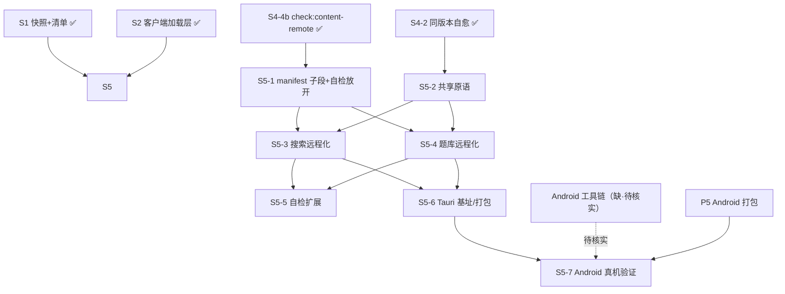
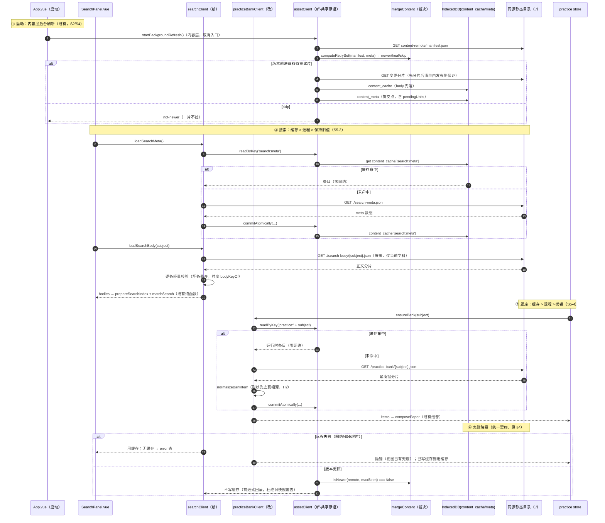

# 批 S5「搜索 / 题库远程化」实施任务卡

> 状态：**规划定稿（未写代码）**。本文把 `docs/proposals/content-extension-dual-track.md` 排期表的 **S5** 行（`:254`）与 §5「对既有搜索/题库的影响」转成可直接开工的实施卡，并给出 **S5-a / S5-b 拆分**（拆分见 §1.2；Tauri 打包策略属 `§7 P-S54`）。
> 角色：架构师（Bob）产出；供工程师照单实现，供 team-lead 裁决 §7 待拍板项。
> 上游（已读并内化）：
> - `docs/proposals/content-extension-dual-track.md` §5（`:225-240`：**协议共用设计一次到位、实现延后 S5+**；`build-content-remote.mjs` 一次构建同代次产出三份产物）+ §7（S5 与 P5 合并）
> - `docs/proposals/batch-s2-tasks.md`（优先级链范式）/ `docs/proposals/batch-s4-tasks.md`（S4-2 自愈、S4-4b 自检门禁范式；本卡格式与其对齐）
> - `docs/content-release-runbook.md`（S4 落地，156 行，发布/回滚唯一 SOP）
> - 源码实测（HEAD = **`f181c4a`）：`src/content/contentManifest.js` / `src/content/searchIndex.js` / `src/content/practiceBank.js` / `src/content/mergeContent.js` / `src/utils/contentClient.js` / `src/utils/fetchJson.js` / `src/utils/search.js` / `src/utils/practiceBankClient.js` / `src/stores/practice.js` / `src/stores/studyDb.js` / `src/components/SearchPanel.vue` / `src/App.vue` / `scripts/build-content-remote.mjs` / `scripts/build-search-index.mjs` / `scripts/build-practice-bank.mjs` / `scripts/check-content-remote.mjs` / `scripts/clean-content-remote.mjs` / `scripts/lib/load-content.mjs` / `.github/workflows/ci.yml` / `package.json`
>
> **纪律**：只读核实，不写产品代码；行号一律以**当前工作树实测**为准（HEAD = **`f181c4a`**）；数字一律用 Node/Python 脚本复核（本环境 `grep` 漏命中，见 `batch-s2-qa-report.md:249-252`）。**增量落盘**（本环境多次中断，攒到最后会全丢）。

---

## 0. 读码更正（上游旧说 vs 实测 vs 对 S5 的影响）

> 本轮共更正 **10 条**。**第 1 条是头号发现：它会直接决定 S5 的第一个落点。**

| # | 旧说（dual-track / S2·S4 卡） | 实测（HEAD=`f181c4a`） | 对 S5 的影响 |
|---|---|---|---|
| **1** | `contentManifest.js:44-50` 注释称 `OPTIONAL_SECTIONS`「留键位**零成本**，S1/B1 阶段这两个键恒为 null（P-S07 a）」——读起来像「S5 直接填上就行」 | ⚠️ **「恒为 null」是 CI 硬断言**：`build-content-remote.mjs:284-288` 的 `assertManifestInvariants` 第 ⑤ 段明写「`manifest.${key} 应为 null（S5+ 才填充）」，缺失键/非 null **都报错**；而 `scripts/check-content-remote.mjs:69` **复用同一函数**作为 CI 具名门禁（`ci.yml:46-51` 的 `npm run check:content-remote`） | **S5 一旦往 manifest 填 search/practice 子段，CI 自检立刻红**。「零成本」只对**不填**成立。S5 的**第一个落点**必须是把第 ⑤ 段从「必须为 null」改为「**若填充则必须满足子段不变量**」，且 `check-content-remote.mjs` 因复用同一函数自动跟上（H7：一处实现） |
| **2** | §2.2 manifest 图示里 `search` / `practice` 已有子清单形状（`units`/`hash`/`path` 同款） | 搜索与题库产物**各自由独立的形状模块定义**：`src/content/searchIndex.js`（`META_FILE:47`、`bodyShardPath:53-55`、`bodyKeyOf:62-64`、`BODY_LIMIT:27`、`QUESTION_MARKER:44`）与 `src/content/practiceBank.js`（`BANK_INDEX_FILE:26`、`practiceShardPath:32-34`、`practiceKeyOf:43-45`、`BANK_ITEM_KEYS:59-81`）——**都不是** `contentManifest.js` 的形状 | S5 不得在 `contentManifest.js` **重写**这两套路径/键（H7 禁止第二处）。manifest 子段只需携带**指针**（分片路径 + 哈希），形状仍归各自模块 |
| **3** | §5 方案图把三份产物画成「同一次构建、同代次」 | ✅ **实测成立**：`package.json` `prebuild = build:index && build:content-remote`，`build:index = build:practice && build:search` → 四份产物（`practice-bank/`、`search-meta.json`、`search-body/`、`content-remote/`）**同一次 `npm run build` 产出**并一起进 `dist/`；CI deploy 第 2/4/5 步（`ci.yml:179-180/194-195/197`）把它们全部推上线 | 「同一次构建」是**事实**而非设计想象 → **决策 1（版本口径）支持复用 `CONTENT_VERSION`**（`§7 P-S51`） |
| **4** | §2.3 优先级链「远程缓存 > 远程拉取 > **内置打包**」 | ⚠️ **搜索/题库没有「内置」层**：内容层有 182 个 `import.meta.glob` 懒加载 chunk 兜底（`loadPage.js:76-78`）；而 `search-meta.json` / `search-body/*.json` / `practice-bank/*.json` **只存在于 `public/`**，运行期**没有对应内置副本** | S5 **不能照搬「远程失败 → 回退内置」**。兜底只能是「**缓存**」或「**保持现有 `public/` 直读**」。这是本卡与内容层最根本的架构差异，`§7 P-S52` 的选项设计由此而来 |
| **5** | S2 卡把 `practiceBankClient.js` 的缓存纪律描述为「首次 fetch 后不再重复请求」 | 实测该纪律**仅进程级内存**：`practiceBankClient.js:11` `indexCache`、`:26` `shardCache`；`SearchPanel.vue:109-110` 同样 `metaCache`/`bodyCache`（注释明写「同会话重复进入不重复 fetch」）→ **刷新页面即丢，离线可用性 = 0** | S5 对搜索/题库的**真实收益点**：IndexedDB 持久缓存 + 版本闸门（否则每次会话都重新拉 ~1.6MB 正文分片，见 `searchIndex.js:38` `BODY_BUDGET_BYTES` 注释的实测 1602KB） |
| **6** | §5 称「客户端 `search.js` / `practiceBankClient.js` 同样接入优先级链，改造点完全同构」 | **失败语义不同**：题库**抛错**（`practiceBankClient.js:20/36` throw，由 practice store 的视图兜）；搜索**置 error 态但不回退**（`SearchPanel.vue:126/166-167`，远程失败即「搜不了」）。两者都**没有**「保持旧结果继续可用」的语义 | 「完全同构」不成立。S5 必须为三者定义**统一的失败降级契约**（`§4 共享知识`），否则会出现「内容页能用、搜索白屏、练习报错」三种不一致体验 |
| **7** | `content-extension-dual-track.md:252` 称 S4 是「改 `scripts/build-content-remote.mjs`；`contentClient.js` 校验分支」 | S4 已落地且**新增**了 `scripts/check-content-remote.mjs`（CI 具名门禁）+ `computeRetrySet` 三模式自愈（`contentClient.js:184-218`）+ `assertManifestInvariants`（`build-content-remote.mjs:226-297`） | S5 的**判据范式已成型可直接复用**：`computeRetrySet`（newer/heal/skip 三模式）、`buildShardEntry`（`:115-160` 逐条轻量校验、坏条丢弃不影响同片其它条）、`mergeContent.js` 纯函数裁决（`isNewer:110-117`/`verifyHash:92-97`/`isWellFormedHash:43-47`/`isUsablePage:58-62`） |
| **8** | S4 卡引「版本闸门 `contentClient.js:176`」 | 该行号**已漂移**：闸门判定现由 `computeRetrySet` 承担，`isNewer` 调用点在 `contentClient.js:188`（`:176` 现在是 `pending` 变量附近） | 本卡所有行号重新实测；**引用旧卡行号前必须复核**（本仓反复出现的漂移模式） |
| **9** | §5 把 search/practice 与内容并列为「三者 loader 结构与缓存层一致」 | ⚠️ **Tauri 端现状与内容层相反**：`clean-content-remote.mjs`（S4）只删 `public/content-remote/`，`tauri:build` 前置它 → 内容层在 Tauri 走**远程**；而 `prebuild:tauri = build:index`（**不含** clean）→ `search-body/` 与 `practice-bank/` **被打进 bundle**，Tauri 端搜索/题库读的是**打包时冻结的副本** | **Tauri 端才是「题库/索引锁死」的真正分叉源**，也正是 S5-b 要解决的。S5 必须为搜索/题库定义**绝对基址派生**（复用 `contentRootFrom`，`contentClient.js:70-73`），否则 APK 永远拿不到新题 |
| **10** | team-lead 报「测试基线 100 文件」 | 实测 `tests/` 下 **101** 个 `*.test.js` | 基线数字以实测为准；S5 新增测试后应在 QA 报告里复核 |

> **另注（非更正，但影响 S5 的 DB 选型）**：`content_meta` 是**单记录**存储（`keyPath:'key'`，`studyDb.js:190-191`），`saveContentMeta` 整体 `put`（`:694-696`）；`content_cache` 同款（`:187-188`）。→ 搜索/题库缓存**可以零升版复用这两表**（键加前缀），不必升 v8（与 S4-2 的 `pendingUnits` 决策一致）。见 `§7 P-S52`。

---

## 1. 总览与依赖

### 1.1 S5 要解决的真问题（按价值排序）

| # | 问题 | 现状（实测） | 归属 |
|---|---|---|---|
| **①** | **Tauri/APK 端题库与索引冻结** | `search-body/`+`practice-bank/` 打进 bundle，APK 发版即锁死（更正 9） | **S5-a + S5-b** |
| **②** | **搜索/题库无持久缓存、离线不可用** | 仅进程级内存缓存，刷新即丢（更正 5） | **S5-a** |
| **③** | **无版本闸门 / 无自愈** | 直接 `fetch`，没有 `isNewer`、没有 `pendingUnits`（更正 6/7） | **S5-a** |
| **④** | **manifest 子段填不进去** | `assertManifestInvariants:284-288` 硬断言 null（更正 1） | **S5-1** |
| **⑤** | **协议共用（`search`/`practice` 子段）只留了键位** | `OPTIONAL_SECTIONS:50` 键在、值恒 null | **S5-1** |

### 1.2 拆分：S5-a（远程化，可独立上线） / S5-b（Tauri 打包 + 真机验证）

```
S5-a（本卡主体，Web 端即可完整验证）
├─ S5-1  manifest 子段填充 + 自检放开            ← 第一个落点（更正 1）
├─ S5-2  共享裁决/存储原语（H7 收敛，不重写 contentClient）
├─ S5-3  搜索客户端远程化（searchClient + SearchPanel）
├─ S5-4  题库客户端远程化（practiceBankClient + practice store）
└─ S5-5  产物自检扩展（check:content-remote 覆盖 search/practice 子段）

S5-b（依赖 Android 工具链，当前缺 → 待核实；无真机）
├─ S5-6  Tauri 端绝对基址派生 + 打包策略（clean 范围是否扩到 search/practice）
└─ S5-7  Android 真机验证（**本环境不可完成**，只交付验证清单与 CI 能做到的部分）
```

### 1.3 依赖图



---

## 2. 逐任务卡

> 编号 `S5-1`…`S5-7`（≤ 5 个硬上限内为 7 个？——**否**：S5-6/S5-7 属 S5-b，依赖外部工具链，标 `blocked`，不占 S5-a 的派工名额；S5-a 实际可派工任务为 **5 个**，符合上限）。
> 每任务含：**落点（行号锚）/ 契约与不变量 / 测试要求（含反向锚）/ 验收口径 / 依赖 / 工作量**。

### S5-1 —— manifest 的 search / practice 子段填充 + 自检放开

- **落点**：
  - `src/content/contentManifest.js`：新增子段**形状常量与校验函数**（零 import 纪律不变，`:9-11` 已声明）。**不**重写 `searchIndex.js`/`practiceBank.js` 的路径与键（更正 2，H7），子段只带指针 `{ path, hash, count?, generatedAt? }`。
  - `scripts/build-content-remote.mjs`：`build()`（`:299-`）在写 manifest 前填 `manifest.search` / `manifest.practice`；`assertManifestInvariants` 第 ⑤ 段（`:284-288`）**重写**为「键必须存在；**为 null 或满足子段不变量**」。
  - `scripts/check-content-remote.mjs`：**零改动**（`:69` 复用同一函数，自动跟上）；但其「分片齐备性」检查（`:74-78`）当前只覆盖 `manifest.units` → **扩展**到子段声明的分片（见 S5-5）。
- **契约与不变量**：
  1. **子段为 null 或合法对象**，二者必居其一（不允许「半填」：填了 `search` 不填 `practice`）。
  2. 子段声明的每个分片 `path` **必须相对 `content-remote/`**、带 `HASH_PREFIX` 哈希（与 `units` 同款口径，`build-content-remote.mjs:256-263`）。
  3. **`contentVersion` 仍只有一个**（`CONTENT_VERSION`，`contentManifest.js:42`）——子段**不**带独立版本号（决策 1，`§7 P-S51`）。
  4. `SCHEMA_VERSION` **不变**（仍 1）——子段填充是**协议内的既有键位启用**，不是结构破坏性变更（`contentManifest.js:18-24` 的语义）。
- **测试要求（含反向锚）**：`tests/build-content-remote.test.js`（既有，扩展）
  - 正向：注入式构造「search/practice 子段齐全」的 manifest → `assertManifestInvariants` **通过**（当前必失败，证明第 ⑤ 段真的被放开了）。
  - 正向：子段为 `null` → 仍通过（向后兼容旧产物）。
  - 负向①：只填 `search` 不填 `practice` → 报错。
  - 负向②：子段分片 `path` 带 `content-remote/` 前缀 → 报错。
  - 负向③：子段哈希缺 `HASH_PREFIX` → 报错。
  - **反向锚**：把第 ⑤ 段的「应为 null」判断**反转** → 上述正向用例必须失败（证明断言真的在校验，而非恒真）。
- **验收口径**：`npm run build:content-remote` 产出的 manifest 含两子段且非 null；`npm run check:content-remote` 绿；既有 `build-content-remote.test.js` 全绿；`validate:content` + `lint` 零回归。
- **依赖**：无。**工作量**：**S**。

### S5-2 —— 共享裁决 / 存储原语（H7 收敛）

- **落点**：
  - **新增** `src/utils/assetClient.js`：把 S2/S4 已验证的编排抽成**参数化原语**——`gateAndTargets(remote, local)`（闸门三模式）、`commitAtomically(db, entries, metaPatch)`（body 先落 / meta 后交）、`readByKey(cacheStore, key)`（读路径 + 内存二级缓存）。
  - **改** `src/content/mergeContent.js`：把 `computeRetrySet`（现位于 `contentClient.js:184-218`）**迁入**本文件（纯函数家族的正确归属；`loadPage`/`contentClient` 改 import，`contentClient.js` 留 re-export 兼容旧测试）。
  - **不改** `contentClient.js` 的既有编排主体（`doRefresh` `:243-`）——**本批不重写最高风险路径**，只搬迁纯函数；contentClient 迁到 `assetClient` 登记为**备案**（下次触碰 contentClient 时收敛，H7 过渡态）。
- **契约与不变量**：
  1. **闸门语义唯一**：`isNewer` 严格大于（`mergeContent.js:110-117`）仍是唯一真相；`assetClient` 不得自造第二套比较。
  2. **原子写模式唯一**：body（`content_cache`）先落 → meta（`content_meta`）后交；`pendingUnits` 与 `units` **同一次 put**（S4-2 已钉死）。
  3. **零 DB 升版**：搜索/题库缓存复用 `content_cache`（键加前缀 `search:` / `practice:`）+ `content_meta` 单记录扩字段（见「另注」）→ **仍 v7**（`studyDb.js:33` 不动）。
  4. **每个对外入口不抛**（红线 2）：失败返回 `null` / `{updated:false}`，调用方无需 try/catch。
- **测试要求（含反向锚）**：`tests/asset-client.test.js`（新增，`fake-indexeddb/auto` + mock fetch）
  - 正向：三模式各一例（newer 取 changed / heal 用 pending 自带坐标 / skip 一片不拉）。
  - 正向：原子写——构造「第 2 片写入抛错」→ 断言 `content_meta` **未被写**（提交点未到）。
  - **反向锚**：把 `commitAtomically` 的顺序**改成 meta 先落** → 上一用例必须失败（证明原子性断言真的在咬）。
  - 零回归：`computeRetrySet` 搬迁后，既有 `content-client.test.js` / `s2-verify-*.test.js` / `s4-verify-*.test.js` **全绿**（搬迁不改语义）。
- **验收口径**：新测试全绿 + S2/S4 既有测试全绿；`DB_VERSION` diff 为空；`lint --max-warnings 0`。
- **依赖**：无（S2/S4 已合入）。**工作量**：**M**。

### S5-3 —— 搜索客户端远程化

- **落点**：
  - **新增** `src/utils/searchClient.js`：`loadSearchMeta()` / `loadSearchBody(subject)` —— 内部走 `assetClient`（缓存 > 远程 > 保持旧值），**导出签名与 `SearchPanel.vue` 现有两处 fetch 对齐**，便于最小改造。
  - **改** `src/components/SearchPanel.vue`：`:124` 与 `:153` 两处 `fetch` 换成 `searchClient` 调用；**保留** `metaCache`/`bodyCache`（`:109-110`）作为**进程内二级缓存**（与内容层 `memoryCache` 同款，`contentClient.js:37`）；错误态（`:126/166-167`）语义**收紧**为「远程失败 → 用缓存；缓存也没有 → error 态」。
  - **不改** `src/utils/search.js`（`prepareSearchIndex`/`matchSearch` 纯匹配，与数据来源无关）。
- **契约与不变量**：
  1. **`./` 相对基址不变**（`:124/:153`）——Web 生产同源，CSP `connect-src 'self'` 覆盖；Tauri 端由 S5-6 切绝对基址（更正 9）。
  2. **正文分片按学科按需**（`bodyShardPath`，`searchIndex.js:53-55`）——不得为「远程化」改成启动全量拉（1.6MB）。
  3. **坏条丢弃粒度 = `bodyKeyOf`**（`searchIndex.js:62-64`）：某页正文结构坏 → 只丢该页，其它页照常（复用 `buildShardEntry` 范式，`contentClient.js:141-149`）。
  4. **`QUESTION_MARKER` 分段不被破坏**（`searchIndex.js:44`；`search.js:20-24` 的 `splitBody`）——远程正文必须保留该标记，「题目」徽标依赖它（E-4）。
- **测试要求（含反向锚）**：`tests/search-client.test.js`（新增）
  - 正向：缓存命中 → **零 fetch**（断言 `fetch.mock.calls` 为空）。
  - 正向：缓存未命中 → fetch 成功 → 写缓存 → 二次调用命中缓存。
  - 正向：远程失败 + 有缓存 → 返回缓存（**新契约**，当前行为是 error 态）。
  - 负向：正文缺 `bodyKeyOf` 对应的键 → 该页不产出，其它页照常。
  - 负向：正文含 `QUESTION_MARKER` 被抹掉的坏分片 → `splitBody` 退化为「无题干段」，**不抛**。
  - **反向锚**：把「坏条丢弃」逻辑删掉 → 负向用例必须失败。
- **验收口径**：`tests/search*.test.js` 全绿；`SearchPanel` 在 jsdom 下「断网 → 用缓存」路径有断言覆盖；`lint` 零回归。
- **依赖**：S5-2。**工作量**：**M**。

### S5-4 —— 题库客户端远程化

- **落点**：
  - **改** `src/utils/practiceBankClient.js`：`loadBankIndex()`（`:17-23`）与 `loadSubjectBank(subject)`（`:33-41`）内部走 `assetClient`；**保留** `indexCache`/`shardCache`（`:11/:26`）作二级缓存；**保留** `normalizeBankItem`（`practiceBank.js:88-109`）作为形状兜底真相源。
  - **改** `src/stores/practice.js`：`ensureIndex`（`:65-69`）/ `ensureBank`（`:71-73`）**不改签名**；错误语义从「抛错」改为「抛错 + 已尝试缓存」（视图层 `PracticeHome` 等已有 error 态兜底，行为兼容）。
- **契约与不变量**：
  1. **`BANK_ITEM_KEYS` 紧凑键形状不变**（`practiceBank.js:59-81`）——远程题库条目与内置产物**逐字同构**，`normalizeBankItem` 零改动。
  2. **`gradable` / `derived` / `verified` 口径不变**（H3 二分 + A-1/A-4）——远程化不得引入第三套判分口径。
  3. **坏条丢弃粒度 = `practiceKeyOf`**（`practiceBank.js:43-45`）：单题坏 → 丢该题，不影响同分片其它题（组卷只少一个候选，不崩）。
  4. **`kp` 回落链不变**（`practiceBank.js:107`：产物 `kp` → 缺省回落 `fk`）——远程条目缺 `kp` 时不得让 kp 覆盖率掉出 100%。
  5. **`build:practice` 必须先于 `build:search`**（`package.json` `build:index`；`build-search-index.mjs:120-134` `readBankShards`）——S5 **不得**改这个顺序，否则搜索正文丢题干。
- **测试要求（含反向锚）**：`tests/practice-client.test.js`（新增）
  - 正向：索引/分片缓存命中 → 零 fetch。
  - 正向：`normalizeBankItem` 对远程条目与内置产物条目产出**一致**（同一 fixture 两路断言）。
  - 负向：单题缺 `q` 或 `o`/`ci` 不匹配 → 该题 `gradable=false` 或被丢弃，其余题照常。
  - 负向：条目缺 `kp` → `item.kp` 回落 `fk`（非空）。
  - **反向锚**：把 `kp` 回落那一行删掉 → 上一用例必须失败。
- **验收口径**：`tests/practice*.test.js` 全绿；`practice-store.test.js` 的组卷/会话断言零回归；`lint` 零回归。
- **依赖**：S5-2。**工作量**：**M**。

### S5-5 —— 产物自检扩展到 search / practice 子段

- **落点**：
  - `scripts/check-content-remote.mjs`：`listShardFiles`（`:37-46`）与「清单声明但盘上缺失」检查（`:74-78`）**扩展**到子段声明的分片；汇总日志（`:80-85`）补子段计数。
  - `.github/workflows/ci.yml`：`quality` job 的具名步骤（`:46-51`）**不改**（已跑 `check:content-remote`，自动覆盖扩展后的检查）。
- **契约与不变量**：
  1. **CI 不联网**（`check-content-remote.mjs:17` 已声明）——只读本地产物。
  2. 子段分片缺失 → **退出码 1**（与 content-remote 同款，不静默）。
  3. **`search-body/` 与 `practice-bank/` 的齐备性也纳入**（它们与 `content-remote/` 同在 `public/`，同一份 `dist/`）——把 S4-4a 的「闭环」从 1 份产物扩到 4 份。
- **测试要求（含反向锚）**：`tests/check-content-remote.test.js`（新增）
  - 正向：fixture 产物齐全 → `check()` 返回含子段计数。
  - 负向：删掉一个子段分片文件 → `check()` **退出码 1**（用子进程或注入 io 断言）。
  - **反向锚**：把「子段分片缺失」检查注释掉 → 负向用例必须失败。
- **验收口径**：`npm run check:content-remote` 在「缺一个 search-body 分片」的临时产物上**失败**；CI 步骤名与退出码符合预期。
- **依赖**：S5-1。**工作量**：**S**。

### S5-6 —— Tauri 端绝对基址 + 打包策略（S5-b 前半，**可本环境完成**）

- **落点**：
  - `src/utils/searchClient.js` / `src/utils/practiceBankClient.js`：基址派生复用 `contentRootFrom(apiBase, isAbsolute)`（`contentClient.js:70-73`，**H7：不另写一处基址逻辑**）。
  - `scripts/clean-content-remote.mjs`：**评估**是否把清理范围扩到 `search-body/` + `practice-bank/`（见契约 3）。
- **契约与不变量**：
  1. **Web/dev 仍相对 `./`**，Tauri 取 `new URL(API_BASE).origin`（`contentClient.js:80-87` `originOf`，S2 的 `/api` 前缀陷阱已实证，勿直接拼 `API_BASE + '/…'`）。
  2. **CSP 免改**：`connect-src` 已放行 `https://520305.top`（`src-tauri/tauri.conf.json`）。
  3. **打包策略二选一（`§7 P-S54`）**：(a) 保留 bundle 内副本作**离线兜底**（Tauri 冷启动无网时搜索/题库仍可用，体积代价 ~1.7MB）；(b) 清掉、与内容层一致（省体积，无网时搜索/题库不可用）。**推荐 (a)**——搜索/题库没有「内置层」（更正 4），清掉后 Tauri 离线即全盲，比内容层严重。
- **测试要求（含反向锚）**：`tests/search-client.test.js` / `tests/practice-client.test.js` 扩展
  - 正向：`isAbsolute=true` → 请求 URL 以 origin 开头（注入 `API_BASE='https://520305.top/api'` 断言不出现 `/api/content-remote` 式错误拼接）。
  - 正向：`isAbsolute=false` → `./search-meta.json`。
  - **反向锚**：把绝对分支改成 `API_BASE + '/' + path` → 必须失败（证明 `/api` 前缀陷阱有守卫）。
- **验收口径**：两个客户端在两种基址模式下 URL 正确；`clean-content-remote.mjs` 的三层路径守卫（`:43-58`）**不被破坏**；`lint` 零回归。
- **依赖**：S5-3、S5-4。**工作量**：**S**。

### S5-7 —— Android 真机验证（**本环境不可完成**，只交付清单）

- **落点**：`docs/远程内容链路验证清单.md` 增补「S5 · 搜索/题库远程化」章节（与既有第 1/2/3 部分同格式）。
- **契约与不变量**：
  1. **无 Android 真机**（team-lead 已确认）→ 本任务**只交付验证清单 + CI 能做的部分**，不承诺真机结论。
  2. 真机才能定的四项：弱网/离线下缓存回退、APK 内 bundle 副本与远程的一致性、存储配额（题库分片 ~700KB/学科）、`tauri://localhost` 下 fetch 实际放行。
  3. 模拟器/CI 能做到的：`cargo check`（既有 `tauri-check` job）、`vite build --mode tauri` 产物形态断言、单元/组件测试。
- **测试要求**：无新单测；验收以**清单勾选**为准。
- **验收口径**：清单成文、与 `docs/远程内容链路验证清单.md` 既有格式一致、被 `content-release-runbook.md` 引用。
- **依赖**：S5-6 + **Android 工具链（缺，待核实）** + P5。**工作量**：**M**（清单本身 S；真机执行不可估）。

---

## 3. 时序图（sequenceDiagram）



---

## 3.5 类图（classDiagram）

```mermaid
classDiagram
    direction TB

    class contentManifestJs {
        <<纯ESM 零import·两端共用>>
        +SCHEMA_VERSION = 1
        +CONTENT_VERSION = 3
        +OPTIONAL_SECTIONS = ['search','practice']
        +REMOTE_DIR / MANIFEST_PATH / HASH_PREFIX / OP
        +shardPath(subject, unitNum)
        +unitKeyOf(meta) / pageKeyOf(meta)
    }
    class searchIndexJs {
        <<纯ESM 零import·形状>>
        +BODY_LIMIT / BODY_BUDGET_BYTES
        +QUESTION_MARKER
        +META_FILE / bodyShardPath(subject) / bodyKeyOf(meta)
    }
    class practiceBankJs {
        <<纯ESM 零import·形状>>
        +QUESTION_LIMIT / ANSWER_LIMIT
        +BANK_DIR / BANK_INDEX_FILE
        +practiceShardPath(subject) / practiceKeyOf(meta) / paperKeyOf(item)
        +BANK_ITEM_KEYS
        +normalizeBankItem(raw)
    }
    class mergeContent {
        <<纯函数·易测·裁决唯一真相>>
        +isNewer(remoteVer, maxSeen)
        +verifyHash(page, expected)
        +isWellFormedHash(v) / isUsablePage(raw)
        +pickPage(builtin, remote)
        +computeRetrySet(manifest, meta) ← S5-2 迁入
    }
    class assetClient {
        <<新增·共享编排原语>>
        +gateAndTargets(remote, local)
        +commitAtomically(db, entries, metaPatch)
        +readByKey(store, key)
    }
    class contentClient {
        <<既有·最高风险路径·本批不重写>>
        +refreshIfNewer(opts)
        +getRemotePage(subject, unitNum, fileIndex)
        +startBackgroundRefresh(opts)
        +contentRootFrom(apiBase, isAbsolute)
    }
    class searchClient {
        <<新增>>
        +loadSearchMeta()
        +loadSearchBody(subject)
    }
    class practiceBankClient {
        <<改>>
        +loadBankIndex()
        +loadSubjectBank(subject)
    }
    class fetchJson {
        <<既有·极薄原语>>
        +joinUrl(base, path)
        +fetchJson(base, path, opts)
    }
    class ContentCache {
        <<IndexedDB v7·零升版复用>>
        +content_cache : {key, version, hash, pageHashes, pages}
        +content_meta : {key, contentVersion, contentHash, units, pendingUnits}
    }
    class SearchPanel {
        <<改·仅换数据源>>
        +loadMeta() / ensureBody()
    }
    class practiceStore {
        <<改·签名不变>>
        +ensureIndex() / ensureBank(subject)
    }
    class buildContentRemote {
        <<Node 发布脚本>>
        +collectSnapshot(opts)
        +assertManifestInvariants(manifest, opts)
        +build()
    }
    class checkContentRemote {
        <<CI 具名门禁>>
        +listShardFiles(dir)
        +check()
    }

    searchClient --> assetClient : 编排
    practiceBankClient --> assetClient : 编排
    contentClient ..> mergeContent : 裁决（computeRetrySet 迁入后改 import）
    assetClient --> mergeContent : 闸门/校验
    assetClient --> fetchJson : 取数
    assetClient --> ContentCache : 原子读写
    searchClient --> searchIndexJs : 路径/键（H7）
    practiceBankClient --> practiceBankJs : 路径/键/normalize（H7）
    contentClient --> contentManifestJs : 路径/键/协议（H7）
    SearchPanel --> searchClient : 数据源替换
    practiceStore --> practiceBankClient : 既有签名
    buildContentRemote --> contentManifestJs : 形状
    buildContentRemote ..> searchIndexJs : 子段指针
    buildContentRemote ..> practiceBankJs : 子段指针
    checkContentRemote --> buildContentRemote : 复用 assertManifestInvariants
```

---

## 4. 共享知识（跨任务口径，工程师必读）

1. **版本口径唯一**：`manifest.contentVersion`（= `CONTENT_VERSION`，`contentManifest.js:42`）是**内容 / 搜索 / 题库共用**的唯一次代号；三份产物同一次 `npm run build` 产出（`package.json` `prebuild`），**不引入 `SEARCH_VERSION` / `BANK_VERSION`**（`§7 P-S51`）。
2. **基址派生唯一**：一律走 `contentRootFrom(apiBase, isAbsolute)`（`contentClient.js:70-73`）+ `originOf`（`:80-87`）。**禁止**在新客户端里拼 `API_BASE + '/…'`（`/api` 前缀陷阱已实证：nginx 把 `/api` 反代给 Fastify，静态目录不在它下面 → 稳定 404）。
3. **CSP 红线不变**：全程 `fetch + JSON.parse`（`fetchJson.js:43-55`）；**禁** `eval` / 运行时 `import()`（`tests/csp-guard.test.js` L3/L6 扫 `src/**`）。搜索/题库产物恒为 JSON。
4. **闸门语义唯一**：`isNewer` 严格大于；等值/更旧**一律不写缓存**（前进式回滚）。同版本自愈走 `computeRetrySet` 的 `heal` 模式（pending 自带 `{key,path,hash}`，**不依赖远程 manifest 可达**）。
5. **失败降级统一契约**（本卡新建，修正更正 6 的三套不一致语义）：
   - **远程失败** → ① 有缓存用缓存；② 无缓存：搜索置 `error` 态（不可用但不崩）、题库抛错（既有视图兜底）。
   - **结构坏** → 逐条轻量校验，**坏条丢弃**（搜索粒度 `bodyKeyOf`、题库粒度 `practiceKeyOf`、内容粒度页），不影响同片其它条目。
   - **版本更旧** → 不写缓存、不改本地 `maxSeen`。
   - **拉到一半** → 成功片落缓存，失败片记 `pendingUnits`（与 `units` 同一次 put）。
6. **缓存键命名**：`content_cache` 内 `unitKey`（内容，既有）、`search:meta`、`search:{subject}`、`practice:index`、`practice:{subject}`（新增，前缀隔离）；`content_meta` 单记录扩 `pendingUnits`（既有）+ 子段摘要（若需要）。
7. **DB 仍 v7**：`studyDb.js:33` `DB_VERSION = 7` **不动**；新缓存复用既有两表（`§7 P-S52`）。**不新增 object store**。
8. **形状模块零 import 纪律**：`contentManifest.js` / `searchIndex.js` / `practiceBank.js` 三者都**不得** import 任何模块（`contentManifest.js:9-11` 已声明）。新增形状常量落在**归属模块**，不另起第四处。
9. **`build:practice` 必须先于 `build:search`**（`package.json` `build:index`）——题库题干并入搜索正文（`build-search-index.mjs:143-146`）。S5 **不得**改此顺序。
10. **测试环境口径**：Node v22；`vitest --pool=threads --maxWorkers=1`；**不读盘产物**（`public/**` 已 gitignore，干净树无产物）→ 一律注入式 fixture / mock fetch / `fake-indexeddb``；数字用 Python/Node 复核，**不用 shell grep**。
11. **所有日期/时间戳**：产物内 `generatedAt`/`updatedAt` 用 ISO 8601 UTC（既有口径，`build-content-remote.mjs:167`）。

---

## 5. 风险表（写实，含「无真机」的诚实标注）

| # | 等级 | 风险 | 触发场景 | 缓解 / 归属 |
|---|---|---|---|---|
| **R-1** | **高** | **manifest 子段填充撞 CI 硬断言** | S5-1 填了 `search`/`practice`，`assertManifestInvariants:284-288` 报「应为 null」→ `check:content-remote` 红 → CI 全红 | 更正 1 已定位；**S5-1 与填充必须同一 commit**（§6 C-1） |
| **R-2** | **高** | **题库/索引在 Tauri 端被清掉后离线全盲** | 若 S5-6 选 (b) 清 bundle，APK 无网时搜索/题库**完全没有兜底**（内容层还有 182 chunk，搜索/题库没有） | `§7 P-S54` 推荐 (a) 保留 bundle 副本；**这是本批最容易做错的技术决策** |
| **R-3** | **中高** | **「缓存优先」引入静默陈旧** | 缓存 `version` 落后于线上 manifest 时若照常命中 → 用户看到旧题/旧索引，且不报错（与 2026-10-15 事故同型的「看不出错」） | 缓存条目**必须带 version**，读时 `entry.version < manifest.contentVersion` 视为未命中；复用 `isNewer` + `pendingUnits` 自愈（S5-2） |
| **R-4** | **中** | **首次访问变慢 / 流量上升** | 远程化若把「按需拉」改成「启动全量拉」，一次多下 ~1.6MB 正文 + ~700KB/学科题库 | 纪律：搜索仍按学科按需（`searchIndex.js:53-55`），题库仍按学科按需；**启动只拉 manifest**（S5-3/S5-4 契约 2/1） |
| **R-5** | **中** | **`normalizeBankItem` 的旧产物兼容被破坏** | 远程条目缺 `x`（解析）/ `dv`/`vf`/`nz`/`kp` 时若不做缺省降级 → 渲染隐藏解析、kp 覆盖率掉出 100% | `practiceBank.js:98-107` 的降级链**零改动**；S5-4 测试固化（坏条负向用例） |
| **R-6** | **中** | **搜索正文的 `QUESTION_MARKER` 分段在远程路径丢失** | 若远程化时重新拼接正文而丢掉标记 → 「题目」徽标全消失（E-4 功能静默退化） | S5-3 契约 4 + 负向用例；`search.js:20-24` `splitBody` 已是容错实现 |
| **R-7** | **中** | **`QUESTION_LIMIT`/`ANSWER_LIMIT`/`BODY_LIMIT` 截断在远程路径不再告警** | 截断告警现在只在构建期（`build-practice-bank.mjs:346`、`build-search-index.mjs:222-227`）；远程路径只消费 | **可接受**（截断是构建期决策，客户端只消费）；但 S5-1 的子段哈希必须覆盖「截断后」的产物，否则哈希对不上 |
| **R-8** | **中** | **无 Android 真机 → 关键结论无法闭环** | team-lead 确认无真机；APK 分发后的缓存迁移、弱网回退、存储配额都无法实测 | S5-7 **只交付清单**；风险表如实标注「未验证」；模拟器/CI 仅覆盖 `cargo check` + 产物形态 + 单测（§2 S5-7 契约 2） |
| **R-9** | **低中** | **H7 过渡态双实现** | S5-2 只搬迁 `computeRetrySet`，`contentClient.doRefresh` 编排仍是第一处，`assetClient` 是第二处 | 明确登记为**备案**（下次触碰 `contentClient` 时收敛）；`assetClient` 的原子写/闸门必须**调用** `mergeContent` 的纯函数而非自造 |
| **R-10** | **低** | **`content_cache` 语义被稀释** | 同表混存内容分片与 search/practice 条目 | 键前缀隔离（§4 第 6 条）+ 测试断言键空间不冲突；**零升版**的代价可接受 |
| **R-11** | **低** | **题库与内容不同步的过渡期分叉** | 上线 S5 前，老 APK 的 bundle 题库/索引 = 打包时版本；Web 端则随 deploy 更新 | 决策 3（`§7 P-S53`）：Web 端**天然同步**（产物随 deploy），分叉源**只在 Tauri**，而 S5 正是要消除它 |

---

## 6. Commit 划分（建议）

| Commit | 内容 | 任务 | 说明 |
|---|---|---|---|
| **C-1** | `contentManifest.js` 子段形状 + `build-content-remote.mjs` 填充 + `assertManifestInvariants` 第 ⑤ 段重写 + 测试 | **S5-1** | **必须同一 commit**（R-1）：填充与放开断言不可分拆，否则中间态 CI 红 |
| **C-2** | `assetClient.js` 新增 + `computeRetrySet` 迁入 `mergeContent.js` + `contentClient.js` 改 import（re-export 兼容）+ 测试 | **S5-2** | 纯函数搬迁，**零行为变更**；既有 S2/S4 测试全绿是硬验收 |
| **C-3** | `searchClient.js` 新增 + `SearchPanel.vue` 两处 fetch 替换 + 测试 | **S5-3** | 可独立上线（搜索先用上缓存/闸门） |
| **C-4** | `practiceBankClient.js` 改造 + `practice.js` 错误语义 + 测试 | **S5-4** | 可独立上线 |
| **C-5** | `check-content-remote.mjs` 扩展 + 测试 | **S5-5** | 依赖 C-1（子段已存在才可检） |
| **C-6** | 两客户端基址派生 + `clean-content-remote.mjs` 评估 + 测试 | **S5-6** | 依赖 C-3/C-4 |
| **C-7** | 验证清单增补 S5 章节（文档 only） | **S5-7** | 无代码；**真机执行不在本环境** |

> **顺序建议**：C-1 → C-2 → C-3 → C-4 → C-5 → C-6 → C-7。C-3 与 C-4 可并行（都只依赖 C-2）。

---

## 7. 待拍板项（编号 **P-S51…P-S55**）

> 编号段位：S1=`P-S0x`、S2=`P-S1x`、S4=`P-S4x`（已成惯例）→ S5 用 **`P-S5x`**，与既往不冲突。每项 2–3 选项 + 推荐 + 理由。

| 编号 | 议题 | 选项 | ✅ 推荐 + 理由 |
|---|---|---|---|
| **P-S51** | **版本口径**（决策 1）：搜索/题库复用 `CONTENT_VERSION` 还是独立版本号 | (a) **复用 `CONTENT_VERSION`** (b) 独立 `SEARCH_VERSION`/`BANK_VERSION` (c) 用 `contentHash` 指纹派生 | **(a)**。① 四份产物**同一次 `npm run build`** 产出（`package.json` `prebuild`，更正 3），物理上同一代次；② 题库由 `build-practice-bank.mjs:178` 从 `src/content/**` 的 quiz/exam 区块抽取、搜索正文又并入题库题干（`build-search-index.mjs:143-146`）——**不存在「只改题库不改内容」的真实场景**，独立号只会多两个待维护点；③ 客户端闸门一处实现（H7）；④ 回滚 SOP（`content-release-runbook.md`）的「bump 纪律」管一个号比管三个号可靠得多。(b) 制造「改了内容只 bump 一个」的漂移 → 立刻出现「搜到旧题/练不到新题」；(c) 指纹无法表达「发了一版新的、内容恰好相同」，前进式回滚失效（`contentManifest.js:29-31` 已论证） |
| **P-S52** | **缓存落点**：搜索/题库缓存放哪 | (a) **复用 `content_cache`（键加前缀）+ `content_meta` 单记录扩字段 → 零升版** (b) 新增 `search_cache`/`bank_cache` store → 升 v8 (c) 不建缓存，只做版本闸门 + 每次 fetch | **(a)**。`content_meta` 是单记录整体 put（`studyDb.js:190-191/694-696`），扩字段零 DDL；与 S4-2 `pendingUnits` 的决策一致（S1 已刻意「预留 v7 避免再升版」，升 v8 破坏该一致性）。(b) 为一个 ≤6 项的键空间付一次全库迁移，不划算。(c) 放弃 S5 的核心收益（离线可用 + 免重复拉 1.6MB） |
| **P-S53** | **过渡期兼容**（决策 3）：如何保证不出现「搜到旧题/练不到新题」 | (a) **缓存条目带 version + 读时版本闸门 + `pendingUnits` 自愈**（推荐） (b) 每次启动强制重拉（放弃缓存收益） (c) 不处理，靠发布纪律 | **(a)**。这是 R-3 的正解：缓存条目带 `version`，读时若 `entry.version < manifest.contentVersion` **视为未命中**（不等同于「有缓存就用」）；失败片记 `pendingUnits` 同版本自愈（S4-2 范式）。②的代价是每次都拉 1.6MB；③正是 2026-10-15 事故的成因（依赖人记得 = 迟早漏）。**另需明确**：Web 端产物随 deploy 上线 → **天然同步、无分叉**；分叉源**只在 Tauri bundle**（更正 9），由 S5-6 消除 |
| **P-S54** | **Tauri 打包策略**（决策 4 的一部分）：bundle 内的 `search-body/`+`practice-bank/` 保留还是清掉 | (a) **保留作离线兜底**（体积 ~1.7MB） (b) 清掉，与内容层一致（`clean-content-remote.mjs` 扩范围） | **(a)**。搜索/题库**没有内置层**（更正 4）——内容层清掉 bundle 无害（182 chunk 还在），搜索/题库清掉后 APK 无网即**全盲**。1.7MB 对 APK 是可接受代价。若选 (b)，必须在 UI 上明确「离线时搜索/练习不可用」，属于**功能降级声明**，不宜静默做 |
| **P-S55** | **协议预留 `op:'append'`**（决策 5）：S5 是否派上用场 | (a) **继续留白，不实现** (b) 借 S5 顺手实现「新增学科分片」 | **(a)**。`OP.APPEND`（`contentManifest.js:120-123`）语义是「远程新增单元/页面，**需 sitePatch 配合**」，属 **B2**（导航派生层改造，波及 8 处外部消费方）；搜索/题库分片按学科（`bodyShardPath`/`practiceShardPath`），新增学科同样是 B2 范畴。S5 顺手开这个口子 = 把 B2 的高风险混进本批。(b) 明确不建议 |

---

## 附：本文件核对过的代码事实（实测 HEAD=`f181c4a`）

| 事实 | 位置 |
|---|---|
| `OPTIONAL_SECTIONS = ['search','practice']`（键位预留） | `src/content/contentManifest.js:50` |
| `CONTENT_VERSION = 3` / `SCHEMA_VERSION = 1` | `contentManifest.js:42` / `:24` |
| `OP.UPSERT/APPEND`（append 仅协议预留） | `contentManifest.js:120-123` |
| **`manifest.search/practice` 必须为 null 的 CI 硬断言** | `scripts/build-content-remote.mjs:284-288` |
| `assertManifestInvariants` 主体（schemaVersion/contentVersion/units/sitePatch/预留键） | `build-content-remote.mjs:226-297` |
| `check:content-remote` 复用同一函数作 CI 具名门禁 | `scripts/check-content-remote.mjs:69`；`ci.yml:46-51` |
| `computeRetrySet` 三模式（newer/heal/skip） | `src/utils/contentClient.js:184-218` |
| `buildShardEntry` 逐条轻量校验、坏条丢弃 | `contentClient.js:115-160` |
| `contentRootFrom` / `originOf`（基址派生 + `/api` 前缀陷阱） | `contentClient.js:70-73` / `:80-87` |
| `isNewer` 严格大于 / `verifyHash` / `isUsablePage` | `src/content/mergeContent.js:110-117` / `:92-97` / `:58-62` |
| `fetchJson`（极薄原语，禁 eval/import()） | `src/utils/fetchJson.js:28-55` |
| 搜索 meta/body 两处 fetch + 会话级内存缓存 | `src/components/SearchPanel.vue:124` / `:153` / `:109-110` |
| 题库 index/shard 两处 fetch + 进程级内存缓存（抛错语义） | `src/utils/practiceBankClient.js:19` / `:35` / `:11` / `:26` |
| 搜索形状（`META_FILE`/`bodyShardPath`/`bodyKeyOf`/`QUESTION_MARKER`） | `src/content/searchIndex.js:47` / `:53-55` / `:62-64` / `:44` |
| 题库形状（`BANK_INDEX_FILE`/`practiceShardPath`/`practiceKeyOf`/`BANK_ITEM_KEYS`/`normalizeBankItem`） | `src/content/practiceBank.js:26` / `:32-34` / `:43-45` / `:59-81` / `:88-109` |
| 题库题干并入搜索正文（`build:practice` 必须先于 `build:search`） | `scripts/build-search-index.mjs:143-146`；`package.json` `build:index` |
| 搜索 meta 条目**无版本字段** | `scripts/build-search-index.mjs:83-94` |
| 四份产物同一次 `npm run build` 产出 | `package.json` `prebuild` / `build:index` |
| CI deploy 已推 content-remote + practice-bank + search-* | `ci.yml:179-180` / `:194-195` / `:197` |
| `tauri:build` 只清 `content-remote`（search/practice 进 bundle） | `package.json` `tauri:build`；`scripts/clean-content-remote.mjs` |
| `DB_VERSION = 7` + 两表 `keyPath:'key'`（零升版复用前提） | `src/stores/studyDb.js:33` / `:187-191` |
| 内容层唯一启动触发点 | `src/App.vue:60` / `:103` |
| 测试基线实测 **101** 个 `*.test.js` | `tests/` |
| 发布/回滚唯一 SOP（156 行） | `docs/content-release-runbook.md` |

> 本文件为功能实现侧技术规划，不构成对考试成绩或录取结果的承诺；考试内容、结构与分值以浙江省教育考试院当年发布为准。


