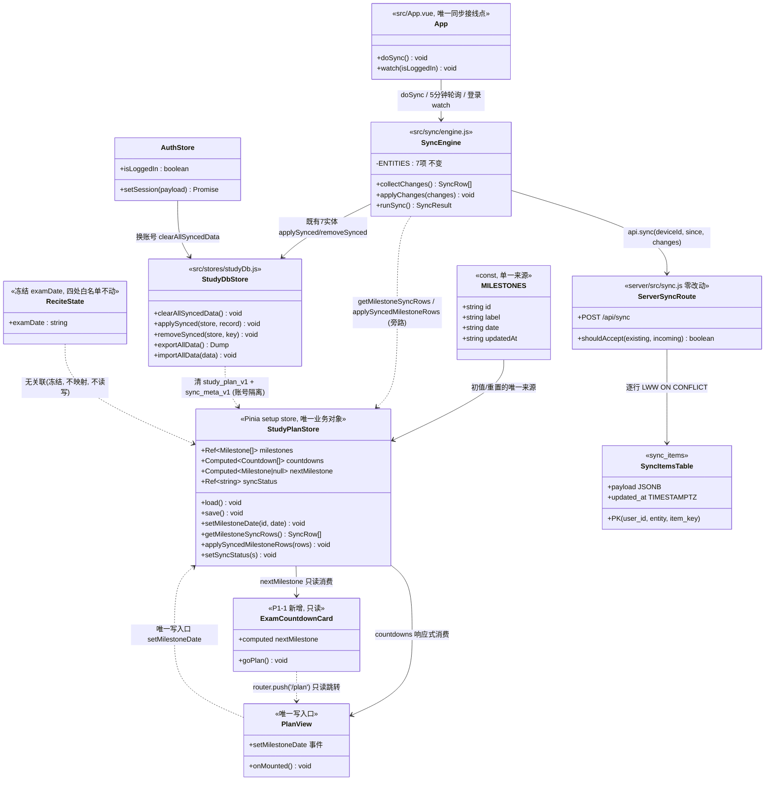
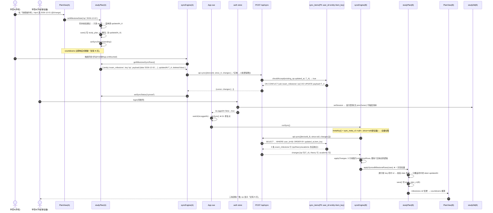
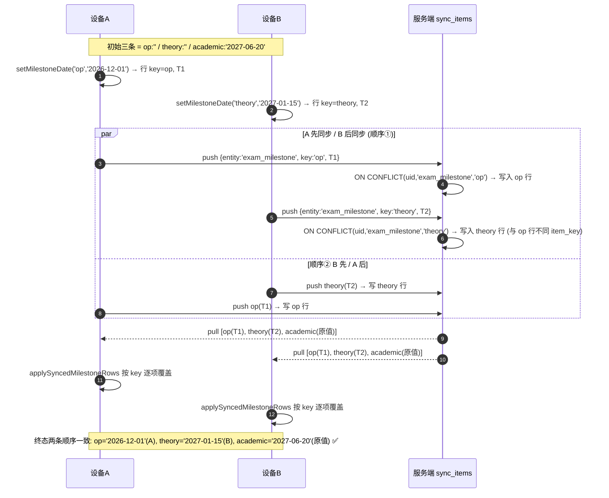
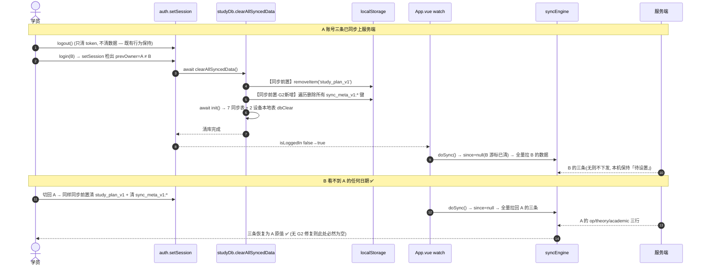
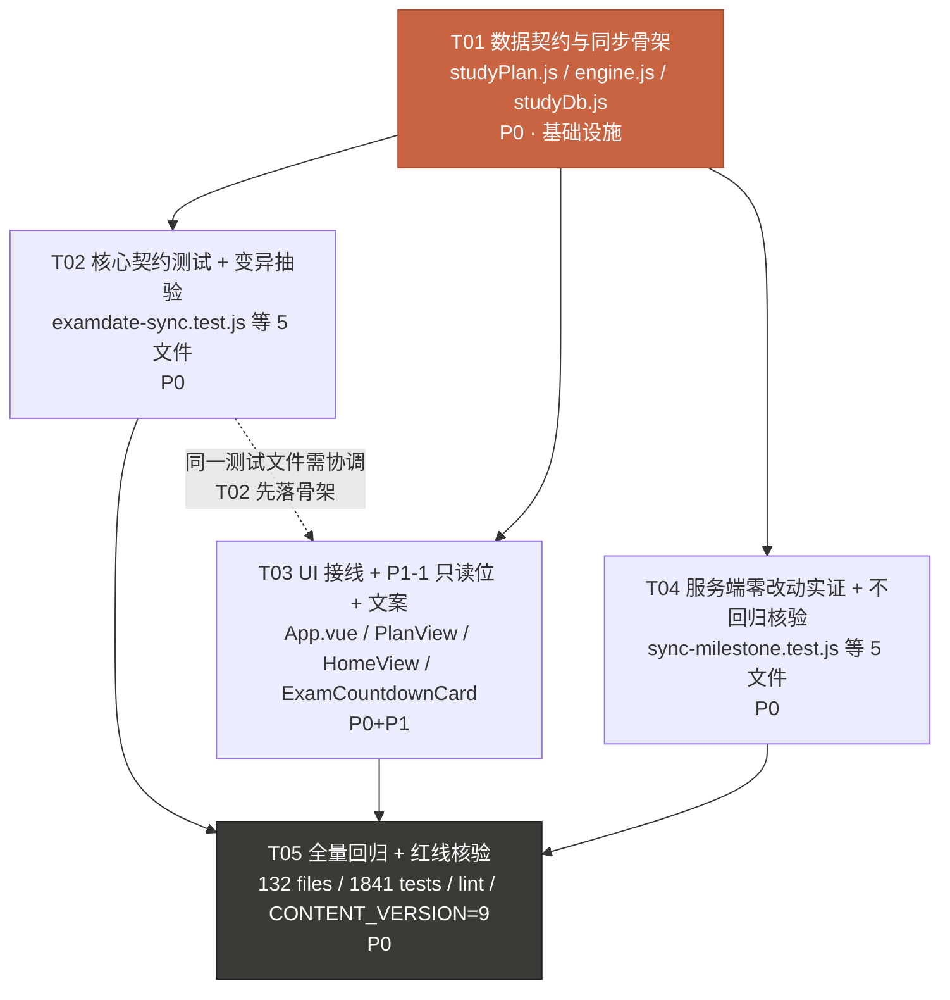

# 统一考试日期真相源 + 跨设备同步 · 增量系统设计

> **增量设计**：只描述本次变更，不重写全量设计。上游唯一权威需求来源 = `docs/prd-examdate-sync.md`（许清楚，v1.0 增量）。
> 本文只回答「怎么做 / 落哪个文件 / 什么顺序 / 怎么验」，供工程师照做；**不含产品口径再定义**。
> 纪律：本次只新建本文件；不改任何源码 / 测试 / 既有文档 / 不提交 git。

| 项 | 内容 |
| --- | --- |
| 文档版本 | v1.0（增量设计） |
| 作者 | 高见远（软件架构师） |
| Project Name | `examdate_sync`（沿用增量 PRD 代号） |
| 基线 | `HEAD = origin/main = 4484ee5`，工作树干净，`CONTENT_VERSION = 9`，全量 **132 files / 1841 tests** 全绿、lint 0 warning |
| 技术栈 | **沿用既有**：Vue 3 + Pinia + Vite（`build.target=es2019`）+ IndexedDB + localStorage（客户端）；Fastify + PGlite/PG（`server/`）。**本期零新增依赖** |
| 服务端改动 | **零改动**（详见 §1.5 证据链）；仅新增 1 个集成验证测试 |
| 任务数 | **5 个**（T01–T05，见 §5） |
| 待明确事项 | **4 条**（§8，均不重复主理人已裁决的 7 条） |

---

## 0. 硬事实复核（先对齐，行号以源码为准）

主理人转交的硬事实已逐条复核。**以下 6 处行号/数值与转交描述有偏差，设计中一律以复核结果为准**：

| 项 | 转交描述 | 源码实测 | 影响 |
| --- | --- | --- | --- |
| `studyPlan.migrateMilestoneDate` | `:85-88` | **`:91-94`** | 无（迁移逻辑一致：字面量精确 `includes`） |
| `studyPlan.setMilestoneDate` | `:227-237` | **`:255-262`** | 无（清空契约 `''`/`null`/`undefined` 一致） |
| `auth.login / register` | `:108 / :115` | **`:108 / :101`** | 无（两处均已 `await this.setSession(d)`） |
| `studyDb.lsKeys` | `:1215` | **`:1218`** | 无（仍是 `['pomodoro_state','math_theme','study_plan_v1']` 三项） |
| `studyDb.getReciteState / saveReciteState` | `:1138-1157 / :1166-1180` | **`:1146-1165 / :1174-1188`** | 无（8 字段白名单一致） |
| `DB_VERSION` | `CLAUDE.md` 文档写 v7 | **`:39` = `8`**（v8 分支 `:206-220` 建 `recite_progress`/`recite_state`） | **重要**：CLAUDE.md/HANDOVER 版本说明已滞后；若走「新增 IndexedDB 表」方案须升 **v9**，非 v8 |
| `server/test/sync-core.test.js` | 「7 条单测」 | **13 例**（7 条 `shouldAccept`/`toDate` + 6 条 `parseSince`） | 无（全部不许放宽） |

其余复核结论（一致）：`study_plan_v1` 键（`:51`）、`load()` 先无条件重置再套用（`:147-178`）、`save()` 仅交互后写盘（`:181-190`）、`ENTITIES` 7 项（`:29-38`）、`metaKey()` 按账号分游标（`:21-25`）、`collectChanges/applyChanges`（`:67-95 / :98-111`）、`DEVICE_LOCAL_LS_KEYS`（`:396`）与 `lsKeys`（`:1218`）职责分离、`clearAllSyncedData()` 同步前置清 LS 再 7+2 个 `dbClear`（`:428-447`）、`dbPut` 盖本地 `updatedAt` / `putSynced` 保留远端（`:256-263 / :276-282`）、`removeSynced` 是**物理删除** `dbDelete`（`:460-463`）——最后一条直接决定 §3.5 的清空语义。

**服务端证据链（实读，非转述）**：`server/src/schema.sql:37-45` `sync_items` 主键 `(user_id, entity, item_key)`、`entity TEXT NOT NULL` **无 CHECK / 无枚举 / 无白名单**、`payload JSONB`；`server/src/sync.js:42-43` 对 `entity` 仅校验「非空字符串」；`:55-61` `ON CONFLICT (user_id, entity, item_key) DO UPDATE SET payload=EXCLUDED.payload` 原样透传；`server/src/sync-core.js:41-44` `shouldAccept` = 纯 `incoming > existing`；`server/src/db.js:49` 只做主键存在性自愈；`src/sync/api.js:33` `api.sync` 纯透传。

---

## 1. 实现方案与关键取舍

### 1.1 四个定档结论（速览）

| # | 议题 | **定档** | 一句话理由 |
| --- | --- | --- | --- |
| ① | 三条里程碑的持久化落点 | **保留 `study_plan_v1`（localStorage）+ 桥接同步**，不迁 IndexedDB、不升 `DB_VERSION` | 改动面最小、既有 21+ 个测试零改动、P1-3 导出备份零改动、`LEGACY_DEFAULT_DATES` 迁移逻辑原样保留 |
| ② | 「3 个独立同步行」推论 | **成立**，优先采用 | 服务端按 `(entity, key)` 存独立行、payload 原样、纯 LWW；A 改 `op` 与 B 改 `theory` 落在两个不同 `item_key`，天然互不覆盖 → **P0-3 无需字段级合并、无需改服务端** |
| ③ | `recite_state.examDate` 保留还是清除 | **保留字段、冻结语义、四处白名单一律不碰** | 清除需同步改 4 处白名单 + 触既有形状断言，收益为零而回归风险高；「不产生第二真相源」靠「不映射/不读写/不展示」即可满足 |
| ④ | 服务端是否需要改 | **零改动**（`server/src/**` 一行不改） | 协议天然支持新 `entity` 名；加白名单反而违背「服务端不感知业务结构」的既有设计。仅新增 1 个集成测试做实跑验证 |

> **不缩水声明**：本方案**完整含跨设备同步** —— 真实走 `POST /api/sync`、真实 LWW、真实账号隔离、真实离线补同步。PM 预估「200–350 行 / 10+ 文件 / 需服务端配合」是**上限授权**，经核实协议天然支持后服务端无需改动、源码行数低于预估，这是核实收益而非范围缩水。用户明确否决的是「只读投影 / 只抽常量」这类**不做同步**的替代，本方案不属于该类。

### 1.2 取舍①：持久化落点的两套方案对比（明确选 B，不和稀泥）

| 维度 | **方案 A：迁到 IndexedDB 新表 `milestone`** | **方案 B（选定）：留 `study_plan_v1` + 桥接同步** |
| --- | --- | --- |
| `DB_VERSION` | 必须 **8 → 9** + `onupgradeneeded` 新增 `oldVersion < 9` 分支 + 保留全部历史分支 | **不动**（`DB_VERSION` 保持 8） |
| 旧存档迁移 | 需在升级事务里把 `study_plan_v1` 三条一次性搬进新表；`LEGACY_DEFAULT_DATES` 字面量迁移语义要从 `load()` 重写到迁移事务里（P0-5 高风险） | `load()` 的 `migrateMilestoneDate` **原样保留**，P0-5 零改动通过 |
| `studyPlan` API | `load()` / `save()` / `setMilestoneDate()` **全变 async**；`PlanView.onMounted` 需 `await` + `flushPromises` | **全部保持同步签名**，内存态即时响应不变 |
| 既有测试 | `tests/study-plan.test.js`(13) / `study-plan-clear-date.test.js`(7) / `plan-account-switch.test.js`(8) / `studyDb.test.js` / `recite-db-v8.test.js`(硬断言 `version===8`) / `studyDbMigration.test.js` / `studyDbV7.test.js` **大量改 async / 改断言** | **21+ 例零改动**；仅新增/补断言 |
| 清单改动 | `SYNC_STORE_NAMES` / `DEVICE_LOCAL_STORES` / `DEVICE_LOCAL_LS_KEYS` / `lsKeys` / `exportAllData` / `importAllData` / `clearAllSyncedData` **七处** | **零处**（`study_plan_v1` 位置与职责完全不变，两清单职责分离原样保留） |
| P1-3 导出备份 | 需改 `exportAllData` / `importAllData` 两处并补格式校验 | **零改动**（三条本就在 `study_plan_v1` 内，已进 `lsKeys`） |
| 账号隔离 | 新表进 `SYNC_STORE_NAMES` → 换账号清 | `DEVICE_LOCAL_LS_KEYS` 已清 `study_plan_v1` → 换账号清 |
| 「3 独立同步行」 | 成立 | **同样成立**（推论与本地落点无关） |
| 与 `CLAUDE.md:126`「IndexedDB 是唯一事实来源」 | 一致 | ⚠️ **受控例外**（见下） |
| 预估改动面 | ~10+ 文件、大量测试重写、升版迁移风险 | **6 改 + 4 新增**，核心逻辑约 120 行 |

**定档：方案 B。** 明确承认它与 `CLAUDE.md:126` 的同步引擎原则、以及 `studyDb.js:382-386` 注释「学习计划不进云同步」这两处**既有设计边界**相冲突。这是一次**受控例外**，不是重新定义同步引擎，控制手段有三条：

1. `ENTITIES` **7 项一字不动**（红线「不破坏既有 7 个同步实体语义与数据」）。里程碑作为**旁路实体**单独处理，不塞进 `ENTITIES`、不伪装成 IndexedDB store。
2. `engine.js` 在旁路分支处写清注释：这是历史载体（学习计划三件套自 v4 起留在 localStorage）造成的一次性例外；**本期只把三条里程碑提升为账号级，周预算 `budget` / 每日清单 `tasks` 仍是设备本地、仍不进云同步**，不扩大范围。
3. `studyDb.js` 的 `DEVICE_LOCAL_LS_KEYS` / `lsKeys` 两张清单**均不改**（禁止合并，红线），仅在 `DEVICE_LOCAL_LS_KEYS` 的 JSDoc 补一句「该键现为混合载体：账号级里程碑 + 设备本地预算/清单；换账号整体清理后，里程碑由服务端按账号重新下发」。

> **对 PM 判断的技术意见（明确表态，不和稀泥）**：PRD §0 警告「若三条作为**一行**同步，后同步的整行会静默覆盖另一条」——担心成立，但**可绕过而不必改协议**：把「一行」拆成 3 个 `item_key` 即可。PM 暗示可能需要「字段级合并 / 服务端配合」，我判定**都不需要**，这是本设计相对 PRD 预判的最大简化。另外 PM §4.2 把「待设置」文案是否改写交架构师定档，我判定**保留原文案「待设置 · 以当年官方通知为准」一字不动**（`tests/study-plan.test.js:256-265` 有精确字符串断言，改它会红且无产品收益），改为在里程碑区块**底部新增常驻小字**承载完整官方口径（§7 文案表）。

### 1.3 取舍②：「3 个独立同步行」推论验证 → 成立

| 验证点 | 证据 | 结论 |
| --- | --- | --- |
| 不同里程碑能否是不同行 | `schema.sql:44` `PRIMARY KEY (user_id, entity, item_key)`；`sync.js:57` `ON CONFLICT (user_id, entity, item_key)` | ✅ `key = 里程碑 id`（`op`/`theory`/`academic`）→ 3 行互不冲突 |
| payload 会不会被裁剪/白名单 | `sync.js:61` `JSON.stringify(ch.payload)` 原样入库；`schema.sql:41` `JSONB`；`db.js` 无字段白名单 | ✅ 原样透传，`{id,label,date,updatedAt}` 完整往返 |
| 新增 `entity` 名是否要注册 | `sync.js:42` 仅 `typeof entity === 'string' && length > 0`；`schema.sql:39` 无 CHECK | ✅ `exam_milestone` 可直接用，**无需白名单** |
| LWW 是否按行独立裁决 | `sync.js:46-52` 逐 `ch` 查 `(user_id, entity, item_key)` 后 `shouldAccept`；`sync-core.js:41-44` 纯时间比较 | ✅ A 改 `op` 只与服务端 `op` 行比，绝不触碰 `theory` 行 |
| 拉取会不会把 3 行合并 | `sync.js:81-96` `SELECT ... ORDER BY updated_at, item_key` 逐行返回 `changes[]`；`engine.applyChanges()` 逐行 `applySynced` | ✅ 逐行独立，客户端按 `key` 逐项覆盖（§3.6） |
| 墓碑语义是否有坑 | `engine.applyChanges()` `ch.deleted` → `removeSynced` = 物理删（`dbDelete`） | ⚠️ **有坑 → 本期里程碑不用墓碑**（§3.5），规避之 |
| `shouldAccept` 严格 `>` | `sync-core.js:43` `>`（相等丢弃）；`sync-core.test.js:30-32` 钉死 | ⚠️ 需客户端 `updatedAt` **单调不减**（§7 时间口径） |

**结论**：推论**完全成立**，且比 PRD 预判更省 —— 不需要字段级合并、不需要改 `sync-core.js`、不需要改 `db.js`/`schema.sql`/`sync.js`、不需要 entity 白名单。`server/test/sync-core.test.js` 13 例**零改动、不许放宽**。

> ⚠️ 但**静态读码不能替代实跑**（红线：静态扫符号有假阴性）。故 T04 新增 `server/test/sync-milestone.test.js`：真实起 PGlite，向 `/api/sync` 推 `exam_milestone/op` 与 `exam_milestone/theory` 两行并拉回，断言两行 `item_key` 独立、互不覆盖。这是「服务端零改动」的实证交付物。

### 1.4 取舍③：`examDate` 保留（字段本身不清除）

| 处置 | 做法 | 判定 |
| --- | --- | --- |
| **保留字段、冻结语义（选定）** | `EMPTY_RECITE_STATE`(`useReciteSchedule.js:84-93`)、`bumpStreak`(`:729-746`)、`studyDb.getReciteState`(`:1146-1165`)、`studyDb.saveReciteState`(`:1174-1188`) **四处白名单一行不改**；仅在这些位置的注释补「已冻结 / 非考试日期真相源」字样（注释改动零风险）；新增一条行为测试断言「设置里程碑后 `getReciteState().examDate` 恒不变」 | ✅ **选定** |
| 清除字段 | 需同步改 4 处白名单，漏一处 → 字段残留或形状漂移；且 `recite_state` 已落盘的旧行仍带该字段，`getReciteState` 显式返回白名单时静默丢弃；既有形状断言（如 8 字段）需同步改 | ❌ 收益为零、回归风险高、违 P0-6「其余 7 字段行为不变」 |

**理由**：主理人裁决 3 只要求「不映射、不作真相源、不参与展示，载入 tolerant（不报错、不清库），不产生第二真相源」。该字段全仓零生产读写、默认 `''`（`design-recitation.md:1262` 明写「P1，一期不加」），留着它是一个无害遗留字段；「不碰它则无此风险」（`recite_state` 多处白名单漏一处即静默抹字段的已知风险）是决定性论据。**旧存档 tolerant 由「白名单显式返回 + 不读该字段做业务逻辑」天然保证，不需要清库、不需要迁移。**

### 1.5 取舍④：服务端零改动（逐项判定）

| 文件 | 是否需要改 | 判定 |
| --- | --- | --- |
| `server/src/schema.sql` | ❌ | `entity TEXT` 无约束、`payload JSONB` 原样；新增 `exam_milestone` 是数据不是 schema |
| `server/src/db.js` | ❌ | 只做约束存在性自愈，与业务实体无关 |
| `server/src/sync.js` | ❌ | 已按 `(user_id, entity, item_key)` 逐行 LWW；**不加 entity 白名单**（见下） |
| `server/src/sync-core.js` | ❌ | `shouldAccept` 是通用纯函数，改它会破坏既有 7 实体语义（红线） |
| `server/test/sync-core.test.js` | ❌ 改 / ✅ 只读核验 | 13 例不许放宽 |
| `server/test/sync-milestone.test.js` | ✅ **新增** | 集成实证「3 独立 key 互不覆盖 + 新 entity 免注册」 |

**关于 entity 白名单**（主理人点名要判定）：`sync.js:42` 只校验非空字符串，理论上客户端可写任意 `entity` 名。我判定**本期不加白名单**，理由：① 这是既有设计（「服务端不感知业务结构」，`schema.sql:2-3` 注释），加白名单等于让服务端开始感知业务，是架构方向变更，超出本期范围；② 加白名单必须同步维护客户端 `ENTITIES`，正是本仓反复强调的「两处必须同步维护」类易错点；③ 该端点是登录后按 `user_id` 隔离的，写入任意 entity 只影响本人数据，不构成越权。若主理人关注滥用，应**另立安全增量**，不塞进本期（已列入 §8 Q3 备选，不作为本期任务）。

### 1.6 复核中发现的两个链路缺口（本期必须一并修，否则 P0 不成立）

> 这两点是读码新发现，转交材料未提及，但不修则 US-1 / P0-4 必然失败。

| # | 缺口 | 证据 | 后果 | 本期修法 |
| --- | --- | --- | --- | --- |
| **G1** | **登录动作本身不触发同步** | `App.vue:158-174`：`onMounted` 仅「挂载时若已登录」跑一次 `doSync()` + 5 分钟轮询；`LoginView` 登录后 `router.replace` 不重挂 App | US-1「B 设备登录同一账号后立即看到三条」要等最多 5 分钟，P0-2 验收失败 | `App.vue` 增 `watch(() => auth.isLoggedIn, ...)`，false→true 时 `doSync()`（保持在 App.vue 接线，不违 `CLAUDE.md:126`「不在各 store 中调用」）；`doSync` 已有 `syncing` 锁防重入 |
| **G2** | **换账号不清账号级同步游标** | `clearAllSyncedData()`(`:428-447`) 清 `DEVICE_LOCAL_LS_KEYS` / 7 同步表 / 2 设备本地表，**不清 `sync_meta_v1:*`**；`metaKey()` 按 uid 保留 `since`（`engine.js:21-25`） | A 设三条 → 切 B（清 `study_plan_v1`）→ 切回 A（`since_A` 仍是上次游标）→ 服务端 `WHERE (updated_at,item_key) > since_A` 返回空 → **A 的三条本地丢失**，P0-4「切回 A 仍是 A 原三条」失败 | `clearAllSyncedData()` 的**同步前置段**（第一个 `await` 之前）追加：遍历 localStorage 删除所有 `sync_meta_v1:` 前缀键 → 换账号后首次同步退化为全量拉取 |

**G2 的范围说明（重要）**：重置游标会让**既有 7 个同步实体**在换账号后也全量重拉。`applySynced` 是整行幂等 put、LWW 相等丢弃，全量重拉**正确且无副作用**，顺带修复了既有 7 实体「切走再切回本地数据拉不回」的同类潜在缺陷。这不是重定义实体语义，不改协议、不改服务端，**不违反红线**。该顺带范围已列入 §8 Q1 供主理人确认。

> `tests/plan-account-switch.test.js:168-176` ⑧ 断言「`clearAllSyncedData()` 未 await 的同步点就已清」——G2 的清理必须同样放在同步前置段，保持该断言不放宽。

### 1.7 红线落地对照（工程师逐条自检）

| 红线 | 本设计的落地方式 |
| --- | --- |
| 不碰 `src/content/**`；`CONTENT_VERSION` 保持 **9**、不 bump、不重建产物、不部署 | 本期纯数据层；文件清单（§2）无 `src/content/**` 任何项；验收跑 `git diff --stat -- src/content/` 必须为空 |
| 不改 `CUMULATIVE_DAYS` / `STAGE_DELTA` / `MAX_STAGE` / `MAINTENANCE_DAYS`；不动 64 篇 `BASELINE`；不引入判分 | `useReciteSchedule.js` **零改动**；`scripts/**` 零改动 |
| 不破坏既有 7 个同步实体语义与数据 | `ENTITIES` 7 项不动；旁路实体独立分支；`server/src/**` 零改动；`sync-core.test.js` 13 例不放宽 |
| 不改 4 Tab 结构、不新增第 5 Tab | P1-1 复用 `HomeView` 今日任务卡区一行卡片，不动路由/Tab |
| CSP `script-src 'self'`：禁 `eval` / `new Function` / 运行时内联脚本 | 无动态求值；Vue SFC 静态模板；不引入内联脚本 |
| `build.target = es2019`：**禁用 `?.` / `??` / ES2020+ 语法** | 本文所有示例均用显式 `typeof`/`||`/`Math.max`；新增代码一律不用可选链与空值合并。⚠️ 注意 `PlanView.vue:202` 的 `stat?.studyMinutes` 是**既有残余**，不要复制该写法到新增代码 |
| JSON-Schema 无 `additionalProperties:false` → 真实风险是**静默失效** | §3.7 给出 7 处「必须手工校验」清单，重点：`load()` 漏带 `updatedAt` 会让同步静默失效且无任何报错 |
| 文案禁词 + 官方口径 + 无数据不占位 | §7 文案表逐条给定；禁词扫描（提分/保过/录取/上岸/稳过/包过/必过/保证通过）零命中；空态只用说明文案、无示例数字 |
| 新守卫/新逻辑必配**变异抽验**（改坏 → 断言 `exit≠0` → 自动还原）；静态扫符号有假阴性，必须实跑测试 | §5.2 给出 5 项必做变异抽验清单；T04 新增真实 PGlite 集成测试而非仅 mock |

---

## 2. 文件清单

### 2.1 修改文件（6 个）

| 相对路径 | 一句话职责 | 关键改动 |
| --- | --- | --- |
| `src/stores/studyPlan.js` | 三条里程碑唯一业务对象 + 唯一写入口 + 同步桥接 | `MILESTONES` 每项加 `updatedAt:''`；`load()` 保留/兜底 `updatedAt`；`setMilestoneDate()` 盖单调时间戳；新增 `getMilestoneSyncRows()` / `applySyncedMilestoneRows()` / `syncStatus` + `setSyncStatus()` / `nextMilestone` computed |
| `src/sync/engine.js` | 同步引擎（旁路实体接入 + 状态回写） | `ENTITIES` **不动**；`collectChanges()` 追加里程碑行；`applyChanges()` 分流 `exam_milestone` 并批量落盘；`runSync()` 回写 `syncStatus` |
| `src/stores/studyDb.js` | IndexedDB 数据层 / 换账号清理 | `clearAllSyncedData()` 同步前置段追加清 `sync_meta_v1:*`（G2）；`DEVICE_LOCAL_LS_KEYS` / `lsKeys` / `exportAllData` / `importAllData` **均不动**；仅补 2 处 JSDoc |
| `src/App.vue` | 同步接线（红线：只在 App.vue 接线） | 新增 `watch(() => auth.isLoggedIn, ...)` 登录触发首次 `doSync()`（G1） |
| `src/views/PlanView.vue` | 唯一可见/可编辑 UI | 里程碑区块底部新增「官方口径」常驻小字 + P1-2 同步状态弱提示；三条 `<input type="date">` / 三态倒计时 / 空态原文案**一字不动** |
| `src/views/HomeView.vue` | 首页（学习 Tab 首屏） | 今日任务卡区 `ReciteTaskCard` 下方挂载 `<ExamCountdownCard />`（P1-1） |

### 2.2 新增文件（4 个）

| 相对路径 | 一句话职责 |
| --- | --- |
| `src/components/ExamCountdownCard.vue` | P1-1 背诵侧只读展示位：只显示「最近一个未来里程碑」倒计时、点名里程碑、点击跳 `/plan`；只读、无写入口 |
| `tests/examdate-sync.test.js` | 核心契约测试：3 行拆分 / 并发两顺序 / 清空 / 旧存档兼容 / 账号隔离 / `examDate` 冻结 / 单调 `updatedAt` / `nextMilestone` 三态 |
| `tests/exam-countdown-card.test.js` | P1-1 组件三态：存在未来日期 / 全未设置 / 全已过 / 既有已过+未来 / 点击跳转 / 禁词与官方口径 |
| `server/test/sync-milestone.test.js` | 服务端零改动实证：真实 PGlite 起服务，推 `exam_milestone/op` + `exam_milestone/theory`，断言两 `item_key` 独立、新 entity 免注册、LWW 各自生效 |

### 2.3 明确零改动（工程师不得顺手改）

| 路径 | 原因 |
| --- | --- |
| `server/src/**`（`sync.js` / `db.js` / `sync-core.js` / `schema.sql` / `index.js`） | 协议天然支持，见 §1.5 |
| `src/content/**` | 红线；`CONTENT_VERSION` 保持 9 |
| `src/composables/useReciteSchedule.js` | 调度常量与 `EMPTY_RECITE_STATE` 白名单一律不碰（§1.4） |
| `src/stores/auth.js` | `setSession` / `login` / `register` / `logout` 均不动（G2 的游标重置放在 `studyDb.clearAllSyncedData` 内，避免 auth→engine 循环依赖） |
| `package.json` / `server/package.json` / `vite.config.js` / `src-tauri/tauri.conf.json` | 零新增依赖、零配置变更 |
| `DEVICE_LOCAL_LS_KEYS` / `lsKeys` / `exportAllData` / `importAllData` 的**清单值** | 职责分离、禁止合并；P1-3 由 `study_plan_v1` 原位覆盖，无需改 |
| 所有既有文档（含 `CLAUDE.md` / `HANDOVER.md` / `docs/prd-*.md` / `docs/design-recitation.md`） | 纪律：只新建本文件 |

> 合计 **6 改 + 4 新增 = 10 个源码/测试文件**（另加本设计文档 1 份），符合用户「10+ 文件」预期；服务端源码改动 **0**。

---

## 3. 数据结构与接口

### 3.1 同步行形状（`entity = 'exam_milestone'`，`key = 里程碑 id`）

```js
// src/stores/studyPlan.js —— getMilestoneSyncRows() 的返回元素
// 与既有 7 实体 collectChanges() 产出的行同构（engine.js:85-91）
{
  entity: 'exam_milestone',        // 新增实体名；服务端免注册（§1.3）
  key: 'op',                      // 'op' | 'theory' | 'academic' —— 决定 P0-3 的独立行粒度
  payload: {
    id: 'op',                     // 冗余，落地时以本地 MILESTONES 为准
    label: '技能操作考',           // 冗余、不采信；三条固定不可改名（P2-1）
    date: '2026-12-01',           // '' = 清空/未设置；YYYY-MM-DD 形状
    updatedAt: '2026-10-09T02:00:00.000Z'  // 冗余，落地以行顶层 updatedAt 为准
  },
  updatedAt: '2026-10-09T02:00:00.000Z',   // LWW 裁决唯一依据（客户端本地时钟，ISO 8601 UTC）
  deleted: false                  // 恒 false —— 里程碑不用墓碑（§3.5）
}
```

| 字段 | 类型 | 语义 | 谁采信 |
| --- | --- | --- | --- |
| `entity` | `string` 常量 `exam_milestone` | 服务端主键第 2 列；与既有 7 实体命名空间隔离 | 服务端 / 客户端 |
| `key` | `string` = 里程碑 id | 服务端主键第 3 列；**三条 = 三行**，互不覆盖 | 服务端 / 客户端 |
| `payload.date` | `string`：`''` 或 `YYYY-MM-DD` | 唯一业务值；`''` 即「清空 / 待设置」 | 客户端（须形状校验） |
| `payload.id` / `payload.label` | `string` | 冗余传输；**落地一律以本地 `MILESTONES` 为准**，防远端脏数据改 id/label | ❌ 不采信 |
| `updatedAt`（行顶层） | ISO 8601 UTC 字符串 | `shouldAccept` 严格 `>` 比较；同步落库时**原样保留** | 服务端 / 客户端 |
| `deleted` | `boolean`，恒 `false` | 见 §3.5；收到 `true` 时按「清空该条」防御处理，不删行 | 客户端 |

### 3.2 本地持久化形状（`study_plan_v1`，增量字段）

```js
// localStorage['study_plan_v1'] —— 只给 milestones[] 每项加一个字段，其余原样
{
  budget: { math: 10, chinese: 8, computer: 14, other: 0 },   // 设备本地，不进同步
  milestones: [
    { id: 'op',      label: '技能操作考', date: '2026-12-01', updatedAt: '2026-10-09T02:00:00.000Z' },
    { id: 'theory',  label: '理论考',     date: '',           updatedAt: '' },
    { id: 'academic',label: '语数考试',   date: '',           updatedAt: '' }
  ],
  tasks: [ /* 设备本地，不进同步，形状不变 */ ]
}
```

**`updatedAt` 三态语义（关键）**：

| 值 | 含义 | 是否推送 | 产生时机 |
| --- | --- | --- | --- |
| `''`（空串） | 从未被用户/同步写入过 | ❌ 不推 | `MILESTONES` 初值、`load()` 无条件重置、旧存档无该字段且 `date === ''` |
| `LEGACY_MIGRATED_AT = '1970-01-01T00:00:00.000Z'` | 旧存档里**学员手填过日期**但无时间戳 | ✅ 推（作为新增；服务端若已有更新行则被 `shouldAccept` 丢弃） | `load()` 读到 `saved.date !== ''` 且 `saved.updatedAt` 缺失 |
| 真实 ISO 时间戳 | 用户改过 / 同步落地过 | ✅ 推 | `setMilestoneDate()` / `applySyncedMilestoneRows()` |

> ✅ **为什么 `getMilestoneSyncRows()` 必须按「`updatedAt !== ''`」过滤**：`tests/sync-engine.test.js:104-118` ⑤ 硬断言 `pushed: 1`（只造了 1 条 note）。若三条默认里程碑无条件入列，`pushed` 会变 4、断言必红。按 `updatedAt` 过滤后，全新 store 三条都是 `''` → 0 行 → **该断言不放宽地继续通过**。

### 3.3 数据结构与接口关系（Mermaid classDiagram）



### 3.4 IndexedDB / `DB_VERSION` 判定

| 判定 | 结论 |
| --- | --- |
| 是否新增 IndexedDB 表 | **否**（方案 B） |
| `DB_VERSION` 是否递增 | **否，保持 8**（`studyDb.js:39`）。**不新增 `oldVersion < 9` 分支、不动 `onupgradeneeded`** |
| 升级路径 | 无。`recite_progress` / `recite_state`（v8）与其他 9 张表全部原样；老安装包升级链零影响 |
| 收益 | `tests/recite-db-v8.test.js:147 / :191 / :359` 对 `version === 8` 的硬断言、`tests/studyDbMigration.test.js` / `studyDbV7.test.js` 的升级分支断言 **全部零改动、不许放宽** |
| 若主理人改选方案 A | 需升 v9 + 迁移事务 + 上述 4 个测试同步改断言 + §1.2 表中 ~10 文件重写；**本设计不采用** |

### 3.5 清空语义：用 `date:''` 正常行，**不用墓碑**

| 维度 | 定档 |
| --- | --- |
| 表达方式 | 清空 = 该里程碑一条 `payload.date === ''`、`deleted: false`、带**新 `updatedAt`** 的**正常行**，走 `applySynced` 整行 put / LWW 覆盖 |
| 为什么不用墓碑 | ① 三条里程碑**固定不可增减**（P2-1 否决自定义），业务上没有「删除一整条」语义，只有「把日期清成未设置」；② `engine.applyChanges()` 的 `ch.deleted` 分支会调 `db.removeSynced()` = **物理删除**（`studyDb.js:460-463` 经 `dbDelete`），本地行消失 → `collectChanges()` 漏推 → 依赖 `load()` 重置补行，形成隐性耦合；③ 墓碑会让「三条固定」与「软删传播」两套语义打架 |
| 防御处理 | `applySyncedMilestoneRows()` 若收到 `deleted:true` 的 `exam_milestone` 行，**按「把该 id 的 `date` 置 `''`」处理，绝不删行**（防旧客户端/脏数据） |
| 跨设备生效 | 空值行 `updatedAt` 更新 → 服务端 `shouldAccept` 接受 → 其他设备 pull → 逐项覆盖为 `''` → 空态 |

**「清空后不复活 `LEGACY_DEFAULT_DATES`」证明链（P0-2 / P0-5 / US-2）**：

| 步 | 行为 | 是否会写入三条旧字面量 |
| --- | --- | --- |
| 1 | `setMilestoneDate(id,'')` → `date:''` + 新 `updatedAt` → `save()` 写盘 | ❌ 写的是 `''` |
| 2 | `load()` 读盘 → `migrateMilestoneDate('')` → `LEGACY_DEFAULT_DATES.includes('')` = false → 保持 `''` | ❌ 该函数只作**匹配键**，从不作赋值 |
| 3 | `MILESTONES` 常量每项 `date` 恒为 `''`（`tests/study-plan.test.js:114-117` 钉死） | ❌ |
| 4 | 同步行 `payload.date === ''` → 服务端 `payload=EXCLUDED.payload` 原样覆盖为 `''` | ❌ |
| 5 | B 设备 `applySyncedMilestoneRows()` 只采信 `date`，落地 `''` → 空态 | ❌ |
| 6 | 导出备份 / 导入：`study_plan_v1` 整包透传，仍是 `''` | ❌ |

> 结论：三条旧推定值 `2026-11-30` / `2027-04-15` / `2027-06-07` **在任何路径上都不是可赋值来源**，重新登录、再次同步、`save()` 自愈写回都不会复活。`tests/study-plan-clear-date.test.js` ①⑤ 用例零改动继续通过。

### 3.6 客户端同步往返数据流

| 阶段 | 函数 | 输入 → 输出 | 约束 |
| --- | --- | --- | --- |
| ① 本地写入 | `studyPlan.setMilestoneDate(id, date)` | `('', null, undefined)` → 清空；`/^\d{4}-\d{2}-\d{2}$/` → 设值；其它 → **拒绝、不改内存、不写盘**（保持既有契约 `:255-262`） | 只改命中 id 那一项；盖**单调不减** `updatedAt`；`save()` 整包写盘；`setSyncStatus('pending')` |
| ② 采集 | `engine.collectChanges()` | 先跑既有 7 实体循环（**不动**），再 `changes.push(...useStudyPlanStore().getMilestoneSyncRows())` | 只推 `updatedAt !== ''` 的行（0~3 行） |
| ③ 推送+拉取 | `api.sync({deviceId, since, changes})` → `POST /api/sync` | 服务端逐行 `shouldAccept` → `ON CONFLICT` 写 `sync_items`；按 `(updated_at, item_key)` keyset 拉回 `changes[]` | `metaKey()` 按 uid 分游标；`since` 为 null 时全量 |
| ④ 应用 | `engine.applyChanges(changes)` | 遍历：既有 7 实体走原逻辑；`entity === 'exam_milestone'` **收集到数组**，`continue`；循环结束后**一次性** `await useStudyPlanStore().applySyncedMilestoneRows(rows)` | 批量收集 → 只 `save()` 一次；`record.updatedAt` 用远端值（禁本地时间覆盖，`tests/sync-engine.test.js` ③ 钉死） |
| ⑤ 落地 | `studyPlan.applySyncedMilestoneRows(rows)` | 对每行：`key` 必须命中本地 `MILESTONES` 的某个 id（否则跳过）；`date` 须为 `''` 或 `YYYY-MM-DD` 形状（否则跳过）；`deleted:true` → 按清空处理；只覆盖命中项的 `date` + `updatedAt`，**其余两条原样不动**；最后 `save()` | ⚠️ **按 id 逐项覆盖，绝不整包替换** —— 这是 P0-3 在客户端侧的对应保证 |
| ⑥ 刷新 UI | Pinia `milestones` ref 更新 → `countdowns` / `nextMilestone` computed 自动重算 → PlanView / ExamCountdownCard 响应式刷新 | 无需手动 `load()`（避免 budget/tasks 被连带重置） |
| ⑦ 状态 | `engine.runSync()` | 未登录 → `setSyncStatus('local')` 后短路（**返回值 `{ok:false,reason:'未登录'}` 不变**）；成功 → `'synced'`；catch → `navigator.onLine === false ? 'offline' : 'pending'` | 见 §7 状态口径 |

```js
// src/sync/engine.js —— applyChanges 旁路分支（伪代码，ES2019，禁用 ?. / ??）
async function applyChanges(changes) {
  const milestoneRows = []
  for (const ch of changes) {
    if (ch.entity === 'exam_milestone') { milestoneRows.push(ch); continue }
    const conf = ENTITIES.find((e) => e.entity === ch.entity)
    if (!conf) continue
    if (ch.deleted) { await db.removeSynced(conf.store, ch.key); continue }
    const record = { ...(ch.payload || {}) }
    record[conf.keyPath] = ch.key
    record.updatedAt = ch.updatedAt
    await db.applySynced(conf.store, record)
  }
  if (milestoneRows.length > 0) {
    await useStudyPlanStore().applySyncedMilestoneRows(milestoneRows)
  }
}
```

### 3.7 「静默失效」手工校验清单（红线：无 `additionalProperties:false`，schema 校验不会报错）

新增 `updatedAt` 字段**不会**让 `validate:content` / lint / 既有测试变红，漏改一处就是「功能看似正常、跨设备悄悄失效」。以下 7 处必须人工逐一核对并写测试断言：

| # | 位置 | 漏改后果 | 必须有的断言 |
| --- | --- | --- | --- |
| 1 | `MILESTONES` 常量每项 | 初值无 `updatedAt`，`getMilestoneSyncRows()` 判据不一致 | `MILESTONES.every(m => m.updatedAt === '')` |
| 2 | **`load()` 的 `MILESTONES.map(base => ...)`** | ⚠️ **最高风险**：现有实现只返回 `{...base, date: ...}`，会**把存档里的 `updatedAt` 静默丢掉** → 每次刷新后时间戳归零 → 同步行推不出去 → 跨设备失效且零报错 | round-trip：`setMilestoneDate` → 新 Pinia → `load()` → `updatedAt` 原样保留 |
| 3 | `setMilestoneDate()` 的 `{...m, date: nextDate}` | 不盖新时间戳 → 同毫秒/旧值被 `shouldAccept` 严格 `>` 丢弃 | 连续两次修改 `updatedAt` 严格递增 |
| 4 | `save()` 的整包 `JSON.stringify` | 若过滤了 `updatedAt`，写盘丢失 | 读盘断言含 `updatedAt` |
| 5 | `getMilestoneSyncRows()` 过滤条件 | 三条默认行无条件入列 → `tests/sync-engine.test.js` ⑤ `pushed:1` 变红；反之清空行被漏掉 → 清空不跨设备 | 0 行 / 1 行（含 `date:''` 清空行）/ 3 行 三档断言 |
| 6 | `applySyncedMilestoneRows()` 按 id 逐项 | 整包替换会重新引入「覆盖另一条」 | A 改 op + B 改 theory 两顺序断言 |
| 7 | `exportAllData` / `importAllData` 的 `study_plan_v1` 整包透传 | `updatedAt` 丢失（实际不会，但须实证） | 导出 → 清空 → 导入 → 三条 `date`+`updatedAt` 逐条还原（P1-3） |

---

## 4. 调用流程

### 4.1 主链路时序图：A 改 `op` → 上传 → B 登录拉取 → 应用 → PlanView 展示



### 4.2 P0-3 证明：A 改 `op` + B 改 `theory` 并发（两种顺序都要过）



**为什么不会互相覆盖（文字推演）**：

| 层 | 保证 |
| --- | --- |
| 服务端 | `sync_items` 主键含 `item_key` → `op` 与 `theory` 是**两行**；`sync.js:46-52` 逐行查 `WHERE user_id=$1 AND entity=$2 AND item_key=$3` 并逐行 `shouldAccept` → A 的推送永远不会 UPDATE 到 `theory` 行 |
| 拉取 | `sync.js:81-96` 按 `(updated_at, item_key)` 排序逐行返回 `changes[]`，不做任何合并 |
| 客户端 | `applySyncedMilestoneRows()` **按 `key` 逐项覆盖**，只改命中 id 的那一项；另两条原样保留 |
| 本地写盘 | `save()` 整包写 `study_plan_v1` 是**单机行为**，不参与跨设备粒度；跨设备粒度完全由「3 个 `item_key`」决定 |

> 与裁决 1 的区分（不可混为一谈）：**同一条**里程碑被两台改成不同值 → 两行 `key` 相同 → 服务端纯 LWW（`shouldAccept`）后写覆盖，收敛为单值、文案注明「以最后一次修改为准」；**不同条** → 两行 `key` 不同 → 两条改动都保留。前者是 LWW 裁决，后者是主键隔离，是两件事。

### 4.3 切账号时序（P0-4，含 G2 修复）



> **P0-4「登出/未登录不残留」的解释性定档**：主理人裁决 2 已明确「未登录仅本机有效、可编辑、不展示跨设备承诺」，且 `auth.logout()`（`:142-154`）既有行为是**只清 token 不清数据**（`tests/auth-account-switch.test.js` ④⑥ 钉死「同账号重登 / 未登录 setSession 不清」）。故本期**不改 `logout()`**：未登录态保留本机最后一次已知三条（符合裁决 2 离线可编辑），但 `ExamCountdownCard` / PlanView 在 `auth.isLoggedIn === false` 时**不显示任何同步相关小字、不展示跨设备承诺**；「不串给别人」由换账号 `clearAllSyncedData()` 保证。工程师**不要**为迎合 P0-4 字面去改 `logout()`。

---

## 5. 有序任务列表（5 个任务，按实现顺序）

> 分组原则：按层次/功能模块分组，不按单文件拆；**T01 为「项目基础设施」的增量等价物**（本期无新建工程配置，T01 承担数据契约与同步骨架，是后续全部任务的唯一硬依赖）。每个任务 ≥3 个文件。

| ID | 任务名称 | 产出文件 | 依赖 | 优先级 | 验收方式 |
| --- | --- | --- | --- | --- | --- |
| **T01** | **数据契约与同步骨架（基础设施）** | `src/stores/studyPlan.js`、`src/sync/engine.js`、`src/stores/studyDb.js` | — | **P0** | ① `MILESTONES` 加 `updatedAt:''`，`load()` 保留/兜底、`setMilestoneDate()` 盖单调时间戳；② `getMilestoneSyncRows()` 默认返回 0 行；③ `applySyncedMilestoneRows()` 按 id 逐项覆盖 + 形状校验 + `deleted:true` 按清空处理；④ `engine.collectChanges/applyChanges` 旁路分支（`ENTITIES` 7 项 diff 为空）；⑤ G2：清 `sync_meta_v1:*` 且在第一个 `await` 之前。**硬验收**：`tests/sync-engine.test.js` ⑤ `pushed:1` 不放宽通过、`tests/plan-account-switch.test.js` ⑧ 不放宽通过 |
| **T02** | **核心契约测试 + 变异抽验（P0 验收网）** | `tests/examdate-sync.test.js`（新）、`tests/sync-engine.test.js`（补）、`tests/study-plan.test.js` / `tests/study-plan-clear-date.test.js` / `tests/plan-account-switch.test.js`（补断言） | T01 | **P0** | 覆盖 PRD §7 功能 8 条：3 行拆分 / 并发两顺序 / 清空跨设备 / 离线补同步 / 旧存档（含 `examDate` 旧字段）/ 账号隔离 / `updatedAt` 单调 / round-trip 保留 `updatedAt`。**§5.2 变异抽验 5 项全部实跑**；既有断言一律不放宽 |
| **T03** | **UI 接线 + P1-1 只读展示位 + 文案** | `src/App.vue`、`src/views/PlanView.vue`、`src/views/HomeView.vue`、`src/components/ExamCountdownCard.vue`（新） | T01 | **P0（UI）+ P1（只读位）** | ① G1：`watch(isLoggedIn)` 登录触发 `doSync()`；② PlanView 三条 input / 三态倒计时 / 空态**原文案不动**，仅底部加官方口径常驻小字 + 同步状态弱提示（仅 `pending`/`offline` 且已登录时显示）；③ `ExamCountdownCard` 只取 ≥今天的最小日期、点名里程碑、点击跳 `/plan`、全未设置/全已过走空态；④ 禁词扫描零命中、触控 ≥44px、日期输入 16px；⑤ **import 增补（易漏，逐项核对）**：`App.vue:54` 的 vue import 现为 `ref, computed, onMounted, onBeforeUnmount`，须补 `watch`；`PlanView.vue` 须补 `import { useAuthStore } from '@/stores/auth'`（同步状态显示条件要用 `auth.isLoggedIn`）；`HomeView.vue` 须补 `import ExamCountdownCard from '@/components/ExamCountdownCard.vue'` |
| **T04** | **服务端零改动实证 + 既有测试不回归核验** | `server/test/sync-milestone.test.js`（新）、`server/test/sync-core.test.js`（只读核验）、`tests/recite-db-v8.test.js` / `tests/auth-account-switch.test.js` / `tests/content-remote-ci-wiring.test.js`（只读核验） | T01 | **P0** | 真实 PGlite 起服务：推 `exam_milestone/op` + `exam_milestone/theory` → 断言两 `item_key` 独立、新 entity 免注册、LWW 各自生效、清空行 `date:''` 生效；**`server/src/**` git diff 为空**；`sync-core.test.js` 13 例 / `recite-db-v8` `version===8` / `content-remote-ci-wiring` 14 例 / `auth-account-switch` 6 例全部原样通过、不许放宽 |
| **T05** | **全量回归 + 红线核验 + 交付自检** | 全仓只读核验：`docs/design-examdate-sync.md`（对照）、`package.json` / `server/package.json`（确认零新增依赖）、`src/content/**`（确认零 diff） | T02、T03、T04 | **P0** | `npm run validate:content` + `npm run lint`（`--max-warnings 0`）+ `npm test`（**132 files / 1841 tests 基线不降，新增用例只增不减**）+ `cd server && npm test`；`git diff --stat -- src/content/` 为空；`CONTENT_VERSION === 9`；64 篇 `BASELINE` 与调度常量未动；`git status` 无既有文档/源码被顺手改 |

### 5.1 依赖与并行度

- T02 / T03 / T04 **均只依赖 T01**，可并行推进（不同文件集，除 `tests/examdate-sync.test.js` 由 T02 主写、T03 只补 `nextMilestone` 用例，需协调同一文件，建议 T02 先落骨架）。
- T05 汇合全部。禁止把配置文件拆散到多个任务（本期无配置改动）。

### 5.2 变异抽验清单（**必做**，改坏 → `exit≠0` → 自动还原）

| # | 改坏哪一行 | 期望被哪条断言抓到 |
| --- | --- | --- |
| 1 | `load()` 的 `MILESTONES.map` 去掉 `updatedAt` 透传 | round-trip「`load()` 后 `updatedAt` 保留」断言变红（对应 §3.7 #2 静默失效） |
| 2 | `getMilestoneSyncRows()` 改为无条件返回三条 | `tests/sync-engine.test.js` ⑤ `pushed:1` 变红 |
| 3 | `applySyncedMilestoneRows()` 改为整包替换（`milestones.value = rows.map(...)`） | 「A 改 op + B 改 theory」两顺序断言变红（P0-3） |
| 4 | `clearAllSyncedData()` 的 `sync_meta_v1:*` 清理移到 `await this.init()` **之后** | `tests/plan-account-switch.test.js` ⑧「未 await 的同步点已清」+ 新增「切回 A 三条恢复」断言变红（G2） |
| 5 | `App.vue` 删除 `watch(isLoggedIn)` | 新增「登录后立即 `api.sync` 被调用」断言变红（G1） |

> 每条必须**实跑** `npx vitest run <file>` / `node --test <file>` 确认 `exit≠0` 后还原，并记下命令与结果；静态 grep 符号不算数（红线：静态扫符号有假阴性）。

### 5.3 测试改动清单：需同步补断言 vs 不许放宽

| 测试文件 | 处置 | 说明 |
| --- | --- | --- |
| `tests/examdate-sync.test.js` | **新增** | 核心契约，T02 主写 |
| `tests/exam-countdown-card.test.js` | **新增** | P1-1 组件三态，T03/T04 |
| `server/test/sync-milestone.test.js` | **新增** | 服务端零改动实证，T04 |
| `tests/sync-engine.test.js` | 补 2 例（里程碑旁路 3 行独立 / `apply` 只改命中 id）；**①–⑤ 原有 5 例断言一字不放宽** | ⑤ `pushed:1` 是 T01 的硬约束 |
| `tests/study-plan.test.js`(13) | 补 `updatedAt` 相关断言；**④' 旧存档迁移 3 例、⑦ 精确文案「待设置 · 以当年官方通知为准」一字不改** | 方案 B 使其零改动 |
| `tests/study-plan-clear-date.test.js`(7) | 补 1 例「清空后同步行仍推 `date:''`」；**其余 7 例零改动** | `savedDate()` 读 `m.date`，加 `updatedAt` 不影响 |
| `tests/plan-account-switch.test.js`(8) | 补 1 例「切账号清 → 从服务端恢复三条」；**⑤「备份清单三项」/ ⑥ / ⑧ 不放宽** | ⑤ 断言 `dump.localStorage` 三键，方案 B 不改 `exportAllData` 故仍通过 |
| `tests/auth-account-switch.test.js`(6) | **零改动、不许放宽** | `auth.js` 不动 |
| `tests/recite-db-v8.test.js` | **零改动、不许放宽**（`version===8` 硬断言） | 方案 B 不升 `DB_VERSION` 的直接收益 |
| `tests/studyDb.test.js` / `studyDbMigration.test.js` / `studyDbV7.test.js` | **零改动、不许放宽** | 不动 store/版本/升级分支 |
| `server/test/sync-core.test.js`(13) | **零改动、不许放宽** | 服务端 `sync-core.js` 不动 |
| `tests/content-remote-ci-wiring.test.js`(14) | **零改动、不许放宽** | `CONTENT_VERSION=9` 保持 |

---

## 6. 依赖包

| 包 | 版本 | 是否新增 | 理由 |
| --- | --- | --- | --- |
| `vue` / `pinia` / `vite` | 既有 | ❌ | 复用既有 setup store / computed / watch |
| `vitest` / `@vue/test-utils` / `fake-indexeddb` | 既有 | ❌ | 单测与 IndexedDB 模拟已在用 |
| `@electric-sql/pglite` / `pg` / `fastify` | 既有（`server/`） | ❌ | `server/test/` 已有 PGlite 集成测试基建 |
| 任何新包 | — | ❌ **零新增** | 跨设备同步完全复用既有 `/api/sync` 协议；LWW / 时间戳 / 形状校验全部用原生 JS（ES2019）实现，无需日期库、无需状态机库 |

> `package.json` 与 `server/package.json` **均不改**；T05 需核验两文件 `git diff` 为空。

---

## 7. 共享知识 / 跨文件约定

### 7.1 命名与键格式

| 项 | 约定 |
| --- | --- |
| 同步实体名 | 常量 `MILESTONE_ENTITY = 'exam_milestone'`（snake_case，与既有 7 实体一致）；定义在 `engine.js` 与 `studyPlan.js` **各导出一份并由测试断言相等**，避免两处漂移 |
| `item_key` | **恒等于里程碑 id**：`'op'` / `'theory'` / `'academic'`；不加前缀、不加 uid（服务端主键已含 `user_id`）。**key 绝不能为空串**（`sync.js:43` 会跳过） |
| 本地键 | 仍为 `study_plan_v1`；**不新增 localStorage 键**，不按 uid 分键 |
| id / label | 固定三条，取自 `MILESTONES`（`studyPlan.js:31-35`），本期不允许增删改名；顺序 `op → theory → academic` 不变 |
| 同步元信息键 | `sync_meta_v1:${uid}` / `sync_meta_v1:anon`（`engine.js:21-25`），G2 清理时按前缀 `sync_meta_v1:` 遍历删除 |

### 7.2 字段白名单清单（谁采信什么）

| 位置 | 白名单 | 规则 |
| --- | --- | --- |
| `study_plan_v1.milestones[]` | `{ id, label, date, updatedAt }` | `load()` 以 `MILESTONES` 为底，仅套用 `date` / `updatedAt`；**不接受存档里的 `id`/`label` 覆盖**（防旧结构漂移，沿用现有 `:166-169` 语义） |
| 同步行 `payload` | `{ id, label, date, updatedAt }` | 客户端落地**只采信 `date` + 行顶层 `updatedAt`**；`id`/`label` 一律以本地 `MILESTONES` 为准 |
| `date` 形状 | `''` 或 `/^\d{4}-\d{2}-\d{2}$/` | 远端非法值**跳过该行、保持原值**（服务端 payload 无 schema 校验，必须手工校验） |
| `recite_state` | 8 字段（含 `examDate`） | **四处白名单一律不动**（§1.4）；`examDate` 冻结、不映射、不读写、不展示 |
| `SYNC_STORE_NAMES` / `ENTITIES` | 各 7 项 | **一字不动**；旁路实体不加入 |
| `DEVICE_LOCAL_LS_KEYS` / `lsKeys` | 各 1 / 3 项 | **值不动**（职责分离、禁止合并）；只补 JSDoc |

### 7.3 时间口径（`updatedAt` 用谁的时间、时钟偏差怎么办）

| 项 | 约定 |
| --- | --- |
| 业务写入 | `new Date().toISOString()` —— **客户端本地时钟，ISO 8601 UTC 字符串**，与 `studyDb.dbPut`(:257) 既有口径一致 |
| 同步落库 | **原样保留远端 `ch.updatedAt`**，禁止 `new Date()` 覆盖（`tests/sync-engine.test.js` ③ 钉死，LWW 根基） |
| 单调不减 | `setMilestoneDate()` 用 `new Date(Math.max(Date.now(), (Date.parse(prev.updatedAt) || 0) + 1)).toISOString()` —— 因 `shouldAccept` 是**严格 `>`**，同毫秒连改必须 +1ms，否则第二次被服务端丢弃、违背裁决 1「最后一次写入生效」 |
| 旧存档兜底 | `LEGACY_MIGRATED_AT = '1970-01-01T00:00:00.000Z'`（旧存档手填日期但无时间戳）；`sync-core.toDate` 视其为最早合法时间，服务端无该行时接受为新增、有更新行时正确丢弃 |
| 默认三条 | `updatedAt === ''` → **不推送**（保 `tests/sync-engine.test.js` ⑤） |
| 跨设备时钟偏差 | **已知局限，本期接受**：服务端 `shouldAccept` 纯比较客户端时间戳、不改写为 `serverTime`（改它会破坏既有 7 实体语义，红线）。若两台设备时钟偏差大于两次修改间隔，物理上「后写」可能因时间戳较小被丢弃。缓解靠单调时间戳 + 文案「以最后一次修改为准」。**不引入服务端 `serverTime` 覆盖**；若将来要求严格，须另立增量 |
| 「今天」的时区 | `daysUntil()` / `nextMilestone` 一律用**本地时区 `YYYY-MM-DD` 字符串比较**（与 `studyPlan.js:60-83`、`recite` 调度同口径），**禁用 `toISOString().slice(0,10)`**（东八区 8 点前错一天）。当天 `days === 0` 算「还有 0 天」（裁决 5） |

### 7.4 账号隔离口径

| 场景 | 行为 |
| --- | --- |
| 登录（新设备 / 首次） | `App.vue watch(isLoggedIn)` → `doSync()`；`metaKey()` 用该 uid，`since=null` → 全量拉（G1） |
| 换账号 | `auth.setSession` 检「换人」→ `await clearAllSyncedData()`：同步前置清 `study_plan_v1` + 清 `sync_meta_v1:*`（G2），再 7+2 表 `dbClear`；随后全量拉新账号数据 |
| 同账号重登 / 刷新恢复 | `setSession` 返回 `undefined`、不清库；`since` 保持增量 —— 既有判据不破坏 |
| 登出 / 未登录 | `logout()` **不改**（只清 token）；本机保留最后一次已知三条、可编辑（裁决 2）；`runSync()` 短路返回 `{ok:false,reason:'未登录'}` 不变；UI 不显示任何同步状态小字、不展示跨设备承诺 |
| 离线 | 本机 `study_plan_v1` 可编辑；`syncStatus='offline'` 时 PlanView 底部弱提示「离线 · 本机修改将在联网后同步」；联网后 `doSync()` 补推（行仍在，`updatedAt` 未丢） |
| 服务端 | `sync_items` 主键含 `user_id`，`WHERE user_id=$1` 拉取，账号维度天然隔离 |

### 7.5 同步状态口径（P1-2 弱提示）

| 值 | 触发 | PlanView 显示 |
| --- | --- | --- |
| `'local'` | `runSync()` 未登录短路 | **不显示**（裁决 2） |
| `'synced'` | `runSync()` 成功 | **不显示**（裁决 6「正常态可完全不显示」+ 裁决 2「不显示已同步假状态」） |
| `'pending'` | 用户改里程碑后 / 同步失败且在线 | `待同步（离线编辑将在联网后同步）` |
| `'offline'` | 同步失败且 `navigator.onLine === false` | `离线 · 本机修改将在联网后同步` |

显示条件统一为 `auth.isLoggedIn && (syncStatus === 'pending' || syncStatus === 'offline')`。**区块底部小字、不弹窗、不阻断、不自动重试弹层**（裁决 6）。PRD P1-2 提到的「已同步」态按裁决 6 收敛为「不显示」，属明确取舍。

### 7.6 文案表（禁词红线逐条落地）

| 位置 | 文案（**一字不改** / 新增） |
| --- | --- |
| 三条空态（既有，`tests/study-plan.test.js` ⑦ 钉死） | `待设置 · 以当年官方通知为准` —— **保留原文案不改** |
| 里程碑区块底部（**新增常驻小字**） | `考试日期以浙江省教育考试院当年发布的通知为准，本应用仅作记录，请自行核对。多条日期以最后一次修改为准。` |
| 同步状态（新增，弱提示） | `待同步（离线编辑将在联网后同步）` / `离线 · 本机修改将在联网后同步` |
| P1-1 存在未来日期 | 主：`距「理论考」还有 42 天`（点名里程碑）；小字：`最近一场 · 以浙江省教育考试院当年发布为准`；行末 `去设置 ›` |
| P1-1 三条全未设置 | `考试日期待设置 · 以浙江省教育考试院当年发布为准`（不显示数字，可点跳 PlanView） |
| P1-1 三条全已过 | `本年度考试日期已过 · 如需更新请前往学习计划`（**不显示负数倒计时**） |
| 禁词 | ❌ 提分 / 保过 / 录取 / 上岸 / 稳过 / 包过 / 必过 / 保证通过 / 高效提分；❌ 不承诺任何教育结果；❌ 不得表述为「官方已公布 / 官方确定」；❌ 不自动填充推定日期 |
| 无数据不占位 | 空态只用说明文案，无示例数字、无假数据（`prd-mobile.md` §6.6 第 9 条） |
| 视觉 | 沿用 `prd-mobile.md` §6 B1–B6：纸白/墨色/陶土橙 `--primary #c96442`（仅关键数字）、`--radius` 阶梯、暖可可阴影；触控区 ≥44px；`type="date"` / 输入框 `16px` 不触发缩放；不新增第 5 Tab、不新增视觉语言 |

### 7.7 错误处理与语法红线

| 项 | 约定 |
| --- | --- |
| 同步失败 | `runSync()` 既有 try/catch 不变（`console.warn` + 返回 `{ok:false,reason}`）；仅追加 `setSyncStatus(...)`；**不抛给 UI、不阻断编辑** |
| 远端脏数据 | `key` 未命中三条 id → 跳过；`date` 形状非法 → 跳过；`deleted:true` → 按清空处理；任何异常不得清空整包 |
| localStorage 损坏 / 不可用 | `load()` 既有 try/catch 保持「内存停在默认态、不抛」；`save()` 失败仅 `console.warn`（对齐「不阻塞」） |
| 语法 | **ES2019**：禁用 `?.` / `??` / `Object.fromEntries` 之外的 ES2020+ 语法；用显式 `typeof` 判断 + `||` 兜底 + `Math.max`；不引入 `eval` / `new Function` / 运行时内联脚本（CSP `script-src 'self'`） |
| 写法 | 不复制 `PlanView.vue:202` 的既有 `stat?.studyMinutes` 残余写法到新增代码 |

---

## 8. 待明确事项（4 条，均不重复主理人已裁决的 7 条）

| # | 待明确 | **推荐答案** | 影响面 / 若不采纳 |
| --- | --- | --- | --- |
| **Q1** | G2 的游标重置会**顺带**让既有 7 个同步实体在换账号后全量重拉（幂等、正确，顺带修复同类潜在缺陷）。是否接受这个「顺带范围」？ | **接受**。全量重拉走既有 `applySynced` 整行 put、LWW 相等丢弃，零副作用；且这是让 P0-4「切回 A 三条恢复」成立的**最小改动**。若要求严格限定在里程碑，替代方案是把里程碑缓存按 uid 分键另存、绕开 `clearAllSyncedData`，但会新增 localStorage 键、改动 `study_plan_v1` 形状、使 `tests/study-plan.test.js` ④' 与 `study-plan-clear-date.test.js` 全部迁移用例变红，**改动面显著更大，不建议** | 中（T01 / T04 范围） |
| **Q2** | P1-1 只读展示位落在 **`HomeView.vue` 学习 Tab 首屏今日任务卡区**（PRD §4.1 二选一之 A）还是 **`ReciteView.vue` /recite 首页顶部**（之 B）？ | **推荐 `HomeView.vue`**（本设计已按此落档）：曝光最高、`ReciteTaskCard` 已有「无任务不占位」的卡片风格可复用、不动背诵页任何逻辑（P0-6 背诵零回归更稳）。若主理人要求「只在背诵流程内可见」，改为挂 `ReciteView.vue` 顶部，组件本身零改动、只改 1 行挂载 | 小（T03 挂载点 1 行） |
| **Q3** | 验收强度：仅用 mock `api.sync` 的客户端单测，还是**新增一次真实 PGlite 双客户端 E2E**（`server/test/sync-milestone.test.js`，真实起服务、两个独立 uid 无关的 deviceId 推/拉）？ | **推荐做真实 PGlite E2E**。PRD §7 的核心验收「A 改 op + B 改 theory 两种顺序」若只靠 mock 服务端，说服力不足（mock 可以「按设计」返回，掩盖 schema/主键真实行为）；红线亦要求「静态扫符号有假阴性，必须实跑测试」。成本仅 1 个测试文件，服务端源码仍零改动 | 小（T04 1 个文件） |
| **Q4** | 「最近一个未来日期」里「今天」的**时区口径**：本地时区 `YYYY-MM-DD` 字符串比较（与 `daysUntil` / recite 调度一致）还是 UTC？裁决 5 只定了「≥ 今天的最小日期、当天算 0 天」，未定「今天」怎么算 | **推荐本地时区字符串比较**（本设计已按此落档）：`studyPlan.daysUntil()`(`:77-83`) 用本地零点、`recite` 调度用本地 `YYYY-MM-DD` 字符串比大小；**禁用 `toISOString().slice(0,10)`**（东八区早上 8 点前会错一天）。若改 UTC，会与 PlanView 三条倒计时出现「同一天两处数字不一致」的静默偏差 | 小（T03 computed 实现） |

> 说明：主理人已裁决的 7 条（后写覆盖 / 离线未登录 / `examDate` 语义 / 固定三条 / 最近未来日期 / 弱提示 / P1-1 纳入）**全部按裁决执行，不再回问**。其中「P1-2 / P1-3 是否本期做」主理人交由架构师按改动面定档，我的定档是：**P1-1 / P1-2 / P1-3 三项本期全做，P1-4 不做**（理由：P1-1 裁决已定必须纳入且只读零风险；P1-2 承载裁决 2「不显示已同步假状态」的可见性，约 15 行；P1-3 在方案 B 下**零改动**（`study_plan_v1` 已在 `lsKeys`），只需补一条断言；P1-4 考试日期驱动排序属另立增量，PRD 已登记不做）。

---

## 附：任务依赖图



---

> **交付自检（工程师开工前确认）**：本设计唯一新建文件为 `docs/design-examdate-sync.md`；`server/src/**` 与 `src/content/**` git diff 必须为空；`DB_VERSION` 保持 8；`CONTENT_VERSION` 保持 9；`ENTITIES` 7 项不变；`recite_state` 四处白名单不变；全部新增代码 ES2019 无 `?.` / `??`；5 项变异抽验实跑留痕。
