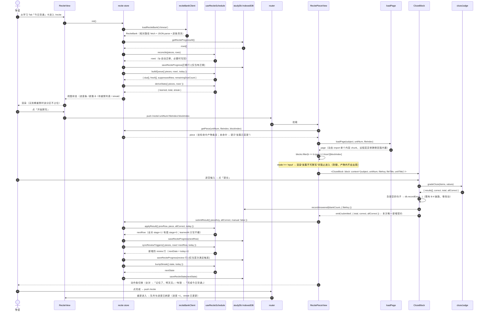
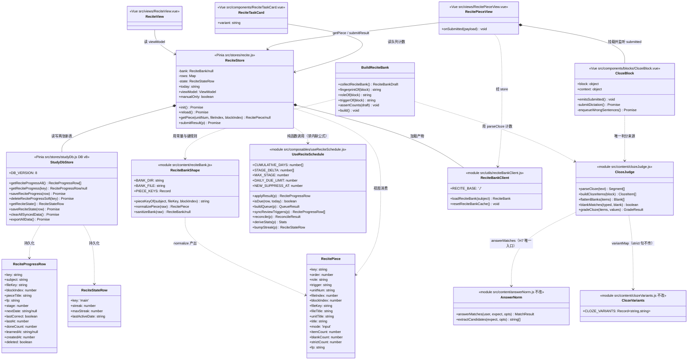

# 每日背诵（一期 · 语文默写）· 系统设计

| 项 | 内容 |
| --- | --- |
| 文档版本 | v1.0 |
| 作者 | Bob（软件架构师） |
| 上游输入 | `docs/prd-recitation.md` v1.0（产品经理 许清楚） |
| 目标仓库 | `danzhao-study-vue3`（Vue 3.5 + Pinia + IndexedDB + Tauri 2） |
| 状态 | 待任务实施；第 8 节 4 条需 team-lead / 用户拍板 |
| 交付边界 | **只读调研 + 本文档**。不改任何源码，不提交实现代码 |

本文所有数字、行号、文件名均为本机实测复核（复核命令见 §0）。

---

## 0. 复核基线（本文设计的全部事实依据）

| 事实 | 复核方式 / 位置 | 结果 |
| --- | --- | --- |
| 全库 `cloze` 区块 | 遍历 `src/content/**` 逐页 `import` | **74 块** = `mode:'input'` 73 + `mode` 缺省(reveal) 1 |
| 排除 reveal 1 篇后的有效篇目 | 同上，`(b.mode\|\|'reveal')!=='input'` → 排除 | **73 篇** |
| `role:'review'` | `title` 匹配 `/自测\|冲关/` 且 input | **6 篇**（5 × 综合自测 + 1 × 综合大冲关） |
| `role:'lesson'` | 73 − 6 | **67 篇** |
| 句数（`items.length`，PRD 的 120/1.79 口径） | 逐块累加 | 正课 120 / 复习 50 / reveal 5 = 175 |
| **真空位数**（`{{...}}` 占位符个数） | 逐句正则计数 | **193**（≠ 175，见 §1 异议 4） |
| `strict:true` 的句 | 全库扫描 | **仅 1 句**：`07-默写专项/01-先秦至魏晋名篇.js` · 《诗经》·关雎 · `求之不得，{{寤寐思服}}。悠哉悠哉，{{辗转反侧}}。` |
| `alts` 非空的句 | 全库扫描 | 4 句（闻王昌龄…、念奴娇…、通假字专项 ×2） |
| 文件 → 篇数分布 | 逐文件聚合 | `01`:15 正课 + 1 自测；`02`:13+1；`03`:11+1；`04`:15+1；`05`:10+1；`06`:3+大冲关 |
| `DB_NAME` / `DB_VERSION` | `src/stores/studyDb.js:34-35` | `study_game_db` / **7** |
| 同步实体清单 | `src/sync/engine.js:29-38` `ENTITIES`（7 项）；`src/stores/studyDb.js:328-336` `SYNC_STORE_NAMES` 同 7 项 | 两处必须同步维护 |
| 换账号清理 | `src/stores/auth.js:86-91` → `studyDb.clearAllSyncedData()`（只清 `SYNC_STORE_NAMES`） | **新表不会被清**（见 §1 异议 8） |
| CSP | `src-tauri/tauri.conf.json:23` | `script-src 'self'`；`connect-src 'self' ipc: http://ipc.localhost https://520305.top`；`style-src 'self' 'unsafe-inline'` |
| 构建目标 | `vite.config.js:39` `target:'es2019'` | `?.` / `??` **会被 esbuild 降级**（既有源码已在用：`studyDb.js:896` `extra?.selfTier`）→ 本仓可写 |
| `siteRoot()` 在 Tauri 下 | `src/utils/assetBase.js:13-25` | 返回**线上 origin**（`https://520305.top`），"首次打开且无缓存时离线不可用" |
| 非页面模块登记 | `scripts/lib/load-content.mjs:37-49` `NON_PAGE_FILES` + `tests/content-style.test.js:50` | 新增 `src/content/*.js` 模块**必须**登记，否则测试失败 |

---

## 1. 实现方案与关键取舍

### 1.1 架构判断（一句话）

> 这是「**构建期派生一份篇目索引** + **运行时一个纯函数调度器** + **复用既有作答组件**」三件套。不新增依赖、不新增区块类型、不新增存储引擎、不重写任何判分代码。

三层职责切得非常干净，实现者只要不越界就不会出事：

| 层 | 落点 | 职责 | 禁止 |
| --- | --- | --- | --- |
| 构建期 | `scripts/build-recite-bank.mjs` | 扫全库 `cloze` → 篇目坐标 + 计数 + `role` + 内容指纹 → `public/recite-bank/chinese.json` | 禁回写 `src/content/`；禁含题面正文（只存坐标） |
| 运行时纯函数 | `src/composables/useReciteSchedule.js` | 判分结果 → 新档位/下次日期；`bank + rows + today` → 队列；streak | 禁碰 IndexedDB / Vue / DOM（必须能直接单测） |
| 运行时编排 | `src/stores/recite.js` | 读产物 → 读/写 `recite_progress` → 调纯函数 → 出视图状态 | 禁内联调度公式（只准调纯函数） |
| UI | `ReciteView` / `RecitePieceView` / `ReciteTaskCard` | 渲染 + 跳转 | 禁第二套输入框、禁第二套判分 |

### 1.2 对产品经理判断的技术意见（有分歧就直说）

#### 认同（我复核后确认成立，不需要改）

1. **复用 `ClozeBlock` 而不是重写** —— 正确且省得比 PRD 描述的还多。这个组件已经带 16px 防缩放输入、44px 触控、`data-no-swipe`、sticky 动作条、逐句冻结、错句入错题本。重写一遍是净损失。
2. **调度独立一张表，不复用 `error_book` / SM-2** —— PRD 5.3 的三条理由我逐条验证为真。再补一条 PRD 没说的**硬证据**：`recordError` 的去重键是 `subject + question + fileKey`（`studyDb.js:895-898`），`question` 是**句级原句文本**。篇级调度若寄生在 `error_book` 上，一篇 8 空答错 3 句就是 3 行，篇级状态必须靠"取这 3 行的聚合"来推导 —— 聚合体没有稳定的写入者，"全对"这条信息在表结构上**根本无处安放**（写进哪一行？）。这不是成本问题，是表达力问题。
3. **一期就做完整 [1,2,4,7,15]，不做降级** —— 见 §1.3 的量化验证，结论成立。
4. **复习篇按"文件"触发而非"单元"触发** —— 实测支持：5 篇综合自测与 `01`~`05` 五个文件严格一一对应，单元概念在产物里根本没有落脚点（`site.js` 的 unit 是渲染层概念，篇目归属看 `fileKey`）。而且这个简化还多赚了一条：见 §1.4。

#### 异议 1（**必须改**）：只"挂 `ClozeBlock`" 拿不到判分结果

PRD P0-3 写"渲染层直接挂 `ClozeBlock`（传 `block` + `context`）"。但实测 `ClozeBlock.vue`：

- `parseCloze`（:90）、`blankMatches`（:176）、`submitDictation`（:246）、`results`（:152）、`correctCount`（:201）**全部是 `<script setup>` 内部私有，没有任何 `defineExpose`、没有任何 `emit`**。

也就是说：**把组件挂上去，父页面完全无法得知"全对还是错了几空"**。而 P0-4 的调度恰恰只由这一个布尔驱动。不改组件的话只剩两条路，都很差：

- 父页面自己再判一次 → 第二份判据 → **破 H7 红线**；
- 父页面用 `@vue/test-utils` 之外的 DOM hack 读 `.is-wrong` 类 → 脆弱到不可维护。

**裁定**：给 `ClozeBlock` 追加一个 `emits: ['submitted']`，在 `submitDictation()` 末尾 emit `{ total, correct, allCorrect }`。这是**读取既有判分结果**，不是新增判据、不是新增区块类型、不碰内容。单元页没有任何监听者 → 行为零变化（`tests/cloze-input.test.js` 会钉死这点）。

#### 异议 2（**必须改**）：`blankMatches` / `parseCloze` 不抽到共享层，"零改动复用"就是空话

PRD 5.1 写"判分复用，零改动"。但这两个函数是组件私有的，而背诵功能在组件**之外**至少有三处需要同样的逻辑：

| 需求 | 需要的函数 |
| --- | --- |
| 产物里的 `blankCount` / `strictCount`（P0-1） | `parseCloze` + 读 `strict` |
| 首页卡片显示「N 空」（PRD 4.2 线框图） | `parseCloze` |
| A3 的 parity 测试（逐空一致） | 两者都要 |

不抽 = 在这三处各写一份 ≈ 直接破 H7。**所以"抽取"不是可选优化，而是"零改动复用"这条红线的必要前置。**抽取本身也要保证 `ClozeBlock` 行为零回归 —— 具体做法见 §5 T01 的三条纪律。

#### 异议 3（**数字自相矛盾**）：P0-1 的"74 篇"与同条其余约束互斥

P0-1 同一条里写了三句：「产物含 **74 篇**」、「`role:'review'` **6 篇**」、「`role:'lesson'` **67 篇**」、「reveal 的填空自测**不在产物内**」。6 + 67 = 73 ≠ 74。实测口径 74 = 73(入产物) + 1(reveal 排除)。

**裁定：产物 = 73 篇**（lesson 67 + review 6）。P0-1 里的"74"判为笔误（那是"全库 cloze 块数"，不是"产物篇数"）。构建脚本把这条写成**断言**并打印：`total=74 → 排除 reveal=1 → 产物 73 (lesson 67 / review 6)`，任何一项不等就 `process.exit(1)`。

#### 异议 4（**口径陷阱，会造成 UI 错**）：`itemCount` ≠ 空位数

PRD 的"120 空 / 均值 1.79"用的是 `items.length`（**句数**）。实测真实 `{{}}` 占位符是 **193 个**，即平均每句 1.10 个空 —— **有句子含 2 个以上空**（例：`{{会当凌绝顶}}，{{一览众山小}}。` 是 1 句 2 空）。

若实现者拿 `itemCount` 渲染卡片上的「N 空」，学员会看到「关雎 · 1 空」实际要填 2 个格子。

**裁定**：产物**两个字段都给** —— `itemCount`（句数，对齐 PRD 验收口径）与 `blankCount`（真空位数，UI 显示唯一来源）。命名要让人不可能用错。

#### 异议 5（**会造成进度条倒退**）：`stage>=1` 不能当「已背」

A7 要求「已背 X / 67」与 `recite_progress` 实际行数一致，P0-8 要求"完成一篇后 X+1"。但 P0-4 又规定**答错 → `stage` 归 0**。于是：学员背到 23 篇，第 24 篇答错一次 → 已背变 22。**进度条会倒退**，这在背诵类产品里是劝退级体验。

这与本项目**已经修过一次的同类缺陷**一模一样 —— `useSpacedReview.js:12-19` 的纪律原文：「『已复习过』与『已掌握』是两种语义，别再合并」。这里同样有两种语义：

- 「**曾经背对过**」（累计成就，只增不减）→ 进度条 / 已背数
- 「**当前档位**」（会被打回）→ 调度

**裁定**：`recite_progress` 增加 `learnedAt`（首学完成日期，**一旦写入永不清零**）。`已背 X = count(learnedAt != null)`，`stage` 与进度条彻底解耦。这一条 PRD 没写，但不加就是带病上线。

#### 异议 6（**验收方式太弱**）：A3 的"随机抽 10 篇"证明不了"逐空一致"

抽取完成后两侧调用的是**同一个函数**，一致性是构造性成立的；真正会出事的窗口是**抽取动作本身写错了**（比如把 `blank.strict ? undefined : {variantMap}` 写成 `{variantMap}`）。抽 10 篇手工对比有 90% 概率漏掉全库**唯一**的那 1 个 strict 句。

**裁定**：A3 的主验收改为**自动 parity 测试**（74 块全量 × 固定输入集 × 逐空断言），手工抽检降为补充。测试必须显式覆盖 `关雎` 的「辗转反侧」：写「返」必须判错（strict 绕开 `CLOZE_VARIANTS` 的 `反→返`），同句之外写「返」判对。

#### 异议 7（**A9 与既有资产基址冲突，会直接违反离线要求**）

A9 要求"离线全程可用"。但 `assetBase.js:13-25` 明写：Tauri（绝对模式）下 `siteRoot()` 返回**线上 origin**，其后果是"Tauri 端搜索 / 题库 = 走远程 + IDB 缓存，**首次打开且无缓存时离线不可用**"。这是 practice bank 的既有取舍。

背诵首页是**首屏依赖**，照抄 `practiceBankClient` 的基址 = 断网首开直接白屏，A9 当场不成立。

**裁定**：`reciteBankClient` **只走相对路径**（`fetchJson('./', 'recite-bank/chinese.json')`），命中安装包内副本。
- Web / dev：`./` = 站点根 → 就是 `public/` 那份产物，同一批文件；
- Tauri：`./` = app 自身 origin → 包内副本，**零网络请求**；
- 不做 IndexedDB 缓存层（产物 20 KB 量级且随包发布，加 `content_cache` 缓存只增复杂度、零收益）。

⚠️ 验收 A9 **必须在 Tauri 断网环境测**（`npm run tauri:build` 后断网启动），不能在浏览器 dev 里测。若实测发现 Tauri 自定义协议不响应 JSON `fetch`，走 §8 的 Plan-B（产物改为构建期生成的 ESM 模块静态 import）。

#### 异议 8（**PRD 完全没提：换账号会串号**）

`clearAllSyncedData()`（`studyDb.js:356-361`）只遍历 `SYNC_STORE_NAMES`（7 个同步仓库）。一期若按 §8-Q2 决定**不同步**，`recite_progress` / `recite_state` 就**不在清理清单里** → 学员 A 登出、B 登录，B 会看到 A 的「已背 23 / 67 · 连续 7 天」。这是隐私问题，也是本项目已修过的"跨用户数据污染"（`studyDb.js:326` 的注释指向 `project-assessment-2026-10-17.md Top 1`）。

**裁定**：一期不同步（理由见 §8-Q2），但**必须**同步做两件事：
1. 新增 `DEVICE_LOCAL_STORES = ['recite_progress', 'recite_state']`，并在 `clearAllSyncedData()` 里一并 `dbClear`（保持方法名不变，避免动 `auth.js` 与既有测试）；
2. `exportAllData` / `importAllData` 纳入这两张表 —— 否则「导出备份 → 换机恢复」会丢掉全部背诵进度。这两处目前**没有任何调用方**（`grep` 全库 0 命中），风险极低。

### 1.3 PRD §6.2 的成本论证验证（这段会被摘进给内容侧的回函，必须站得住）

产品经理的论证是：「去掉四档自评 UI 之后，艾宾浩斯固定档与『只做答错重排』是同一量级，所以降级省不了成本」。我做真实实现量对比：

| 方案 | 表字段 | 纯函数实现量 | 新增 UI | 能否复用 `useSpacedReview.js` | 能满足 [1,2,4,7,15] |
| --- | --- | --- | --- | --- | --- |
| **A · 固定档**（PRD 主张） | 6 业务字段 | 档位推进 2 行 + 日期查表 1 行 + 队列/触发/streak ≈ 35 行 | **0** | 只复用日期工具 | ✅ 原生 |
| **B · SM-2** | 9 业务字段（多 `repetitions` / `easeFactor` / `interval`） | 算法现成，但要**改它**才符合间隔序列 | 0（若坚持机器判分） | 算法层看起来能复用，**实测不能** | ❌ 间隔是 1/6/15.6/39… |
| **C · 只做答错重排** | 5 业务字段 | A 减去「`stage` 字段 + `DELTA` 查表 + `min(stage+1,5)`」≈ 29 行 | 0 | 只复用日期工具 | ❌ 无曲线 |

**关于 B 为什么"看似能复用、实际不能"（这是硬证据，不是判断）**：

1. `calculateSM2(error, grade)` 确实是已导出的纯函数（`useSpacedReview.js:74`），签名上能直接调。但它的间隔序列是 `1 → 6 → round(interval × easeFactor)`，即 **1/6/15/39/98…**，与内容侧指定的累计 **[1,2,4,7,15]** 不是同一条曲线。要让它输出 [1,2,4,7,15]，只能改 `calculateSM2` —— 而它同时服务着 `error_book` 的既有验收（`tests/review-*`、`tests/error-book-dedup.test.js`），改它是**动共享纯函数**，回归面远大于收益。
2. 只在机器判分下，`grade` 只有两个取值：`GOOD(4)` 与 `AGAIN(0)`。代入 `easeFactor += 0.1 − (5−grade)×(0.08 + (5−grade)×0.02)`：
   - `GOOD(4)`：增量 = `0.1 − 1×(0.08+0.02)` = **0** → `easeFactor` 永不上升；
   - `AGAIN(0)`：增量 = `0.1 − 5×(0.08+0.1)` = **−0.8** → 每次答错直接把 `easeFactor` 打到下限 1.3。
   也就是说 **`easeFactor` 在这套用法里是一个只会往下走的死字段**，对调度零贡献，纯占 1 个字段 + 1 段无人会读的逻辑。**SM-2 的价值恰恰来自四档自评提供的信息量；没有自评，SM-2 退化成比固定档更差的东西。**

**结论：PRD §6.2 的论证成立，我确认。** 并且可以给回函一个更强的表述：

> 固定档比"答错重排"只多 **1 个整数字段 + 2 行逻辑**（`nextDate = today + DELTA[stage]`、`stage = min(stage+1, 5)`），比复用 SM-2 **更省**（SM-2 多 3 个字段、且间隔曲线与内容侧指定的不一致、且改它会波及错题本既有验收）。降级确实省不了成本，却会把功能意义抹掉。

**能复用的部分（诚实清单）**：

| 复用项 | 结论 |
| --- | --- |
| `getDateStr()` 日期工具 | ✅ 复用，需把 `useSpacedReview.js:57` 的 `function getDateStr` 加上 `export`（纯导出，零语义变化）。理由：本仓已有两份日期工具（`studyDb.js:292` 同款），拒绝第三份 |
| `isDue()` due 判据 | ❌ 不复用代码（它绑死 `nextReviewDate` / `isMastered` 字段），但**复用其语义**：缺排期一律视为到期（漏卡代价 > 多默一次） |
| `pickDue()` 排序 | ❌ 不复用（`error_book` 排序键是 `createdAt`，背诵要按 `order`） |
| `calculateSM2()` | ❌ 见上，语义冲突 |
| `GRADES` / `GRADE_META` / `GradeButtons` | ❌ 背诵**没有自评**，一个按钮都不需要 |
| `recordError()` 错句入本 | ✅ 完全复用，**一行不改**（`ClozeBlock` 自带） |

### 1.4 一个顺手赚到的简化（建议保留）

PRD §6.3 把触发条件拆成两条：「文件内正课全完成 → 推该文件综合自测」+「67 篇全完成 → 推综合大冲关」。

实测发现：**`06-高频易错字与冲刺` 是最后一个含正课的文件**，所以"文件 06 的正课全完成"与"67 篇全完成"在时间上是**同一个瞬间**。用一个规则就能同时兑现两条，且零硬编码：

> **复习篇在「其所属 `fileKey` 的全部 `lesson` 篇 `stage ≥ 1`」的次日进入队列。**

但为了让语义**不依赖当前文件排序**（万一内容侧将来在 06 之后加第 7 个文件，大冲关会提前解锁），产物里显式烘焙 `trigger: 'file' | 'all'` 字段（构建期按 `title` 含「冲关」判定 `all`，其余 review 判 `file`）。运行时**只读字段**，不在运行时按 title 猜。

---

## 2. 文件清单

### 2.1 新增（13 个）

| 文件 | 职责（一句话） |
| --- | --- |
| `src/content/clozeJudge.js` | 从 `ClozeBlock` 抽出的共享判分/解析层（`parseCloze` / `buildClozeItems` / `flattenBlanks` / `blankMatches` / `gradeCloze`），零 UI、零浏览器 API |
| `src/content/reciteBank.js` | 篇目产物形状定义（紧凑键 ↔ 运行时字段、`normalizePiece`、路径与常量），纯 ESM 零 import，构建脚本与浏览器两端共用 |
| `scripts/build-recite-bank.mjs` | 扫描全库 `cloze` → 篇目索引产物；含断言与超限必报告 |
| `public/recite-bank/chinese.json` | **构建产物**（入库，与 `public/practice-bank/*.json` 同款纪律） |
| `src/utils/reciteBankClient.js` | 运行时加载产物（**相对路径** `fetch` + JSON.parse + 逐条清洗），离线优先 |
| `src/composables/useReciteSchedule.js` | 调度纯函数库：`INTERVALS` / `applyResult` / `isDue` / `buildQueue` / `deriveStats` / `syncReviewTriggers` / `bumpStreak` |
| `src/stores/recite.js` | Pinia 编排层：产物 × DB 行 → 视图状态（队列 / 进度 / streak），唯一写库入口 |
| `src/views/ReciteView.vue` | 背诵首页（进度条 / 今日新篇 / 今日待重默 / 连续天数 / 常驻大冲关） |
| `src/views/RecitePieceView.vue` | 单篇作答页（挂 `ClozeBlock`，接收 `submitted` → 写调度 → 返回） |
| `src/components/ReciteTaskCard.vue` | 任务卡组件，供学习 Tab（主入口）与复习 Tab（次级入口）两种 `variant` 复用 |
| `tests/cloze-judge.test.js` | 共享判分层单测（通假 / strict / alts / 全半角 / 空白） |
| `tests/recite-bank.test.js` | 构建脚本纯函数单测（形状、`role`/`trigger`、`order` 单调、断言） |
| `tests/recite-schedule.test.js` | 调度纯函数单测（覆盖 A4 / A5 / A6 / A7 全部构造） |
| `tests/recite-db-v8.test.js` | DB v7→v8 迁移、换账号清理、导出/导入 |
| `tests/recite-cloze-parity.test.js` | **A3 主验收**：74 块全量逐空 parity（含唯一 strict 句） |
| `tests/recite-entry.test.js` | 两入口计数一致、无数据不占位、4 Tab 不变 |

### 2.2 修改（8 个）

| 文件 | 改动 |
| --- | --- |
| `src/components/blocks/ClozeBlock.vue` | ① 删除私有 `parseCloze` / `blankMatches`，改为 `import` 共享层；② 追加 `emits: ['submitted']` 并在 `submitDictation()` 末尾 emit。**其余逻辑一行不动** |
| `scripts/lib/load-content.mjs` | `NON_PAGE_FILES` 增加 `'clozeJudge.js'`、`'reciteBank.js'`（否则 `tests/content-style.test.js:50` 失败） |
| `src/stores/studyDb.js` | `DB_VERSION` 7→**8**；`onupgradeneeded` 建 `recite_progress` / `recite_state`；新增访问器；`DEVICE_LOCAL_STORES` 纳入 `clearAllSyncedData`；`exportAllData` / `importAllData` 纳入两张表 |
| `src/composables/useSpacedReview.js` | **仅** 给 `getDateStr` 加 `export`（2 个字符，零语义变化） |
| `src/router/index.js` | 新增 2 条路由：`/recite`、`/recite/:unitNum/:fileIndex/:blockIndex`（**均不带 `meta.tab`** → 隐藏底部 pill，4 Tab 数量不变） |
| `src/views/HomeView.vue` | 在 `today-task` 与 `continue-card` 之间插入 `<ReciteTaskCard variant="home" />` |
| `src/views/ReviewView.vue` | 顶部工具区插入 `<ReciteTaskCard variant="review" />`（N=0 时不渲染） |
| `package.json` | 新增 `"build:recite": "node scripts/build-recite-bank.mjs"`，并串入 `build:index` 与 `prebuild` |

> `src/sync/engine.js` **明确不改**（一期不同步，见 §8-Q2）。

---

## 3. 数据结构

### 3.1 `recite_progress`（新增对象仓库，DB v8）

```js
/**
 * 一篇默写素材的调度与进度。
 * keyPath: 'key'（业务键，非自增）
 * 索引：fileKey（P0-7 文件级触发要按文件分组）、nextDate（出到期队列）
 */
{
  key: 'chinese|chinese_07_01-先秦至魏晋名篇|0', // 主键，见 §3.2
  subject: 'chinese',
  fileKey: 'chinese_07_01-先秦至魏晋名篇',        // 与 page_progress / error_book 同一 fileKey 规则
  blockIndex: 0,                                  // 页内 cloze 流水号
  pieceTitle: '《诗经》 · 关雎',                   // 冗余，只为排障/日志可读（不参与调度）

  fp: 'k3f9a2',          // 内容指纹（§3.2），仅用于诊断与自动迁移，**不是主键的一部分**

  // ── 调度（会被答错打回）──
  stage: 0,              // 0..5：已连续全对的档位数。0 = 未通过首学 / 被打回
  nextDate: '2026-10-27',// YYYY-MM-DD（本地时区）；null = 已毕业（stage=5），永不进队列
  lastCorrect: false,    // 最近一次是否全对
  lastAt: 1759000000000, // 最近一次作答时间戳（ms）
  doneCount: 3,          // 累计作答次数（含答错）

  // ── 成就（只增不减，**永不打回**）──
  learnedAt: '2026-10-24', // 首次全对完成的日期；null = 从未背对过。→ 「已背 X / 67」唯一来源

  createdAt: 1759000000000,
  deleted: false         // 软删墓碑（一期无 UI 删除；为 P1-3「重开一轮」预留，形状与既有仓库一致）
}
```

**字段增量说明（PRD P0-4 只列了 5 个，我多给 6 个，逐条给理由）**：

| 字段 | PRD 有？ | 为什么必须有 |
| --- | --- | --- |
| `key` | 有（"篇键 = subject + fileKey + blockIndex"） | 主键 |
| `stage` / `nextDate` / `lastCorrect` / `lastAt` / `doneCount` | 有 | 调度 |
| `fp` | ✗ | 内容侧微调一个字时不丢进度（§3.2） |
| `learnedAt` | ✗ | **不加则进度条会倒退**（§1 异议 5） |
| `pieceTitle` | ✗ | 排障可读性；`console.warn` 与未来"错题本联查"要用 |
| `createdAt` | ✗ | 与 `error_book` 同款，便于排序与同步演进 |
| `deleted` | ✗ | 与既有仓库形状一致，P1-3「重开一轮」可软删而非清库 |

### 3.2 主键设计与「内容指纹」兜底方案

#### 问题

`cloze` 区块**没有 `id`、没有 `key` 字段**（实测 `schema/content-schema.json` 与全部 74 块数据，均无此字段），内容侧红线又禁止添加字段。所以篇级主键只能由**坐标**派生。

#### 主键

```
pieceKey = `${subject}|${fileKey}|${blockIndex}`
```
- `fileKey = pageFileKeyOf(meta)`（`src/content/pageMeta.js:63`），形如 `chinese_07_01-先秦至魏晋名篇`；
- `blockIndex` = **页内 `cloze` 区块流水号**（不是 `page.blocks` 下标）。理由：运行时定位靠 `page.blocks.filter(b => b.type === 'cloze')[blockIndex]`，用 cloze 流水号可以直接对上；用 raw 下标则要在运行时重算一遍过滤后映射，多一处可漂移的转换。

#### 两种内容变更的后果（这是本节的核心取舍）

| 内容侧动作 | 主键变？ | 后果 |
| --- | --- | --- |
| 修一个错别字（`text` 内改字） | **不变** | ✅ 进度完整保留（`fp` 变化只更新 `fp`，不动 `stage`/`learnedAt`） |
| 改 `title`（如加书名号） | **不变** | ✅ 保留（title 不进主键） |
| 在某文件**中间插入**一篇 cloze | **变**（后续全部后移一位） | ❌ 后面的篇进度会错位 |
| 重命名内容文件 | **变**（`fileKey` 变） | ❌ 该文件全部篇进度"消失" |
| 删除某篇 | 后续后移 | ❌ 同上 |

也就是说：**最常见的变更（改错别字）绝对安全，危险的只有"结构性变更"**。这正好回答了 team-lead 的问题「内容侧微调一个字会不会让学员进度全丢」——**不会**，因为主键不含文本。

#### 指纹的用途：不是校验，是**自动迁移**

```js
// 纯函数，无依赖；FNV-1a 32 位，base36 输出 6-7 字符。不用 crypto.subtle（异步 + 需 secure context）
export function fingerprintOf(block) {
  const src = String(block.title || '') + '\u0001' +
    (block.items || []).map(it => String(it.text || '') + '\u0002' +
      (Array.isArray(it.alts) ? it.alts.join('\u0003') : '')).join('\u0001')
  let h = 0x811c9dc5
  for (let i = 0; i < src.length; i++) {
    h ^= src.charCodeAt(i)
    h = Math.imul(h, 0x01000193) >>> 0   // Math.imul 是 ES2015，es2019 目标安全
  }
  return h.toString(36)
}
```
取哪些字段：`title` + 每句 `text` + 每句 `alts`。**不取** `mode`（改名不影响内容同一性）、**不取** `strict`（红线标记翻转不是内容变更）。

运行时在**加载产物后**执行一次协调（`reconcile`，纯函数）：

```
对产物中每一篇 p：
  row = rows[p.key]
  if (!row) continue
  if (row.fp === p.fp) continue                    // 正常
  // 情况 ①：同一篇内容被微调（title/text 改了字）→ 只更新指纹，绝不碰调度
  若无任何 current piece 的 fp 等于 row.fp
     → 更新 row.fp = p.fp（保留 stage/nextDate/learnedAt）
  // 情况 ②：内容搬家（行插入/文件改名）→ 按 fp 认领
  若存在另一篇 q（q.key !== p.key）且 q.fp === row.fp 且 rows[q.key] 为空
     → 把 row 迁到 q.key（整体搬 stage/nextDate/learnedAt/doneCount），旧行软删
  // 情况 ③：两边都对不上 → 保留原行不动，console.warn 点名（不删数据）
```

**取舍（明确不做的）**：**一期不做手工别名映射表**。

- 理由：`fp` 自动迁移已经覆盖"插入一篇/删除一篇/文件改名"这三种结构性变更；剩下唯一迁移不了的是"**内容同时被改又被搬家**"（罕见），最坏后果 = 该篇重新默一次（30 秒）。
- 代价对比：引入 `scripts/recite-bank-aliases.json` + 人工维护流程 + 一份额外文档约定，为的是省一次 30 秒的重默。不划算。
- **触发条件**（写进 §8）：若内容侧将来要对 `07-默写专项` 做**整体重排**（一次动多篇顺序），必须先告知，我们在重排前补别名表 —— 那种场景下"多数篇同时位移"会让情况 ② 出现竞争（两个旧行争抢同一个新 key），`fp` 迁移会退化为"先到先得"，值得一次人工兜底。

### 3.3 `recite_state`（新增对象仓库，与 `recite_progress` 同一次升版建出）

单行状态表。为什么不用 localStorage：本项目 v4 已把"进度类数据"从 localStorage 收敛进 IndexedDB（`studyDb.js:102-106`），再开一条 localStorage 双轨就是逆着纪律走。

```js
{
  key: 'main',                  // keyPath 'key'，全表只有这一行
  streak: 7,                    // 连续天数
  maxStreak: 12,                // 历史最长（P1-3 里程碑用，零成本先记）
  lastActiveDate: '2026-10-26'  // 最近一次完成背诵的日期 YYYY-MM-DD
}
```

为什么 streak 不能从 `study_log` / `daily_stats` 派生：
- `daily_stats` 有行的日子 = "任何学习活动"，不是"完成背诵"，语义错；
- `study_log` 要 `getAllStudyLogs()` 全量读再过滤，首页热路径上不划算，且日志会被清理策略影响。

### 3.4 `public/recite-bank/chinese.json` 产物形状

```ts
/** 产物根 */
interface ReciteBank {
  schemaVersion: 1                     // 形状版本；运行时不匹配 → 视为产物不可用
  generatedAt: string                  // ISO 8601
  subject: 'chinese'
  counts: { all: 73; lesson: 67; review: 6 }   // 构建期断言值，运行时用于自检
  pieces: RecitePiece[]                // 按 order 升序
}

interface RecitePiece {
  /** 主键 `${subject}|${fileKey}|${blockIndex}` */
  key: string
  /** 全局顺序：文件顺序 × 块顺序（先秦→唐诗上→唐诗下→宋词元曲→古文→高频易错） */
  order: number
  /** 'lesson' = 每日新篇池；'review' = 条件触发池 */
  role: 'lesson' | 'review'
  /** 仅 role==='review' 有：'file' = 本文件正课全首学后触发；'all' = 整轮（构建期按 title 含「冲关」烘焙） */
  trigger?: 'file' | 'all'

  // ── 运行时定位坐标（缺一不可：RecitePieceView 要用它 loadPage + 取块）──
  unitNum: string      // '07'
  fileIndex: number    // 1
  blockIndex: number   // 页内 cloze 流水号
  fileKey: string      // 'chinese_07_02-唐诗名篇（上）'
  fileTitle: string    // '默写专项 · 唐诗名篇（上）'
  unitTitle: string    // '默写专项'

  // ── 展示与校验 ──
  title: string        // '李白 · 行路难（其一）'
  mode: 'input'        // 产物内恒为 'input'（reveal 篇构建期即排除）
  itemCount: number    // 句数（对齐 PRD 的 120 / 1.79 口径）
  blankCount: number   // 真空位数（`{{}}` 个数）—— UI「N 空」唯一来源
  strictCount: number  // strict:true 的句数（A3 需要能筛出含红线句的篇）
  fp: string           // 内容指纹（§3.2）
}
```

**真实条目示例**（前两篇，按实测数据）：

```json
{
  "schemaVersion": 1,
  "generatedAt": "2026-10-26T08:00:00.000Z",
  "subject": "chinese",
  "counts": { "all": 73, "lesson": 67, "review": 6 },
  "pieces": [
    {
      "key": "chinese|chinese_07_01-先秦至魏晋名篇|0",
      "order": 0,
      "role": "lesson",
      "unitNum": "07", "fileIndex": 0, "blockIndex": 0,
      "fileKey": "chinese_07_01-先秦至魏晋名篇",
      "fileTitle": "默写专项 · 先秦至魏晋名篇", "unitTitle": "默写专项",
      "title": "《诗经》 · 关雎",
      "mode": "input",
      "itemCount": 2, "blankCount": 2, "strictCount": 1,
      "fp": "1x9f3ab"
    },
    {
      "key": "chinese|chinese_07_01-先秦至魏晋名篇|15",
      "order": 15,
      "role": "review",
      "trigger": "file",
      "unitNum": "07", "fileIndex": 0, "blockIndex": 15,
      "fileKey": "chinese_07_01-先秦至魏晋名篇",
      "fileTitle": "默写专项 · 先秦至魏晋名篇", "unitTitle": "默写专项",
      "title": "综合自测（遮住上文，逐句默写）",
      "mode": "input",
      "itemCount": 6, "blankCount": 6, "strictCount": 0,
      "fp": "0k2m7dz"
    }
  ]
}
```

> ⚠️ 5 篇综合自测的 `title` **完全相同**（`'综合自测（遮住上文，逐句默写）'`）。所以 UI 上"复习篇"必须显示 `fileTitle` 而非 `title`，否则列表里 5 行长得一模一样。取源：`RecitePiece.fileTitle`（如「默写专项 · 唐诗名篇（上）」）。这是实现者极易踩的坑。

### 3.5 调度常量（唯一真相源，`useReciteSchedule.js` 导出）

```js
/** 累计档位：第 1/2/4/7/15 天（内容侧指定，不可在此处"优化"） */
export const CUMULATIVE_DAYS = [1, 2, 4, 7, 15]
/** 相邻档位增量 = diff([0, ...CUMULATIVE]) → [1,1,2,3,8]。由 CUMULATIVE_DAYS 派生，禁手写 */
export const STAGE_DELTA = [1, 1, 2, 3, 8]
export const MAX_STAGE = 5          // stage 达 5 → nextDate = null，永不进队列
export const DAILY_DUE_LIMIT = 5    // P0-5：单日重默上限
export const NEW_SUPPRESS_AT = 3    // P0-5：到期 ≥3 篇则不推新篇
export const DAILY_NEW_LIMIT = 1    // 每日新篇数（P2-2 明确不做可配置，但留常量便于 P1 用）
```

`STAGE_DELTA` 必须由 `CUMULATIVE_DAYS` **派生**（`[0,...C].slice(1).map((v,i)=>v-C[i])`），不许手写两份 —— 这是本项目 H7 的一贯要求（对照 `practiceBank.js` 里"三方必须看同一份定义"）。

---

## 4. 调用流程

### 4.1 主链路时序图（打开背诵页 → 取队列 → 作答 → 判分 → 写调度 → 回首页）



### 4.2 类图



### 4.3 关键不变量（实现者必须守住，测试要钉死）

| # | 不变量 | 后果 |
| --- | --- | --- |
| I1 | `stage` 只由 `applyResult` 改，且只能 `+1`（上限 5）或归 `0` | 出现第二种改法 = 调度不可解释 |
| I2 | `learnedAt` **只写不撤**（`null → 日期` 单向；已非 null 则永不覆盖） | 否则进度条倒退 |
| I3 | `nextDate` 是 `YYYY-MM-DD` 本地字符串，绝不用时间戳比较 | 时区/夏令时错位 |
| I4 | 队列构造只读 `bank + rows + today`，不读 `new Date()` 以外的时间源；`today` 必须可从参数注入 | 否则 A5/A6 无法构造验收 |
| I5 | 判分只在 `clozeJudge.gradeCloze` 一处，`RecitePieceView` 内**零**判分代码 | H7 |
| I6 | `manual` 模式（大冲关手动入口）**不写任何 `recite_progress` 行** | P0-9 |
| I7 | `src/content/**` 下**内容页数据文件**零改动（新增两个模块不算，见 §7.1） | 内容侧红线 |

---

## 5. 有序任务列表

> 5 个任务，每个 ≥3 个文件。T01 是唯一的地基，T02 与 T03 可并行（见 §5.6 的并行窗口说明）。

### T01 · 判分与形状契约层（P0，无依赖）

**为什么必须第一**：`ClozeBlock` 的私有函数抽不出来，后面所有涉及判分/空位的工作都只能在背诵页写第二份判据 —— 直接破 H7。这一步错了会把**单元页一起弄挂**，所以它是风险最高的一步，必须单独成任务、单独验收。

**产出文件**
| 文件 | 动作 |
| --- | --- |
| `src/content/clozeJudge.js` | 新增 |
| `src/content/reciteBank.js` | 新增 |
| `scripts/lib/load-content.mjs` | 改（`NON_PAGE_FILES` 登记上面两个） |
| `src/components/blocks/ClozeBlock.vue` | 改（改 import + 加 `emits`） |
| `tests/cloze-judge.test.js` | 新增 |

**抽取的三条零回归纪律（写进代码注释）**

1. **逐字搬运，不"顺手优化"**。`parseCloze`（:90-102）与 `blankMatches`（:176-182）的字符（含正则 `/\{\{([\s\S]*?)\}\}/g`、`blank.strict ? undefined : { variantMap: CLOZE_VARIANTS }`）原样搬，连注释一起搬。`blankMatches` 头部的 D-0 长注释（解释为什么 strict 句不传 variantMap、为什么不能删 `反→返` 键）必须跟着走 —— 那是防未来有人"优化"掉的唯一护栏。
2. **`ClozeBlock` 只改两处**：把 `function parseCloze` / `function blankMatches` 的**函数体删除**，改为 `import { parseCloze, buildClozeItems, flattenBlanks, blankMatches } from '@/content/clozeJudge'`；把 `items` / `blanks` 两个 `computed` 改为调用 `buildClozeItems(props.block)` / `flattenBlanks(items.value)`（**仍包在 `computed` 里**，保持响应性）。**`enqueueWrongSentences`、`submitDictation`、`retryAll`、`retryWrongSentences`、焦点管理、全部 `ref`/`watch`、模板与样式一行不动。**
3. **新增 `emits: ['submitted']`**，在 `submitDictation()` 里 `await enqueueWrongSentences()` **之后** emit `{ total: blanks.length, correct: correctCount, allCorrect: correctCount === blanks.length && blanks.length > 0 }`。
   - 顺序很关键：先落库（错题本）再通知父级。若父级写调度失败，错题本已经记上了 —— 与"宁可多记一条，不可漏记"的既有取向一致。
   - 空篇（`blanks.length === 0`）不得 emit `allCorrect: true`，否则空篇会被判"全对"推进档位。

**验收方式**
- `npx vitest run tests/cloze-input.test.js tests/cloze-strict.test.js tests/cloze-variants.test.js tests/cloze-enqueue.test.js` **全绿且零用例改动**（这是"单元页行为零回归"的硬证据；不许为了让它们过而改测试）。
- 新增 `tests/cloze-judge.test.js` 覆盖：`parseCloze` 未闭合 `{{` 原样保留为文本；14 组通假（`说→悦`/`反→返`/`惠→慧`…）在非 strict 句判对、在 strict 句判错；`alts` 与主答案并集判对；全角→半角折叠；空输入判错；`gradeCloze` 返回的 `results` 长度与 `flattenBlanks` 一致。
- `npx vitest run tests/content-style.test.js` 通过（证明两个新模块已登记 `NON_PAGE_FILES`）。
- `npm run lint` 零 warning（注意 `--max-warnings 0`）。
- `git diff --stat -- 'src/content/**' ':!src/content/clozeJudge.js' ':!src/content/reciteBank.js'` **无输出**（既有内容页文件零修改）；`git status --porcelain -- 'src/content/**'` 只出现两个白名单**新增**文件、无任何 ` M ` 行（判据见 §7.1，**任何既有内容页文件出现在修改行里即返工**）。

### T02 · 构建期产物（P0，依赖 T01）

**产出文件**
| 文件 | 动作 |
| --- | --- |
| `scripts/build-recite-bank.mjs` | 新增 |
| `public/recite-bank/chinese.json` | 新增（构建生成，入库） |
| `package.json` | 改（`build:recite` + 串入 `build:index` / `prebuild`） |
| `tests/recite-bank.test.js` | 新增 |

**实现要点**
- 遍历与元信息**一律**来自 `scripts/lib/load-content.mjs`（`collectFiles` / `buildMetaIndex` / `importFresh` / `relPathOf`），`fileKey` 来自 `pageFileKeyOf` —— 照 `build-practice-bank.mjs:21-32` 的 import 写法。
- 递归扫（`walkBlocks` 口径）**发现**所有 cloze，但**只接受顶层**（`page.blocks` 直接子项）；发现嵌套 cloze 就 `console.warn` 点名并跳过（运行时按顶层 cloze 流水号定位，嵌套的定位不到，宁可不收也不能收进来渲染失败）。
- 排除 `(block.mode || 'reveal') !== 'input'`。
- **断言（不满足即 `process.exit(1)`）**：`total(74) - excludedReveal(1) === pieces.length(73)`、`lesson === 67`、`review === 6`、`order` 为 `0..n-1` 连续、`key` 无重复、每篇 `blankCount > 0`。
- 超限必报告（对齐 `build-practice-bank.mjs:344-361` 纪律）：断言失败、嵌套 cloze、未注册文件，三者都必须点名打印。
- 导出 `collectReciteBank()` 纯函数（不落盘），供测试直接断言形状 —— 与 `build-practice-bank.mjs` 的 `if (process.argv[1] && import.meta.url === pathToFileURL(process.argv[1]).href)` 守卫同款。
- **`trigger` 烘焙**：`role==='review'` 时，`title` 含「冲关」→ `'all'`，否则 `'file'`（只有这一处按 title 判定，且判定结果落进产物，运行时不猜）。

**验收方式**
- `node scripts/build-recite-bank.mjs` 打印类似 `[recite-bank] 73 篇（lesson 67 / review 6），排除 reveal 1，totalBlank 193，strict 1`。
- 故意把断言阈值改错 → 脚本必须 `exit 1`（手工验证一次）。
- `npx vitest run tests/recite-bank.test.js`：形状齐全、`mode` 恒为 `input`、6 篇 review 的 `trigger` 正确（5 个 `file` + 1 个 `all`）、`order` 单调、`关雎` 的 `strictCount === 1`。
- 产物入库后 `git status` 干净（重复跑脚本产出字节级一致：`generatedAt` 会让它变，故 `generatedAt` 用**文件内容哈希以外的固定策略**：保留时间戳但在测试里剔除该字段比较 —— 与 practice-bank 同款处理）。

### T03 · 数据层 + 调度纯函数 + 资产加载（P0，依赖 T01；**可与 T02 并行**）

**产出文件**
| 文件 | 动作 |
| --- | --- |
| `src/composables/useReciteSchedule.js` | 新增 |
| `src/stores/studyDb.js` | 改（v8 + 两表 + 访问器 + 换账号清理 + 导出导入） |
| `src/utils/reciteBankClient.js` | 新增 |
| `src/composables/useSpacedReview.js` | 改（`getDateStr` 加 `export`） |
| `tests/recite-schedule.test.js` | 新增 |
| `tests/recite-db-v8.test.js` | 新增 |

**DB v8 迁移（必须升版，不能只建表）**
```js
const DB_VERSION = 8   // 7 → 8
// onupgradeneeded 内追加：
if (oldVersion < 8) {
  if (!d.objectStoreNames.contains('recite_progress')) {
    const s = d.createObjectStore('recite_progress', { keyPath: 'key' })  // 业务键，无自增
    s.createIndex('fileKey', 'fileKey', { unique: false })
    s.createIndex('nextDate', 'nextDate', { unique: false })
  }
  if (!d.objectStoreNames.contains('recite_state')) {
    d.createObjectStore('recite_state', { keyPath: 'key' })
  }
}
```
- 文件头版本历史补一行 `v8：新增 recite_progress / recite_state（每日背诵，P0-4）`。
- `DEVICE_LOCAL_STORES = ['recite_progress', 'recite_state']`，在 `clearAllSyncedData()` 里**追加**一个循环清除（方法名、签名、`SYNC_STORE_NAMES` 全部不动 → `tests/sync-engine.test.js:42` 不受影响）。JSDoc 必须写清"这两张表不同步，但**必须**随换账号清空，否则 B 会看到 A 的进度"。
- `exportAllData` 返回对象加 `recite_progress` / `recite_state`；`importAllData` 的 `stores` 数组加同两项（`recite_state` 是数组形式 `[row]`，注意与 `localStorage` 字段区分）。
- 新增访问器：`getReciteProgressAll` / `getReciteProgress(key)` / `saveReciteProgress(row)`（走 `dbPut`，自动盖 `updatedAt`）/ `deleteReciteProgressSoft(key)`（写 `deleted:true` 墓碑）/ `getReciteState()`（缺行返回 `{key:'main', streak:0, maxStreak:0, lastActiveDate:''}`）/ `saveReciteState(row)`。

**调度纯函数（`useReciteSchedule.js`）签名**
```js
export function applyResult({ prevRow, piece, allCorrect, today })   // → ReciteProgressRow
export function isDue(row, today)                                    // → boolean
export function buildQueue({ pieces, rows, today, opts })            // → { due, fresh, suppressedNew, remainingDueCount }
export function syncReviewTriggers({ pieces, rows, today })          // → ReciteProgressRow[]（待新增的行）
export function reconcile({ pieces, rows })                          // → { rows, migrated, orphaned }
export function deriveStats({ pieces, rows, state })                 // → { learned, totalLesson, dueCount, streak }
export function bumpStreak({ state, today, hasTaskToday })           // → ReciteStateRow
```
全部零 `import`（除 `getDateStr` 与 `STAGE_DELTA` 自身常量）→ 裸 Node 可直接单测。

**`reciteBankClient.js` 要点**
- `import { fetchJson } from '@/utils/fetchJson'`，base 写死 `'./'`（**不用 `siteRoot()`**，理由见 §1 异议 7）。
- 进程内 `Map` 缓存（一次会话只拉一次），导出 `resetReciteBankCache()` 供测试。
- 形态校验走 `reciteBank.normalizePiece` / `sanitizeBank`；产物形状不可用 → **抛错**（背诵不像练习有"少一题也能做"的退化空间），由 store 转成"素材加载失败，请重试"态。
- 禁 `import()` 动态导入（`tests/csp-guard.test.js` L6 会扫）；禁写死主机名（L4 会扫）。

**验收方式**
- `npx vitest run tests/recite-schedule.test.js` 必须覆盖 PRD 全部构造：
  - **A4**：stage 0→1→2→3→4→5 的 `nextDate` 依次 `+1/+1/+2/+3/+8`；stage=5 时 `nextDate === null`；
  - **A4'**：任意档位答错 → `stage===0 && nextDate===today+1`，但 `learnedAt` 不被清（若已有）；
  - **A5**：构造 4 篇到期 → `fresh.length === 0` 且 `suppressedNew === true`；构造 8 篇到期 → `due.length === 5` 且 `remainingDueCount === 3`；
  - **A6**：构造"3 天前该给第 5 篇"（即 4 篇有行、第 5 篇无行）→ 今日仍只给 1 篇新篇且 `order` 不跳；
  - **A7**：`deriveStats().learned` 等于 `learnedAt != null` 的 lesson 篇数，且答错归零后**不减少**；
  - **P0-7**：文件 01 的 15 篇 lesson 全 `stage>=1` → `syncReviewTriggers` 恰好返回 1 行（该文件综合自测，`nextDate===today+1`）；重复调用返回空（幂等）；
  - **reconcile**：`fp` 一致不动；`text` 改一个字（`fp` 变、`key` 不变）→ 只更新 `fp`，`stage`/`learnedAt` 原样；`blockIndex` 整体后移一位 → 按 `fp` 成功认领。
- `npx vitest run tests/recite-db-v8.test.js`（`import 'fake-indexeddb/auto'`，参照 `tests/error-book-dedup.test.js:11-28` 写法）：
  - 从 v7 现状库升级 → 两表存在、7 个旧仓库数据一条不丢；
  - 连续两次 `init()` 幂等；
  - `clearAllSyncedData()` 后 `getReciteProgressAll()` 为 `[]`、`getReciteState().streak === 0`；
  - `exportAllData()` 含两个新键且 `importAllData(导出结果)` 能完整还原。
- `npx vitest run tests/sync-engine.test.js tests/review-due.test.js tests/review-consistency.test.js` 全绿（证明没碰坏既有复习链路）。

### T04 · 状态编排 + 两个页面（P0，依赖 T03）

**产出文件**
| 文件 | 动作 |
| --- | --- |
| `src/stores/recite.js` | 新增 |
| `src/views/ReciteView.vue` | 新增 |
| `src/views/RecitePieceView.vue` | 新增 |
| `src/router/index.js` | 改（2 条路由，**均无 `meta.tab`**） |
| `tests/recite-cloze-parity.test.js` | 新增 |

**页面要点**
- `ReciteView`：进度条（`已背 X / 67`，分母来自 `bank.counts.lesson` **不硬编码**）、`连续 N 天`、今日新篇卡（无则显示"今日无新篇"）、今日待重默列表（**无到期时整个分区不渲染**，不留空白卡）、底部常驻「综合大冲关（12 句 · 模拟考场）」。加载中/失败各有独立态（失败给"重试"按钮，不白屏）。
- 复习篇列表项显示 `fileTitle`（不是 `title`，见 §3.4 的坑）。
- `RecitePieceView`：`loadPage` 后取第 `blockIndex` 个 cloze 块 → 挂 `ClozeBlock`；监听 `@submitted`；按 `allCorrect` 切动作条文案。**大冲关手动入口带 `?manual=1`**（或独立路由 meta），此分支 `submitResult(..., manual: true)` → 不写行、只提示"模拟完成，不计入进度"。
- 离开保护：沿用 `ExamBlock` 的三层思路（父级状态注入 / `beforeunload` / 路由守卫）**降级为两层**：因为每次作答都已即时落库（与 `ReviewView` 同款理由，"逐张已落库、随时可退"），所以**不做 `beforeunload`**，只做"输入框有内容且未提交时点返回"的二次确认。

**验收方式**
- `npx vitest run tests/recite-cloze-parity.test.js`（jsdom）—— **A3 主验收**：对产物中全部 73 篇，用固定的确定性输入集（主答案原样 / 全角化 / 加空格 / 空串 / 通假变体）分别走 `gradeCloze()` 与**挂载 `ClozeBlock` 后点提交**的 DOM 结果，断言**逐空完全相同**；再对 `关雎` 单独断言「辗转返侧」判错、「辗转反侧」判对。
- 路由：`/recite` 与 `/recite/07/0/0` 可达；`npx vitest run tests/route-params.test.js tests/batch-f0-verify-route.test.js` 全绿；`AppTabBar.vue` 仍为 4 项（B4）。
- 手工：移动端视口下输入框 `16px`（不触发 iOS 聚焦缩放）、主按钮触控 ≥44×44px（B/A10）。

### T05 · 入口接入 + 全量回归（P0，依赖 T04）

**产出文件**
| 文件 | 动作 |
| --- | --- |
| `src/components/ReciteTaskCard.vue` | 新增 |
| `src/views/HomeView.vue` | 改（插第三张卡） |
| `src/views/ReviewView.vue` | 改（次级入口） |
| `tests/recite-entry.test.js` | 新增 |

**要点**
- `ReciteTaskCard` 两个 `variant`：`home`（含篇名 + 出处 + `N 空` + 状态角标「新篇 / 第 2 次 / 逾期 X 天」）、`review`（单行「今日背诵 · 重默 N 篇」，`N===0` 时**不渲染**）。
- **两处入口读同一个 store getter**（`recite.viewModel`），不得各自算一遍 —— 否则"两个入口计数不一致"（P0-6 验收）。这一点用单测钉死。
- 卡片放在 `today-task`（今日待复习）**之后**、`continue-card`（继续学习）**之前**：日课优先级高于"接着上次"，但"先复习"纪律（P0-6 验收 1）仍然在最上。

**验收方式**
- `npx vitest run tests/recite-entry.test.js`：`home` 与 `review` 两处渲染出的 `dueCount` 相同；`dueCount===0` 时 `review` 变体不渲染节点；无产物数据时首页不出现占位空卡。
- **全量回归**：`npm run test` 全绿；`npm run validate:content` 输出 `183` 页通过；`npm run lint` 零 warning。
- **B1**：`git diff --stat -- 'src/content/**' ':!src/content/clozeJudge.js' ':!src/content/reciteBank.js'` 输出为空。
- **B2–B6**：内容校验通过 / 全量测试通过 / `AppTabBar` 4 项 / 复习 Tab 仍为翻面+四档自评（不出现输入框）/ 单元页 `07-默写专项` 任一页作答结果与改造前一致。
- **A9**：`npm run tauri:build` 后**断网启动**，`/recite` 能出队列、能进单篇、能提交判分。

### 5.6 并行窗口（供 team-lead 排人）

```
T01（地基，唯一串行门槛）
 ├── T02 构建产物 ──┐
 └── T03 数据层+调度 ─┴── T04 页面 ── T05 入口+全量回归
```
- T02 与 T03 **无相互依赖**：T02 只消费 `clozeJudge.parseCloze` 与 `reciteBank.PIECE_KEYS`；T03 只消费 `reciteBank` 的常量与访问器契约，**不读产物文件**（单测自带 fixture）。两人可同时开工。
- 唯一的握手点：`src/content/reciteBank.js`（T01 产出，两方都 import）。T01 完成即冻结该文件，改动需双方确认。

---

## 6. 依赖包

**新增 npm 依赖：0 个。** 逐项说明为什么一个都不需要：

| 候选 | 结论 | 理由 |
| --- | --- | --- |
| 哈希库（如 `object-hash` / `xxhash-wasm`） | **不加** | 指纹只需 32 位抗碰撞、非安全用途，`FNV-1a` 8 行手写即可（§3.2）。引入 wasm 还会碰 CSP 与 es2019 目标 |
| 日期库（`dayjs` / `date-fns`） | **不加** | 只需"`YYYY-MM-DD` 字符串 + N 天"，`getDateStr`/`addDays` 已存在（`useSpacedReview.js:57-66`），且必须复用避免第三份 |
| 进度条组件 | **不加** | 既有 CSS 变量（`--primary` / `--radius-full`）画一个 `<div>` 填充即可，与 `ReviewView` 的 `rv-progress` 同款 |
| 动画库 | **不加** | 项目已明确不引入 Tailwind / GSAP；过渡走既有 `transition` 与 `useMotionPrefs` |
| `idb` / `dexie` | **不加** | `studyDb` 已封装好 Promise 化 CRUD，加 ORM 等于开第二条数据通路 |
| 卡片/UI 库 | **不加** | 与 `prd-mobile.md` 的"去 Web 味"取向冲突 |

---

## 7. 共享知识 / 跨文件约定

### 7.1 `src/content/` 红线的准确边界（**极易误解，必须读**）

内容侧红线是「**内容页数据文件零改动**」，不是「`src/content/` 目录字节不变」。

| 动作 | 是否破红线 | 说明 |
| --- | --- | --- |
| 改任一内容页的 `blocks` / `text` / `alts` / `strict` | ❌ **破** | 绝对禁止 |
| 改 `answerNorm.js` / `clozeVariants.js` | ❌ **破** | H7 单一真相源与内容侧可增补数据，均不许动 |
| **新增** `src/content/clozeJudge.js` | ✅ 不破 | 这是**共享代码模块**（与 `pageMeta.js` / `practiceBank.js` / `judgeDerive.js` / `answerNorm.js` 同一族），不是内容页 |
| **新增** `src/content/reciteBank.js` | ✅ 不破 | 同上（形状定义，与 `practiceBank.js` 同族） |
| 改 `scripts/lib/load-content.mjs` 的 `NON_PAGE_FILES` | ✅ 不破 | 该文件在 `scripts/` 下；且**必须**改，否则 `tests/content-style.test.js:50` 失败、`validate:content` 会把新模块误判为孤儿页 |

**因此 B1 的正确验证命令**（而不是裸 `git diff --stat -- src/content/`，那会把两个合法的**新增**文件也报出来，造成假阳性）：

```bash
# ① 已跟踪的内容页文件零修改 —— 这才是内容侧红线本身
git diff --stat -- 'src/content/**' ':!src/content/clozeJudge.js' ':!src/content/reciteBank.js'
# 期望：无输出

# ② 目录内的新增只有白名单里的两个模块（git diff --stat 不显示未跟踪文件，故需另查）
git status --porcelain -- 'src/content/**'
# 期望：只有 clozeJudge.js / reciteBank.js 两条（?? 或 A），不得有任何 ` M ` 修改行
```

### 7.2 命名与键格式

| 概念 | 唯一格式 | 禁止 |
| --- | --- | --- |
| 篇主键 | `` `${subject}|${fileKey}|${blockIndex}` ``，例 `chinese|chinese_07_01-先秦至魏晋名篇|0` | 禁把 `title`/`text` 放进键 |
| `fileKey` | `pageFileKeyOf(meta)` = `` `${subject}_${unitNum}_${name}` `` | 禁手拼（含单元标题） |
| `blockIndex` | **页内 cloze 流水号**（0 起） | 禁 `page.blocks` 原始下标 |
| `nextDate` / `lastActiveDate` / `learnedAt` | `YYYY-MM-DD`（**本地时区**，用 `getDateStr`） | 禁 `toISOString().slice(0,10)`（UTC，跨时区错一天） |
| `lastAt` / `createdAt` | 毫秒时间戳 `Date.now()` | 禁 Date 对象（IndexedDB 可存但破坏比较一致性） |
| IndexedDB 仓库名 | `recite_progress` / `recite_state`（下划线，与既有 7 个仓库同风格） | 禁驼峰 |
| 产物路径 | `public/recite-bank/chinese.json` | 禁放 `src/` 下 |
| 常量 | `CUMULATIVE_DAYS` / `STAGE_DELTA` / `DAILY_DUE_LIMIT` / `NEW_SUPPRESS_AT` / `DAILY_NEW_LIMIT` / `MAX_STAGE` | 禁在视图里出现魔法数字 `5` / `3` / `1` |

### 7.3 语法与平台约束（已实测确认，别再猜）

| 项 | 结论 |
| --- | --- |
| 可选链 `?.` / 空值合并 `??` | **可以写**。`build.target='es2019'` 会让 esbuild 降级；既有源码已大量使用（`studyDb.js:896` `extra?.selfTier`、`studyDb.js:872` `existing?.unitTitle`）。真正会踩的是"esbuild 不降级的运行时特性" |
| 需要避免的 | `String.prototype.replaceAll`、`Array.prototype.at`、`Object.hasOwn`、`structuredClone`、RegExp 后行断言 `(?<=)`、顶层 `await`（模块级）。日期用现有工具，字符串替换用 `split().join()` |
| `crypto.randomUUID` | 只在 `genId()` 里、且已有 `typeof crypto.randomUUID === 'function'` 守卫（`studyDb.js:316-321`）。新代码需要 UUID 时**复用 `genId` 的守卫写法**，不要直接调 |
| 内联样式 | **允许**（`style-src 'self' 'unsafe-inline'`）。进度条填宽用 `:style="{ width: pct + '%' }"` 没问题 |
| 内联/动态脚本、`eval`、`new Function` | **绝对禁止**（`script-src 'self'`；`tests/csp-guard.test.js` L3 会扫全仓） |
| 动态 `import()` | 新代码里**禁止**（L6 会扫）。取内容页一律经 `loadPage()`；取产物一律 `fetch` + `JSON.parse` |
| `loadPage.js` 的 `@/content/` 模板前缀 | **不得改动**。它是 `import.meta.glob` 分包的唯一依据，一动全库内容压成巨型 chunk |
| 主机名 | 新代码里禁出现裸主机字符串（L4 会扫）；`reciteBankClient` 只用相对路径 |

### 7.4 错误处理约定

| 场景 | 处理 | 不许 |
| --- | --- | --- |
| 产物加载失败（网络/JSON/形状） | 抛错 → store 转 `status:'error'` → 页面显示"素材加载失败 / 重试" | 静默返回空队列（学员会以为"今天没任务"） |
| 产物条目坐标失效（`loadPage` 返 null 或块不存在） | 页面显示"该篇内容已调整，返回列表"，**并软删该行**（避免空转） | 白屏 |
| `loadPage` 远程层异常 | 由 `loadPage` 内部静默回落内置（既有行为），本节不做第二层 try | 重复包裹 |
| 写 `recite_progress` 失败 | `console.error` + 页面提示"进度没保存成功，请重试"，**不静默** | 吞掉（学员做完却丢进度最伤） |
| `recordError`（错题本）失败 | `ClozeBlock` 既有行为：`console.error` 不阻断判分展示（`ClozeBlock.vue:313-315`） | 改它 |
| `reconcile` 出现 `orphaned`（两边都对不上） | `console.warn` 点名 `key` + `pieceTitle`，**保留原行不删** | 删数据 |
| 构建期断言失败 | `console.error` 明细 + `process.exit(1)` | 只 warn 继续写产物 |

### 7.5 状态归属（谁可以改什么）

```
ClozeBlock            → 只 emit，不改任何进度（判分 UI + 错题本，职责不变）
RecitePieceView       → 只调 store.submitResult，不碰 DB、不算调度
recite store          → 唯一调 DB 与纯函数的层；本身不实现任何公式
useReciteSchedule     → 纯函数，零副作用，零 import（除 getDateStr）
studyDb               → 唯一 IndexedDB 访问层
ReciteView            → 只读 viewModel
```

**一句话判据**：如果实现者发现自己在一个 `.vue` 里写了 `+ 1` 或 `addDays`，位置就错了。

### 7.6 一期明确接受的两个"不完美"（QA 别当缺陷报）

1. **句/篇双份**（PRD §5.4，即 §9-Q3）：答错时 `error_book` 多一张**句级**「默写」卡，`recite_progress` 把**篇**排到明天。粒度与动作不同（一句 vs 一篇、认读 vs 默写），一期不去重。
2. **「今日答题数」包含默写空数**：`ClozeBlock` 自带 `db.recordAnswered(blanks.length, {fileKey})`，一期沿用不改。这是**正确**的（默写确实是作答），但与"复习不算做题"（`ReviewView.vue:9`）口径不同，QA 若看到数字变化请对照本条。

---

## 8. 待明确事项

> 标 **[我裁定]** 的是我给出结论、team-lead 只需确认；标 **[需拍板]** 的是我不能单方面决定。

### Q1 · 考试日期是否可得（PRD §9-1）—— **技术影响评估，非我决策**

- **一期无影响**：P0 全部按产物的 `order` 顺序推进，不读任何日期。
- **若将来要接 P1-1（高频优先排序）**：改动面只有一处 —— 产物增加 `priority?: number` 字段（构建期烘焙），`buildQueue` 的 `fresh` 选择从"取最小 `order`"改为"取最小 `(priority, order)`"。**运行时零结构变更**，`recite_progress` 不需要新字段。
- **[需拍板]** 考试日期来自用户手动输入（存哪里？`recite_state` 加一个 `examDate` 字段最省）还是完全不做 —— 属产品决策，非技术约束。

### Q2 · `recite_progress` 是否纳入多设备同步（PRD §9-2）—— **[我裁定：一期不同步]**

**结论**：一期**不同步**。不加入 `sync/engine.js` 的 `ENTITIES`，也不加入 `studyDb.SYNC_STORE_NAMES`。

**理由（按重要性）**：
1. **同步协议是整行 LWW**（`engine.js:98-111`）。两台设备各默一遍同一篇，`stage` 只会保留 `updatedAt` 更新的那一份 —— 不会产生损坏，但**会静默丢掉另一台的一次推进**。而背诵的产品承诺恰恰是"每次默都对记忆有贡献"。要正确同步必须改成"档位取 max / 日期取 min"的**字段级合并**，那是改同步引擎，一期做不完。
2. **成本**：加同步要改 3 处（`engine.js` ENTITIES、`studyDb` SYNC_STORE_NAMES、`collectChanges` 的 switch 分支）+ 一次真实双设备验证。`question_attempt` 的先例说明"整行 LWW"能跑，但它的写入是**只增不改**（`engine.js:36-37` 注释），与本表的"反复改写同一行"性质不同。
3. **用户价值低**：背诵是"每天打开同一台手机"的高频动作；跨设备收益远小于风险。

**但不同步带来两个必须一并处理的副作用（PRD 未提，我判为本次设计的必做项）**：
- **换账号串号**：`clearAllSyncedData()` 只清 `SYNC_STORE_NAMES` → 必须新增 `DEVICE_LOCAL_STORES`（§1 异议 8）。**不做就是隐私缺陷。**
- **备份丢进度**：`exportAllData` / `importAllData` 必须纳入两张新表，否则"导出备份→换机恢复"会丢掉全部背诵进度（该功能目前零调用方，改动风险近零）。

**[需拍板]** 若 team-lead 认为跨设备同步是一期硬需求，请明确告知 —— 那我建议改方案为"**只同步 `learnedAt` + `doneCount`（累加类）+ `stage` 取 max**"，代价是自定义合并逻辑约 80 行 + 一次真实设备验证，工期至少 +2 天。

### Q3 · 句/篇重叠是否接受（PRD §9-3）—— **[我裁定：接受，且无隐藏成本]**

复核结论：**确实没有隐藏成本**。逐项验证：
- `ClozeBlock.enqueueWrongSentences`（:284-316）**一行不改**（T01 纪律明确禁止碰它）；
- `error_book` 的去重键 `subject + question + fileKey` 与背诵无交集（背诵只写 `recite_progress`）；
- 唯一可观测后果是 §7.6 的两条（句级错题卡 + 今日答题数），已登记；
- **反向验证**：若要让背诵答错不写错题本，就必须给 `ClozeBlock` 加一个开关参数并改 `enqueueWrongSentences` —— 那才是真正的隐藏成本（要回归整个 B-4 链路）。**"不改"就是最便宜的选择。**

### Q4 · 学习 Tab 首屏是否容得下第三张卡（PRD §9-4）—— **[我裁定：容得下，且不建议合并]**

- 现状实测（`HomeView.vue:26-53`）：`today-task`（今日待复习）+ `continue-card`（继续学习），两张卡都是**单行 + 副标题**的轻量卡，纵向排布。
- **[我裁定]** 加第三张 `ReciteTaskCard`，**不合并**「今日待复习」与「今日背诵」。理由：两者是**不同的队列、不同的动作**（翻面自评 vs 默写判分）、不同的落库表；合并成"今日任务"双行卡会让学员点进去才发现是两件事，且会让"计数一致"这条验收（P0-6）从"两个入口"变成"三层嵌套"，复杂度反升。
- 空间压缩的具体做法（若实测过挤）：`ReciteTaskCard` 用**与 `continue-card` 完全一致的行高与内边距**（不新增视觉语言），无到期重默时只显示篇名一行（不显示状态角标）。
- **[需拍板]** 若移动端负责人实测 320px 宽度下三卡仍需滚动才能看到学科列表，请告知 —— 我可以把「今日背诵」在**无任务时完全不渲染**（当前设计已如此），实际最多只有 3 张有内容的卡。

### Q5 · 每日新篇是否提到 2 篇（PRD §9-5）—— **技术零影响，产品决策**

`DAILY_NEW_LIMIT = 1` 是 `useReciteSchedule.js` 的一个常量，改 2 不影响任何结构（`buildQueue` 返回 `fresh[]` 本来就是数组）。**[需拍板]** 由 team-lead 问用户，我不给倾向。

### Q6 · 整轮完成后做什么（PRD §9-6）—— **[我裁定：一期"空转态"即可，但 streak 规则需要产品确认]**

- 67 篇全部 `stage>=1` 后：`fresh` 永为空 → 首页显示"整轮完成"文案 + 到期重默 + 常驻大冲关。零额外代码（`buildQueue` 天然返回空 `fresh`），与 P1-3 不冲突。
- **⚠️ 需要产品拍板的细节（PRD 没写，我给了临时规则）**：**没有到期任务的日子，streak 怎么算？**
  - 我的临时规则：`bumpStreak` 只在"当天有任务（`due.length + fresh.length > 0`）且当天未完成"时归 0；**无任务日不判负、也不推进**（`lastActiveDate` 保持不变）。
  - 理由：全部 `stage=5` 时学员没有任何可做的事，判负等于惩罚"背得太好"。
  - 代价：streak 可能跨越空窗期（"连续 7 天"里可能夹了 2 个无任务日）。
  - **[需拍板]** 若产品要求"宁可断也不许跨空窗"，改成"无任务日也必须在当天打开 App 才算"，实现只多 3 行，但需要一次明确的产品签字。

### Q7 · 其他需要 team-lead 知悉的技术风险（我已备 Plan-B）

1. **Tauri 相对路径 `fetch` 未实测**（§1 异议 7）。若 `tauri://` 自定义协议不响应 JSON `fetch`，Plan-B：产物改为构建期生成 `src/recite/bank.generated.js`（`export default {...}`）并静态 `import` —— 代价 ~20 KB 进主 chunk，换来零 fetch、零 CSP 风险、绝对离线。**请在 T03 期间让工程同学先在真机上验证一次**（一条 `fetch('./recite-bank/chinese.json')` 即可），别等到 T05 才发现。
2. **`07-默写专项` 的 6 个文件全部是 `unitNum:'07'`**，`unitTitle:'默写专项'`。若将来内容侧把这 6 个文件拆到多个单元，`trigger:'file'` 规则仍成立（按 `fileKey` 分组），但"综合大冲关"的 `trigger:'all'` 会提前解锁 —— 已用产物字段烘焙规避，无需改代码。
3. **只有 1 个 strict 句**（关雎「辗转反侧」）。这意味着 strict 机制在默写专项里几乎没被"实战使用"。若内容侧后续要给更多句子加 `strict`，那是纯数据改动，本设计零影响；但请内容侧注意：`strict:true` 会**同时**禁用全局通假映射，加之前要想清"这句里有没有合法通假"。
4. **手工别名映射表一期不做**（§3.2）。触发条件：内容侧要对 `07-默写专项` 做**整体重排**时必须先告知，我们重排前补一张 `scripts/recite-bank-aliases.json`。

---

## 附录 A · 本文档与 PRD 的差异索引（供 team-lead 逐条核对）

| # | PRD 位置 | PRD 说法 | 本设计 | 类型 |
| --- | --- | --- | --- | --- |
| 1 | P0-1 | 产物含 74 篇 | **73 篇**（6+67，74 是"全库 cloze 块数"） | 数字修正（自相矛盾） |
| 2 | P0-1 | 每篇带 `itemCount` | 追加 `blankCount` / `strictCount` / `fp` / `order` / `trigger` | 补字段（§1 异议 4） |
| 3 | P0-3 | 直接挂 `ClozeBlock` | **必须**再给组件加 `submitted` emit | 阻塞性缺口（§1 异议 1） |
| 4 | 5.1 | 判分复用、零改动 | **必须**先把 `parseCloze`/`blankMatches` 抽到共享层 | 阻塞性缺口（§1 异议 2） |
| 5 | P0-4 | 表 5 个字段 | **11 个**业务字段（新增 `fp`/`learnedAt`/`pieceTitle`/`createdAt`/`deleted`） | 补字段（§1 异议 5） |
| 6 | A7 + P0-8 | 已背 X 与实际行数一致 | X 必须由 `learnedAt` 统计，**不能**用 `stage>=1` | 语义修正（会倒退） |
| 7 | A3 | 手工抽 10 篇验证 | 改为 74 块全量自动 parity 测试 | 验收强化（§1 异议 6） |
| 8 | A9 | 离线全程可用 | 必须走相对路径，**禁止**沿用 `siteRoot()` | 阻塞性缺口（§1 异议 7） |
| 9 | — | 未提 | 换账号必须清两张新表；备份必须含两张新表 | 新增必做项（§1 异议 8） |
| 10 | P0-6 | 学习 Tab 第三张卡 | 保留三卡、不合并，给出空间压缩做法 | 裁定（§Q4） |
| 11 | — | 未提 | streak 在"无任务日"不判负（临时规则，待产品确认） | 新增规则（§Q6） |
| 12 | §6.2 | 降级省不了成本 | **确认成立**，并给出 SM-2 `easeFactor` 退化为死字段的硬证据 | 验证通过（§1.3） |
