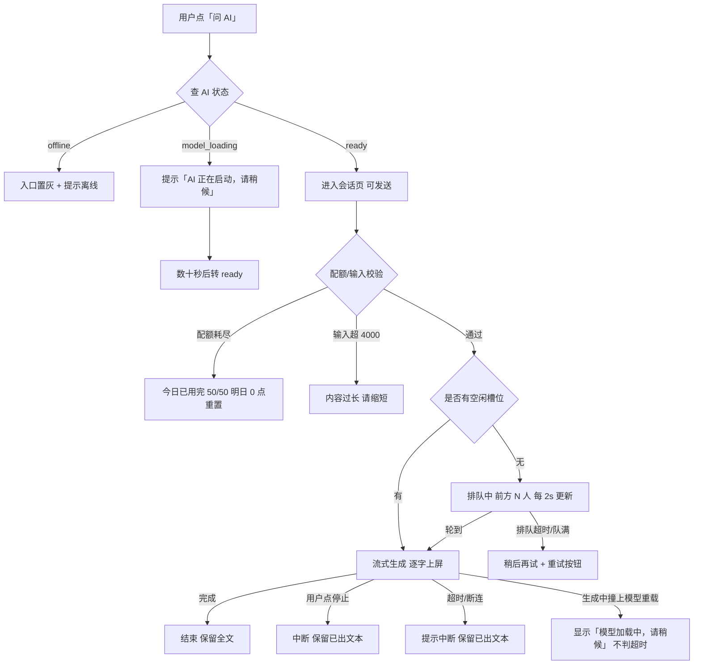

# AI 功能 PRD（增量）

| 项 | 内容 |
| --- | --- |
| 文档版本 | v0.1（初版，可评审） |
| 作者 | 许清楚（软件产品经理） |
| 项目 | danzhao-study-vue3（浙江单招学习应用） |
| 性质 | **增量 PRD** —— 只描述 AI 新增部分，不重写既有产品文档 |
| 上游依赖 | `docs/prd-mobile.md`（练习 Tab 交互稿等）、`docs/ai-gateway-design.md`（网关契约） |
| 状态 | 需求与方案阶段，未开工 |

**本文定位**：AI 相关的交互、优先级、文案、配额口径以本文为准；**传输、隧道、并发、超时实现以 `docs/ai-gateway-design.md` 为准**，本文档跟随，不另立口径。

---

## 0. 前提（已定，不推翻）

### 0.1 接入架构

- **不使用第三方云 LLM API**（不接 DeepSeek / 通义 / OpenAI / Claude）。
- 模型服务 = **本机 Ollama（OpenAI 兼容接口）**，经**反向隧道**由生产服务器 `520305.top` 中转。
- 链路：前端 → `/api/ai/*` → 服务器 → 隧道 → 作者本机 Ollama。
- 前端 bundle 内**不出现任何端点地址或密钥**；CSP 的 `connect-src` 保持不变。
- 端点全部**环境变量配置**，不得硬编码：`AI_BASE_URL`（如 `http://127.0.0.1:11434/v1`）、`AI_MODEL`、`AI_API_KEY`（本地无鉴权时可为空）、`AI_PROTOCOL`（预留 `openai-compatible` / `ollama-native` 两种适配器，默认 `openai-compatible`）。
- **协议必须抽象成适配器层**：本机服务接口形态不统一（Ollama 原生 `/api/chat` 与 OpenAI 兼容 `/v1/chat/completions` 不同）。
- **算力不做假设**：并发、超时、队列、配额等容量参数全部环境变量可调。

### 0.2 数据底座（P6 已建成）

- 题库 **2363 题**：可判分 1488 题（63%）、需自评 875 题；真题卷 245 题 / 9 套。
- `practiceBank` 索引带 `fileKey` / `fileTitle` / `unitTitle` 来源坐标 —— 答疑与出题可定位"用户在练哪页"。
- 错题本（`error_book`）+ SM-2 间隔复习 + 学情统计 —— 学情分析的输入源。
- 练习聚合层（组卷 / 做题会话 / 结算页）已落地，见 `docs/prd-mobile.md` 第 5 节。

### 0.3 已定技术前提（原 Q1 / Q2 / Q3，已由用户与 team-lead 拍板）

| 项 | 结论 | 说明 |
| --- | --- | --- |
| **模型选型** | 默认 `AI_MODEL=qwen2.5:7b-instruct`（中文能力强、7B 量级） | 写成**默认值**而非选定值：走环境变量，用户随时可换。PRD 不绑定具体模型 |
| **上下文预算** | 按**保守 8k 窗口**设计 | 学情分析走「截断 + 聚合摘要」（只喂题干与错因标签，不喂完整解析）；答疑多轮上限 8 轮 |
| **在线时段** | 用户答复为**几乎全天开、可保持常开** | 因此答疑排 P0 无争议，优先级不重排 |

**但"常开"不等于四态模型可简化。** Ollama 重启、模型被手动卸载、Provider 进程重启、系统休眠唤醒，都会触发 `model_loading`。**四态模型保留原样**（见第 5 节）。

#### 0.3.1 上下文预算：用公式而非固定数字（架构师给出，PRD 跟随）

已约定**不对模型做假设**，因此不能写死"喂 N 轮 / 喂 N 条错题"——写死后换模型就得改代码和 PRD。采用预算公式：

```
输入预算 = floor((AI_CONTEXT_TOKENS - AI_RESERVE_SYSTEM - AI_MAX_OUTPUT_TOKENS) × 0.9)
可喂汉字 ≈ 输入预算 × AI_CHARS_PER_TOKEN（默认 1.0，保守估算）
```

`AI_CONTEXT_TOKENS` 保守默认 **4096**。据此得出 PRD 采用的三个数：

| 有效窗口 | 答疑历史轮次上限 | 学情分析可喂错题上限 |
| --- | --- | --- |
| **4k（保守默认）** | **3 轮** | **18 条** |
| 8k | 8 轮（触顶） | 30 条（触顶） |
| 32k | 8 轮（触顶） | 30 条（触顶） |

配套口径：

1. **32k 也不放开上限。** 历史越长 prefill 越慢、首 token 延迟线性上升；错题超过 30 条后边际价值低于等待代价。**上限本身是设计的一部分，不是"因为 8k 才小"**——不要把它理解为待优化项。
2. **学情分析走聚合摘要**（沿用 3.x 口径），单条上限 `AI_ANALYSIS_ITEM_CHARS=120`（约 120 字/条：题干精简 + 错因标签，**不喂完整解析**）。
3. **换模型只需改 `AI_CONTEXT_TOKENS` 一个值**，代码与 PRD 都不用动；表中三个数随该值自行变化。

#### 0.3.2 上下文裁剪必须明示（硬要求）

系统按预算裁剪上下文时，**必须告知用户裁了多少**，不得静默：

| 场景 | 用户可见提示 |
| --- | --- |
| 答疑历史被裁剪 | "仅基于最近 3 轮对话" |
| 学情分析错题被裁剪 | "基于最近 18 条错题分析（共 47 条）" |

**理由（产品立场）**：不告知的裁剪等于骗用户——AI 会基于残缺上下文给出看似完整实则错误的结论，而用户无从判断可信度。

**必须与用户输入区分开**（两条容易搞混，实施时注意）：

| | 处置 |
| --- | --- |
| **用户自己打的字**超限 | **直接拒绝**（"内容过长，上限 4000 字"），**不静默截断** |
| **系统拼装的上下文**超限 | **裁剪 + 明示**（告知裁了多少） |

技术上由 `done` 事件带 `truncated`、学情带 `includedItems/totalItems` 提供数据。

### 0.4 必须由产品直面的现实：AI 不是永远可用

AI 可用性**取决于作者本机电脑是否开机、Ollama 是否在运行、隧道是否连通**。电脑关机 / 休眠 / 断网 / 模型未启动 → 线上所有客户端的 AI 全部不可用。

这不是边缘情况，而是**常态之一**。因此本 PRD 的一条总原则：

> **「AI 离线」是一个正常状态，不是错误。** 任何入口都必须能在有限时间内拿到明确状态，禁止无限转圈、禁止白屏、禁止让用户点进去才被告知不可用。

---

## 1. 产品目标

对这个应用的用户（浙江高职单招考生，15–18 岁，备考焦虑 + 时间稀缺），AI 带来的增量价值说人话是三条：

1. **卡住的时候有人答。** 刷题卡在一道题、看解析看不懂，身边没有老师——AI 答疑把"卡住就放弃"变成"卡住能继续"。
2. **知道自己差在哪、该先补什么。** 错题本只告诉你错了几道，AI 学情分析告诉你"你错的是同一类：解三角形的正弦定理适用场景判断"，并给出下一步顺序。
3. **同一份内容换个讲法。** 教材讲法听不懂时，AI 用更口语/更基础的方式重讲一遍当前页——不改变内容，只降低理解门槛。

明确**不追求**的目标：不做通用聊天机器人；不替代 183 页既有内容；AI 不产出需要背诵的新知识点体系（准确性责任见第 8 节）。

---

## 2. 用户故事

四项用途，各给核心场景。格式：作为谁 / 在什么情境 / 做什么 / 得到什么。

### 2.1 AI 答疑助手（对应 `kind: qa`）

| # | 用户故事 |
| --- | --- |
| 1 | 作为考生，晚上刷题遇到一道数学题完全没思路、解析看不懂 —— 我在做题会话页点「问 AI」，它带着这道题的题干一起发过去，我用大白话问"为什么这里用正弦定理"，得到针对这道题的逐步讲解，而不是泛泛的知识点 |
| 2 | 作为考生，在错题本复习时又错了一次同一道题 —— 我问 AI"我还是不懂第二步怎么来的"，它基于我上一轮的追问继续解释（多轮上下文），而不是从头重讲 |
| 3 | 作为考生，看到解答一半觉得够了 —— 我点「停止生成」，已出的内容保留在页面上，我不会被迫等 60 秒 |

### 2.2 AI 内容讲解（对应 `kind: explain`）

| # | 用户故事 |
| --- | --- |
| 1 | 作为基础薄弱的考生，读"三角恒等变换"这一页读不懂 —— 我在内容页点「AI 讲解」，得到基于**当前这一页**的口语化重讲（不是泛泛讲三角函数） |
| 2 | 作为考生，同一页想再简单一点 —— 我选「讲得更基础」，得到降低起点、跳过推导直觉版（同一页面、不同难度档） |
| 3 | 作为考生，第二次打开同一页的讲解 —— 秒开（命中缓存），不消耗我的当日次数 |

### 2.3 AI 学情分析（对应 `kind: analysis`）

| # | 用户故事 |
| --- | --- |
| 1 | 作为考生，错题攒了 40 道不知道从哪补起 —— 我在复习 Tab 打开学情分析，得到"你的错题集中在解三角形（12 道）与数列求和（9 道），共同问题是公式适用条件判断；建议先补解三角形"，而不是只看一堆数字 |
| 2 | 作为考生，想确认这周有没有进步 —— 得到本周与上周的对比（新增错题数、掌握率变化）与一句结论 |
| 3 | 作为考生，作者电脑离线时 —— 我仍能看到**最近一次生成**的分析，带"生成于 3 天前"的时间戳，不会看到一个空白页 |

### 2.4 AI 智能出题（对应 `kind: quiz`）

| # | 用户故事 |
| --- | --- |
| 1 | 作为考生，把"解三角形"练完了想再做同类题 —— 我在练习 Tab 组卷时勾「AI 出变式题」，得到基于我错题特征生成的同类新题（不是题库里已有的 2363 题） |
| 2 | 作为考生，想要针对某个薄弱点的专项练习 —— 得到一组围绕该薄弱点、难度递增的题 |
| 3 | 作为考生，作者电脑离线时 —— 我仍能用**此前已生成并入库**的 AI 题组（预生成批次），不受在线状态影响 |

---

## 3. 需求池与优先级（核心章节）

### 3.0 我的正式判断：**按「能否预生成/缓存」分流，而不是按用途平分**

team-lead 的初步建议是"答疑 + 讲解实时、出题 + 分析预生成"。**我的判断是：只有答疑是真正必须实时的，其余三项都能缓存。** 理由：

- **内容讲解有天然缓存键**：`（页面 fileKey + 难度档）`。页面内容是确定性的，183 页是有限的、可枚举的。它可以做成"首次请求实时生成并落库 → 之后命中缓存秒开"，并且可以在作者电脑在线时**批量预热高频页面**。因此它的实时依赖只发生在"该页第一次被请求讲解"。
- **学情分析有天然缓存键**：`（用户 + 日期/周）`。它本来就该是"一天一份"，不需要实时。可排在夜间低峰生成。
- **智能出题有天然缓存键**：`（薄弱单元 + 难度 + 题量）`的批次。可预生成后当作"AI 题组"入库，用户随时取。
- **答疑没有缓存键**：问题是开放式的、无法预测的，只能实时。

所以分流结论是 **1 : 3**，而不是 2 : 2：

| 用途 | 是否必须实时 | 缓存键 | 作者电脑离线时 |
| --- | --- | --- | --- |
| 答疑助手 | **必须实时** | 无 | **不可用** |
| 内容讲解 | 首次实时，之后缓存 | `fileKey + 难度档` | 已缓存的页**可用**，未缓存的页不可用 |
| 学情分析 | 否（批量） | `用户 + 日期` | 最近一次结果**可读**（带时间戳） |
| 智能出题 | 否（批量） | `薄弱单元 + 难度 + 题量` | 已入库题组**可用** |

**这条分流直接决定优先级**：能缓存的三项，其体验会随缓存命中率上升而"越用越好"，且离线伤害小；不能缓存的答疑，是唯一会被在线率直接伤害的功能。

### 3.1 优先级建议（与 team-lead 初步建议有分歧，已说明理由）

| 批次 | 用途 | 我的排序理由 |
| --- | --- | --- |
| **批次一 P0** | **AI 答疑助手** + **AI 内容讲解（带缓存）** | ① 答疑是学生价值最直接的一项（"卡住能继续"），必须最先验证；② 讲解虽然排序第二，但它可缓存、离线伤害小、且能与答疑共用同一套"流式会话 UI + 状态服务"，**与答疑同批做的边际成本很低**，因此并入 P0 |
| **批次二 P1** | **AI 学情分析（预生成）** | 价值明确，但**依赖错题数据积累**——P6 刚建成、用户量小、冷启动阶段错题稀疏，AI 容易产出空洞结论。放在讲解之后更稳妥 |
| **批次三 P2** | **AI 智能出题** | **边际价值最低**：题库已有 2363 题，不缺题。AI 出题的独特价值只在"变式题/针对薄弱点定制"，属锦上添花。等前三项验证后再做 |

**与 team-lead 建议的差异**：team-lead 建议"学情分析次之（直接吃 P6 数据）"。我把它降到 P1 的理由不是数据不通，而是**数据稀疏会让 AI 产出质量不稳定**——分析的输入是错题本，冷启动阶段一个用户可能只有几道错题，AI 此时给"薄弱点分析"是过度解读。等错题积累到一定量（如 ≥10 道）再开启更合适。这条建议**可被推翻**，若你认为"先有分析框架、数据慢慢喂"更符合运营节奏，我可以调整。

### 3.2 需求池明细

#### P0 —— 批次一（MVP 边界）

| # | 需求 | 验收要点 |
| --- | --- | --- |
| P0-1 | **AI 状态服务与入口徽标**：全局可查询 AI 可用状态，入口在不可用时置灰并显示状态文案 | 见第 5 节四态表；任一入口进入后 5s 内拿到明确状态 |
| P0-2 | **答疑会话页**：带上下文发起（当前题/当前页）、流式逐字上屏、可中断、保留已出文本 | 首字可见；中断后已出文本保留在页面上 |
| P0-3 | **流式渲染 + 停止按钮** | 生成中展示"停止"；点击后立即停止并保留文本 |
| P0-4 | **内容讲解入口与缓存**：内容页可请求讲解，缓存键 = `fileKey + 难度档 + promptVersion`（见 3.3） | 第二次请求秒开且**不计入当日配额** |
| P0-5 | **容量约束落地**：并发 1、队列上限 20、排队位次每 2s 更新、日配额 50、输入 4000 字上限 | 见第 7 节 |
| P0-6 | **失败态文案全量覆盖**（16 条） | 无一条出现无限转圈或白屏；超时/断连保留部分文本 |
| P0-7 | **灰度开关**：`AI_ROLLOUT=admin` 先对管理员开放 | 非灰度用户看不到入口 |

**P0 明确不做**（防范围膨胀）：不做语音输入；不做图片/拍照提问；不做多模态；不做对话历史云同步（仅本地/单机会话）；不做用户自定义 prompt。

#### P1 —— 批次二

| # | 需求 | 说明 |
| --- | --- | --- |
| P1-1 | 学情分析报告页（周报/日报口径） | 预生成，带时间戳；错题数 < 阈值（建议 10）时不生成，改为引导继续练习 |
| P1-2 | 报告的历史版本与对比 | 本周 vs 上周 |
| P1-3 | 讲解的批量预热 | 作者在线时按"高频页面"预热，降低冷启动 |
| P1-4 | 缓存陈旧提示与重新生成 | 见 3.4 |

#### P2 —— 批次三

| # | 需求 | 说明 |
| --- | --- | --- |
| P2-1 | AI 变式题生成（针对薄弱单元） | 入库为"AI 题组"，可预生成。**默认走异步 + 落库**；单卷内按**每批 ≤5 题**下发以保持在 90s 超时预算内，失败只丢最后一批可重跑 |
| P2-2 | AI 题组的难度递增编排 |  |
| P2-3 | AI 出题结果的人工抽检与下线机制 | 准确性责任，见第 8 节 |

### 3.3 预生成策略（我的正式建议）

| 项 | 建议 |
| --- | --- |
| **触发时机** | ① **服务端调度**：作者电脑在线（Provider connected）且处于低峰时，按队列批量生成；② **首次请求 miss**：实时生成并落库（用户等一次，之后都快）；③ 优先级：先预热"高频内容页讲解"与"活跃用户学情" |
| **生成预算** | 每次在线窗口内限定生成条数，避免占满算力影响实时答疑。**实时答疑的请求优先级高于预生成**，预生成可被抢占暂停 |
| **缓存失效** | 讲解：内容页内容变更（内容 hash 变化）→ 该页缓存失效；学情：按日重新生成（每日至多 1 次，或错题增量 > N 时触发重算）；AI 题组：入库后除非人工下线，否则不失效 |
| **缓存键必须含 `promptVersion`** | **所有 AI 生成物的缓存键都要带 `promptVersion`（或模板文本短哈希）**：`cacheKey = fileKey + 难度档 + promptVersion`。**否则改了 prompt 之后旧缓存仍然命中** —— 作者改了措辞或格式（例如新增定界符约束），用户看到的还是旧结果，且**没有任何报错**。这类"改了不生效"的问题排查成本极高。用模板文本短哈希更省事：改了自动失效 |
| **陈旧提示** | 展示"生成于 X 天前"；超过 7 天提示"内容可能已变化"；**仅当 AI 在线时**才给"重新生成"按钮，离线时不给按钮（避免点了没反应） |

### 3.4 离线提示的措辞口径（原 architect 提问，已按 Q3 答案修订）

**背景变更**：原问题是"作者电脑关机时段是否给预期提示"，假设存在可预期的规律时段。Q3 拍板为**几乎全天开、可保持常开**，因此**不存在规律关机时段，该设计作废**，改为「偶发中断提示」。

**决定**：

- **不再出现任何时段承诺或规律描述**。禁止文案："通常 19:00–23:00 可用""每天 X 点后可用"等。
- 离线态统一文案：**`AI 助手离线中`**，可附一句原因说明（偶发维护 / 模型重启），但**不得承诺恢复时间**。
- 启动中态文案：**`AI 正在启动，请稍候`**（不是错误态）。
- 理由：既然在线是常态、离线是偶发，给用户"规律时段"反而是错误信息——他会据此判断"现在应该能用"，与偶发中断的事实不符，反而增加困惑。偶发中断只需诚实说明"现在不可用"，无需解释规律。

因此 `GET /api/ai/status` **无需扩展"历史在线时段"字段**，实现成本归零。

---

## 4. 信息架构与入口摆放

### 4.1 总原则

- **不新增第 5 个 Tab**（已定决策）。AI 不是一级信息域，它是**嵌入在既有任务流里的能力**。
- AI 入口的位置遵循"**问题在哪里发生，入口就在哪里**"：题目卡住时入口在做题页，页面看不懂时入口在内容页，不知道补什么时入口在复习页。
- 例外：答疑需要一个**全局可达**的入口（学生可能随时想问），用轻量悬浮入口而非 Tab。

### 4.2 各用途入口

| 用途 | 入口位置 | 形态 | 上下文携带 |
| --- | --- | --- | --- |
| 答疑助手 | ① 全局悬浮入口（做题会话页 / 内容页 / 错题详情 / 结算页 均可见）；② 上述页面内的「问 AI」按钮 | **会话页**（全屏页，非弹窗——流式内容长，弹窗不够） | 当前题目 `question` / 当前页 `fileKey` / 错题 `errorId` |
| 内容讲解 | 学习页内容页 → 页脚功能条（v4 已有主行动 + 次级插槽）新增「AI 讲解」次级插槽 | 页内底部抽屉或半屏面板 | `fileKey` + `unitTitle` |
| 学情分析 | 复习 Tab 顶部卡片（今日待复习之上）；我的 Tab 学习数据区入口 | 页面（展示最近一次生成结果） | 用户错题本 + 练习记录 |
| 智能出题 | 练习 Tab → L2 组卷配置内新增「AI 变式题」选项（P2） | 复用现有组卷流程 | 薄弱单元 |
| AI 状态 | 不单独成页；**每个 AI 入口按钮自身带状态**（可用/离线/启动中/忙碌） | 按钮态 + 会话页顶部状态条 | — |

### 4.3 会话页形态选择（答疑）

选**独立全屏页**而非浮层，理由：① 流式输出内容长（数百字）且需滚动回看；② 需要输入框 + 历史消息 + 停止按钮的完整布局；③ 移动端浮层在小屏上输入体验差。

---

## 5. 可用性与状态：四态模型（PRD 口径）

网关提供 4 个用户可见状态（其中"离线"含一个"启动中"子态）：

| 状态 | 触发 | 用户可见文案 | 入口表现 | 是否错误态 |
| --- | --- | --- | --- | --- |
| `offline` 离线 | 隧道断 / Ollama 未运行 / 功能关闭 | **AI 助手离线中**（偶发中断，**不得附任何时段规律或恢复时间承诺**，见 3.4） | 入口置灰，点击后提示并禁用发送 | 否，正常状态 |
| `offline` + `model_loading` 启动中 | 模型权重加载（冷启动） | **AI 正在启动，请稍候** | 入口显示启动中，数十秒后自动可用 | 否，**不得写成错误页、不得出现"重试"措辞** |
| `ready` 可用 | 正常 | 无状态提示（不打扰） | 入口正常可点 | — |
| `busy` 排队中 | 队列非空 | **排队中，前方 N 人**（每 2s 更新） | 发送后进入排队态 | 否 |

**各入口在不可用时的表现**（逐入口列清）：

| 入口 | 离线时 | 启动中时 |
| --- | --- | --- |
| 悬浮「问 AI」按钮 | 置灰，点击 toast「AI 助手离线中」 | 显示「AI 正在启动」，点击后进入会话页并显示等待 |
| 内容页「AI 讲解」 | 若该页**已有缓存** → 正常展示（不提示离线）；无缓存 → 按钮置灰 + 说明 | 同离线分支（缓存优先） |
| 复习 Tab 学情分析 | 展示**最近一次生成结果** +「生成于 X 天前」；无历史 → 展示占位与说明 | 同左 |
| 练习 Tab AI 出题 | 展示已入库题组；无题组 → 置灰 | 同左 |

**硬要求**：以上任何分支都不得出现无限转圈或白屏；已生成文本在超时/断连时必须保留（见 7.3）。

---

## 6. 关键页面草图

### 6.1 答疑会话页（一屏线框）

```
┌──────────────────────────────────────┐
│ ←  AI 答疑                    [状态] │  <- 状态条：仅在非 ready 时显示
├──────────────────────────────────────┤
│  上下文卡（可折叠）                   │
│  ┌────────────────────────────────┐  │
│  │ 来自：数学 · 解三角形 · 正弦定理 │  │
│  │ 已知 a=3, b=5, A=30°，求 B      │  │
│  └────────────────────────────────┘  │
├──────────────────────────────────────┤
│                                      │
│  我：为什么这里用正弦定理？           │  <- 用户气泡（右）
│                                      │
│  AI：因为这道题已知的是两边和其中一   │  <- AI 气泡（左），逐字上屏
│      边的对角，属于 SSA 情形……▌      │     ▌ = 流式光标
│                                      │
│      [ 停止生成 ]                    │  <- 生成中显示
│                                      │
├──────────────────────────────────────┤
│ [ 输入你的问题…            ] [发送]  │  <- 4000 字上限，超限明确拒绝
│  剩余今日次数 47/50                  │
└──────────────────────────────────────┘
```

### 6.2 状态流转（答疑一次请求的完整生命周期）



### 6.3 内容页「AI 讲解」面板（简）

```
内容页页脚功能条：[主行动] [笔记] [AI 讲解] [更多]
                                     ↑ 新增次级插槽
点击后 → 半屏面板：
  ┌────────────────────────────┐
  │ AI 讲解 · 三角恒等变换      │
  │ [标准] [更基础]  <- 难度档 │
  ├────────────────────────────┤
  │ （流式/缓存内容区）         │
  │ 底部：生成于 3 天前 · 重新生成 │
  └────────────────────────────┘
```

#### 6.4 AI 回答的流式呈现口径（LaTeX 与 Markdown）— P0 硬需求

**为什么这是 P0**：答疑与内容讲解都在 P0，而数学/物理类回答必然含公式。本机 CPU 推理一次回答要 30–60 秒，若公式处理不当，要么全程裸 LaTeX 源码（流式失去意义），要么每 token 全量重渲染（持续闪烁 + 移动端掉帧）。**此项不能留到工程阶段再想，故在此定产品口径（技术实现另派架构师）。**

**现状基础（已核实）**：项目已有 `src/composables/useKatex.js` + `MathJaxRender.vue`，支持 `**加粗**`、`==高亮==`、`` `行内代码` ``、代码围栏与 KaTeX 公式；且已有「引擎未就绪 → 剥掉定界符的纯文本」的降级先例（`useKatex.js:8`、`renderPlainFallback`）。本节是在此之上的**分段冻结**策略。

##### 口径一：公式未闭合时 —— 等宽代码样式占位，闭合后立即渲染（**否决"等整段结束再统一渲染"**）

把回答切为「已完成的段」与「正在生成的段」，分别处理：

| 情形 | 呈现 |
| --- | --- |
| 公式**已闭合** | 立即渲染为 KaTeX 公式 |
| 公式**未闭合**（只有开定界符） | 该片段以**等宽字体 + 淡次级底 + 小圆角**的"代码样式"显示**去掉定界符后的公式体源码**（`\(x^2 +` 显示为 `x^2 +`），**不尝试渲染** |
| 公式**刚闭合**的那一刻 | 就地替换为渲染态（同一位置，不跳动到别处） |

**定界符对全程不可见**：pending 态剥离定界符、闭合态渲染为公式，因此 `\(...\)` / `$$` **永远不会出现在用户眼前**。这比我原先"保留定界符"的写法更彻底地消除了定界符闪现闪消问题——不是缓解，而是根本不显示。"这是公式"由**样式**（等宽 + 淡底）表达，不需要靠定界符表达。

**pending 态与 `renderPlainFallback` 必须样式可区分**（两条是不同的降级，工程师容易混用）：

| | 语义 | 样式 | 时长 |
| --- | --- | --- | --- |
| **pending** | 瞬时态，秒级后会变成公式 | 等宽 + 淡色 | 1–3 秒 |
| **`renderPlainFallback`** | 长期态（引擎未就绪），不会变 | 正常文本色 | 长期 |

**明确否决"等整个回答结束再统一渲染"**：本机推理单次要 30–60 秒，全程让用户对着裸 `x^2 + \frac{1}{` 这类源码，流式输出就失去了意义；且对看不懂 LaTeX 源码的高中生极不友好——他们要的是公式长什么样，不是源码。

**与既有降级先例的关系（刻意区分两种降级，不要混用）**：

| 场景 | 处置 | 理由 |
| --- | --- | --- |
| 引擎**未就绪**（KaTeX 未加载完） | 沿用既有：**剥掉定界符的纯文本** | 这是**长期/整段**状态，裸 `\(...\)` 定界符长期挂着很难看 |
| 流式**未闭合**（瞬时） | **保留源码 + 等宽代码样式** | 这是**瞬时**状态（1–3 秒）；保留源码能让用户看出"公式正在被写出来"，且**避免定界符闪现闪消**造成的字符跳动 |

**中断兜底（必须覆盖）**：若回答因超时/用户停止/断连而结束时仍有未闭合定界符 —— **保持等宽样式展示，不报错、不空白、不弹错误提示**。这条直接对应失败模式 #6/#9「保留已出文本」的要求。

##### 口径二：已完成的段必须冻结，不再重排

- **是，必须冻结。** 一旦某段渲染完成即冻结，后续 token **不得**引起它的重排、跳动或样式变化。
- **只允许最后一个"生成中"的段发生变化。**
- 冻结边界：以「已闭合的完整公式」与「换行 / 句末」为可冻结边界。
- 理由：① 前面内容随后续 token 跳动是流式体验里最破坏阅读的行为；② 每 token 全量 KaTeX 重渲染在移动端会掉帧。
- **唯一允许的例外**：整段生成**结束后**做一次**一次性**的最终渲染校验（处理尾部未闭合定界符、清理半截标记）。这是一次性的、用户会感知为"完成了"，不是持续跳动。

##### 口径三：Markdown 标记未闭合 —— 不解释，原样显示字符

- 未闭合的标记**不产生任何样式效果，原样显示字符**：`**加粗` 就字面显示 `**加粗`（不显示成半个加粗，也不把 `**` 隐藏掉）。
- 闭合后（`**加粗**`）整体变为加粗。
- 这与口径一是**同一条原则的两种表现**：**未闭合 = 不解释、原样呈现；闭合 = 立即解释**。
- 理由：① 隐藏未闭合标记会让用户看到"字符凭空消失"，比看到半截标记更困惑；② 无需预测模型意图，实现简单可靠；③ 与主流流式 Markdown 渲染器行为一致，用户有预期。
- **块级结构**（代码块、表格）：流式期间按纯文本段落处理，生成结束后再整体排版——块级结构的中间态无法被有意义地呈现。

##### 口径四：可接受的"不美观"边界（给可判断的验收线）

| | 判定 |
| --- | --- |
| **可接受** | 单个公式在闭合前以等宽源码样式展示（时长 = 该公式生成耗时，通常 1–3 秒），闭合后立即变渲染态 |
| **可接受** | 因中断导致最后一个公式停留在占位态 |
| **不可接受** | ① 全篇公式**始终**以裸源码呈现（超过 5 秒仍是全裸 = 视为渲染失败，需告警） |
| **不可接受** | ② 已渲染内容随 token 持续跳动 / 闪烁 |
| **不可接受** | ③ 出现 KaTeX 报错红字或 `ParseError` 原文（错误必须被吞掉并降级为占位态） |
| **不可接受** | ④ 未闭合公式区域显示为空白或内容消失 |

**验收**：随机抽 10 条含公式的回答，流式过程中 —— 已闭合公式 **100%** 渲染为公式；未闭合公式 **100%** 以等宽占位；**零** KaTeX 报错；已冻结段**零**跳动。

**不做的事**：不向用户解释"正在渲染公式"、不加独立的公式 loading 提示——公式闭合即渲染是瞬时的事，额外提示反而制造焦虑。

##### 口径五（P0 前置，已定）：定界符双保险 —— prompt 约束 + AI 专用渲染器兜底

**问题**：项目 KaTeX 识别正则（`useKatex.js:294`）只支持 `$$...$$` → `\[...\]` → `\(...\)`，**不支持单美元 `$...$`**；而 `qwen2.5:7b-instruct` 默认极可能输出单美元，会导致公式完全不被识别、P0 直接失效。

**定稿为双保险，两条都做**（架构师采纳并升级）：

| | 措施 | 作用 |
| --- | --- | --- |
| **主** | `prompts.js` 的 system prompt 钉死：行内只用 `\(...\)`、块级只用 `$$...$$`，**不用单美元**；另统一不用 `\[...\]`（虽然渲染器支持，便于维护）。**四类 `kind` 全加** | 把触发率压下去 |
| **辅** | AI 专用渲染器（`src/ai/render.js`）**兜底支持单 `$`**，带三条件限窄误判 | 把漏网的接住 |

**为什么两条都要**（架构师理由，我认可）：7B 级 instruct 模型对输出格式约束的遵循率不是 100%，且**输出越长越容易漂移**；流式下每漂移一次就是一处裸源码，用户侧没有补救机会（不像离线内容还能改数据文件）。反过来，单 `$` 在自然文本里有真实歧义（金额 `$5`、shell `$var`），三条件只是**限窄**而非消除误判。**两者是乘法关系。**

**反向约束（必须守住，请工程师勿越界）**：**不要**去改 `useKatex` 的 `HAS_DELIM_RE` / `delimRegex` 来"顺便"支持单 `$`。那会影响内容侧已稳定的渲染口径（内容里 `$` 多见于金额）。**单 `$` 只在 `src/ai/render.js` 内支持，与内容侧渲染管线彻底隔离。**

##### 口径六（P0）：生成结束必须做收尾渲染

`done` / `error{partial:true}` 到达时**强制收尾渲染**，把残留的 pending 定稿为等宽展示，不报错、不空白。

**为什么必须写进 PRD**：不做收尾的话，pending 占位会**永久留在屏幕上**，看起来像渲染坏了。这在**超时 / 用户停止 / 连接中断**三种情况下都会发生——**不是边缘场景，是常态分支**。

---

## 7. 容量型约束与降级（本地推理，非按量计费）

本地推理**没有按 token 计费的云费用**，约束从"预算"转为"容量"。

### 7.1 容量参数（默认值，全部环境变量可调）

| 项 | 默认值 | 说明 |
| --- | --- | --- |
| 并发上限 | 1（本机单模型，串行反而体验最好） | 由 `AI_MAX_CONCURRENCY` 控制 |
| 队列上限 | 20 | `AI_QUEUE_MAX` |
| 单用户日配额 | 50 次 / 自然日（Asia/Shanghai） | `AI_QUOTA_PER_DAY` |
| 全局日配额 | 2000 | `AI_QUOTA_GLOBAL_PER_DAY` |
| 每用户分钟频率 | 6 | `AI_RATE_PER_MIN` |
| 输入上限 | 4000 字 | `AI_MAX_INPUT_CHARS`，**超限明确拒绝，不静默截断** |
| 首 token 超时 | 60s（冷启动另设更宽） | `AI_FIRST_TOKEN_MS` / `AI_FIRST_TOKEN_COLD_MS` |
| 多轮上限 | 8 轮 | `AI_MAX_TURNS` |

### 7.2 分用途延迟容忍度与超时预算

| 用途 | 延迟敏感度 | 超时预算（架构预留） | 交互要求 |
| --- | --- | --- | --- |
| 答疑 `qa` | **最敏感**（对话） | 45s | 必须流式 + 可中断；首字延迟目标见下 |
| 内容讲解 `explain` | 中等（可预生成缓存） | 60s | 流式；命中缓存时秒开 |
| 学情分析 `analysis` | 低（可异步） | 60s | 异步生成 + 结果落库，用户取用时已就绪 |
| 智能出题 `quiz` | 低（可后台异步） | 90s | 后台异步，完成后通知/入库 |

**首字延迟目标（PRD 口径，待真机校准）**：本机 CPU 推理约 3–10 token/s，一次 300 字回答需 30–60 秒。因此**流式是 P0 硬需求而非优化项**：

- 目标：发起后 **≤10s 出现首字**（模型已常驻时）；冷启动允许更久但必须显示"正在启动"。
- 逐字上屏，光标可见。
- 用户可中断（`POST /api/ai/cancel`）。
- **非流式的"转圈后一次性出结果"在答疑/讲解场景不可接受。**

> 若某类用途实际输出明显更长（如整卷出题），需告知架构师调高对应超时预算。

### 7.3 降级路径

| 情形 | 降级表现 |
| --- | --- |
| 本地 API 不可达 / 模型未启动 / 隧道断 | 入口置灰 + "AI 助手离线中"（正常状态，非错误） |
| 生成超时（已出字） | **保留已出文本** + "生成超时，已中断" |
| 连接中途断开 | **保留已出文本** + "连接中断，已停止生成" |
| 排队超时 / 队满 | "当前使用人数较多，请稍后再试" + 重试按钮 |
| 配额耗尽 | "今日 AI 次数已用完（50/50），明日 0 点重置" |
| 输入过长 | "内容过长（上限 4000 字），请缩短后重试" |
| 模型加载中 | "AI 正在启动，请稍候" / "模型加载中，请稍候"（**不是错误态**） |
| 功能关闭 | 入口隐藏或置灰 |

**不降级到规则引擎**：AI 不可用时，展示缓存或历史结果；没有缓存就明确告知不可用。**不做假 AI**（用模板拼一段看似智能的文字），这是信任问题。

### 7.4 配额口径的两个补充（产品决定）

1. **缓存命中不计入当日配额。** 讲解命中缓存、学情读取已生成报告、AI 题组取用，都不消耗 50 次额度。这样才能真正享受缓存带来的体验与成本收益。
2. **50 次/日的确认**：对一个学生用户，50 次/日充足（答疑为主时，正常一天不会超过 20 次）。**确认采纳该默认值**。若后续发现讲解被高频使用（每页都点），可改为"按用途分别计数"或提高上限——留待数据观察。

---

## 8. 合规、隐私与准确性

### 8.1 隐私优势（相对云 API）

题目内容、作答数据、错题只送到**作者本机的模型**，不出境、不进第三方云。这是本方案的明确加分项，可在产品内对用户明示。

### 8.2 必须如实写入的要求

数据会经过服务器中转，因此：

- **传输加密**：全程 TLS（`wss` / `https`）。
- **服务器侧不落盘 / 短留存**：AI 审计默认**只存长度 + 哈希 + 前 200 字摘要，不存完整对话**（`AI_AUDIT_KEEP_DAYS` 控制留存期）。
- 本机 Ollama **只监听 `127.0.0.1`**，不得暴露公网（见网关设计 7.1 红线）。

**需要产品侧确认的口径**：若作者想复盘答疑质量、需要存全文，则需①在隐私说明中告知用户，②最好做成可关闭的开关。**我的建议是默认不存全文**，仅在 admin 灰度内测阶段临时开启全文用于质量评估，正式放开前关闭。

### 8.3 教育内容准确性责任

- AI 输出**必须标注为 AI 生成**，并附免责说明："AI 回答仅供参考，以教材与教师讲解为准。"
- 涉及**答案正确性**的用途（智能出题）风险最高：P2-3 要求有人工抽检与下线机制。
- 答疑/讲解在**答案冲突时以既有内容页与题库标准答案为准**，AI 不得覆盖权威答案；产品层面建议在 AI 回答涉及具体答案时，同时展示"标准答案"供对照。
- 不做医疗/心理/志愿填报建议类场景（超出范围直接拒答）。

---

## 9. 待拍板问题清单

### 9.1 已由产品决定（无需再拍板，仅记录）

| # | 议题 | 我的决定 |
| --- | --- | --- |
| 1 | 本地 API 部署位置 | **已定**：本机 Ollama + 服务器反向隧道中转（本节不再作为开放问题） |
| 2 | 离线提示措辞 | **不给时段规律**，改为偶发中断提示，禁止任何"通常 X 点可用"表述，见 3.4 |
| 3 | 缓存命中是否计配额 | **不计**，见 7.4 |
| 4 | 日配额 50 次是否合适 | **合适**，采纳默认值 |
| 5 | 审计是否存全文 | **默认不存全文**，仅 admin 内测期临时开，见 8.2 |
| 6 | 模型选型（原 Q1） | 默认 `qwen2.5:7b-instruct`，写成**默认值**而非选定值，随时可换，见 0.3 |
| 7 | 上下文预算（原 Q2） | 按**保守 8k** 设计；学情走截断+聚合摘要；答疑多轮上限 8 轮，见 0.3 |
| 8 | 在线时段（原 Q3） | 几乎全天开、可保持常开；**四态模型保留不简化**，见 0.3 |
| 9 | 是否流式输出（原 Q4） | **是，P0 硬需求**，见 7.2 |
| 10 | 离线降级形态（原 Q5） | 缓存/历史/明确不可用，**不做假 AI**，见 7.3 |
| 11 | 讲解难度档（原 Q6） | **2 档**：`标准` / `更基础`；**默认标准**；不要更多档（档位越多缓存命中率越低、生成成本越高） |
| 12 | 是否人工预审（原 Q7） | **分类处理**：智能出题**需抽检 + 可下线**（P2-3）；答疑/讲解**不预审**（对话类无法预审），靠免责声明 + 反馈入口兜底 |
| 13 | 错误反馈入口（原 Q8） | **要**，做一个轻量「回答没用」按钮（每条 AI 回答一条），成本低、是准确性闭环唯一的数据来源；反馈数据进审计但**不存全文** |
| 14 | LaTeX / Markdown 流式呈现 | 六条口径已定（未闭合剥离定界符占位 + 已完成段冻结 + 未闭合标记不解释 + 可接受边界 + 定界符双保险 + 收尾渲染），见 6.4 |
| 15 | 模型输出定界符（原 Q1） | **双保险**：prompt 约束（只用 `\(...\)` / `$$...$$`，四类 kind 全加）+ AI 专用渲染器兜底支持单 `$`；**禁止改 `useKatex` 的正则**，单 `$` 只在 `src/ai/render.js` 隔离支持，见 6.4 口径五 |
| 16 | 缓存键含 `promptVersion` | 所有 AI 生成物缓存键须带 prompt 版本/模板哈希，防止"改了 prompt 不生效"，见 3.3 |

### 9.2 仍需拍板（当前 2 条）

| # | 议题 | 为何阻塞 | 需要谁定 |
| --- | --- | --- | --- |
| **Q1**（原 Q2） | **智能出题若要求"当场出题当场做"** | 默认方案已定为**异步 + 结果落库**（架构师 §4.5 取舍表，与 PRD 一致）：单卷内按**每批 ≤5 题**下发，单批保持在 90s 内，不动超时预算、不动 nginx，失败只丢最后一批可重跑。**仅当作者要求"当场出题当场做"时才需退到拆批循环方案**，那需要服务器新增"同一 jobId 保留槽位"设计，属新增范围 | 待 P2 立项时确认作者是否要求实时；不阻塞当前 |
| **Q2**（原 Q3） | **admin 灰度内测的范围与验收标准** | `AI_ROLLOUT=admin` 已预留，但参与人、验收清单、反馈收集方式未定 | team-lead 安排，我补文档 |

**已确认关闭（不再列入待拍板）**：
- 上下文预算（原 Q2）→ 架构师给出公式与三个数，见 0.3.1
- 整卷出题默认方案（异步落库）→ 已定，仅保留"是否要求实时"为 Q1
- **模型输出定界符（原 Q1）→ 已定为双保险，见 9.1 第 15 条、6.4 口径五**

---

## 10. TODO（初版未展开，后续补）

- [ ] 页面草图：学情分析报告页、AI 出题组卷配置页的完整线框
- [ ] 多轮对话的上下文裁剪策略（按 8k 预算细化，见 0.3）
- [x] ~~AI 回答的 Markdown / LaTeX 渲染方案~~ → **已定稿，见 6.4**（含五条口径与定界符约束）
- [ ] 内测阶段（admin 灰度）的验收清单与反馈收集方式（对应 Q3）
- [ ] 与现有配额/限流文档（`docs/auth-rate-limit.md`）的口径交叉核对
