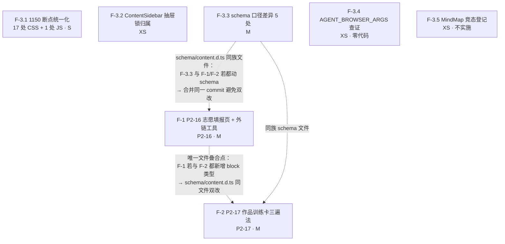

# 批 F「P2 其余 + 备案小项收拢」任务卡（P2-16 志愿填报 · P2-17 作品训练卡三遍法 · F-3 收拢）—— 工程师照单实现版

> 状态：**规划定稿（未写代码）**。本文是 roadmap §2「批 F」的**落地拆解**，不推翻既有路线图，只把范围拆到可直接开工的粒度（文件、改动点、测试点、风险、依赖），并单列一节「待拍板清单」供 team-lead 裁决。
> 角色：架构师（Bob）产出；供工程师直接照单实现，供 team-lead 拍板 §7。
> 上游（已读并内化）：
> - `docs/proposals/implementation-roadmap.md` §2「批 F」（`:250-269`）+ §3 内容侧依赖表（`:308-309`）+ §0「存量代码事实」（`:79-81`）
> - `docs/proposals/batch-f0-tasks.md`（**格式模板**；H1–H7 硬约束沿用）
> - `docs/功能与布局改进需求_内容侧提出.md`（P2-16 / P2-17 需求来源）
> - 源码实测：`reader.css` / `UnitView.vue` / `ContentSidebar.vue` / `NotesPanel.vue` / `AppTabBar.vue` / `App.vue` / `PomodoroPanel.vue` / `main.css` / `validateBlock.js` / `content-schema.json` / `content.d.ts` / `FormulaCard.vue` / `TableBlock.vue` / `ColumnsBlock.vue` / `GeometryBlock.vue` / `ExamBlock.vue` / `PracticeSession.vue` / `usePomodoro.js` / `MindMapBlock.vue` / `router/index.js` / `studyDb.js` / `scripts/validate-content.mjs` / `tests/csp-guard.test.js` / `package.json` / `.github/workflows/ci.yml` / `src-tauri/{tauri.conf.json,capabilities/default.json,src/lib.rs,Cargo.toml}`
>
> **两条纪律贯穿全文**：① 数字、行号、接口一律以**本次实际读码**为准（关键校验一律 Node/Python 脚本复核——本环境 `grep` 漏命中，结论以脚本为准）；② 不写实现代码，只给「关键函数签名 + 伪代码级要点」。
> **行号基准**：本文全部行号**实测于 HEAD = `e0c3f02`**（工作树含内容侧在制改动：`src/content/**` 若干页 + `public/practice-bank/*.json`；**只读勿动**）。基线测试 **68 文件 / 774 用例全绿**，DB **v7**，H1–H7 有效。

---

## 0. 开工前必读：本次只读核查对 roadmap §2 批 F 的**更正与补充**（务必以本节为准）

> 以下为本次只读核查的实测结论（HEAD = `e0c3f02`）。**更正 1 / 更正 4 直接改变任务形态**：照抄 roadmap 会对不存在的前提动刀、或漏掉真实约束。

| # | roadmap / 上游写法 | 实测事实 | 对任务的影响 |
|---|---|---|---|
| **更正 1（关键）** | P2-16「新增内容页（走 site.js 末尾追加，H2）+ 官方入口链接」；F-1 外链默认「有通路」 | **仓库前端没有任何外链打开通路**：`package.json` 依赖里**无** `@tauri-apps/api`、**无** 任何 `@tauri-apps/plugin-*`（仅 dev `@tauri-apps/cli`）；`src/**` 内**零** `window.open(` / `invoke(` / `openUrl(` / `@tauri-apps` 引用。Rust 侧仅注册 `tauri_plugin_shell`（`lib.rs:8`）且 `capabilities/default.json` 授权 `shell:allow-open`——即有「开外部程序」的**母端能力**，但**没有前端 JS 入口**（`lib.rs:13` 的 `window.open_devtools()` 是 `open` 前缀误命中，非 `window.open()`） | **F-1 必须新增一个最小外链工具**（要么引 `@tauri-apps/plugin-shell` 的 JS 端，要么引官方 `opener`），**不能**假设已有 `window.open` 通路。见 §2 F-1 与 §7 P-F01 |
| **更正 2** | F-1 外链「是否触碰 CSP 红线（`connect-src`/`script-src 'self'`）」 | **不触碰代码执行红线，但触碰 L4 静态扫描线**：① 打开外链 = 交给系统浏览器/OS，**不是** webview 的 fetch/ws → `connect-src` 与 `script-src` 与它无关；② 但 `tests/csp-guard.test.js` **L4** 会扫描 `src/**`（`.js/.vue/.ts`，**排除** `src/content/{math,chinese,computer}/**`）里所有 `https?://host` 字面量，凡不在 prod CSP 覆盖集（实测仅 `ipc.localhost`、`520305.top`）且不在 `HOST_ALLOWLIST`（当前**空**）者即**断言失败**。→ 在 src 非内容目录写 `https://www.zjzs.net` 会**直接红 CI** | F-1 落地**必须**处理 L4：或把 URL 放进被排除的内容数据目录、或在 `HOST_ALLOWLIST` 登记 `www.zjzs.net`（推荐）。**注意 `tests/**` 本批不得改**（见 §7 P-F02 与纪律）——故推荐改「内容数据落点」绕过，若必须改测试须先请 team-lead 授权 |
| **更正 3** | F-3.3「`formula` 的 `formulas`/`lines` 双字段名，19 处旧写法（`validateBlock.js:94-97`）」 | 数字对、**行号漂移**：当前 `validateBlock.js:100-113`。且**校验链全程容忍双名**：validator `:101-103`（`formulas || lines`）+ `FormulaCard.vue:28`（`formulas || lines`）；只有 **JSON Schema**（`content-schema.json:38` `required:["formulas"]`）与 `content.d.ts:66` 声明单名。实测：`formulas` 块 **113**、`lines` 块 **19**（**9 个数学文件**，`both=0`）、文件内 `lines:` 出现 **20** 次 | F-3.3 第 1 项 = 「内容迁移 + schema 单名 vs validator 兼容」的取舍，**非**「改渲染点」。见 §7 P-F09(a) |
| **更正 4（关键）** | roadmap 通篇假设「JSON Schema 是 CI 强制关卡」 | **实际不成立**：CI 内容关卡 `scripts/validate-content.mjs` **只调用手写语义校验器** `createBlockValidator`（`:29`），**从不跑 JSON Schema**（全仓 `ajv` 仅存在于 `package-lock.json` 传递依赖，**无任何源码 import**）。即 `content-schema.json` 的 `required`/`additionalProperties` **目前不产生任何运行时/CI 强制**，它只作为**枚举单一来源**被 validator 派生（`BLOCK_TYPES`/`DIFFICULTY`/`QUESTION_TYPES`/`LAYOUT_*`） | **F-3.3 五项全部是「validator 与 schema 的口径差」**，修法一律落在**手写 validator**（或显式给 schema 补被代码读取的字段）；**不存在**「schema 已挡住、无需处理」的可能。见 §2 F-3.3 表 |
| **更正 5** | F-3.1「`reader.css` 1150/1151 混用（`:55/123/132/321/331/334`）；`UnitView.vue:.664/703`」 | 数字形态对，**行号与全站范围都要更正**：`reader.css` 6 处**行号不变**（`:55/123/132/321/331/334`）；`UnitView.vue` 实为 `:671`（`min-width:1150`）与 `:710`（`min-width:1151 and max-width:1456`）。**全站 1150 断点共 17 处**（`reader.css` 6 + `UnitView.vue` 2 + `ContentSidebar.vue` 2 + `NotesPanel.vue` 3 + `PomodoroPanel.vue` 1 + `AppTabBar.vue` 2 + `App.vue` 2），**含 1 处 JS `matchMedia`**（`NotesPanel.vue:64` `MOBILE_MQ`）。写法分三档：`min-width:1150`（7 处）/ `min-width:1151`（3 处）/ `max-width:1149`（2 处）/ `max-width:1150`（多） | F-3.1 落点**不止** roadmap 列的 2 个文件；**必须连带 JS `matchMedia`**，否则 CSS/JS 在 1150px 处撕裂。见 §2 F-3.1 完整清单 |
| **更正 6** | F-3.2「`ContentSidebar` 抽屉锁归属感知（QA 观察项）」——须先复核是否仍存在 | **仍存在**：`ContentSidebar.vue:297-299` `watch(sheetOpen, s => document.body.style.overflow = s ? 'hidden' : '')` + `:300-303` `onBeforeUnmount` 无条件 `overflow=''`——**不感知归属**（关闭即清空，会误释放他人加的锁）。对照组 `NotesPanel.vue:129-140` **已实现**归属感知（`lockOwned` 标志 + `syncBodyLock`）。故 F-3.2 = **把 NotesPanel 的成熟做法搬到 ContentSidebar** | F-3.2 确认为真，修法照搬 `lockOwned`。见 §2 F-3.2 |
| **补充 1** | F-3.4「`AGENT_BROWSER_ARGS` 传参查证（测试工具，非产品）」 | 实测：全仓（含上层目录 `danzhao/`）**仅** `implementation-roadmap.md:268` 出现该字符串，**无任何脚本/配置/CI 引用**——它是**外部浏览器自动化测试栈的环境变量**，与本仓库代码零耦合 | F-3.4 = **纯查证/登记归档**，**不改任何代码**。见 §2 F-3.4 |
| **补充 2** | F-3.5「`MindMapBlock` 高频导航竞态——本批只登记不实施」 | 实测：`MindMapBlock.vue:200-233` `renderMindmap()` 为 async，`:207 await loadMermaid()`、`:210 await renderMermaidTo(container.value,…)`，**await 之后**再访问 `container.value.querySelector(...)`（`:212`）与 `requestAnimationFrame(fitToView)`（`:220`）；`:201` 的空守卫在 **await 之前**。→ 连续导航导致组件卸载后 `container.value` 变 `null`，**await 后无二次守卫** → `Cannot read properties of null (reading 'querySelector')`，与内容侧所述完全吻合 | 修法已定位（await 后补 `if (!container.value) return`）；**本批只登记不实施**（roadmap 既定，触发条件=用户实测/崩溃日志复现即升级）。见 §2 F-3.5 |
| **补充 3** | P2-16「走 site.js 末尾追加」（隐含页面归属为某学科） | 实测：`src/content/site.js` 是**数学**站配置（`subject:"math"`，units `01…12`）；学科枚举固定 `math/chinese/computer`（`content-schema.json:11`）。**「志愿填报」不属于任一学科**——追加到某学科 site.js 会语义错挂 | P2-16 **页面归属属产品决策**（追加某学科 / 新顶层页 / 挂 `/plan`）。见 §7 P-F03 |
| **补充 4** | P2-17「第三遍复用现有倒计时组件」 | 实测：仓库**没有独立的倒计时组件**；可复用者只两处——`ExamBlock.vue`（`deadline`+`setInterval`+`ceil`，`:292/:301-305`）与 `PracticeSession.vue:254-276`（注释明写「**复用 ExamBlock 的 deadline 时序骨架**」，是**同一内核的第二份拷贝**）。`usePomodoro` 是固定 25/5/15 的**会话级**番茄钟（`usePomodoro.js:17-19`），**非**任意时长倒计时，**不可直接复用** | P2-17 第三遍 = 复用 **deadline 骨架**（非 `usePomodoro`）；是否抽 `useCountdown` 见 §7 P-F06 |
| **补充 5** | F-3.3 项 5「几何字段未入 schema（`diagram` 仅 `boardId`）」 | 实测：`GeometryBlock.vue` **已读取** `block.boundingbox`（`:117` 默认 `[-6,4,6,-4]`）、`block.height`、`block.fixed`（`:4/:48` 注释）；schema（`:44`）与 `content.d.ts`（`:115-119`）**只声明 `boardId`+`caption`**。内容侧实测 20 个 `diagram`：**19 个** `{boardId,caption,title,type}`、**1 个** `+{boundingbox,height}`（`title` 为通用字段，所有块可带） | 「未入 schema」= **代码已用但声明缺失**；修法 = 给 schema/d.ts 补字段（零数据迁移）。见 §2 F-3.3 表 |
| **补充 6** | — | `package.json` 现状（F0 后）：`check:dup`（`scripts/check-duplicates.mjs`）、`check:single`（`scripts/check-single-choice.mjs --selftest && …`）**均已存在**并已入 CI（`ci.yml:41-45`，位于「生产构建」之后）。本批**不新增/不改**这两个关卡 | 批 F 无 CI 接线任务；回归仍以 `csp-guard.test.js`（L1-L6）为闸门 |

### 0.1 批 F 与批 F0 / 批 S / P5 的边界（有意划清，勿顺手扩围）

- **不进本批**：**S1–S5 内容双轨**（`content-extension-dual-track.md`；S2 会动 `loadPage.js` 运行时核心 + DB 升版，**最高风险，明确排除**）、**P5 Android 打包**（依赖 S5+F）。本批 **DB 停在 v7、零升版、零迁移**（`studyDb.js:33`）。
- **P2-16 硬约束（不可越）**：**仅流程说明 + 浙江省教育考试院官方入口**，**不得固化任何院校/录取结论**（分数线、投档、院校名单、录取概率等一律不得进入内容或代码）。文案由**内容侧**提供（roadmap §3 `:308`）。
- **P2-17 内容依赖**：训练卡正文（PS/PR 三遍步骤）由**内容侧**提供（roadmap §3 `:309`）。功能侧可先落**组件/区块骨架**，内容后填（见 §2 F-2 与 §7 P-F04/F05）。
- **F-3.5 只登记不实施**（roadmap `:269`）；**F-3.4 只查证不改码**。

---

## 1. 总览：任务编号 / 依赖 / 顺序

### 1.1 任务一览表

| 任务 | 范围条目 | 内容 | 依赖 | 预估 | 触碰 DB / schema / CSP 配置 |
|:--:|---|---|:--:|:--:|---|
| **F-1** | P2-16 | 志愿填报页（**骨架**：纯内容页/独立页 + 流程说明区块）+ **最小外链工具**（打开浙江省教育考试院官方入口）+ L4 处置 | 无 | **M** | 否（CSP 配置**不改**；L4 允许清单**可能**需登记） |
| **F-2** | P2-17 | 作品训练卡三遍法：新 block 类型（或区块组合）+ 三勾本地状态（可选持久化 `page_progress`）+第三遍倒计时（复用 deadline 骨架） | 无（组件） / 待内容侧（正文） | **M** | 若走新 block：触 `schema`+`content.d.ts`（H5 白名单流程）；持久化**零 DB 升版** |
| **F-3.1** | F-3-①  | 1150 断点统一化：17 处 CSS + 1 处 JS `matchMedia` 边界写法收敛到 `--bp-lg`（=1150）口径 | 无 | **S** | 否 |
| **F-3.2** | F-3-②  | `ContentSidebar` 抽屉锁**归属感知**（照搬 `NotesPanel` 的 `lockOwned`） | 无 | **XS** | 否 |
| **F-3.3** | F-3-③  | schema 口径差异**5 处**收敛（formula/table/solve/columns/diagram） | 无 | **M** | 触 `schema`+`content.d.ts`+validator（H5 流程） |
| **F-3.4** | F-3-④  | `AGENT_BROWSER_ARGS` 传参**查证**（**零代码**，登记归档） | 无 | **XS** | 否 |
| **F-3.5** | F-3-⑤  | `MindMapBlock` 导航竞态**只登记不实施**（附已定位修法） | 无 | **XS** | 否 |

> **本批不改 `tauri.conf.json` 的 CSP 配置**（`app.security.csp` / `devCsp` 保持原样）；F-2 若走新 block 会触 **H5 schema 白名单**（须按流程改 `content-schema.json` + `content.d.ts` + validator + 守卫测试，见 §4）。DB 停在 **v7**。

### 1.2 依赖图



> **读图**：七项**无硬依赖边**（可并行/任意次序）。真正的**叠合风险**只有一处：`schema/content-schema.json` + `src/types/content.d.ts` 是 **F-1（若新增页面块）/ F-2（新 block）/ F-3.3（5 处收敛）的公共文件**——若三者都动 schema，**必须并 commit**（避免同文件多改冲突）。其余任务落点互不相交。

### 1.3 实现顺序建议（详见 §6）

```
① F-3.4（XS，零代码查证）＋ F-3.5（XS，登记）
   → ② F-3.2（XS，单组件，风险最低，先做）
   → ③ F-3.1（S，纯 CSS/JS 边界，机械改，需 1150/1149 回归）
   → ④ F-3.3（M，schema+validator 收敛，需守卫测试回归）
   → ⑤ F-2（M，新 block + 状态 + 倒计时，需 block-registry + H5 流程）
   → ⑥ F-1（M，外链工具 + 页面骨架 + L4 处置，需 team-lead 拍板页面归属）
```

> **排序理由**：先清 **零风险/机械项**（F-3.4/3.5/3.2/3.1），再动 **schema 族**（F-3.3），最后动 **需产品拍板的 F-1/F-2**。所有落点实测行号见 §附表。

---

## 2. 逐任务卡

> 每项格式：**目标 / 落点文件 / 改法（伪代码级）/ 测试要点 / 风险（S·M·L）/ 依赖**。

### 任务 F-1 · P2-16 志愿填报（骨架 + 最小外链工具）

**目标**：提供**志愿填报流程说明**页面 + **浙江省教育考试院官方入口**外链。**硬约束**：只放「流程说明 + 官方入口」，**不得固化任何院校/录取结论**。本批先落**功能骨架**（页面结构 + 外链能力 + 板块容器），**流程文案等待内容侧**（roadmap §3 `:308`）。

**落点文件**

| 动作 | 路径 | 说明 |
|---|---|---|
| 新增 | `src/utils/openExternal.js` | **最小外链工具**：Tauri 走 `@tauri-apps/plugin-shell` 的 `open()`（复用母端已注册的 `tauri-plugin-shell` + `shell:allow-open` 能力）；非 Tauri（dev 浏览器/网页版）走 `window.open(url,'_blank','noopener')`。**静态字面量 import**（H1/L6 合规） |
| 改 / 新增 | 页面归属（**待拍板** §7 P-F03）：`src/content/{subject}/site.js` 末尾追加 或 新顶层页 | 内容页骨架：`warning`/`tip`（流程要点）+ `steps`（办理步骤）+ `table`（材料清单）+ 一个**官方入口行**（触发 `openExternal`） |
| 新增（可选） | `tests/open-external.test.js` | 断言 `openExternal` 在无 Tauri 时调用 `window.open`、有 Tauri 时调用 `shell.open`（mock） |

**改法（伪代码级）**

```js
// src/utils/openExternal.js —— 最小外链工具（唯一落点，H7）
import { open as shellOpen } from '@tauri-apps/plugin-shell' // 静态字面量 import（L6 豁免）
const ZJZS_URL = 'https://www.zjzs.net'                     // ⚠️ 字面量落 src 非内容目录 → 命中 L4（见下）

function isTauri() {
  return typeof window !== 'undefined' && !!window.__TAURI_INTERNALS__
}
export async function openExternal(url) {
  if (isTauri()) return shellOpen(url)          // 经 IPC（connect-src 已含 ipc: / http://ipc.localhost）
  window.open(url, '_blank', 'noopener')        // 浏览器/dev 兜底
}
```

**CSP / L4 处置（更正 2，关键）**：
- `shell.open` 走 Tauri IPC（`ipc:` / `http://ipc.localhost` 已在 prod CSP `connect-src`）→ **无需改 CSP**。
- 打开外链**不是** webview 网络请求 → `connect-src` / `script-src` **与它无关**，**不触碰代码执行红线**。
- **但** URL 字面量若写在 `src/` 非内容目录，`csp-guard` **L4** 会因 `www.zjzs.net` 不在 prod CSP 覆盖集而**断言失败**。处置选项见 **§7 P-F02**（推荐：把 URL 放进被 L4 排除的**内容数据目录**，或经 team-lead 授权在 `HOST_ALLOWLIST` 登记——**本批不得擅改 `tests/**`**）。

**测试要点**
1. `openExternal`：无 `window.__TAURI_INTERNALS__` → 调 `window.open(url,'_blank','noopener')`；有 → 调 `shell.open(url)`（mock 两端）。
2. **硬约束检查**：页面源文件中**不得**出现院校名/分数线/投档/录取概率等字样（人工 + 可选正则自检）。
3. `npx vitest run tests/csp-guard.test.js` **必须绿**（L4 决定 URL 落点是否合法）。
4. `npm run validate:content` 绿（新页面合 schema）；`npm run lint`（新 util 在 `src/` 覆盖内）。

**风险**：**M**。主风险 = ① **L4 静态扫描**（更正 2，处置不当直接红 CI）；② **页面归属未定**（补充 3，需产品拍板，否则无处落地）；③ 引新依赖 `@tauri-apps/plugin-shell`（需 `npm i` 并确认锁文件变更）。

**依赖**：无代码依赖；**依赖 team-lead 拍板** §7 P-F01（外链方式）、P-F02（L4 处置）、P-F03（页面归属）。

---

### 任务 F-2 · P2-17 作品训练卡三遍法

**目标**：一张卡**三勾**——① 对照做 ② 只看成品还原 ③ 限时独立做；**第三遍复用现有倒计时内核**。功能侧先落**组件/区块骨架 + 三勾状态 + 倒计时**；**卡片正文（PS/PR 三遍步骤）等待内容侧**（roadmap §3 `:309`）。

**落点文件**

| 动作 | 路径 | 说明 |
|---|---|---|
| 新增（形态待拍板 §7 P-F04） | `src/components/blocks/WorkCardBlock.vue`（**若选新 block**） | 训练卡：卡片头/正文 + 三个勾选项 + 第三勾触发倒计时 + 「到点」提示（**不自动判分**） |
| 改（若选新 block） | `src/components/blocks/blockTypes.js`、`src/components/blocks/registry.js`、`src/components/BlockRenderer.vue` | 注册新 type（单一真相链，见 §4） |
| 改（若选新 block） | `schema/content-schema.json`、`src/types/content.d.ts` | 加 `workcard` 分支/接口（**H5 白名单流程**） |
| 新增 | `src/composables/useCountdown.js`（**可选**，见 §7 P-F06） | 复用 `ExamBlock` 的 deadline 骨架（`deadline=Date.now()+sec*1000` + `setInterval` + `ceil((deadline-now)/1000)`） |
| 新增 | `tests/workcard-block.test.js` | 三勾状态、第三勾启动/到点、可选的 `page_progress` 读写 |

**改法（伪代码级）**

```js
// 三勾本地状态（是否持久化见 §7 P-F05）
const checks = ref({ guided: false, restore: false, timed: false })
// 第三勾 → 启动倒计时（复用 deadline 骨架，与 ExamBlock:292 / PracticeSession:270 同款）
const { timeLeft, start, stop } = useCountdown(DURATION_SEC) // 内部 deadline=Date.now()+sec*1000
function onTick3(on) { on ? start() : stop() }
// 到点：timeLeft<=0 → 展示「到点」提示；不自动判分、不写错题本（H3 无关，浏览态自测）
```

**形态与持久化（待拍板）**
- **组件形态**：新 block 类型 vs 区块组合（§7 P-F04）。推荐**新 block 类型**（「三勾 + 倒计时 + 状态」是交互语义，现成静态块无法表达）。
- **三勾持久化**：不持久化 / `page_progress`（**零 DB 升版**：object store 无 schema，`savePageProgress` 直接 `dbPut`，`markPageVisited` 已用 spread 加字段为precedent）vs `notes`（§7 P-F05）。推荐 `page_progress`。
- **倒计时复用**：deadline 骨架（§7 P-F06）。**不可**复用 `usePomodoro`（固定 25/5/15，会话级，非任意时长——补充 4）。

**测试要点**
1. 勾选①②→ `checks` 置位；勾选③→ 倒计时启动，`timeLeft` 递减（fake timers）；到点展示提示、**不落库判分**。
2. 若走新 block：`tests/block-registry.test.js`（type ↔ schema.enum ↔ content.d.ts ↔ registry ↔ BlockRenderer ↔ KIND_EXEMPT 全链）**必须绿**。
3. 若持久化：`getPageProgress(fileKey)` 读回三勾值；**DB 版本仍为 v7**（`studyDb.test.js` / `studyDbV7.test.js` 不因本项升版）。
4. `npm run validate:content` 绿（新块字段合 schema）；`npm run lint`。

**风险**：**M**。主风险 = ① **新 block 触 H5 白名单**（须同步 schema+content.d.ts+validator+守卫测试，漏一处守卫测试即红）；② 倒计时内核**复制第三份**（ExamBlock/PracticeSession 已有两份；是否抽取见 §7 P-F06）；③ 内容依赖（正文未到则卡为空壳，需按「骨架先行」交付）。

**依赖**：无代码依赖；**依赖 team-lead 拍板** §7 P-F04（形态）、P-F05（持久化）、P-F06（倒计时复用）；**部分依赖内容侧**（卡片正文）。

---

### 任务 F-3.1 · 1150 断点统一化

**目标**：把全站 **1150 断点**的边界写法收敛到 `--bp-lg:1150` 口径（`main.css:206`）。**注意**：CSS `@media` **不解析 `var()`**（`main.css:200` 注释明写），故「统一到 `--bp-lg`」是**口径统一**（字面量与 token 值一致），**不是**在媒体查询里写 `var(--bp-lg)`。

**落点文件 + 完整清单（更正 5，实测 HEAD=e0c3f02）**

| 文件 | 行 | 当前写法 | 语义 | 统一后 |
|---|:--:|---|---|---|
| `src/assets/css/reader.css` | 55 | `(min-width: 1150px)` | 桌面 ≥1150 | 保持 `min-width:1150` |
| `src/assets/css/reader.css` | 123 | `(min-width: 1151px)` | 桌面 ≥1151（**不一致**） | **→ `min-width:1150`** |
| `src/assets/css/reader.css` | 132 | `(max-width: 1150px)` | 移动 ≤1150 | **→ `max-width:1149`** |
| `src/assets/css/reader.css` | 321 | `(min-width: 1150px)` | 桌面 ≥1150 | 保持 |
| `src/assets/css/reader.css` | 331 | `(max-width: 1150px)` | 移动 ≤1150 | **→ `max-width:1149`** |
| `src/assets/css/reader.css` | 334 | `(min-width: 1150px)` | 桌面 ≥1150 | 保持 |
| `src/views/UnitView.vue` | 671 | `(min-width: 1150px)` | 桌面 ≥1150 | 保持 |
| `src/views/UnitView.vue` | 710 | `(min-width: 1151px) and (max-width: 1456px)` | ≥1151–≤1456（**不一致**） | **→ `(min-width:1150px) and (max-width:1456px)`** |
| `src/components/ContentSidebar.vue` | 574 | `(max-width: 1150px)` | 移动 ≤1150 | **→ `max-width:1149`** |
| `src/components/ContentSidebar.vue` | 767 | `(max-width: 1150px) and (orientation: landscape)` | 移动横屏 | **→ `max-width:1149`** |
| `src/components/NotesPanel.vue` | 254 | `(max-width: 1150px)` | 移动 ≤1150 | **→ `max-width:1149`** |
| `src/components/NotesPanel.vue` | 268 | `(min-width: 1151px)` | 桌面 ≥1151（**不一致**） | **→ `min-width:1150`** |
| `src/components/NotesPanel.vue` | 271 | `(max-width: 1150px)` | 移动 ≤1150 | **→ `max-width:1149`** |
| `src/components/NotesPanel.vue` | **64** | **JS `MOBILE_MQ='(max-width: 1150px)'`** | 移动判定（JS） | **→ `(max-width:1149px)`**（与 CSS 同步，否则 JS/CSS 在 1150px 撕裂） |
| `src/components/PomodoroPanel.vue` | 410 | `(max-width: 1150px)` | 移动 ≤1150 | **→ `max-width:1149`** |
| `src/components/AppTabBar.vue` | 275 | `(max-width: 1149px)` | 移动 <1150 | 保持（**已是规范写法**） |
| `src/components/AppTabBar.vue` | 280 | `(min-width: 1150px)` | 桌面 ≥1150 | 保持 |
| `src/App.vue` | 134 | `(max-width: 1149px)` | 移动 <1150 | 保持（**已是规范写法**） |
| `src/App.vue` | 141 | `(min-width: 1150px)` | 桌面 ≥1150 | 保持 |

**统一口径（推荐）**：`移动 = max-width:1149`（即 <1150）＋ `桌面 = min-width:1150`（即 ≥1150）——与已规范的 `App.vue:134/141`、`AppTabBar.vue:275/280` 完全一致，1150 归桌面，**无重叠、无缝隙**（`1149.98px` 是否采用见 §7 P-F07）。

**改法（伪代码级）**
```css
/* 统一前：同文件内 1150 与 1151 混用 → 1150px 处不同组件归属不一致（roader.css:331 max-1150 与 :123 min-1151 打架） */
@media (max-width: 1150px) { … }   /* 移动：含 1150 */
@media (min-width: 1151px) { … }   /* 桌面：从 1151 起 —— 与「≥1150 桌面」口径矛盾 */
/* 统一后：与 App.vue / AppTabBar 既有约定一致 */
@media (max-width: 1149px) { … }   /* 移动：<1150 */
@media (min-width: 1150px) { … }   /* 桌面：≥1150 */
```
```js
// NotesPanel.vue:64 —— JS 侧必须同步（否则 JS 判移动、CSS 判桌面）
const MOBILE_MQ = '(max-width: 1149px)' // 与 CSS 边界一致
```

**测试要点**
1. 1150/1149/1151 字面量在 `src/**/(*.css|*.vue)` 内的**残留检索**：统一后**不得**再出现 `min-width: 1151px`、`max-width: 1150px`（除 `PomodoroPanel` 等刻意保留——本任务要求全清）。
2. `NotesPanel.vue` 的 CSS 边界与 JS `MOBILE_MQ` **一致**（可加断言：两者都含 `1149`/`1150` 同一口径）。
3. 既有布局回归：`tests/layout-css-contract.test.js` / `tests/panel-pos.test.js` / `tests/block-card.test.js` 等绿。
4. `npm run lint` + `npm run build` 绿（CSS 改动不破坏构建）。

**风险**：**S**。主风险 = ① **边界像素**：1150px 处若 CSS 与 JS 不同步会「JS 判移动 / CSS 判桌面」→ 抽屉/浮窗形态错位（故 **JS `matchMedia` 必改**）；② 误把 `PomodoroPanel:410`/`ContentSidebar:767`（带 `and` 条件）漏改。

**依赖**：无。

---

### 任务 F-3.2 · `ContentSidebar` 抽屉锁归属感知

**目标**：修复「关闭抽屉时**无条件**清空 `body.overflow`」——会误释放**他人**（如 `NotesPanel` 抽屉）加的滚动锁。修法：**照搬 `NotesPanel` 已实现的 `lockOwned` 归属感知**（更正 6）。

**落点文件**

| 动作 | 路径 | 说明 |
|---|---|---|
| 改 | `src/components/ContentSidebar.vue`（`:296-303`） | `watch(sheetOpen)` 内改为「仅在自己加锁时才写 `hidden`，仅在自己持锁时才清空」 |
| 新增（可选） | `tests/sidebar-body-lock.test.js` | 断言：他人持锁时关闭本抽屉**不**清空 `overflow` |

**改法（伪代码级，照搬 `NotesPanel.vue:129-140`）**
```js
// 现状（ContentSidebar.vue:297-303）—— 不感知归属
watch(sheetOpen, (s) => { document.body.style.overflow = s ? 'hidden' : '' })
onBeforeUnmount(() => { document.body.style.overflow = '' /* 无条件清空 → 误释放他人锁 */ })

// 修法：加 lockOwned 归属标志（与 NotesPanel:129-140 同款）
let lockOwned = false
watch(sheetOpen, (open) => {
  if (open && document.body.style.overflow !== 'hidden') {
    document.body.style.overflow = 'hidden'; lockOwned = true
  } else if (!open && lockOwned) {
    document.body.style.overflow = ''; lockOwned = false   // 只清自己加的锁
  }
})
onBeforeUnmount(() => { if (lockOwned) document.body.style.overflow = '' })
```

**测试要点**
1. 模拟「先开 NotesPanel 抽屉（`overflow='hidden'`）→ 开/关 ContentSidebar 抽屉」→ 关后 `overflow` 仍为 `hidden`（未误释放）。
2. 单独开/关 ContentSidebar 抽屉 → 开时 `hidden`、关后清空（正常路径不回归）。
3. 与 `UnitView.vue:534` 的键盘守卫（`if (document.body.style.overflow === 'hidden') return`）联动不破。

**风险**：**XS**。主风险 = 归属判定疏漏导致「锁残留」（关不干净）——用 `lockOwned` 精确配对即可；对标 `NotesPanel` 已验证实现。

**依赖**：无。

---

### 任务 F-3.3 · schema 口径差异 5 处收敛

**目标**：消除 `content-schema.json` / `content.d.ts` 与**手写 validator**（CI 唯一强制层，更正 4）之间的 5 处口径差。每项给出**「改实现 / 改 schema / 二者都改」**裁定 + 影响面。

**落点文件**

| 动作 | 路径 | 说明 |
|---|---|---|
| 改 | `src/utils/validateBlock.js` | 5 处语义规则（formula/table/solve/columns/diagram） |
| 改 | `schema/content-schema.json` | 与代码读取对齐（diagram 几何字段） |
| 改 | `src/types/content.d.ts` | 同步类型（H5 单一真相链） |
| 新增/改 | `tests/validate-*.test.js`（如 `tests/validate-quiz-item.test.js` / `tests/validate-layout.test.js` 或新增） | 逐项断言 |
| 待内容侧 | 迁移脚本（`scripts/`，见下 item 1） / 1 处数据修正（item 2） | 由内容侧执行（功能侧提供脚本/落点） |

**5 项裁定表（每项：现状 → 改哪层 → 影响面）**

| # | 项 | 实测现状（HEAD=e0c3f02） | 裁定 | 影响面 |
|:--:|---|---|---|---|
| **1** | `formula` 的 `formulas`/`lines` 双字段名 | schema`:38` 要求 `formulas`；validator`:100-113` 接受 `formulas\|\|lines`；`FormulaCard.vue:28` 同款兼容。内容：`formulas` 块 **113**、`lines` 块 **19**（**9 个数学文件**，`both=0`） | **改内容 + 改 schema（二者收敛），validator 兼容期内保留** | 内容迁移 **19 处→`formulas`**（9 文件，机械化）；提供一次性 `scripts/` 迁移脚本（改 `lines:` → `formulas:`，正则 `\blines\s*:` 仅命中公式块）。validator/`FormulaCard` 的兼容分支**暂留**（防内容侧未同步时炸），下一步再删。**不**改 `FormulaCard` 渲染 |
| **2** | `table` 的 `headers` 语义未强制 | schema`:39` 要求 `headers`+`rows`；validator`:115-117` **只查 `rows`**；`TableBlock.vue:10` `v-if="block.headers"`（可选渲染）。内容：152 表**全带** `headers`；**1 处**行宽不符（`math/06-数列/01-数列基础.js`：headers 3 列 vs 某行 2 列） | **改实现（validator 补强），schema 保持** | validator 增补「`headers` 必填 + 每行长度 == `headers` 长度」；**1 处数据修正交内容侧**（数列基础）。当前 152 表除该 1 例外全合规 → 补强后**仅暴露已知 1 处** |
| **3** | `solve` 白名单为 quiz/exam **并集** | validator`:37-43` 运行时取 `quizItem.type ∪ examItem.type`；schema`quizItem.type:102`=`[single,judge,fill]`（**无 solve**）、`examItem.type:169`=含 `solve`；`content.d.ts:36/100` `QuestionType` 含 `solve` 且用于 quiz | **改实现（按块派生，去并集）** | validator 改为**按块**从 schema 各自 enum 派生（quiz 不允许 `solve`，exam 允许）→ 白名单回到 schema 单一来源。内容实测 **quiz `solve`=0 / exam `solve`=64** → 收紧**零数据成本**；`content.d.ts` 同步（拆 `QuizItem.type` 与 `ExamItem.type`） |
| **4** | `columns` 的 `cols` 未强校验 | schema`:48` 有 `cols` enum`[2,3]` + 描述「长度必须与 cols 一致」；validator`:204-218` 只递归 `items`，**不查 `cols`**；`ColumnsBlock.vue:29-40` `Number(block.cols)` + `raw[i]\|\|[]` 兜底。内容：**2 处** columns，均 `cols:2`、`items` 长 2 → 合规 | **改实现（validator 补强）** | validator 增补「`cols ∈{2,3}` 且 `cols === items.length`」。当前 2 处合规 → **零暴露**；防未来内容侧误写 |
| **5** | `diagram` 几何字段未入 schema | schema`:44` 仅 `boardId`+`caption`；`content.d.ts:115-119` 同；**但** `GeometryBlock.vue:117` 读 `boundingbox`（默认 `[-6,4,6,-4]`）、`:4/:48` 读 `height`/`fixed`。内容：20 个 diagram，19 个无几何字段、**1 个** `+{boundingbox,height}` | **改 schema（+ d.ts），对齐代码已读字段** | schema `diagram` 分支 + `content.d.ts` **增补** `boundingbox?`/`height?`/`fixed?`（`title` 已为通用字段）。**零数据迁移**（19 处无字段，1 处已含）。**不改** `GeometryBlock` 读取逻辑 |

**改法（伪代码级）**
```js
// validateBlock.js —— item 2（table 补强）
case 'table':
  if (!Array.isArray(block.rows)) errors.push('表格区块缺少 rows')
  if (!Array.isArray(block.headers)) errors.push('表格区块缺少 headers')            // 新增
  else if (Array.isArray(block.rows))
    block.rows.forEach((r,ri) => { if (Array.isArray(r) && r.length !== block.headers.length)
      errors.push(`表格第${ri}行宽度与表头不一致（${r.length}≠${block.headers.length}）`) }) // 新增

// item 3（solve 按块派生，取代 :37-43 的并集）
const QUIZ_TYPES = schema.definitions.quizItem.properties.type.enum
const EXAM_TYPES = schema.definitions.examItem.properties.type.enum
// checkQuestionItems(items, prefix, errors, allowed) —— 由调用处传 QUIZ_TYPES / EXAM_TYPES

// item 4（columns 补强）
case 'columns':
  if (!Array.isArray(block.items)) errors.push('分栏区块缺少 items')
  if (block.cols !== undefined && ![2,3].includes(block.cols)) errors.push(`分栏 cols 只支持 2/3: ${block.cols}`)
  if (Array.isArray(block.items) && block.cols !== undefined && block.items.length !== block.cols)
    errors.push(`分栏列数 ${block.items.length} 与 cols ${block.cols} 不一致`)
  /* …保留原递归校验… */
```

**测试要点**
1. `formula`：`lines`-only 块在「兼容期」仍通过（validator）；迁移后内容改用 `formulas` → `validate:content` 绿。
2. `table`：缺 `headers` → 报错；行宽不符 → 报错；修正 `数列基础` 后全库绿。
3. `solve`：`quiz` 带 `solve` → **报错**；`exam` 带 `solve` → 通过（回归 `tests/validate-quiz-item.test.js`）。
4. `columns`：`cols:4` → 报错；`cols:2` 但 3 列 → 报错；现 2 处通过。
5. `diagram`：schema/d.ts 加字段后，`tests/block-registry.test.js` 与内容校验均绿（新字段为可选，不影响存量 20 处）。
6. **H5 流程**：凡动 `content-schema.json` / `content.d.ts`，须同步守卫测试（`tests/block-registry.test.js` 等）——见 §4。

**风险**：**M**。主风险 = ① **schema/d.ts/validator 三处不同步**（H5 单一真相链，漏同步守卫测试即红）；② `formulas/lines` 迁移与兼容**双轨期**：若内容侧迁移滞后，validator 必须保留兼容分支，否则 `validate:content` 误红；③ **1 处数列表格数据**须内容侧修（本批可先「只报不阻断」或随带修）。

**依赖**：无；**item 1/2 部分依赖内容侧**（迁移 19 处 + 修 1 处表格）。

---

### 任务 F-3.4 · `AGENT_BROWSER_ARGS` 传参查证（零代码）

**目标**：roadmap `:268` 登记项，**纯查证**。

**落点文件**：**无**（仅产出查证结论，登记归档）。

**查证结论（补充 1，实测）**
- 全仓（含上层 `danzhao/`）**仅** `docs/proposals/implementation-roadmap.md:268` 出现 `AGENT_BROWSER_ARGS`；**无**任何脚本 / 配置 / CI / `package.json` 引用。
- 该变量属于**外部浏览器自动化测试栈**（agent 侧工具链），**与产品代码零耦合**。
- **结论**：**无需改任何代码**；建议在 roadmap 就地标注「已查证：仓库零引用，非产品，归档」。（若后续确需传参，属外部测试栈配置，不落在本仓库。）

**测试要点**：无（零代码）。

**风险**：**XS**。无。

**依赖**：无。

---

### 任务 F-3.5 · `MindMapBlock` 高频导航竞态（**只登记不实施**）

**目标**：roadmap `:269` 登记项 —— **本批只登记，不改代码**（低优先，触发条件已定）。

**落点文件**：**无**（本批）；修法已定位，登记如下。

**问题与修法（补充 2，实测）**
- 现象：连续 12 次导航、每次 120ms → 约 1 次 `querySelector of null`（冷启动直达不复现）。
- 定位：`MindMapBlock.vue:200-233` `renderMindmap()` async，`:201` 空守卫在 **await 之前**；`:210 await renderMermaidTo(container.value,…)` 之后**直接**访问 `container.value.querySelector(...)`（`:212`）与 `requestAnimationFrame(fitToView)`（`:220`）。组件在 await 期间被卸载 → `container.value=null` → await 后解引用抛错。
- 修法（**下一批**）：await 后补 `if (!container.value) return`（或 `unmounted` 标志 / `onBeforeUnmount` 置 `disposed=true`）。
- **登记，不实施**：真实用户难以 120ms 连点换页（roadmap 已评估）；**触发条件 = 用户实测 / 崩溃日志复现即升级**。

**测试要点**：无（不实施）。

**风险**：**XS**。仅登记，未修期间保持现状（已评估为低概率）。

**依赖**：无。

---

## 3. 关键程序调用流（sequenceDiagram）

> 详见 `docs/proposals/batch-f.sequence.mermaid`（下方同源）。覆盖 F-1 外链、F-2 三勾+倒计时、F-3.2 抽屉锁归属、F-3.3 schema 收敛四条主链；F-3.1 为纯 CSS/JS 边界（以 Note 标注）、F-3.4/3.5 为零代码/不实施。

```mermaid
sequenceDiagram
    autonumber
    participant U as 学员
    participant RT as vue-router
    participant UV as UnitView.vue
    participant WC as 训练卡(F-2 新块/组合)
    participant CD as useCountdown(deadline 骨架)
    participant CS as ContentSidebar.vue
    participant NP as NotesPanel.vue
    participant OP as openExternal util(F-1)
    participant TA as Tauri shell / 系统浏览器
    participant VB as validateBlock(F-3.3)

    Note over U,TA: F-1 · P2-16 官方入口外链（桌面）
    U->>OP: 点击「浙江省教育考试院官方入口」
    OP->>OP: isTauri()（window.__TAURI_INTERNALS__）
    alt 桌面 Tauri
        OP->>TA: shell.open('https://www.zjzs.net')（IPC，capability: shell:allow-open）
        TA-->>U: 系统默认浏览器打开
    else 浏览器 / dev
        OP->>TA: window.open(url,'_blank','noopener')
    end
    Note over OP: 打开外链不是 webview 网络请求 → connect-src/script-src 不受影响<br/>URL 字面量落 src 非内容目录 → 命中 csp-guard L4 → 须放内容目录或登记

    Note over U,CD: F-2 · P2-17 作品训练卡三遍法
    U->>WC: 勾选① 对照做 / ② 只看成品还原
    WC->>WC: checks[1/2]=true（可选落 page_progress，零 DB 升版）
    U->>WC: 勾选③ 限时独立做
    WC->>CD: start(durationSec)（复用 ExamBlock deadline 骨架）
    loop 每秒
        CD->>CD: timeLeft=max(0, ceil((deadline-Date.now())/1000))
    end
    CD-->>WC: timeLeft<=0 → 到点
    WC-->>U: 展示「到点」提示（不自动判分）

    Note over U,NP: F-3.2 · 抽屉锁归属感知
    U->>CS: 打开抽屉 sheetOpen=true
    CS->>CS: overflow='hidden'; lockOwned=true
    U->>NP: 同时开笔记抽屉（NP 侧已有 lockOwned）
    U->>CS: 关闭抽屉 sheetOpen=false
    CS->>CS: 仅 lockOwned 才清空（不再无条件 overflow=''）
    Note over CS,NP: 修复点：现状无条件清空 → 会误释放 NP 的锁

    Note over U,VB: F-3.1 · 1150 边界统一（纯 CSS/JS）
    Note over UV: 17 处 1150 断言 + NotesPanel JS MOBILE_MQ（:64）→ max-1149 / min-1150 口径

    Note over VB: F-3.3 · schema 口径收敛（CI 唯一强制层 = 手写 validator）
    VB->>VB: formula → 收敛 formulas（lines 兼容期保留）
    VB->>VB: table → 强制 headers + 行宽一致
    VB->>VB: solve → 按块派生（去并集）
    VB->>VB: columns → 强制 cols∈{2,3} 且 ==items.length
    VB->>VB: diagram → 几何字段入 schema/d.ts
```

---

## 4. 跨任务共享知识（工程师必读，防漂移）

1. **schema 不是 CI 强制层（更正 4，最关键）**：CI 内容关卡 `scripts/validate-content.mjs` **只跑手写 `createBlockValidator`**（`:29`），**从不跑 JSON Schema**（无 `ajv` import）。`content-schema.json` 只作**枚举单一来源**被 validator 派生。→ **凡「口径收敛」改动一律落在手写 validator**；改 schema 只影响 validator 派生到的枚举与文档。
2. **H5 schema 白名单流程（F-2 新块 / F-3.3 动 schema 时）**：新增/修改块类型或字段**必须同步**四处 **+ 守卫测试**，否则 `tests/block-registry.test.js` 红：
   - `src/components/blocks/blockTypes.js`（`BLOCK_TYPES_META` / `KIND_EXEMPT`）
   - `schema/content-schema.json`（`block.type.enum` `:29` / 对应 `allOf` 分支）
   - `src/types/content.d.ts`（`BlockType` 联合 `:8` + 接口）
   - `src/components/blocks/registry.js` + `src/components/BlockRenderer.vue`（组件绑定）
3. **H1 / L6 动态 import 口径**：**静态字面量 import 豁免**（F-1 `import { open } from '@tauri-apps/plugin-shell'` 属此列）；**裸变量 / `+` 拼接禁止**。F 全部改动**不得**新增运行时拼接 `import()`。
4. **每 commit 必跑回归闸门**：`tests/csp-guard.test.js`（**L1–L6**）——F-1 的外链字面量**受 L4 管**（见 §7 P-F02）；`tests/block-registry.test.js`——F-2/F-3.3 动 schema 时必跑；`tests/studyDbV7.test.js`——证明本批**零 DB 升版**。
5. **DB 零升版（本批）**：停在 **v7**（`studyDb.js:33`）。F-2 若持久化三勾，**只能**写 `page_progress`（object store `keyPath:'key'`，`savePageProgress` 直接 `dbPut`，**无 schema 约束 → 加字段零迁移**；`markPageVisited:688` 已用 spread 加字段为precedent）。**不得**升 `DB_VERSION`。
6. **1150 口径单一来源**：`main.css:206 --bp-lg:1150px` 是**口径**，**不是**可被 `@media` 引用的值（`main.css:200` 已注：CSS 媒体查询不解析 `var()`）。统一动作 = 让所有字面量边界与 1150 口径一致（`max-width:1149` / `min-width:1150`），**含 JS `matchMedia`**。
7. **外链「打开」与 CSP 无关（F-1）**：`shell.open` 经 IPC（`connect-src` 已含 `ipc:`/`http://ipc.localhost`）；交给系统浏览器打开外链**不是** webview 请求 → `connect-src`/`script-src` 不受影响。**唯一风险是 L4 静态扫描**（见 §7 P-F02）。
8. **P2-16 硬约束（F-1）**：页面**只**放「流程说明 + 官方入口」，**不得**出现院校/分数线/投档/录取概率等。文案等待内容侧。
9. **浏览态自测不落库（F-2）**：训练卡「到点」**不自动判分、不写错题本、不发 XP**（维持浏览态契约；错题落库仍只在练习/考试链路）。
10. **注释只写「为什么」**（项目纪律）：改动处解释**设计理由**（如「为何仅清自己加的锁」「为何 solve 按块派生」），不写「做了什么」。
11. **硬约束自查**：H1（无运行时拼接 import）、H2（`site.js` **只追加末尾**；若 F-1 追加页面，顺序即身份，**只能 append**）、H3（F-2 浏览态不落库）、H4（Node v22 跑测）、H5（F-2/F-3.3 动 schema 走白名单）、H6（`validate:content` + `lint --max-warnings 0` 每 commit 必跑）、H7（单一真相源：外链工具 / validator 规则 / 归一化各只一处）。
12. **不 commit / 不 push**：未经 team-lead 明确批准不得 `git commit` / `git push`。

---

## 5. 风险表（每任务 1–3 条 + 缓解）

| 任务 | 风险 | 影响 | 缓解 |
|:--:|---|---|---|
| **F-1** | `www.zjzs.net` 字面量命中 `csp-guard` **L4**（src 非内容目录） | **CI 红**（不是运行期问题） | 按 §7 P-F02：把 URL 放**被 L4 排除的内容数据目录**，或经 team-lead 授权登记 `HOST_ALLOWLIST`；**本批不得擅改 `tests/**`** |
| **F-1** | 页面**归属未定**（非数学/语文/计算机三学科） | 无处落地 / 误挂某学科 | 产品拍板 §7 P-F03；先落 `openExternal` 与区块骨架（归属无关部分） |
| **F-1** | 引新依赖 `@tauri-apps/plugin-shell` | 锁文件变更 / 体积 | 仅引 JS 端（**母端插件已在** `lib.rs:8`）；纯 gzip 小包；确认 `package-lock.json` 变更入 commit |
| **F-2** | 新 block 触 **H5**，schema/d.ts/registry/守卫测试**漏同步** | `block-registry.test.js` 红 | 按 §4 第 2 条**四处 + 守卫测试**一并改 |
| **F-2** | 倒计时内核**第三份拷贝** | 运维漂移 | 复用 deadline 骨架；是否抽 `useCountdown` 见 §7 P-F06；**不**用 `usePomodoro` |
| **F-2** | 三勾持久化误升 DB | 破坏 v7 契约 | 只写 `page_progress`（零 schema store，spread 加字段）；**不升 `DB_VERSION`**；`studyDbV7.test.js` 守住 |
| **F-3.1** | **JS `matchMedia` 未同步**（`NotesPanel:64`） | 1150px 处 JS/CSS 撕裂 | 清单强制含 JS 侧；测试断言 CSS/JS 边界一致 |
| **F-3.1** | 带 `and` 条件的媒体查询漏改（`ContentSidebar:767`、`UnitView:710`） | 边界残留 | 逐处清单化（§2 表已列全 17 处）；统一后跑残留检索 |
| **F-3.3** | `formulas/lines` 迁移与兼容**双轨期**误红 | `validate:content` 假红 | validator **保留兼容分支**直至内容侧迁移完成；迁移脚本仅改公式块 `lines:` |
| **F-3.3** | `table` 补强暴露 **1 处**数据不符（`数列基础`） | 迁移期红 | 该 1 处交内容侧修；或分两步（先「只报不阻断」再「阻断」） |
| **F-3.3** | `solve` 按块派生后内容侧误在 quiz 放 solve | 未来内容红 | 符合预期（收紧即目的）；当前 quiz `solve`=0，零暴露 |
| **F-3.5** | 未修期间竞态仍在 | 极低概率崩溃 | 已评估（120ms 连点换页非真实场景）；触发即升级；修法已定位 |

---

## 6. 给工程师的实现顺序建议（commit 划分）

| commit | 内容 | 任务 | 关卡（提交前本地必跑，Node v22） |
|:--:|---|---|---|
| **Fc1** | 查证归档（零代码）：`AGENT_BROWSER_ARGS` 结论 + `MindMap` 竞态登记（可并入文档 commit） | **F-3.4 + F-3.5** | 无（不改码） |
| **Fc2** | `ContentSidebar` 抽屉锁归属（`ContentSidebar.vue` + 可选 `tests/sidebar-body-lock.test.js`） | **F-3.2** | `npx vitest run tests/sidebar-body-lock.test.js tests/csp-guard.test.js --pool=threads --maxWorkers=1` → `npm run lint` |
| **Fc3** | 1150 断点统一（`reader.css` + `UnitView.vue` + `ContentSidebar.vue` + `NotesPanel.vue`（含 JS）+ `PomodoroPanel.vue`） | **F-3.1** | `npx vitest run tests/layout-css-contract.test.js tests/panel-pos.test.js --pool=threads --maxWorkers=1` → `npm run lint` → `npm run build` |
| **Fc4** | schema 口径收敛（`validateBlock.js` + `content-schema.json` + `content.d.ts` + `tests/validate-*.test.js`） | **F-3.3** | `npm run validate:content` → `npx vitest run tests/block-registry.test.js tests/validate-quiz-item.test.js tests/validate-layout.test.js --pool=threads --maxWorkers=1` → `npm run lint` |
| **Fc5** | 作品训练卡三遍法（新块/组合 + `useCountdown` + `WorkCardBlock.vue` + registry/types/schema + `tests/workcard-block.test.js`） | **F-2** | `npx vitest run tests/workcard-block.test.js tests/block-registry.test.js tests/studyDbV7.test.js --pool=threads --maxWorkers=1` → `npm run validate:content` → `npm run lint` |
| **Fc6** | 志愿填报页骨架 + 外链工具（`openExternal.js` + 页面 + L4 处置） | **F-1** | `npx vitest run tests/open-external.test.js tests/csp-guard.test.js --pool=threads --maxWorkers=1` → `npm run validate:content` → `npm run lint` |

- **Fc1/Fc2 最前**：零代码 / 单组件，零风险。
- **Fc3**：机械改，但**必含 JS `matchMedia`**（防 1150px 撕裂）。
- **Fc4**：schema 族，**先于 Fc5/Fc6**（避免 `content-schema.json`/`content.d.ts` 同文件多改冲突——见 §1.2 叠合点）。
- **Fc5/Fc6**：需产品拍板（形态/归属）后开工。
- 每个 commit 后**全量** `npm test --pool=threads --maxWorkers=1` + `npm run lint --max-warnings 0` + `npm run validate:content`；**每 commit 必含** `tests/csp-guard.test.js`（含 L4/L6）回归。
- **沙箱提示**：vitest 必须带 `--pool=threads --maxWorkers=1`（本沙箱 forks 池坏，报 `Failed to start forks worker` 不是测试失败）；跑测前 `node --version` 确认 v22。
- **未经 team-lead 明确批准不得 git commit / push。**

---

## 7. 待 team-lead 拍板清单（每项 2–3 选项 + 明确推荐 + 理由）

> 本节为**独立清单**，供 team-lead 逐项裁决；未拍板项不阻塞 Fc1–Fc4（零风险项）开工，但 **Fc5（F-2）/Fc6（F-1）须待 P-F03/P-F04/P-F05 拍板**。

| # | 事项 | 选项 | **推荐** | 理由 |
|:-:|---|---|---|---|
| **P-F01** | **P2-16 外链打开方式** | (a) `@tauri-apps/plugin-shell` `open()`（复用母端已注册插件 + `shell:allow-open`）<br/>(b) `@tauri-apps/plugin-opener` `openUrl()`（Tauri 官方外链方案，跨端/移动端最佳，需**新增 Rust 插件 + JS 依赖 + capability**）<br/>(c) 只用 `window.open`（Tauri webview 默认**不**跳系统浏览器→**不满足**） | **(a)** | 最小增量：母端 `tauri-plugin-shell` 已注册（`lib.rs:8`）、能力已授（`capabilities/default.json`），只补 **JS 端**即可；本批面向桌面。（b）是**前进方向**，待 **P5 Android** 落地时迁移并登记为备案。（c）不算方案 |
| **P-F02** | **F-1 URL 的 L4 处置** | (a) 把官方入口 URL 放进**被 L4 排除的内容数据目录**（`src/content/{math,chinese,computer}/**`）+ 现成区块渲染<br/>(b) 经授权在 `tests/csp-guard.test.js` 的 `HOST_ALLOWLIST` 登记 `www.zjzs.net`（理由：外链交系统浏览器，webview 不加载）<br/>(c) 把 `www.zjzs.net` 加进 prod+dev CSP → 语义错 + 双簿记 | **(a)（若 URL 天然落在内容页）**，否则 **(b)** | L4 只管「src 源码里引用的外部**主机**」；外链**不由 webview 加载**，登记/隔离均正当。（c）**拒绝**：`connect-src` 并非「打开外链」所需，改它属误导且需 dev 同步。⚠️ **无论选哪个，`tests/**` 本批不得擅改**——若选 (b) 请先授权 |
| **P-F03** | **P2-16 页面归属** | (a) 追加到某学科 `site.js` 末尾（H2 append-only）——须选一学科，语义略牵强<br/>(b) 新增**独立顶层页**（如 `/guide`，非 subject，内容页 + 新路由）<br/>(c) 挂到既有 `/plan`（学习计划）或 HomeView 工具入口 | **(b)** | 「志愿填报」不属数学/语文/计算机任一学科；独立页语义最正、不动三学科 site.js 身份序（H2）、不动 subject 枚举。（a）便宜但错挂；（c）与「学习计划」职责混淆。属**产品决策**，请拍板 |
| **P-F04** | **P2-17 组件形态** | (a) 新增 block 类型 `workcard`（走 H5 白名单 + 单一真相链）<br/>(b) 复用「区块组合 + 本地状态」（`steps` 静态 + 自定义交互元素）<br/>(c) 独立页面组件 | **(a)** | 「三勾 + 倒计时 + 状态」是**交互语义**，现成静态块无法表达（b 不成立）；(c) 过重（无独立路由需求）。新 block 有 `block-registry.test.js` 守卫保证一致性 |
| **P-F05** | **P2-17 三勾状态持久化** | (a) 不持久化（视图内即用即弃）<br/>(b) 落 `page_progress`（**零 DB 升版**，spread 加字段）<br/>(c) 落 `notes`（按页文本） | **(b)** | 跨会话回看进度有价值；(a) 丢失进度。(b) **零迁移**：`page_progress` object store 无 schema，`savePageProgress` 直接 `dbPut`，`markPageVisited:688` 已用 spread 加字段为precedent，**无需升 `DB_VERSION`**。(c) 语义是笔记，误用 |
| **P-F06** | **P2-17 第三遍倒计时复用** | (a) 抽 `useCountdown(seconds)` 共享 composable（ExamBlock + PracticeSession + 新块三处共用）<br/>(b) 按 `PracticeSession` 先例，**内联**同一 deadline 骨架<br/>(c) 复用 `usePomodoro`（改造支持任意时长） | **(b)** | (b) 与既有先例（`PracticeSession.vue:254` 已内联复用骨架）一致，**爆炸半径最小**；(a) 更干净但须回归 ExamBlock/PracticeSession（超本批范围，登记为备案）；(c) `usePomodoro` 是固定 25/5/15 **会话级**番茄钟，**非**任意时长倒计时，改造代价大 |
| **P-F07** | **F-3.1 边界写法** | (a) `max-width:1149px` + `min-width:1150px`（整数，与 App.vue/AppTabBar 现有约定一致）<br/>(b) `max-width:1149.98px` + `min-width:1150px`（防亚像素死区）<br/>(c) 维持 1150/1151 | **(a)** | (a) 与全站既规范写法（`App.vue:134/141`、`AppTabBar.vue:275/280`）**完全一致**，改动机械、diff 最小；(b) 更鲁棒但引入第三套写法、churn 大，**非必需**（1150 处本 app 的 JS `matchMedia` 也按整数判定）；(c) 保留现缺陷 |
| **P-F08** | **F-3.2 抽屉锁修法** | (a) 照搬 `NotesPanel` 的 `lockOwned` 归属感知<br/>(b) 改为**引用计数**（多组件共锁）<br/>(c) 不动 | **(a)** | (a) 已在 `NotesPanel.vue:129-140` **验证**的成熟实现，最小改、最一致；(b) 过度设计（当前仅 2 处锁）；(c) 缺陷留存（关闭误释放他人锁） |
| **P-F09** | **F-3.3 `formulas`/`lines` 收敛路径** | (a) 内容迁移 **19 处**→`formulas`（9 文件，脚本化），validator/`FormulaCard` **兼容期内保留**<br/>(b) 仅 schema 加 `lines` 为合法别名（保留双名）<br/>(c) 二者都改：迁移内容 + schema 收敛单名 + validator **立即去兼容** | **(a)** | (a) 迁移成本低（9 文件机械改）、**双轨期不炸**（validator 暂留兼容，内容侧滞后也安全）；(b) 未「收敛」、留双名；(c) 兼容立即删除会在内容侧未同步时**误红** `validate:content`。**下一步批**再删兼容分支 |
| **P-F10** | **F-3.3 `table.headers` 数据不符 1 处**（`数列基础`） | (a) validator 补强 + **交内容侧修**该 1 处<br/>(b) 分两步：先「只报不阻断」再「阻断」 | **(a)** | 仅 1 处、机械修（表头 3 列 vs 某行 2 列）；内容侧顺手修即闭环。(b) 双步对 1 处过重 |
| **P-F11** | **F-3.4 处置粒度** | (a) 仅登记归档（仓库零引用）<br/>(b) 深挖外部测试栈配置 | **(a)** | 实测仓库零引用（补充 1）；属外部工具链，**不改本仓库代码** |
| **P-F12** | **F-3.5 是否本批实施** | (a) 本批**只登记不实施**（roadmap 既定）<br/>(b) 顺手加 await 后守卫（~2 行） | **(a)** | 遵 roadmap 与本批范围；真实用户难 120ms 连点换页；修法已定位，**触发即升级** |

---

## 附：本文件核对过的代码事实（行号为本次实测 HEAD=`e0c3f02`，工作树含内容侧在制改动）

| 事实 | 证据 |
|---|---|
| HEAD=`e0c3f02`；工作树含内容侧在制（`public/practice-bank/*.json` + 若干 `src/content/**`） | `git log --oneline -1` + `git status --short` |
| **前端零外链通路**：无 `@tauri-apps/api` / `@tauri-apps/plugin-*` 依赖；src 无 `window.open(`/`invoke(` | `package.json` deps；全仓扫描（`lib.rs:13 window.open_devtools()` 为前缀误命中） |
| Rust 注册 `tauri-plugin-shell`；capability 授 `shell:allow-open` | `src-tauri/src/lib.rs:8`；`src-tauri/capabilities/default.json`；`src-tauri/Cargo.toml` |
| prod CSP / devCsp 原值 | `tauri.conf.json`（`connect-src` 含 `ipc:` + `http://ipc.localhost` + `https://520305.top`） |
| **csp-guard L4** 扫 `src/**`（排除 `src/content/{math,chinese,computer}/**`）；prod 覆盖主机 = `ipc.localhost`/`520305.top`；`HOST_ALLOWLIST` 空 | `tests/csp-guard.test.js:80-85,189-253` |
| csp-guard L6：字面量/静态前缀模板 import 豁免 | `tests/csp-guard.test.js:255-354` |
| `--bp-lg:1150px`；CSS `@media` 不解析 `var()` | `src/assets/css/main.css:206`（`:200` 注释） |
| 1150 断点全站 **17 处**（行号见 §2 F-3.1 表）+ JS `matchMedia` `NotesPanel.vue:64` | 脚本逐文件扫描（HEAD 实测） |
| `ContentSidebar` 抽屉锁**不感知归属** | `ContentSidebar.vue:297-303`（无条件 `overflow=''`） |
| `NotesPanel` **已实现** `lockOwned` 归属感知 | `NotesPanel.vue:129-140`（`syncBodyLock`） |
| CI 内容关卡**不跑 JSON Schema**（无 `ajv` import） | `scripts/validate-content.mjs:29`；全仓 `ajv` 仅在 `package-lock.json` |
| validator：`formula` 兼容 `formulas\|\|lines`；`table` 只查 `rows`；`solve` 并集；`columns` 不查 `cols`；`diagram` 只查 `boardId` | `validateBlock.js:100-117`（formula）/`:115-117`（table）/`:37-43`（solve）/`:204-218`（columns）/`:157-166`（diagram）；`solution` 绊线 `:72-74` |
| 渲染层：`FormulaCard.vue:28` 兼容 `formulas\|\|lines`；`TableBlock.vue:10` `v-if="block.headers"`；`ColumnsBlock.vue:29-40` `Number(cols)`+兜底；`GeometryBlock.vue:117` 读 `boundingbox` | 各文件实测 |
| schema：`block.type.enum` 22 类 `:29`；`formula` `:38`；`table` `:39`；`diagram` `:44`（仅 `boardId`+`caption`）；`columns` `:48`（`cols` enum[2,3]）；`quizItem.type` `:102`；`examItem.type` `:169` | `schema/content-schema.json` |
| `content.d.ts`：`BlockType` `:8`；`QuestionType` 含 solve `:36`；`FormulaBlock` `:64-67`；`DiagramBlock` `:115-119`；`columns` `:201-204` | `src/types/content.d.ts` |
| 内容实测：`formula` `formulas`=113/`lines`=19（**9 数学文件**）/`both`=0；`table` 152 全带 headers、**1 处行宽不符**（`math/06-数列/01-数列基础.js` 3 vs 2）；`columns` 2 处均 `cols:2`/items 2；`diagram` 20（19 无几何字段 + 1 含 `boundingbox,height`）；quiz `solve`=0、exam `solve`=64 | Node 脚本（经 `scripts/lib/load-content.mjs` 的 `collectFiles`+`importFresh`） |
| 倒计时内核：`ExamBlock` `deadline=Date.now()+duration*60*1000`（`:292`）+ `setInterval`（`:301-305`）+ `ceil`；`PracticeSession` **复用同一骨架**（`:254-276`）；`usePomodoro` 固定 25/5/15（`:17-19`） | `ExamBlock.vue` / `PracticeSession.vue` / `usePomodoro.js` |
| `page_progress`：`keyPath:'key'`，`savePageProgress` 直接 `dbPut`（无 schema 约束）；`markPageVisited` spread 加字段 | `studyDb.js:73,388-404,688` |
| `MindMapBlock` 竞态：await 后访问 `container.value`（`:212/:220`），守卫在 await 前（`:201`） | `MindMapBlock.vue:200-236` |
| `AGENT_BROWSER_ARGS` 全仓仅 1 处（roadmap `:268`），零代码引用 | 脚本扫描（含上层 `danzhao/`） |
| `package.json`：`check:dup`/`check:single` 已存在；CI 在其后穿插（`ci.yml:41-45`，位于 build 之后） | `package.json` scripts；`.github/workflows/ci.yml` |
| DB 版本 v7 | `studyDb.js:33` |

---

## 8. 拍板记录（team-lead，2026-10-12）

> 对 §7 的逐项裁决。**未列改动者 = 照推荐执行**。第一实施波 = Fc2 + Fc3 + Fc4（已派工）；Fc5/Fc6 待第一波回报后派。

| # | 裁决 | 与推荐的关系 / 增补 |
|:-:|---|---|
| P-F01 | **(a)** `@tauri-apps/plugin-shell` 的 `open()` | 照推荐。增补三条硬要求：① JS 包版本与 `src-tauri/Cargo.toml` 的 `tauri-plugin-shell` **同线**；② 失败/未授权时**回退 `window.open`**（不静默吞错）；③ 「点击后系统浏览器打开」记入**待实机验证清单**（沙箱跑不了 Tauri，由用户侧验证一次）。**(b) opener 登记为 P5 Android 的迁移方向。** |
| P-F02 | **(b)** 在 `tests/csp-guard.test.js` 的 `HOST_ALLOWLIST` 登记 `www.zjzs.net` | **授权改 `tests/**`**（仅加该主机 + 理由注释）。理由：`HOST_ALLOWLIST` 的既有语义就是「不用于加载资源、允许出现的主机（非空须说明理由）」——外链交系统浏览器、webview 不加载，正合此列；且 P-F03 选独立顶层页后 URL 不在 L4 排除目录内。**禁止**改动 `isContentPageFile` 的排除边界（有反向锚测试钉住）。 |
| P-F03 | **(b)** 独立顶层页 `/guide` | 照推荐。**增补硬要求：必须同时给出可达入口**（只加路由不算完成）；入口落点按最小侵入优先序：① `PlanView`（学习计划页，语义最接近「升学路径」）② `ProfileView` ③ 若 HomeView 已有「工具/拓展」入口模式则复用该模式。 |
| P-F04 | **(a)** 新 block 类型 `workcard` | 照推荐（走 H5 四处 + 守卫测试）。 |
| P-F05 | **(b)** 三勾落 `page_progress`（零升版） | 照推荐。增补：读写**走 `studyDb` 既有 API**（不新写第二套序列化，H7）；`studyDbV7.test.js` 必须绿。 |
| P-F06 | **(a′) 变体**：抽 `src/composables/useCountdown.js`（deadline 校准口径入注释），**只在新块使用**；**不在本批迁移** `ExamBlock`/`PracticeSession`（登记备案：下次触碰这两处时迁移） | **改推荐**。取 (a) 的单一落点 + (b) 的零回归风险：新代码用共享原语，旧两处不动（不扩本批炸弹半径）。 |
| P-F07 | **(a)** `max-width:1149px` + `min-width:1150px` | 照推荐（与 `App.vue:134/141`、`AppTabBar.vue:275/280` 既有约定一致）。 |
| P-F08 | **(a)** 照搬 `NotesPanel` 的 `lockOwned` | 照推荐。 |
| P-F09 | **(a)** validator 保留兼容期 + 内容迁移 19 处（9 数学文件） | 照推荐。增补三条：① 迁移**按块结构**改（实测文本层 `lines:` 20 处 / 10 文件，其中 1 处不在 formula 块上 → **禁盲正则**；块结构级准确数 = 19 块 / 9 文件）；② 迁移**交内容侧执行**（我方出清单，回函通报）；③ 兼容分支删除时机 = 内容迁移完成 + 复扫 0 → 下一批。 |
| P-F10 | **(a) 变体**：validator 补强**一次落地**；那 1 处数据缺陷由**我方同 commit 顺手修**（3 行补前导空单元格 `""`，保持「合并列/续行」视觉意图、不发明内容），并在 commit message 与回函中**双重通报内容侧** | **改推荐**（(a) 的时序调整）。理由：避免「validator 先落地 → CI 红窗口」；空单元格是「续行」的标准表达；内容侧如欲改为重复「按增减性」只需 1 行。 |
| P-F11 | **(a)** 仅登记归档 | 照推荐。roadmap §2 F-3.4 已就地标注「已查证：仓库零引用，非产品，归档」。 |
| P-F12 | **(a)** 本批**只登记不实施** | 照推荐（修法已定位：await 后补 `if (!container.value) return`；触发条件不变）。 |

**拍板增补的一条实施纪律**：Fc6（F-1）落地后，「Tauri 实机点一次外链」与「三勾进度跨会话回看」两项**记入用户侧待实机验证清单**（沙箱无 Tauri 运行时）。

> 本文件为功能实现侧的技术规划，不构成对考试成绩或录取结果的承诺；考试内容、结构与分值以浙江省教育考试院当年发布为准。
